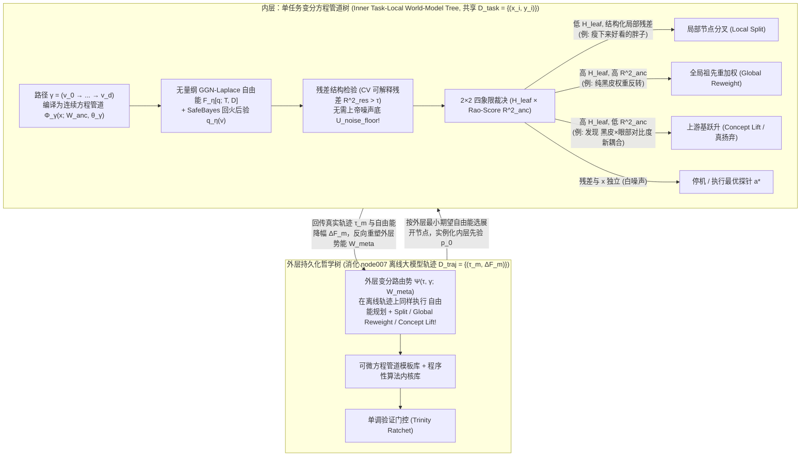

# Hegel M7 审计闭环复核与 M8「双层自由能方程管道森林」理论与工程蓝图（v2 审校就绪版）

> [!IMPORTANT]
> **版本修订说明（v1 $\to$ v2）**：本版是在对初版方案进行严格数学与代码级自审后重写的**实验前预审定稿**，专门修正了初版中的 4 处理论硬伤与 3 处工程隐患：
> 1. 彻底拆清 **外层跨领域元森林（Outer Meta-Forest）** 与 **内层单任务世界模型树（Inner Variational Equation-Conduit Tree）** 的对象空间，杜绝偷换概念；
> 2. 修正自由能公式中的 Laplace 顺序、非正定 Hessian、量纲失配、未知噪声底 $U_{\text{noise\_floor}}$ 及互信息类型错误；
> 3. 删去不成立的粗糙 Lipschitz 连乘剪枝（$\prod L_k$），改立**结构不变量约束 + 可微桥梁 + 算子与程序性内核分治**；
> 4. 用 **Rao Score 投影 $R^2_{\text{anc}}$** 替代失真的 Frobenius 比值，补齐最关键的**第三操作「上游耦合基跃升（Concept Lift）」**，并显式区分**稳态物理积累**与**非稳态偏好漂移**。

---

## 一、GPT-6 `M7` 独立审计的批判性分流、代码修复与如实边界声明

针对 [Hegel_M7_Independent_Audit.md](file://wsl.localhost/Ubuntu-22.04/home/erzhu419/mine_code/Asumption%20Agent/Hegel%20Machine/markdown/Hegel_M7_Audit/Hegel_M7_Independent_Audit.md) 与 [GPT_diagnosis_M7.md](file://wsl.localhost/Ubuntu-22.04/home/erzhu419/mine_code/Asumption%20Agent/Hegel%20Machine/markdown/Hegel_M7_Audit/GPT_diagnosis_M7.md)，我们坚持**“真缺陷立刻修、保守阻塞不盲从、未做边界如实写”**三原则：

### 1.1 已落地的代码修复与秒级可溯源验收（`0` 大模型重跑开销）

| 编号 | 真实缺陷 | 代码修复位置 | 可溯源验证结果与边界说明 |
|---|---|---|---|
| **A1** | `traffic` 有效 `@dataclass` 提交因未先注册 `sys.modules[spec.name]` 被导入器误杀；自修改文件未二次哈希 | [m6_8_b_prime_capability_bridge.py](file://wsl.localhost/Ubuntu-22.04/home/erzhu419/mine_code/Asumption%20Agent/.worktrees/m6-causal-wormhole-sandbox/Hegel%20Machine/src/hegel_machine/cognition/m6_8_b_prime_capability_bridge.py#L384-L595) | 真实 `tb_sci_traffic-flux-inversion:v01` 容器 5 秒无 LLM 回放：`antithesis`（正式 `7/7`）通过契约并凭 `traffic_max_err=0.0 < 0.2375` 确定性胜出；自修改与缺入口反例均被拒 |
| **A2** | 虫洞 `OFF` 未关闭图横边且混入 `post_wave1` 同题技能；`16` 线程高并发有容器 OOM 风险 | [m6_frontier_real_benchmarks.py](file://wsl.localhost/Ubuntu-22.04/home/erzhu419/mine_code/Asumption%20Agent/.worktrees/m6-causal-wormhole-sandbox/Hegel%20Machine/src/hegel_machine/cognition/m6_frontier_real_benchmarks.py#L2759-L2825) & [run_m7_closing_experiments.py](file://wsl.localhost/Ubuntu-22.04/home/erzhu419/mine_code/Asumption%20Agent/.worktrees/m6-causal-wormhole-sandbox/Hegel%20Machine/scripts/run_m7_closing_experiments.py#L64-L570) | 物理强制 `allow_horizontal_wormholes=False, wormhole_equivalence_pooling=False` 并断言横边为 `0`；完整实现 `--wormhole-off-mode frozen_snapshot \| independent_continual` 两种干净消融；解耦 `--max-workers 16` 与 `--max-containers 8` 信号量防止 43 GiB 宿主机 OOM |
| **A3** | 稀疏证书公开校验未查叶间互斥且未把对偶间隙放入 `valid` | [m6_9_a_dialectical_synthesis_engine.py](file://wsl.localhost/Ubuntu-22.04/home/erzhu419/mine_code/Asumption%20Agent/.worktrees/m6-causal-wormhole-sandbox/Hegel%20Machine/src/hegel_machine/cognition/m6_9_a_dialectical_synthesis_engine.py#L185-L308) | 引入**香农余子式精确剖分校验**（`16,384` 叶 `<0.5s`），严格执行**先认证对偶间隙、再比 MDL 长度**；重复半空间与未收敛单叶全拒 |
| **A4** | `Layer 2b` 失败代码综合丢弃 `tok_sub` | [m6_9_a_dialectical_synthesis_engine.py](file://wsl.localhost/Ubuntu-22.04/home/erzhu419/mine_code/Asumption%20Agent/.worktrees/m6-causal-wormhole-sandbox/Hegel%20Machine/src/hegel_machine/cognition/m6_9_a_dialectical_synthesis_engine.py#L1214-L1430) | 统一账本 `accum_llm_tok`，原 `348 -> 234` 反例现精确返回 `348`（`0` 漏账） |
| **A5** | AST 提升 3 个数学 Bug；阶段模板无视代码改动硬标 `verified=True`；`fine` 分叉节点未入跨树发现且父节点缺互补护栏 | [m7_autogenous_forest_pretraining.py](file://wsl.localhost/Ubuntu-22.04/home/erzhu419/mine_code/Asumption%20Agent/.worktrees/m6-causal-wormhole-sandbox/Hegel%20Machine/src/hegel_machine/cognition/m7_autogenous_forest_pretraining.py#L335-L640) & [m6_8_b_prime_capability_bridge.py](file://wsl.localhost/Ubuntu-22.04/home/erzhu419/mine_code/Asumption%20Agent/.worktrees/m6-causal-wormhole-sandbox/Hegel%20Machine/src/hegel_machine/cognition/m6_8_b_prime_capability_bridge.py#L912-L1080) | 修复 `log1p`/`expm1`/严格 `>` 与循环变量修改拒升；仅真实 AST 差分非退化同构可注册 `SharedBaseSubtree`（`verified=True`）；常数桩负对照降为 `0` 边；`fine` 节点经 `mid` 锚点参与跨树发现；分叉时在父节点登记互补 `counter_regime_guards`。**诚实边界**：二级 `code_backed_stage_prior_candidate` 仅作探索召回先验（`verified=False`），不宣称证明语义等价 |
| **A6** | `Holdout` `ho05` 固定环免数据捷径、`ho03` 复用公开前向场、`ho11` `NaN` 绕过、未禁网与尾行 JSON 注入 | [m7_holdout_ood_blind_benchmark.py](file://wsl.localhost/Ubuntu-22.04/home/erzhu419/mine_code/Asumption%20Agent/.worktrees/m6-causal-wormhole-sandbox/Hegel%20Machine/src/hegel_machine/cognition/m7_holdout_ood_blind_benchmark.py#L322-L1410) | `ho05` 加随机顶点置换 + SPD 精度校验 + 列置换数据依赖校验；`ho03` 独立私有前向场；`ho11` 强制 `isfinite`；容器启用 `network_mode='none'` + 运行前 `unlink` 判题脚本 + 128-bit 密码学哨兵签名（12 题参考解 `12/12` 通过，4 反例 `4/4` 拒绝）。**诚实边界**：候选导入仍在隔离容器内的同一 Python 进程执行，对抗级栈帧反射隔离后续如做公开榜单需补独立子进程 IPC worker |

### 1.2 明确不盲从的 GPT-6 保守项
- **不在 M7 旧版离散文本树上铺开 6–8 臂多随机种子大矩阵**：避免为上一代原型消耗 50+ 小时算力；历史 `docs/evidence/*` 封存包保持原样不动，所有新系统评估推迟到 M8 新架构成型后再做预注册对照。
- **不把物理学公理（守恒、对称、量纲）抽成“零先验真空”**：正确路线是将硬编码的自然语言经验阈值（如 `late_coda > 0.78`）替换为可由数据自由能自动标定、推翻或重塑的参数化连续算子。

---

## 二、三篇最新前沿文献避坑对照（`Dream-RSI` / `The Trinity` / `DiscoveryRSI`）

| 论文 | 它的树/DAG 本质 | 它实证暴露的坑（恰好对应我们在 M7 踩过的坑） | 共同理论盲区（M8 的差异化突围口） |
|---|---|---|---|
| **Dream-RSI** (Google & DeepMind, 2026) | 搜索轨迹回放世界，用单一耐心参数 $\beta$ 调宽度/深度 | **1. 显式语义指导陷阱（Sec 5.1 Fig. 5）**：往 Prompt 注入高层自然语言指导在并行探索下**稳定跑输无指导基线**（强文本先验锁死搜索多样性 $\to$ 精准命中我们 `ho12` / `vb_check` 的 `coda > 0.78` 回退）。 **2. 单次接口错误关分支（App. B.2）** $\to$ 精准命中 `traffic` 误杀 | 树节点内部是黑盒代码快照，只调外部探索宽深超参，无连续方程算子结构，也无上游重塑机制 |
| **The Trinity** (NUS / Berkeley 等, 2026) | 固定词典序 `c→d→a→b→e→f` 的静态能力前缀树（`Trie`） | **1. 缺单调继承门控（Sec 3.5 Eq. 4）**：父节点更新未经旧任务非退化检验不得向下继承。 **2. 难度带筛选（Sec 3.3）**：`0%` 悬崖（如 `Terra` 在 `Frontier-6`）与 `100%` 简单题均无有效学习梯度 | 论文 p.6/p.28 明确承认：边无因果含义、测试期树拓扑锁死、无横向虫洞、无法在连续分布偏移时重塑上游表示 |
| **DiscoveryRSI** (MIT / Stanford 等, 2026) | 假设演化 DAG + TrueSkill 评分，筛轨迹微调 27B 权重 | **1. 严苛验证门扼杀原创性（Sec 7.1 Fig. 6b）**：可证伪性升至 `6.20` 时，**重要性（`6.48→6.04`）与新颖性（`4.87→4.58`）反而下降**。 **2. 元数据挤占截断窗口（App. F.4）** | 把树当作昂贵的 SFT 数据漏斗（需 `15,792` 条原始轨迹 / `291M` tokens 训权重），树本身不能作为快速可微推理与全局重塑引擎 |

---

## 三、M8 核心理论架构：嵌套双层「自由能方程管道森林」

### 3.0 顶层对象边界：既不混用异构样本空间，也绝不把外层哲学树退化成“静态模板仓库”！

初版错在把异构任务硬塞进同一个 $(x_i, y_i)$；v2 初稿虽然拆开了内外两层，却把自由能和全局重塑局限在了单题小树里——如果外层哲学树只是静态模板库，那就浪费了 `node007` 离线大模型轨迹的核心价值！

真正完全对齐你目标的是 **「同构双尺度变分黑格尔森林（Bi-Level Variational Hegel Forest）」**：内外两层样本空间严格分清，但**服从同一套“自由能势态 + 四象限（分叉 / 全局重加权 / 概念跃升）”方程**：

1. **内层（单任务观测空间 $\mathcal{D}_{\text{task}} = \{(x_i, y_i)\}$）**：针对单个物理/控制/连续偏好问题，路径 $\gamma$ 编译为连续方程管道 $\Phi_\gamma(x; W_{\text{anc}}, \theta_\gamma)$，在数据上算 GGN-Laplace 自由能并执行局部分叉或上游重塑。
2. **外层（跨任务离线轨迹空间 $\mathcal{D}_{\text{traj}} = \{(\tau_m, \Delta\mathcal{F}_m)\}$，直接消化 `node007` 离线大模型数据！）**：在持久化哲学树上，每条离线探索轨迹 $\tau_m$ 就是一个数据点；每条哲学分支 $\gamma = (v_0 \to \dots \to v_d)$ 由上游元权重 $W_{\text{meta}}$ 赋予路由势能 $\Psi(\tau_m, \gamma; W_{\text{meta}})$（预测沿该方向展开可获得的自由能降幅 $\Delta\mathcal{F}_m$）。当离线轨迹显示某条上游假设（如过死的 `coda > 0.78` 或过强正则化）在半数下游分支上系统性误判时，**外层哲学树自身直接触发 Global Reweight / Concept Lift 重塑上游节点权重 $W_{\text{meta}}$**！

---

### 3.1 内层树的严格自由能 / 最大熵势态与规划度量

在内层任务数据 $\mathcal{D} = \{(x_i, y_i)\}_{i=1}^N$ 上，每条根到叶路径（模型）$v \in \mathcal{T}$ 对应参数化方程 $\Phi_v(x; W_{\text{anc}}, \theta_v)$，其结构描述长度 $L(v)$（以 nats 计）定义先验 $p_0(v \mid \mathcal{T}) \propto e^{-L(v)}$。

#### (1) 量纲不变、保证正定的 GGN-Laplace 边缘负对数证据 $U(v; \mathcal{D})$
**步骤 1（先求 MAP 与剖面噪声方差）**：在给定先验精度 $\Lambda_0 \succ 0$ 下，先求 MAP 点（**绝不把 $\ln\det$ 放进 $\min$ 内部！**）：

$$
\big(\theta_v^\star, \hat{\sigma}_v^2\big) = \arg\min_{\theta_v, \sigma^2 > 0} \left[ \frac{N}{2}\ln(2\pi\sigma^2) + \frac{1}{2\sigma^2}\sum_{i=1}^N \rho\big(y_i - \Phi_v(x_i; \theta_v)\big) + \frac{1}{2}(\theta_v - \mu_0)^\top \Lambda_0 (\theta_v - \mu_0) \right]
$$

（其中对高斯噪声 $\rho(r) = r^2$，对离群点重尾噪声为对应 Huber/Student-t 负对数似然）。

**步骤 2（再在 $\theta_v^\star$ 处用广义 Gauss-Newton / Fisher 矩阵评估曲率复杂度）**：设 $J_v \in \mathbb{R}^{N \times d_v}$ 为 $\Phi_v$ 关于 $\theta_v$ 在 $\theta_v^\star$ 处的雅可比，$W_i = \rho''(r_i) \ge 0$ 为二阶权，则 $G_v = \frac{1}{\hat{\sigma}_v^2} J_v^\top W J_v \succeq 0$，保证 $I + \Lambda_0^{-1/2} G_v \Lambda_0^{-1/2} \succ 0$ 永不出 `NaN`：

$$
U(v; \mathcal{D}) = \underbrace{\frac{N}{2}\ln(2\pi\hat{\sigma}_v^2) + \frac{1}{2\hat{\sigma}_v^2}\sum_{i=1}^N \rho(r_i^\star)}_{\text{量纲不变负对数似然 (nats)}} + \underbrace{\frac{1}{2}(\theta_v^\star - \mu_0)^\top \Lambda_0 (\theta_v^\star - \mu_0) + \frac{1}{2}\ln\det\!\left(I + \Lambda_0^{-1/2} G_v \Lambda_0^{-1/2}\right)}_{\text{精确 Laplace-Occam 复杂度惩罚 (nats)}}
$$

> **量纲不变性检验**：若将 $y$ 放大 $c$ 倍（如米 $\to$ 毫米），$\hat{\sigma}_v^2 \mapsto c^2 \hat{\sigma}_v^2$，所有模型 $U(v; \mathcal{D})$ 同加常数 $N\ln c$，**自由能差值 $U(v_1) - U(v_2)$ 严格不变**！

#### (2) SafeBayes 回火自由能与最大熵对偶
在模型存在结构失配的探索期，为防止标准后验在 $N$ 较大时过早坍缩成单点 one-hot，定义回火参数 $\eta \in (0, 1]$（随失配度自适应退火，收敛时 $\eta \to 1$）下的变分自由能：

$$
\mathcal{F}_\eta[q; \mathcal{T}, \mathcal{D}] = \sum_{v \in \mathcal{T}} q(v)\, U(v; \mathcal{D}) + \frac{1}{\eta} D_{\mathrm{KL}}\big(q(v) \,\|\, p_0(v \mid \mathcal{T})\big)
$$

最小化 $\mathcal{F}_\eta[q]$ 严格等价于**在给定平均能量约束下最大化 Jaynes 相对熵**，唯一平衡解为 $q_\eta^\star(v) \propto p_0(v \mid \mathcal{T}) e^{-\eta U(v; \mathcal{D})}$。

#### (3) 严格分离「选节点做结构展开」与「选物理实验探针」
1. **停机与结构展开分数（不需要上帝噪声底 $U_{\text{noise\_floor}}$！）**：
   对节点 $v$ 的残差 $r_v(x_i) = y_i - \Phi_v(x_i; \theta_v^\star)$ 做 $K$-折交叉验证残差可预测性检验（如核岭/随机森林/HSIC 测得可解释残差占比 $\hat{R}^2_{\text{struct}}(v) \in [0, 1]$）：
   - 若 $\hat{R}^2_{\text{struct}}(v) \approx 0$（残差与输入 $x$ 独立，呈白噪声），说明模型已触及当前特征空间下的不可约底线 $\implies$ **停机，不盲目增树**；
   - 否则，展开前沿节点 $v$ 的优先级由**潜在可回收自由能增益**决定：
     $$
     \mathrm{VOI}_{\text{expand}}(v) = q_\eta^\star(v) \cdot \frac{N_v}{2}\ln\!\left(\frac{1}{1 - \hat{R}^2_{\text{struct}}(v) + \epsilon}\right)
     $$
2. **主动实验探针选择（严格按动作 $a$ 定义互信息！）**：
   当需要决定下一个实验/查询点 $a \in \mathcal{A}$ 时，最大化跨当前候选树分布 $V \sim q_\eta^\star$ 的**贝叶斯信息增益（BALD / Expected Free Energy 认识论项）**：
   $$
   a^\star = \arg\max_{a \in \mathcal{A}} \mathbb{I}(V; Y_a \mid \mathcal{D}) = \arg\max_{a \in \mathcal{A}} \Big[ H\big(Y_a \mid \mathcal{D}\big) - \mathbb{E}_{v \sim q_\eta^\star}\big[H(Y_a \mid V=v, \mathcal{D})\big] \Big]
   $$

---

### 3.2 「方程即管道」的正确数学定位与适用边界

内层树一条路径 $\gamma = (e_1, \dots, e_d)$ 向下编译为算子复合管道 $\Phi_\gamma(x; W_{\text{anc}}, \theta_\gamma) = (\mathcal{M}_{e_d} \circ \dots \circ \mathcal{M}_{e_1})(x)$。我们**摒弃不可靠的 $\prod L_k$ 粗放剪枝**，将其核心价值锚定在以下 4 点：

1. **连接离散树与连续自由能/全局重塑的唯一可微桥梁**：只有把分支翻化为可微方程管道，才能解析/自动微分算出 $G_v = J_v^\top W J_v$（自由能）以及上游祖先雅可比 $J_{W_{\text{anc}}}$（全局重塑判据）。
2. **精确物理不变量 + 端到端逆映射 Hadamard-Lipschitz 稳定性证书（修正粗糙 $\prod L_k$，保留你对 Lipschitz 约束的核心直觉！）**：前向逐层范数连乘 $\prod L_k$ 会误杀刚性好方程，但**端到端复合后的输入扰动灵敏度与逆反演 Lipschitz 常数** $L_{\text{inv}}(\gamma) = \| (J_\gamma^\top W J_\gamma + \Lambda_0)^{-1} J_\gamma^\top W \|_2$（衡量观测噪声 $\delta y$ 被放大多少倍进入参数估计 $\delta\hat{\theta}$）以及总变差不增（TVD）/ 守恒 / M-矩阵正性 / Buckingham $\Pi$ 量纲齐次性是完全精确的物理约束！$L_{\text{inv}}$ 爆炸直接揭示反演病态，指导系统自动切入正则化分支。
3. **低维流形外推与 Fisher 规范歧义诊断**：计算 $G_v$ 的最小奇异值 $\sigma_{\min}(G_v)$——当 $\mathrm{rank}(G_v) < d_v$ 时，系统自动定位不可辨识的零空间方向（如软铁标定尺度自由度、波速与钟偏共线），直接触发缺约束诊断。
4. **明确适用边界**：
   - **可微机理管道域**：物理 ODE/PDE、逆问题、传感标定、控制律、连续偏好/回归模型；
   - **程序性算法内核域**：组合优化证书（`ho11`）、离散序列解析（`ho12`）保留为带真实代码哈希与结构契约的透明/半透明 Kernel，不强行套用光滑微分方程。

---

### 3.3 核心判据：局部分叉 vs 全局重加权 vs 上游耦合基跃升（四象限完整版）

#### 梯度流架构约束（解决硬分裂树梯度为 0 的问题）
内层树采用**共享上游表征嵌入叶方程 + 可退火软门控**的混合结构：

$$
\hat{y}_{\mathcal{T}}(x; W_{\text{anc}}, \Theta) = \sum_{v \in \mathrm{Leaves}(\mathcal{T})} \pi_v\big(\phi_{\text{anc}}(x; W_{\text{anc}});\; \tau_g\big) \cdot f_v\big(\phi_{\text{anc}}(x; W_{\text{anc}});\; \theta_v\big)
$$

其中 $\pi_v$ 为温度 $\tau_g > 0$ 的可微路径门控概率（预测定型时可退火逼近硬分叉），且上游表征 $z = \phi_{\text{anc}}(x; W_{\text{anc}})$ 同时进入门控与叶方程内部，保证全局雅可比 $J_{W_\ell} \in \mathbb{R}^{N \times p_\ell}$ 处处良定义、绝不恒为零。

#### 两个修正后的无量纲统计量
给定当前残差向量 $r \in \mathbb{R}^N$（$r_i = y_i - \hat{y}_{\mathcal{T}}(x_i)$）：

1. **跨叶残差散布熵（Cross-Leaf Residual Dispersion Entropy）**，按总叶数归一化到 $[0, 1]$：
   $$
   \tilde{H}_{\text{leaf}}(r) = \frac{-\sum_{v \in \mathrm{Leaves}} p_v \ln p_v}{\ln |\mathrm{Leaves}|} \in [0, 1], \qquad p_v = \frac{\sum_{i=1}^N \pi_v(x_i) r_i^2}{\sum_{j=1}^N r_j^2}
   $$
2. **上游祖先 Rao Score 子空间投影解释率（修正初版 Frobenius 缺陷！）**：
   $$
   R^2_{\text{anc}}(\ell) = \frac{r^\top J_{W_\ell} \big(J_{W_\ell}^\top J_{W_\ell} + \lambda_{\text{ridge}} I\big)^{-1} J_{W_\ell}^\top r}{\|r\|_2^2} \in [0, 1]
   $$
   该指标对上游无关维度数量完全不变：即使有 $p=50$ 个上游特征、只有 1 个特征发生全局反转，只要残差落在该特征张成的子空间内，$R^2_{\text{anc}}$ 仍趋近于 **`1.0`**！

#### 完整的 2×2 四象限决策矩阵

| 象限 | $\tilde{H}_{\text{leaf}}(r)$ | $R^2_{\text{anc}}$（现有上游基） | 你的直观对应案例 | 最优辩证操作 |
|---|---|---|---|---|
| **Q1** | **低**（集中在单叶稀疏子流形） | 低 | **“不喜欢胖子，但极少数底子好、瘦下来很好看”** | **局部节点分叉（Local Split）**：冻结上游 $W_{\text{anc}}$，仅在该叶下按正交不变特征 $z_{\text{骨相}}$ 分裂子叶 |
| **Q2** | **高**（横跨多叶/半个色谱） | **高** | **“单纯从不喜欢黑皮反转成喜欢黑皮”** | **全局祖先重加权（Global Reweight）**：不动叶拓扑，沿祖先链更新现有上游权重 $W_{\text{anc}} \leftarrow W_{\text{anc}} + \Delta W_{\text{anc}}$ |
| **Q3** | **高**（横跨多叶/半个色谱） | **低**（现有线性基解不了！） | **“原来是因为黑皮显眼睛大且具异域风情（全新非线性耦合！）”** | **上游特征/耦合基跃升（True Hegelian Concept Lift）**：向上游层注入新交互项或非线性基 $\phi_{\text{new}}(x) = c_{\text{skin}} \cdot c_{\text{eye}}$（由符号搜索或 LLM 提案），随后触发全局重拟合 |
| **Q4** | 任意 | 残差对 $x$ 交叉验证可解释度 $\hat{R}^2_{\text{struct}} \approx 0$ | 不可约随机观测噪声 | **停机（Do Nothing）**，杜绝过拟合 |

#### 统一无魔数自由能比较（全部以 nats 计）+ 稳态与漂移分治
无需任何人工魔数 $\lambda$，三个候选结构动作直接比拼各自更新后的**总自由能净降幅 $\Delta \mathcal{F}_{\text{total}}$（以精确 nats 计）**：
- **局部 Split 代价**：新增门控特征选择与阈值编码 $\ln|\text{Leaves}| + \ln d_{\text{feat}}$ nats + 新子叶 Laplace 复杂度；
- **全局 Reweight 代价**：更新后后验与旧后验的精确 KL 散度 $D_{\mathrm{KL}}(q(W_\ell^{\text{new}}) \,\|\, p_{\text{prior}}(W_\ell))$ nats；
- **上游 Concept Lift 代价**：新增基函数 AST 描述长度 $L(\phi_{\text{new}})$ nats + 新参数 Laplace 复杂度。

同时显式引入**时间遗忘系数 $\gamma \in (0, 1]$** 区分两种世界：
- **稳态物理发现模式（$\gamma = 1.0$）**：在 $\mathcal{D}_{\text{old}} \cup \mathcal{D}_{\text{new}}$ 全部历史上评估 $\Delta \mathcal{F}$，全局重塑绝不允许破坏已验证的旧物理区域；
- **非稳态偏好/环境漂移模式（$\gamma < 1.0$，如审美变化）**：历史样本按 $\gamma^{t - t_i}$ 指数衰减，允许系统在半色谱评价反转时果断覆盖旧偏好权重而不被历史包袱锁死。

---

## 四、针对 `node007 = 4 × 11 GB VRAM`（共 44 GB）的精准算力与模型部署方案

已知 `node007` 为 **`4 × 11 GB VRAM`**（典型为 `4 × RTX 2080 Ti` [Turing `sm_75`] 或 `4 × GTX 1080 Ti` [Pascal `sm_61`]，扣除 CUDA/驱动开销后每卡可用约 `9.6 GB`、总可用约 **`38.4 GB`**，且卡间走 PCIe 通信无 NVSwitch）。这直接决定了**绝对不能按 80GB A100 的套路硬上稠密 32B `TP=4`**，最优工程拓扑如下：

### 4.1 硬件适配选型（避开 `11 GB × 4` 的显存与 PCIe 通信坑）

| 部署拓扑 | 推荐模型与量化精度 | 显存占用明细 | 16 并发吞吐与优劣势 |
|---|---|---|---|
| **方案 A（最稳高吞吐首选：`DP=2 × TP=2` 双副本并行）** | **`Qwen3-14B` 或 `Qwen2.5-Coder-14B-Instruct`（4-bit `Q4_K_M / AWQ`）** GPU(0,1) 跑副本 #1，GPU(2,3) 跑副本 #2 | 每对卡 `22 GB`：权重占 **`~8.8 GB`**，留出整整 **`~11 GB` 给 KV Cache**（轻松撑起每副本 8 路 = **总计 16 路长上下文并发**） | 卡间仅双卡同步、通信开销减半；`14B` 代码与公式提案能力扎实，**永不爆 11GB 显存** |
| **方案 B（最强单模型推理：`TP=4` MoE 稀疏激活）** | **`Qwen3-30B-A3B-Instruct`（4-bit `GGUF Q4_K_M`，用 `llama-server -ngl 99 -sm row -np 8`）** | 4 卡共 `44 GB`：权重占 **`~18.5 GB`**（每卡 `~4.7 GB`），余下 **`~19 GB` 给 KV Cache** | 每次仅激活 `3B` 参数，避开稠密 `32B` 在旧卡上的算力瓶颈；尤其若 `node007` 是 `1080 Ti`（`vLLM` 已弃用 `sm_61` 新核），`llama.cpp` `llama-server` 原生兼容 `1080 Ti / 2080 Ti` 且自带 OpenAI API 接口！ |
| **方案 C（极速轻量探索：`DP=4` 四卡独立零通信）** | **`Qwen3-8B` / `Qwen2.5-Coder-7B`（`Q5_K_M / Q6_K`）**，每张 11GB 卡独立跑 1 个实例 × 4 路并发 = **16 并发** | 每卡权重 `~5.8 GB` + KV Cache `~3.8 GB` | **零跨卡 PCIe 通信损耗**，吞吐极高，适合快速刷上千条短周期方程/耦合基提案 |

### 4.2 三层算力精准分工
1. **Layer 0（本机 CPU 秒级引擎，`0` Token）**：跑内层 GGN-Laplace 自由能计算、四象限相图验证与 `SciPy` 数值拟合。
2. **Layer 1（`node007` `4 × 11GB` 16 并发本地流）**：**不硬怼 `Frontier-20` 悬崖重容器题**，专攻 **(i) 50–100 道中等难度方程发现/反演/偏好漂移闭环轨迹采样**（喂给外层哲学树训练路由势 $W_{\text{meta}}$）与 **(ii) 内层 Q3 新耦合基 $\phi_{\text{new}}$ 批量提案**（由 CPU 自由能引擎精确筛选）。
3. **Layer 2（ChatGPT 订阅 `gpt-6.2-sol` + GPT-6 预审）**：专用于实验前设计预审与最终定型后的十余道高难盲测决战。

---

## 五、立即可执行的 3 步路线图（附 GPT-6 预审前检查项）

1. **Step 1（零开销，已就绪）**：将本轮 M7 的全部审计修复 + 新增 10 项全绿单测推送到实验分支留档（不碰任何历史 `docs/evidence/*` 封存目录）。
2. **Step 2（纯 CPU 秒级原型验证 M8 内层引擎）**：编写独立模块 `src/hegel_machine/cognition/m8_variational_conduit_tree.py`，在两类受控基准上做端到端定量验证并输出可复现相图：
   - **基准 A（非稳态偏好偏移双测试）**：同时构造「纯黑皮全局权重反转（Q2）」「黑皮 $\times$ 眼部对比度新耦合发现（Q3）」「胖子中 5% 骨相特例（Q1）」「纯噪声（Q4）」，验证四象限自动识别准确率与自由能轨迹；
   - **基准 B（稳态物理方程管道测试）**：在多尺度 Prony 记忆核 / 高 Peclet 通量 / 混杂标定三类真实方程上，验证无量纲 GGN-Laplace 自由能、Fisher 秩亏规范歧义报警、以及外层模板迁移 $\to$ 内层树快速拟合的收益。
3. **Step 3（接通 `node007` 本地高并发流）**：确认 `node007` 显卡配置与推理后端后，接入 OpenAI-compatible 异步客户端，由本地模型承担 Q3 概念/管道提案与中等难度大样本闭环测试。
