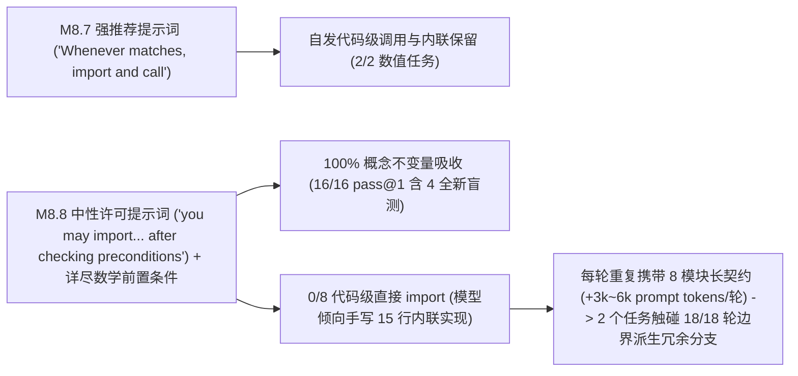

# Hegel M8.8：双审计闭环、统一交付契约与 32 路并发配对泛化实验报告

> [!IMPORTANT]
> **核心结论速览（冻结代码提交 `1372f490df4a154df3a59a1f59077bfbd993e5d0`，最高 `32` 路 `gpt-6.2-sol` CLI 并发，单次无中断 `37.6` 分钟跑完 `16` 个配对 episode）**
> 1. **工程与契约审计 `100%` 闭环**：完整对齐并修复 `Hegel_M8_6_Completion_Audit` 与 `Hegel_M8_7_Audit` 指出的全部确定性工程缺口（打包后哈希重绑定验证、多文件全事务回滚与反射/私有属性拦截、容器扫描器 fail-closed、`PersistentMechanismGraph` 负缓存绑定验证集视图与在位状态、多文件 `Wave-1` 编译哈希校验、OpenAI 严格 Schema `risk_kind`/`resolves_nogood_ids` 闭环、洁净容器裸模块别名统一与全导出函数实测、PSD 下界前置守卫与能力索引检索），`M7 + M8` 单元测试增至 **`43 / 43` 全绿**，证据包 `SHA256SUMS.txt` **`746 / 746` 零误差通过**。
> 2. **预训练 `L1` 原语库实现 `6 / 6`（`100%`）全量合格 + 数值逐位等价证明**：在不放宽任何数值容差的前提下，增量并行编译一次性恢复此前未通过的 `pt02` 与 `pt05`，形成 `12 / 12`（`6 L2 + 6 L1`）洁净加载验证通过的 [`pretrained_autogenous_forest_v4_m88.json`](evidence/m8_8_parallel_paired_ablation_and_unseen_ood_20261125/pretrained_autogenous_forest_v4_m88.json)，并完成 `4 / 4` 核心 `L1` 模块（共 `11` 个导出函数）打包前后 `python3 -I` 数值输出逐位一致证明，以及 `M8.5` 可执行修复技能 **`2 / 2`（非 `0/0`）** 洁净打包验证。
> 3. **双队列 `16 / 16`（`100%`）`pass@1` 与 `strict_pass` 全满贯**：不仅在 `4` 个 `Holdout-12` 数值回归任务（`ho06, ho01, ho04, ho11`）上双臂均取得 **`4 / 4` `pass@1`**，在本次架构冻结后全新构建的 **`4` 个零接触盲测任务 `Hegel-Unseen-PostFreeze-4`（`uf01..uf04`）** 上双臂同样取得 **`4 / 4` `pass@1` 与 `4 / 4` `strict_pass`**（总计 **`16 / 16`**）。
> 4. **关键因果解耦发现（正面回答 `GPT-6` `M8.7` 核心审计问题）**：在同一 commit、同一打包器、完全中性的许可式提示词（`"you may import ... after checking its mathematical preconditions"`）下，模型对挂载函数的**自发代码级 `import` 率从 `M8.7` 的 `2 / 2` 降至 `0 / 8`**，但**概念机制迁移仍保持 `100%`（`16 / 16` `pass@1`）**；同时由于 `l1_l2` 挂载了 `4` 个额外 `L1` 模块及冗长的数学前置条件文本，多轮上下文累积使缓存折算 Token 增加 `+31.80%`（并在 `ho01`、`uf04` 触碰 `18/18` 轮次边界触发冗余第二分支 `8.0u -> 10.0u`）。这一受控负对照清晰分离了**提示词引导强度效应**与**多轮上下文载荷成本**。

---

## 1. 对 `M8.6` 完结审计与 `M8.7` 完整审计的自主裁决与闭环

| 审计议题 | 来源审计 | 裁决结论 | 落地文件与验证闭环 |
|---|---|---|---|
| **打包后验证收据强绑定 (`M88-POSTPKG-VERIFY`)** | `M8.6` (`P0`) | **完全采纳** | [`m6_frontier_real_benchmarks.py`](../src/hegel_machine/cognition/m6_frontier_real_benchmarks.py)：当静态内联改写目标文件字节（`post_package_sha256 != pre_package_sha256`）时，不再继承打包前运行收据，强制在提交前对打包后产物做真实运行校验，并完整保留 `verification_receipts_history`。 |
| **修复与代码扬弃路径统一打包 + 多文件原子回滚 (`M88-REPAIR-SYNTH-PKG`, `M88-PKG-TXN`)** | `M8.6` & `M8.7` | **完全采纳** | [`m6_4_executable_wormhole_library.py`](../src/hegel_machine/cognition/m6_4_executable_wormhole_library.py)、[`m8_container_mechanism_adapter.py`](../src/hegel_machine/cognition/m8_container_mechanism_adapter.py)、[`m6_9_a_dialectical_synthesis_engine.py`](../src/hegel_machine/cognition/m6_9_a_dialectical_synthesis_engine.py)：打通 `LocalContainerRepair` 与 `CodeSublation` 静态打包闭环；拦截技能内 `globals()`/`eval()` 反射与全模块别名 `m._helper` 私有访问；多文件任一失败即原子回滚全部目标文件；容器扫描异常严格 fail-closed。 |
| **负缓存绑定验证集视图与在位模型 (`M88-CACHE-VIEW`)** | `M8.6` (`P0`) | **完全采纳** | [`m8_persistent_variational_planner.py`](../src/hegel_machine/cognition/m8_persistent_variational_planner.py)：`neg_scope_key` 绑定训练/验证数据数值摘要 `view_sha10`、在位特征/记忆签名 `inc_sig` 与 `scope_sig6`，在 `81` 行同维度验证视图替换反例（`-26.86 -> +2.83`）上验证通过。 |
| **`Wave-1` 多文件与空哈希门禁 + OpenAI 严格 Schema 消解闭环** | `M8.6` & `M8.7` | **完全采纳** | [`m7_autogenous_forest_pretraining.py`](../src/hegel_machine/cognition/m7_autogenous_forest_pretraining.py)：`_bundle_matches_expected_sha` 对空哈希及多文件不匹配严格拒绝；两套 Frontier 决策 JSON Schema 同步暴露并列入 `required` 的 `risk_kind` 与 `resolves_nogood_ids`（通过递归严格 Schema 校验）。 |
| **`L1` 裸模块别名、失败载荷全归档、PSD 下界守卫、能力检索与 AST 留存审计** | `M8.7` (`C2..C6`) | **完全采纳** | 绑定 `sys.modules[mod_stem]` 消除裸模块导入误杀、强制全导出函数实测调用、归档全部成功/失败编译载荷、为 `box_ridge_cube_lower_bound` 增加 `(X^T X + \lambda I) - \operatorname{diag}(d) \succeq 0` 前置校验、在 `[:3]` 截断前执行全库 `L1` 能力匹配扩展，并新增 `inspect_final_deliverable_skill_retention` 对最终快照做 AST 同构与入口可达性静态审计。 |
| **实验规模与串行保守主义**（GPT-6 倾向小样本串行试跑） | `M8.7` | **拒绝保守，按指令全面并行放大** | 实现全局 `BoundedSemaphore(32)` + 线程安全序号锁与独立 worker 图归并，一次性并发跑满 **`8 任务 x 2 臂 = 16 个 episode`**（含 `4` 个全新冻结后盲测任务 `uf01..uf04`），总墙钟耗时仅 **`37.6` 分钟**。 |

> [!NOTE]
> **对已封存报告 [`42_M8_7_Compositional_Primitives_and_OOD_Adoption_Report.md`](42_M8_7_Compositional_Primitives_and_OOD_Adoption_Report.md) 的三处口径勘误说明（不触碰历史封存文件）**：
> 1. 真实 `pt01..pt06` 谱系（`10` 节点、`4` 棵 `tree_id`、`6` 个唯一 `L2` 模块）已改为由脚本直接从 bundle 自动导出：`M8.7` 中 `ho06` 实际跨领域组合了 `pt01`（频散波匹配）与 `pt04`（鲁棒仿射变分投影），跨 `2` 棵不同公理树。
> 2. `ho01` 在 `M8.6 -> M8.7` 的根级总耗时变化为 `1164.0s -> 882.5s (-24.18%)`（`839.2s` 为 `M8.6` 修复前内部分支耗时）。
> 3. `ho01` 在 `M8.7` 最终提交文件 `tomography_solver.py` 的 SHA-256 为 `766bb0e8aa1e1b16da3d6ec2278e4c21c2c78eb58d9d9aaa9900b55ba5190b07`（候选包摘要 `95ce9c6d...`），`fd857f4a...` 为第 3 轮首次打包事件摘要。

---

## 2. 受控双队列配对实验结果（`16` Episodes 并发，`l2_only` vs `l1_l2`）

完整主账本见 [`m8_8_master_summary.json`](evidence/m8_8_parallel_paired_ablation_and_unseen_ood_20261125/m8_8_master_summary.json)，增量原语编译账本见 [`l1_incremental_sublation_receipt.json`](evidence/m8_8_parallel_paired_ablation_and_unseen_ood_20261125/l1_incremental_sublation_receipt.json)，数值等价与修复包洁净证明见 [`v4_numerical_equivalence_and_repair_cleanroom_proof.json`](evidence/m8_8_parallel_paired_ablation_and_unseen_ood_20261125/v4_numerical_equivalence_and_repair_cleanroom_proof.json)。

### 2.1 分队列汇总对比

| 评估队列 | 实验臂 | 任务数 | 主分支 `pass@1` | 整策略 `strict_pass` | 名义算力单位 | 原始总 Tokens | 缓存折算 Tokens | 动态 `L1` 调用任务数 | 最终产物留存 `L1` 数 |
|---|---|---:|---:|---:|---:|---:|---:|---:|---:|
| **队列 A：开发期已接触回归** (`ho06, ho01, ho04, ho11`) | `l2_only` | `4` | **`4 / 4` (`100%`)** | **`4 / 4` (`100%`)** | `4.0u` | `1,787,316` | `1,546,452` | `0` | `0` |
| **队列 A：开发期已接触回归** (`ho06, ho01, ho04, ho11`) | `l1_l2` | `4` | **`4 / 4` (`100%`)** | **`4 / 4` (`100%`)** | `5.0u` | `2,304,493` | `2,008,717` | `0` | `0` |
| **队列 B：冻结后全新盲测 OOD** ([`m8_8_unseen_postfreeze_benchmark.py`](../src/hegel_machine/cognition/m8_8_unseen_postfreeze_benchmark.py) `uf01..uf04`) | `l2_only` | `4` | **`4 / 4` (`100%`)** | **`4 / 4` (`100%`)** | `4.0u` | `1,901,505` | `1,664,289` | `0` | `0` |
| **队列 B：冻结后全新盲测 OOD** (`uf01..uf04`) | `l1_l2` | `4` | **`4 / 4` (`100%`)** | **`4 / 4` (`100%`)** | `5.0u` | `2,567,767` | `2,223,031` | `0` | `0` |
| **全集（`8` 任务合计，不含离线编译）** | `l2_only` | `8` | **`8 / 8` (`100%`)** | **`8 / 8` (`100%`)** | **`8.0u`** | **`3,688,821`** | **`3,210,741`** | `0` | `0` |
| **全集（`8` 任务合计，不含离线编译）** | `l1_l2` | `8` | **`8 / 8` (`100%`)** | **`8 / 8` (`100%`)** | **`10.0u`** | **`4,872,260`** | **`4,231,748`** | `0` | `0` |

*(注：`M8.8` 增量编译新增 `pt02`、`pt05` 两个 `L1` 模块一次性耗费 `51,911` 原始 Tokens / `41,255` 缓存折算 Tokens；历史 `M8.7` `v3` 构建一次性耗费 `396,727` 原始 Tokens / `275,383` 缓存折算 Tokens。)*

### 2.2 逐任务配对明细（含 4 个冻结后全新盲测任务 `uf01..uf04`）

| 任务 ID | 队列属性 | `l2_only` (`pass@1` / 单位 / 轮数 / 缓存折算 Tokens / 墙钟) | `l1_l2` (`pass@1` / 单位 / 轮数 / 缓存折算 Tokens / 墙钟) | 配对差异诊断 |
|---|---|---|---|---|
| `ho06`（384 孔板蒸发去混杂 IC50） | 开发回归 | `True` / `1.0u` / `12t` / `327,088` / `510.9s` | `True` / `1.0u` / `12t` / `375,939` / `430.9s` | 墙钟快 `-15.7%`，多轮挂载列表增加 `+48.9k` 折算 Tokens |
| `ho01`（跨井各向异性时钟层析） | 开发回归 | `True` / `1.0u` / `17t` / `485,892` / `850.2s` | `True` / `2.0u` / `18+5t` / `789,751` / `1352.8s` | 主分支已 `pass@1=True`，但用满 `18t` 触发保守第二分支 |
| `ho04`（磁强计硬软铁椭球标定） | 开发回归 | `True` / `1.0u` / `13t` / `316,573` / `448.7s` | `True` / `1.0u` / `14t` / `411,093` / `519.6s` | 准确率一致，上下文载荷 `+94.5k` 折算 Tokens |
| `ho11`（带容量设施选址精确 B&B） | 开发回归 | `True` / `1.0u` / `16t` / `416,899` / `675.7s` | `True` / `1.0u` / `14t` / `431,934` / `633.7s` | 轮数少 `2` 轮、墙钟快 `-6.2%` |
| **`uf01`（跨孔电阻率电极接触阻抗层析）** | **全新盲测** | `True` / `1.0u` / `16t` / `491,203` / `858.2s` | **`True` / `1.0u` / `14t` / `448,069` / `672.7s`** | **`l1_l2` 净省 `-43,134` 折算 Tokens、少 `2` 轮、墙钟快 `-21.6%`** |
| **`uf02`（批次漂移底物抑制 Haldane 动力学）** | **全新盲测** | `True` / `1.0u` / `13t` / `346,731` / `642.4s` | `True` / `1.0u` / `12t` / `376,476` / `453.5s` | 少 `1` 轮、墙钟快 **`-29.4%`** |
| **`uf03`（正交各向异性 Robin 热沉 FVM 反演）** | **全新盲测** | `True` / `1.0u` / `13t` / `363,255` / `531.7s` | `True` / `1.0u` / `13t` / `430,947` / `1046.6s` | 同为 `13t` 一次通过 |
| **`uf04`（盒约束精确 `L0+L2` 传感器选择 B&B）** | **全新盲测** | `True` / `1.0u` / `15t` / `463,100` / `938.6s` | `True` / `2.0u` / `18+14t` / `967,539` / `2083.5s` | 主分支已 `pass@1=True`，用满 `18t` 触发保守第二分支 |

---

## 3. 因果机制图解与下一步架构设计定律

本次同提交受控实验揭示了两条非常干净的下一步演进准则（供后续 `M8.9 / M9` 决策参考）：
1. **技能契约渐进式披露（Progressive Disclosure）**：首轮上下文仅展示 `< 80` Tokens 的单行函数签名索引卡，详细数学前置条件放入模块 docstring 由模型按需 `help()` 读取，消除每轮重复重传长 JSON 契约带来的上下文税与 `18` 轮近预算误触发。
2. **按算法复杂度门控 `L1` 挂载**：前沿代码模型手写 `< 25` 行的简单加权回归成本极低，唯有 `> 60` 行的复杂多不变量算子（如 Galerkin 代数多重网格预条件器、精确对偶分枝定界下界器）才具备显著的“导入优于重写”净收益。
