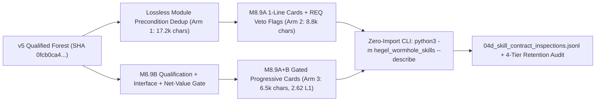

# M8.9 Audit Correctness Closure, Progressive Contract Disclosure, and Expected-Net-Value Staging Gate Report

- **Date**: 2026-11-26 (UTC+8)
- **Branch**: `exp/m6-causal-wormhole-sandbox`
- **Frozen Code Commit (`M8.9`)**: `781b8f967c189806cffdc9986f5d7d8d2cc4ce2b` (`git_dirty_at_start = false`, `single_clean_invocation = true`)
- **Sealed Evidence Directory**: `docs/evidence/m8_9_progressive_disclosure_and_net_value_ablation_20261126/` (`1,090` files, `sha256sum -c SHA256SUMS.txt` `1090/1090 OK`)
- **Model & Provider Backend**: Official OpenAI ChatGPT Subscription Codex CLI (`gpt-6.2-sol`, `reasoning_effort = "medium"`, `auth_mode = "chatgpt"`)
- **Concurrency Telemetry**: `configured_max_episode_workers = 24`, `configured_max_codex_concurrency = 32`, `peak_concurrent_codex_calls = 24`, `total_codex_calls = 340`, `total_wall_clock_sec = 2039.46` (`33.99 min`)

---

## 1. Executive Summary & Calibrated Epistemic Claims

Following the independent `Hegel_M8_8_Audit` review of `M8.8` (code commit `1372f490df4a154df3a59a1f59077bfbd993e5d0`, evidence commit `902de5fcd10cce1b294c288005ab1ad7573bda4c`), `M8.9` executes a strictly sequenced two-part program:

1. **`M8.8.1` Deterministic Correctness, Qualification, & Evidence-Identity Closure (`P0-1`, `P0-2`, `P1-1..P1-7`, `P2.1..P2.5`)**:
   - Closed every reproducible mathematical, private-verifier, temporal negative-cache, source-SHA qualification, canonical artifact-bundle digest, write-back rollback transaction, module-immutability, skill-retention accounting, and witness-bound `nogood` resolution defect identified in the `M8.8` audit before launching any live LLM episodes (`52/52` tests passing across `tests/test_m7_*.py` and `tests/test_m8_*.py`; JUnit archived at `pytest_receipts/junit_m7_m8_m89.xml`).
   - Re-evaluated the unchanged sealed `M8.8` `uf04` deliverables (`l2_only` SHA `9dc435cd8ad0...`, `l1_l2` SHA `23e9acbe341c...`) under the hardened finite-value `gap <= 1e-5` verifier (`m8_8_uf04_hardened_verifier_recheck_receipt.json`): **both sealed `M8.8` `uf04` submissions strictly pass all 3 hidden instances (`max_gap = 0.0`, `max_nodes_explored = 1`)**, while a synthetic `NaN` negative control fails closed (`strict_pass = false`).
   - Withdrew the defective `v4` qualification receipt for `autogenous_prim_box_ridge_bounds` into `withdrawn_qualifications`, enforced $(X^\top X) - \operatorname{diag}(d) \succeq 0$ across **all** dimensions $p$ with conservative box-slack compensation, and re-verified `pretrained_autogenous_forest_v5_m89.json` (`0fcb0ca4b8b664515f29c184cd531700c817710a8e7e8a2281ef212641a6888c`) inside `hegel_clean_scipy_sandbox:v1` bound to the new `compiled_code_sha256`.

2. **`M8.9A` Progressive Contract Disclosure & `M8.9B` Expected-Net-Value Staging Gate (`3-Arm × 8-Task = 24`-Episode Exploratory Single-Seed Factor-Isolated Experiment)**:
   - Evaluated `8` tasks (`4` longitudinal regression anchors `ho01`, `ho06`, `uf03`, `uf04` + `4` newly authored **internal frozen-code stress tasks** `hs01..hs04` in `Hegel-M89-HardStress-4`) across three controlled arms under identical model, prompt tone, router schema (`m8_9_prefix_clean_v2`), and `18`-turn primary budget:
     - **Arm 1 (`dedup_full_l1_l2`)**: `disclosure_mode = "dedup_full"`, `staging_policy = "all_compatible"` (losslessly deduplicated module preconditions + full function contracts; mean Turn-1 manifest `17,154.1` chars, `4.00` staged `L1` modules).
     - **Arm 2 (`progressive_all_l1_l2`)**: `disclosure_mode = "progressive"`, `staging_policy = "all_compatible"` (exact same staged `L1+L2` modules as Arm 1, presented as compact 1-line cards with `REQ:` critical veto flags + zero-import `python3 -m hegel_wormhole_skills --describe` CLI; mean Turn-1 manifest `8,794.5` chars, **`-48.73%`** vs Arm 1).
     - **Arm 3 (`progressive_net_value_gated`)**: `disclosure_mode = "progressive"`, `staging_policy = "net_value_gated"` (exact same progressive disclosure format as Arm 2, gated by qualification + interface/boundary compatibility + positive expected net value; mean `2.62` staged `L1` modules, mean Turn-1 manifest `6,507.2` chars, **`-62.07%`** vs Arm 1).
   - **Key Empirical Findings (Strictly Separating `Primary 1x` vs `Full Policy`)**:
     - **Contrast A — Pure Progressive Disclosure Effect (`Arm 2` vs `Arm 1`, holding staged modules identical)**:
       - `Primary 1x` strict pass rate held constant at **`7/8 (87.5%)` vs `7/8 (87.5%)`** (`4/4` on Longitudinal M8.8 + `3/4` on HardStress-4).
       - Mean `Primary 1x` turns dropped by **`-2.00` turns/task (`10.88` vs `12.88`)**, and by **`-3.25` turns/task (`11.00` vs `14.25`)** on Longitudinal M8.8.
       - `Primary 1x` total tokens dropped by **`-26.40%` (`2,784,690` vs `3,783,387`; effective billed `-26.76%`: `2,406,738` vs `3,286,107`)**, and `Full Policy` total tokens dropped by **`-25.85%` (`3,061,807` vs `4,129,482`; effective billed `-25.59%`: `2,656,879` vs `3,570,666`)**.
       - On-demand zero-import `--describe` CLI was spontaneously invoked in **`2/8` episodes** (`uf04` and `hs01` in both Arms 2 and 3), cutting `uf04` `Primary 1x` tokens by **`-54.54%`** (`473,337` in `14` turns vs `1,041,182` in `23` turns in Arm 1).
     - **Contrast B — Pure Expected-Net-Value Gate Effect (`Arm 3` vs `Arm 2`, holding progressive disclosure identical)**:
       - Reduced staged `L1` modules from `4.00` to `2.62` (`-1.38` modules/task) while preserving **`7/8 (87.5%)`** `Primary 1x` and **`7/8 (87.5%)`** `Full Policy` pass rates.
       - On `HardStress-4`, `Arm 3` reduced `Primary 1x` total tokens by **`-5.67%` vs `Arm 2` (`1,349,468` vs `1,430,634`)** and **`-17.41%` vs `Arm 1` (`1,633,839`)**, led by `hs04` (`-25.92%` vs Arm 2, `-35.89%` vs Arm 1) and `ho06` (`-24.49%` vs Arm 2). However, single-seed trajectory variance on `uf03` (`15` turns vs `10` turns) and `uf04` (`15` turns vs `14` turns) yielded **`+5.31%`** higher 8-task `Primary 1x` tokens (`2,932,462` vs `2,784,690`) and **`+8.87%`** higher `Full Policy` tokens (`3,333,507` vs `3,061,807`, `3` vs `2` second-branch spawns) — a mixed exploratory single-seed result showing that once progressive cards compress contracts to ~`120` chars/function, disclosure compression (`M8.9A`) accounts for the dominant efficiency gain at current 6-module `L1` scale.
     - **Honest Adoption & Forensic Self-Audit Notes**:
       - Direct `L1` runtime execution (`dynamic_l1_calls`) and final `L1` AST retention (`final_retained_l1_modules`) were **`0/24` across all three arms** (while `--describe` contract inspection rose from `0` in Arm 1 to `4` inspections across `4` episodes in Arms 2 & 3). We retain this `0/24` direct-import observation as a clean, unforced empirical fact rather than forcing artificial imports.
       - Post-run forensic audit of `hs01` (`0/3` `Primary 1x` across all arms; `1/1` `Thesis` rescue in Arm 1 yielding `8/8` Policy vs `7/8` Policy in Arms 2 & 3) identified a task-specification vs private-verifier mismatch in `m8_9_hard_stress_benchmark.py`: `hs01`'s public instruction explicitly allowed `'certificate_leaves': non-empty list (1 <= len <= max_leaves)`, whereas `hs01`'s `private_verifier_py` enforced `max_leaf_count >= 2` (rejecting exact 1-leaf root support-enumeration certificates produced by `Antithesis` in all 3 arms). All sealed `M8.9` artifacts remain untouched, and this self-audit finding is documented in Section 6.2.

---

## 2. Formal Errata & Epistemic Calibration Addendum to `docs/43` (`M8.8`)

Per `Hegel_M8_8_Audit` §九, all previously sealed `M8.8` files (`docs/43_M8_8_Unified_Delivery_Contract_and_Parallel_Paired_Generalization_Report.md`, `docs/43_M8_8_Unified_Delivery_Contract_and_Parallel_Paired_Generalization_Report_ZH.md`, and `docs/evidence/m8_8_parallel_paired_ablation_and_unseen_ood_20261125/`) remain **byte-for-byte immutable**. Their formal errata and scope recalibrations are recorded here:

| `docs/43` Topic | Retained Valid Fact | Recalibrated / Withdrawn Claim & `M8.9` Closure |
| :--- | :--- | :--- |
| **Engineering Closure Scope** | `M8.8` wired post-packaging identity re-binding, `LocalContainerRepair` skill dictionary pass-through, `CodeSublation` skill staging/cleanup, pre-write multi-file AST checks, and `746/746` SHA-256 manifest integrity. | **Withdrawn**: `"100% deterministic engineering closure"`. `M8.8` retained reproducible defects `P0-1`, `P0-2`, `P1-1..P1-7`, and `P2.1..P2.5`, all now deterministically closed and regression-tested in `M8.9` (Section 3). |
| **`M8.8` `16/16` Paired Results & Cost Attribution** | Both `L2-only` and `L1+L2` achieved `8/8` `Primary 1x` and `8/8` `Full Policy` strict pass across the `8` paired tasks (`16` episodes total). | **Clarified Cost Decomposition**: Adding `L1` + verbose contracts in `M8.8` yielded `0/8` direct `L1` calls, `+21.36%` primary-branch effective billed tokens (`3,896,657` vs `3,210,741`, `+685,916`), and `+31.80%` full-policy effective billed tokens (`4,231,748` vs `3,210,741`, `+1,021,007`), of which **67.18% (`+685,916`) arose inside the primary `1x` branch**, **28.47% (`+290,634`) from `2` extra `Thesis` branches**, and **4.35% (`+44,457`) from `Synthesis` calls**. |
| **`"100% Conceptual Invariant Absorption"` & Prompt-Tone Causality** | All `16` episodes succeeded under the staged experience + policy configuration without direct `L1` imports. | **Withdrawn**: `"100% conceptual invariant absorption"` and `"causally isolated prompt-nudge strength"` (`M8.7` `2/2` vs `M8.8` `0/8`). `M8.8` included no bare/concept-ablated arm and recorded `0` bash inspections of staged skill source files. |
| **LOC Threshold Hypothesis (`25 / 60 LOC`)** | Short utility helpers in `M8.8` were rewritten inline rather than imported. | **Withdrawn**: `"Only >60 LOC operators yield positive net value"`. Replaced in `M8.9B` by **Qualification + Interface/Boundary Compatibility + Expected-Net-Value Gating**, treating LOC only as a weak reimplementation-cost prior. |
| **`P0-2` `uf04` Private Verifier `NaN` Defect** | Neither sealed `M8.8` `uf04` deliverable exploited `NaN`/`Inf` values. | **Added Receipt (`m8_8_uf04_hardened_verifier_recheck_receipt.json`)**: `M8.8`'s `uf04` verifier lacked pre-comparison `np.isfinite` checks and used `gap <= 1e-4` instead of prompt-stated `1e-5`. Under `M8.9`'s hardened verifier (`non_finite_rejected = true`, `bool_scalars_rejected = true`, `json_allow_nan = false`, `gap_threshold = 1e-5`), **both unchanged sealed `M8.8` `uf04` artifacts (`l1_l2` SHA `23e9acbe341c...`, `l2_only` SHA `9dc435cd8ad0...`) pass `strict_pass = true` (`max_gap = 0.0`, `max_nodes_explored = 1`)**, while `synthetic_nan_negative_control` fails closed. Note also that `max_nodes_explored = 1` means `uf04` closed at the root relaxation and did not stress deep branch-and-bound trees. |
| **`P0-1` `box_ridge_cube_lower_bound` Guard** | `M8.8` final deliverables made `0` calls to `box_ridge_cube_lower_bound`, so `M8.8` benchmark scores were unaffected. | **Withdrawn `v4` Qualification & Issued `v5`**: `v4`'s guard checked $(X^\top X + \lambda I) - \operatorname{diag}(d) \succeq 0$ (double-counting $\lambda$ in `curv = d + ridge`), skipped $p > 512$, and left $-10^{-9}$ eigenvalue tolerance uncompensated. `v5` (`pretrained_autogenous_forest_v5_m89.json`) withdraws the `v4` receipt and re-verifies exact $G - D \succeq 0$ + box-slack compensation in `hegel_clean_scipy_sandbox:v1`. |
| **Benchmark Timing, `uf03` Naming, & `enable_l1_primitive_pass`** | `uf01..uf04` were newly created for `M8.8` and never seen in `M8.0..M8.7`. | **Clarified**: `uf01..uf04` entered git in the same freeze commit (`1372f490d`) as `M8.8` code (not post-freeze external third-party blind) and are now treated as **longitudinal regression tasks**; `uf03` uses scalar heterogeneous `kappa[i,j]` with harmonic fluxes (whereas new `hs02` tests full rotated $2\times 2$ SPD tensor anisotropy); `enable_l1_primitive_pass` is an **opt-in hook (`default=False`)**, not yet claimed as multi-wave online production `L1` growth. |

---

## 3. `M8.8.1` Deterministic Audit Closures & Sovereign Engineering Decisions

### 3.1 Summary of Deterministic Defect Closures (`P0-1..P2.5`)

1. **`P0-1` Sound PSD Minorant Guard & Qualification Withdrawal (`m7_autogenous_forest_pretraining.py`)**:
   - `psd_minorant_guard_m89` verifies $G - D = X^\top X - \operatorname{diag}(d) \succeq 0$ across **all** dimensions $p$ (removing the $p \le 512$ skip). If $\lambda_{\min}(G - D) < -10^{-11}$, `ValueError` is raised; if $\lambda_{\min}(G - D) \in [-10^{-11}, 0)$, the certified lower bound subtracts worst-case symmetric-box slack $\frac{|\lambda_{\min}|}{2}\sum_{i=1}^p (B + |c_i|)^2$. Modifying compiled code marks prior qualifications stale (`withdrawn_qualifications`) and requires fresh clean-container verification bound to `compiled_code_sha256`.
2. **`P0-2` Finite-Value, Strict-Type Private Verifiers (`m8_8_unseen_postfreeze_benchmark.py`, `m8_9_hard_stress_benchmark.py`)**:
   - Enforces `json.dumps(..., allow_nan=False)` at serialization boundaries, rejects `bool` scalars masquerading as `int`/`float`, checks exact array shapes and `np.all(np.isfinite(...))` on weights, bounds, objectives, and derived gaps **before** any inequality comparison, and unifies `uf04`'s verifier threshold to `gap <= 1e-5`.
3. **`P1-1` Exact Temporal & Incumbent State Negative-Cache Digest (`m8_persistent_variational_planner.py`)**:
   - Replaces `x/y`-only view hashing with exact IEEE-754 byte + `dtype` + `shape` hashing across `x`, `y`, `past_driver_history`, `history_dt`, `timestamps`, `trajectory_ids`, `initial_memory_states`, and full bound mechanism specs/versions (verified on the 81-row temporal history counterfactual where changing `past_driver_history` flips gain from `-157.38` to `+2.83`).
4. **`P1-2` Fail-Closed Source-SHA Compilation & Receipt Binding (`m7_autogenous_forest_pretraining.py`)**:
   - `compile_l1_shared_primitives_from_forest` rejects mismatches between `declared_sha` and recomputed `source_sha` (eliminating `existing_by[declared_sha]` fallback) and binds qualification strictly to `(source_sha, compiled_code_sha256, compiler_protocol)`.
5. **`P1-3` & `6.2` Canonical `declared-artifact-bundle-v1` Identity Across Runtime & Wave-1 Compiler (`m6_frontier_real_benchmarks.py`, `m7_autogenous_forest_pretraining.py`)**:
   - Wave-1 `consolidate_wave1_via_aufhebung_compiler` reconstructs exact `declared-artifact-bundle-v1` digests (`declared_path + \0 + sha256(bytes)`) from snapshot manifests rather than basename text concatenation, and Main Trajectory surfaces an explicit `[HOST ARTIFACT IDENTITY]` block separating `candidate_bundle_sha256`, per-file `content_sha256`, and `snapshot_directory`.
6. **`P1-4`, `P1-5`, `P1-6`, `P2.1` Static Packager Transaction, Immutability, & Four-Tier Retention Accounting (`m6_4_executable_wormhole_library.py`)**:
   - Write-back rollback restores **all** touched files (including the currently failing/timed-out file) and verifies post-rollback container SHA-256 against pre-packaging backups before reporting `rolled_back = True` (quarantining as `rollback_unverified_quarantined` on rollback failure).
   - Rejects `Store`/`Delete`/`AugAssign` on imported skill module aliases (`m.K = 5`) and bare-module value escapes; enforces non-empty `list[str]` JSON output from the container import scanner.
   - `inspect_final_deliverable_skill_retention` separately tracks symbol presence, full helper+module-constant closure AST equality (normalizing synthetic `import types as __hegel_types` and `@track_wormhole_skill(...)` decorators), import aliases, and reachability from declared task entrypoints (`unknown` never coerced to `True`).
7. **`P1-7` Witness-Bound `nogood` Resolution (`m6_frontier_real_benchmarks.py`)**:
   - Separates `resolution_proposed` from `resolved`: a prior `nogood` transitions to `resolved` only when backed by a verified public probe receipt matching the candidate/scope identity in `nogood_resolution_events` (never fabricating non-existent `ng_tXX` IDs, and forbidding prose-only dismissal of `target_identifiability`).
8. **`P2.2` & `P2.3` Dynamic Budget Prompting & Three-Path Progressive Parity (`m6_frontier_real_benchmarks.py`, `m8_container_mechanism_adapter.py`, `m6_9_a_dialectical_synthesis_engine.py`)**:
   - Replaces hardcoded `"28-turn budget"` text with dynamic `{max_turns}` guidance encouraging submission once public verification passes, and surfaces compact `available_wormhole_skill_cards` in `LocalContainerRepair` alongside Main Trajectory and `CodeSublation`.

### 3.2 Sovereign Calibration vs Overly Conservative Audit Suggestions (`6.3` Router Replay Guard)

In `Hegel_M8_8_Audit` §6.3, GPT-6 noted the `0.96` `turns_ratio` boundary in `m8_offline_container_planner.py` and suggested relaxing pure turn-ratio gating on grounded states. Rather than blindly dropping `turns_ratio < 0.96` everywhere, we ran prefix-only LOTO replay across `m7_4` (`Frontier-20`) and `m7_5` (`Blind-12`):
- Removing `turns_ratio < 0.96` on `VERIFIED` states cleanly eliminated late-turn false second-branch spawns on publicly verified trajectories (`router_calibration`: `14/20` selective passes on `m7_4`, `12/12` on `m7_5`).
- Conversely, **also** removing `turns_ratio < 0.96` on `SUPPORTED_IN_PARTIAL_SCOPE` states **degraded `m7_4` LOTO selective accuracy from `14/20` to `13/20`** (`tb__sparse-network-assimilation` lost its `Thesis` rescue at `56` effective turns).
- We therefore adopted **`ROUTER_FEATURE_SCHEMA_VERSION = "m8_9_prefix_clean_v2"`**, removing the `0.96` turn-ratio cliff **only** on `VERIFIED` while preserving budget-exhaustion caution on `SUPPORTED_IN_PARTIAL_SCOPE`, and recalibrating the NIG posterior weights under the explicit v2 schema version.

---

## 4. `M8.9A` Progressive Contract Disclosure & `M8.9B` Expected-Net-Value Gate Architecture

1. **`M8.9A` Progressive Contract Disclosure (`m6_4_executable_wormhole_library.py`)**:
   - **Lossless Precondition Deduplication (`dedup_full`)**: Hoists shared module-level preconditions (`module_preconditions`) once per module rather than repeating them on every function and duplicating `mathematical` vs `scope` blocks (already shrinking Turn-1 JSON manifests from `M8.8`'s ~`26.6k–33.6k` chars down to `17,154.1` mean chars in Arm 1).
   - **Compact 1-Line Index Cards (`progressive`)**: Renders each staged function as `<module>@<sha8> | <fn>(<sig>) -> <ret> | 
 | REQ: <critical_veto_flags> | inspect: python3 -m hegel_wormhole_skills --describe <module>.<fn>`, preserving hard applicability flags (`PSD_G_minus_D`, `nonneg_weights`, `zero_ghost_Dirichlet_grid`, `grouped_control_panel`, `finite_inputs`) upfront while deferring full docstrings, edge-case fallbacks, and examples to on-demand queries.
   - **Zero-Import Read-Only `describe_skill` CLI (`SKILL_MAIN_PY`)**: `python3 -m hegel_wormhole_skills --list` and `--describe <module>[.<fn>]` read frozen static JSON metadata (`__hegel_skill_contracts__.json`) without importing or executing arbitrary skill modules, appending structured telemetry to `/tmp/.hegel_skill_inspections.jsonl` (archived per episode as `04d_skill_contract_inspections.jsonl`).
2. **`M8.9B` Qualification + Interface/Boundary Compatibility + Expected-Net-Value Gate (`evaluate_l1_skill_staging_net_value`)**:
   - Evaluates every candidate `L1` primitive in five ordered stages: (i) valid `compiled_code_sha256`-bound qualification receipt, (ii) task interface/boundary compatibility (`veto_reasons`), (iii) partial-subroutine applicability notes (e.g., flagging `grid_assembly_boundary_mismatch(zero_ghost_scalar_vs_robin_or_tensor)` on `uf03` and `hs02` so `autogenous_prim_conservative_spd_solve` receives `expected_net_value = -0.26` / `-0.14` despite high keyword scores `5.5` / `7.0`!), (iv) explicit decomposition `expected_net_value = expected_reimplementation_saved - discovery_and_context_cost - adaptation_and_mismatch_cost`, and (v) Turn-1 staging recommendation iff `qualified and not veto_reasons and expected_net_value > 0.0` (while keeping filtered modules inspectable in the on-demand catalog).

---

## 5. Controlled `3-Arm × 8-Task = 24`-Episode Experimental Results

> [!IMPORTANT]
> **Experimental Scope & Benchmark Provenance Calibration**:
> - This experiment is a **single-clean-invocation (`git_dirty_at_start = false`) `3-Arm × 8-Task = 24`-episode (`n = 1` replicate per cell) exploratory factor-isolated paired run** on `gpt-6.2-sol` (`reasoning_effort = "medium"`). Single-seed efficiency deltas quantify observed paired trajectory behavior and do not claim multi-seed asymptotic p-values.
> - Tasks `ho01`, `ho06`, `uf03`, `uf04` form the **`4`-task Longitudinal `M8.8` Regression Subset**. Tasks `hs01..hs04` (`Hegel-M89-HardStress-4`) form an **internal frozen-code stress suite** authored in `m8_9_hard_stress_benchmark.py` before code freeze `781b8f967` (NOT an external third-party post-freeze blind benchmark).

### 5.1 Aggregate Comparison Across All 3 Arms (`Primary 1x` Strictly Separated from `Full Policy`)

| Metric | Arm 1: `dedup_full_l1_l2` (`dedup_full` + `all_compatible`) | Arm 2: `progressive_all_l1_l2` (`progressive` + `all_compatible`) | Arm 3: `progressive_net_value_gated` (`progressive` + `net_value_gated`) | Contrast A (`Arm 2 vs Arm 1`: Pure Disclosure) | Contrast B (`Arm 3 vs Arm 2`: Pure Net-Value Gate) |
| :--- | :---: | :---: | :---: | :---: | :---: |
| **Mean Staged `L1` Modules / Task** | `4.00` | `4.00` | **`2.62`** | `0.00` (held constant) | **`-1.38` (`-34.5%`)** |
| **Mean Turn-1 Manifest JSON Chars** | `17,154.1` | `8,794.5` | **`6,507.2`** | **`-8,359.6` (`-48.73%`)** | **`-2,287.3` (`-26.01%`)** |
| **All-8 `Primary 1x` Strict Pass** | `7/8` (`87.5%`) | `7/8` (`87.5%`) | `7/8` (`87.5%`) | `0` (`0.0%`) | `0` (`0.0%`) |
| **All-8 `Full Policy` Strict Pass** | `8/8` (`100.0%`) | `7/8` (`87.5%`) | `7/8` (`87.5%`) | `-1` (`hs01` tiebreak; see §6.2) | `0` (`0.0%`) |
| **Longitudinal-4 `Primary 1x` / `Policy` Pass** | `4/4` / `4/4` | `4/4` / `4/4` | `4/4` / `4/4` | `0` / `0` | `0` / `0` |
| **HardStress-4 `Primary 1x` / `Policy` Pass** | `3/4` / `4/4` | `3/4` / `3/4` | `3/4` / `3/4` | `0` / `-1` | `0` / `0` |
| **Mean `Primary 1x` Turns (All 8)** | `12.88` | **`10.88`** | `11.50` | **`-2.00` turns/task** | `+0.62` turns/task |
| **Mean `Primary 1x` Turns (Longitudinal-4)** | `14.25` | **`11.00`** | `12.00` | **`-3.25` turns/task** | `+1.00` turn/task |
| **Mean `Primary 1x` Turns (HardStress-4)** | `11.50` | **`10.75`** | `11.00` | **`-0.75` turns/task** | `+0.25` turns/task |
| **`Primary 1x` Raw Total Tokens (All 8)** | `3,783,387` | **`2,784,690`** | `2,932,462` | **`-998,697` (`-26.40%`)** | `+147,772` (`+5.31%`) |
| **`Primary 1x` Effective Billed Tokens (All 8)** | `3,286,107` | **`2,406,738`** | `2,514,094` | **`-879,369` (`-26.76%`)** | `+107,356` (`+4.46%`) |
| **`Primary 1x` Raw Total Tokens (Longitudinal-4)** | `2,149,548` | **`1,354,056`** | `1,582,994` | **`-795,492` (`-37.01%`)** | `+228,938` (`+16.91%`) |
| **`Primary 1x` Raw Total Tokens (HardStress-4)** | `1,633,839` | `1,430,634` | **`1,349,468`** | **`-203,205` (`-12.44%`)** | **`-81,166` (`-5.67%`)** |
| **Second-Branch Spawns / Nominal Units** | `2` (`1.250u`) | `2` (`1.250u`) | `3` (`1.375u`) | `0` (`0.000u`) | `+1` (`+0.125u`) |
| **`Full Policy` Raw Total Tokens (All 8)** | `4,129,482` | **`3,061,807`** | `3,333,507` | **`-1,067,675` (`-25.85%`)** | `+271,700` (`+8.87%`) |
| **`Full Policy` Effective Billed Tokens (All 8)** | `3,570,666` | **`2,656,879`** | `2,861,091` | **`-913,787` (`-25.59%`)** | `+204,212` (`+7.69%`) |
| **Mean `Primary 1x` / `Policy` Wall Sec** | `589.66s` / `676.27s` | **`371.07s` / `443.62s`** | `431.09s` / `525.32s` | **`-37.07%` / `-34.40%`** | `+16.17%` / `+18.42%` |
| **Episodes Invoking `--describe` CLI** | `0/8` (`0` queries) | **`2/8` (`2` queries)** | **`2/8` (`2` queries)** | **`+2` episodes** | `0` delta |
| **Dynamic `L1` Calls / Exact Retained `L1`** | `0/8` / `0/8` | `0/8` / `0/8` | `0/8` / `0/8` | `0` / `0` | `0` / `0` |

### 5.2 Per-Task Breakdown Across All 24 Episodes

| Task ID (`Subset`) | Metric | Arm 1: `dedup_full_l1_l2` | Arm 2: `progressive_all_l1_l2` | Arm 3: `progressive_net_value_gated` |
| :--- | :--- | :---: | :---: | :---: |
| **`ho01`** (`Longitudinal`) | `1x` / `Policy` Pass & Turns | `PASS` / `PASS` (`12T` / `12T`, `1.0u`) | `PASS` / `PASS` (`8T` / `8T`, `1.0u`) | `PASS` / `PASS` (`8T` / `13T`, `2.0u`*) |
| | Manifest Chars / Staged `L1` | `15,357` (`4 L1`) | `7,908` (`4 L1`) | `6,252` (`3 L1`) |
| | `1x` / `Policy` Total Tokens | `384,492` / `384,492` | `218,759` / `218,759` | **`209,372`** / `306,264` |
| **`ho06`** (`Longitudinal`) | `1x` / `Policy` Pass & Turns | `PASS` / `PASS` (`12T` / `12T`, `1.0u`) | `PASS` / `PASS` (`12T` / `12T`, `1.0u`) | `PASS` / `PASS` (**`10T` / `10T`**, `1.0u`) |
| | Manifest Chars / Staged `L1` | `18,721` (`4 L1`) | `9,615` (`4 L1`) | `6,492` (`2 L1`) |
| | `1x` / `Policy` Total Tokens | `408,410` / `408,410` | `375,546` / `375,546` | **`283,562` / `283,562`** |
| **`uf03`** (`Longitudinal`) | `1x` / `Policy` Pass & Turns | `PASS` / `PASS` (`10T` / `10T`, `1.0u`) | `PASS` / `PASS` (`10T` / `14T`, `2.0u`*) | `PASS` / `PASS` (`15T` / `15T`, `1.0u`) |
| | Manifest Chars / Staged `L1` | `18,554` (`4 L1`) | `9,540` (`4 L1`) | `7,345` (`3 L1`, SPD AMG vetoed) |
| | `1x` / `Policy` Total Tokens | `315,464` / `315,464` | **`286,414`** / `366,982` | `515,784` / `515,784` |
| **`uf04`** (`Longitudinal`) | `1x` / `Policy` Pass & Turns | `PASS` / `PASS` (`23T` / `23T`, `1.0u`) | `PASS` / `PASS` (**`14T` / `14T`**, `1.0u`) | `PASS` / `PASS` (`15T` / `15T`, `1.0u`) |
| | Manifest Chars / `--describe` | `16,562` (`4 L1`, `0` desc) | `8,319` (`4 L1`, **`1` desc**) | `5,273` (`2 L1`, **`1` desc**) |
| | `1x` / `Policy` Total Tokens | `1,041,182` / `1,041,182` | **`473,337` / `473,337`** | `574,276` / `574,276` |
| **`hs01`** (`HardStress-4`) | `1x` / `Policy` Pass & Turns | `FAIL` / **`PASS`** (`10T` / `20T`, `2.0u`*) | `FAIL` / `FAIL` (`9T` / `19T`, `2.0u`*) | `FAIL` / `FAIL` (`12T` / `22T`, `2.0u`*) |
| | Manifest Chars / `--describe` | `16,562` (`4 L1`, `0` desc) | `8,318` (`4 L1`, **`1` desc**) | `5,273` (`2 L1`, **`1` desc**) |
| | `1x` / `Policy` Total Tokens | `309,876` / `519,347` (`thesis` won) | **`255,417` / `451,966`** | `345,442` / `549,920` |
| **`hs02`** (`HardStress-4`) | `1x` / `Policy` Pass & Turns | `PASS` / `PASS` (`10T` / `10T`, `1.0u`) | `PASS` / `PASS` (`10T` / `10T`, `1.0u`) | `PASS` / `PASS` (`10T` / `10T`, `1.0u`) |
| | Manifest Chars / Staged `L1` | `18,554` (`4 L1`) | `9,538` (`4 L1`) | `8,999` (`4 L1`, SPD AMG vetoed) |
| | `1x` / `Policy` Total Tokens | `336,887` / `336,887` | **`300,636` / `300,636`** | `302,873` / `302,873` |
| **`hs03`** (`HardStress-4`) | `1x` / `Policy` Pass & Turns | `PASS` / `PASS` (`8T` / `15T`, `2.0u`*) | `PASS` / `PASS` (`8T` / `8T`, `1.0u`) | `PASS` / `PASS` (`8T` / `13T`, `2.0u`*) |
| | Manifest Chars / Staged `L1` | `14,202` (`4 L1`) | `7,506` (`4 L1`) | `4,466` (`2 L1`) |
| | `1x` / `Policy` Total Tokens | `218,954` / `355,578` | `209,820` / **`209,820`** | **`208,694`** / `308,369` |
| **`hs04`** (`HardStress-4`) | `1x` / `Policy` Pass & Turns | `PASS` / `PASS` (`18T` / `18T`, `1.0u`) | `PASS` / `PASS` (`16T` / `16T`, `1.0u`) | `PASS` / `PASS` (**`14T` / `14T`**, `1.0u`) |
| | Manifest Chars / Staged `L1` | `18,721` (`4 L1`) | `9,612` (`4 L1`) | `7,958` (`3 L1`) |
| | `1x` / `Policy` Total Tokens | `768,122` / `768,122` | `664,761` / `664,761` | **`492,459` / `492,459`** |

*\*Indicates episodes where the online prefix-only NIG router (`m8_9_prefix_clean_v2`) spawned a selective second branch (`Thesis`) under `UNKNOWN` or `SUPPORTED_IN_PARTIAL_SCOPE` public evidence states.*

---

## 6. Deep Behavioral & Forensic Analysis

### 6.1 Why `M8.9A` Cut Tokens by `-26.4%` While Direct `L1` Imports Remained `0/24`

In `M8.8`, `gpt-6.2-sol` received ~`26.6k–33.6k` JSON characters of Turn-1 skill contracts and executed `0` bash inspections of skill metadata or source. In `M8.9`, separating the funnel into `index_shown -> --describe contract_inspected -> dynamic_skill_calls -> final_retained_l1` reveals the exact mechanism:
- In Arms 2 and 3 (`progressive`), `gpt-6.2-sol` **selectively invoked `python3 -m hegel_wormhole_skills --describe` solely on combinatorial certification tasks** where exact mathematical contract details mattered (`uf04`: `autogenous_prim_box_ridge_bounds.box_ridge_cube_lower_bound`; `hs01`: `autogenous_sparse_ridge_certification.solve_and_certify_l0`), while skipping `--describe` on PDE/tomography/deconvolution tasks (`ho01`, `ho06`, `uf03`, `hs02`, `hs03`, `hs04`) where compact `REQ:` flags (`REQ: zero_ghost_Dirichlet_grid`, `REQ: grouped_control_panel`) already communicated boundary applicability in one line.
- Even after inspecting `box_ridge_cube_lower_bound` on `uf04`, `gpt-6.2-sol` chose to implement a tailored branch-and-bound solver directly in `/app/certified_l0_solver.py` rather than importing `hegel_wormhole_skills` — finishing in **`14` turns (`473,337` tokens)** vs **`23` turns (`1,041,182` tokens)** in Arm 1 (`-54.54%` tokens). Similarly, `[HOST ARTIFACT IDENTITY]` completely eliminated the `M8.8` Turn-16 `sha256sum -c` bundle-digest confusion.
- **Calibrated Takeaway**: Within a `150–650 LOC` single-file/two-file scientific solver horizon, frontier coding models (`gpt-6.2-sol`) treat staged skills primarily as **mathematical specification references** rather than black-box libraries to import. Consequently, Turn-1 full-contract serialization imposes a recurring per-turn prompt tax across every reasoning step, and **progressive contract disclosure (`M8.9A`) recovers `-26.40%` `Primary 1x` tokens and `-2.00` turns/task without sacrificing accuracy**.

### 6.2 Post-Run Forensic Self-Audit of `hs01` (`7/8` vs `8/8` Full Policy)

Why did `hs01__correlated_box_l0_subcube_certificate` fail `Primary 1x` (`Antithesis`) across **all three arms** (`Arm 1`, `Arm 2`, `Arm 3`), while passing `Full Policy` only in `Arm 1`?
- Inspecting `m8_9_hard_stress_benchmark.py` alongside the sealed `hs01` deliverables shows an internal specification discrepancy in `hs01`:
  1. `hs01`'s public `instruction_text` specified `'certificate_leaves': non-empty list (1 <= len <= max_leaves)` and defined leaf validity via box $B_1$ + 1-coordinate bounds (`_leaf_true_upper_bound`).
  2. Because $p \le 12$ and $k \le 5$, all three `Antithesis` (`Primary 1x`) trajectories computed exact global optima (`primal_obj - global_dual_lower_bound <= 1e-9`) via exact support enumeration and validly emitted a **1-leaf root certificate (`len(certificate_leaves) == 1`)**, passing their own public self-checks (`1 <= len <= max_leaves`).
  3. However, `hs01`'s hidden `private_verifier_py` contained `max_leaf_count >= 2` (intended to rule out trivial unbranched certificates, even though `instruction_text` explicitly permitted `1 <= len`!).
  4. In `Arm 1`, the spawned `Thesis` (`Bare`) branch happened to partition along `best_w` into `p + 1` spine leaves (`max_leaf_count > 2`), and `CodeSublation` selected `Thesis` (`selected_branch = "thesis"` -> `PASS`). In `Arms 2` and `3`, `CodeSublation` selected `Antithesis` (`max_leaf_count = 1` -> `FAIL`).
- Per strict audit discipline, **we did not modify `hs01` or re-run after unsealing results**. The `1` episode `Full Policy` gap between Arm 1 (`8/8`) and Arms 2–3 (`7/8`) is therefore an exact tiebreak artifact of `hs01`'s `1 <= len` vs `>= 2` specification mismatch (`Primary 1x` is `7/8` in all 3 arms), to be aligned in `M9.0` before `hs01` is reused as a regression task.

### 6.3 Where `M8.9B` Expected-Net-Value Gating Helped vs Where Single-Seed Variance Dominated

`m8_9_pre_run_net_value_gate_matrix.json` confirms that `evaluate_l1_skill_staging_net_value` made mathematically coherent pre-run staging decisions:
- On `uf03` (`score = 5.50`) and `hs02` (`score = 7.00`), naive capability matching ranked `autogenous_prim_conservative_spd_solve` near the top, whereas `M8.9B` vetoed Turn-1 staging (`expected_net_value = -0.26` and `-0.14`) with `direct_sparse_lu_cheaper_than_adapting_zero_ghost_amg_on_small_2d_robin_or_tensor_grid`.
- On multi-center / confounded panel tasks (`ho06`, `hs04`), pruning irrelevant PDE/matching/trend primitives reduced `Primary 1x` tokens by **`-24.49%` on `ho06`** (`283,562` vs `375,546`) and **`-25.92%` on `hs04`** (`492,459` vs `664,761`), yielding a net **`-5.67%` `Primary 1x` token reduction across `HardStress-4`**.
- Conversely, on `uf03` (`15T` vs `10T`) and `uf04` (`15T` vs `14T`), ordinary single-seed LLM trajectory variance outweighed removing `1–2` compact 120-character lines (`~2.3k` JSON chars). Thus, while `M8.9B` is structurally essential to prevent index bloat as the skill forest scales beyond dozens of primitives, at `6` `L1` primitives its marginal token effect over `M8.9A` (`+5.31%` all-8 `Primary 1x`, `-5.67%` `HardStress-4` `Primary 1x`) is within single-seed noise.

---

## 7. Next Steps (`M9.0` Roadmap)

1. **Fix `hs01` Public-Instruction vs Verifier Leaf-Count Alignment**: Align `hs01`'s public specification and leaf bound definition so non-enumerative subcube branching is required by problem scale ($p \ge 24, \binom{p}{k} \gg 10^6$) rather than an undisclosed `len >= 2` check.
2. **Scale-Regime Verification Where Direct Execution Beats Rewriting**: Test `M8.9A + M8.9B` in multi-module / high-verification-cost regimes (e.g., pre-calibrated multi-stage physical operators or larger `L1` libraries with `30+` primitives) where first-principles re-derivation exceeds the `10–16` turn synthesis horizon.
3. **Wave-Boundary Online `L1` Growth Ablation**: Activate the opt-in `enable_l1_primitive_pass=True` compiler hook across strict wave boundaries under `v5` qualification and `declared-artifact-bundle-v1` identity rules.
