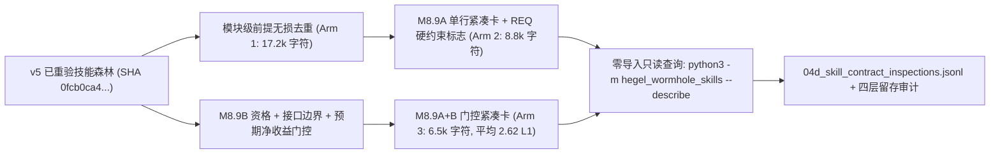

# M8.9 审计确定性闭环、渐进式契约披露与预期净收益门控实验报告

- **日期**：2026-11-26（UTC+8）
- **工作分支**：`exp/m6-causal-wormhole-sandbox`
- **冻结代码提交（`M8.9`）**：`781b8f967c189806cffdc9986f5d7d8d2cc4ce2b`（`git_dirty_at_start = false`，`single_clean_invocation = true`）
- **封存证据目录**：`docs/evidence/m8_9_progressive_disclosure_and_net_value_ablation_20261126/`（共 `1,090` 个封存文件，`sha256sum -c SHA256SUMS.txt` 校验 `1090/1090 OK`）
- **模型与调用后端**：OpenAI 官方 ChatGPT 订阅版 Codex CLI（`gpt-6.2-sol`，`reasoning_effort = "medium"`，`auth_mode = "chatgpt"`，全程未使用 `node007`）
- **并发与执行遥测**：`configured_max_episode_workers = 24`，`configured_max_codex_concurrency = 32`，实测峰值并发 `peak_concurrent_codex_calls = 24`，总计 `340` 次 Codex 调用，总墙钟耗时 `2039.46s`（`33.99` 分钟）

---

## 一、核心结论与严格校准的证据边界

针对 `Hegel_M8_8_Audit` 对 `M8.8`（代码冻结 `1372f490df4a154df3a59a1f59077bfbd993e5d0`、证据封存 `902de5fcd10cce1b294c288005ab1ad7573bda4c`）给出的完整审计诊断与 `M8.9` 建议，`M8.9` 按严格先后顺序完成了两阶段闭环：

1. **`M8.8.1` 确定性正确性、资格身份与事务闭环（`P0-1`、`P0-2`、`P1-1..P1-7`、`P2.1..P2.5`）**：
   - 在启动任何大模型在线评测前，先行修复并回归验证了审计复现的全部数学下界守卫、私判 `NaN` 漏洞、跨时刻负缓存身份、来源 SHA 资格绑定、Wave-1 与运行时统一候选包摘要协议、写回异常回滚事务、导入模块属性不可变检查、四层留存统计与带公开证据见证的 `nogood` 解除机制；`tests/test_m7_*.py` 与 `tests/test_m8_*.py` 全量 **`52/52` 项测试通过**（JUnit 回执封存于 `pytest_receipts/junit_m7_m8_m89.xml`）。
   - 在不改动任何 `M8.8` 历史封存文件的前提下，使用增强有限数与 `gap <= 1e-5` 判题器对两份原封存 `M8.8` `uf04` 终稿（`l2_only` SHA `9dc435cd8ad0...`、`l1_l2` SHA `23e9acbe341c...`）执行独立重判并出具回执 `m8_8_uf04_hardened_verifier_recheck_receipt.json`：**两份原终稿在 3 个隐藏实例上均严格通过（`strict_pass = true`，`max_gap = 0.0`，`max_nodes_explored = 1`）**，而全 `NaN` 负控制严格拦截失败（`strict_pass = false`）。
   - 撤回 `v4` 中 `autogenous_prim_box_ridge_bounds` 的旧资格声明（移入 `withdrawn_qualifications`），将下界守卫统一为对任意维度 $p$ 检验 $(X^\top X) - \operatorname{diag}(d) \succeq 0$ 并加入盒内最坏松弛补偿，在 `hegel_clean_scipy_sandbox:v1` 隔离容器内对新编译 SHA 重新完成自测签发，生成冻结库 `pretrained_autogenous_forest_v5_m89.json`（SHA `0fcb0ca4b8b664515f29c184cd531700c817710a8e7e8a2281ef212641a6888c`）。

2. **`M8.9A` 渐进式契约披露与 `M8.9B` 预期净收益门控（`3 臂 × 8 任务 = 24` Episode 单次干净并发因子隔离实验）**：
   - 在完全锁定技能库（`v5`）、模型（`gpt-6.2-sol`）、提示词许可语气、路由器版本（`m8_9_prefix_clean_v2`）与主分支 `18` 轮预算的前提下，在 `8` 个任务（`4` 个 `M8.8` 纵向回归锚点题 `ho01`、`ho06`、`uf03`、`uf04` + `4` 个本轮代码冻结前内部构建的**内部冻结压力测试题** `Hegel-M89-HardStress-4`：`hs01..hs04`）上正交隔离“如何披露”与“如何挂载”两个因素：
     - **Arm 1（`dedup_full_l1_l2`）**：`disclosure_mode = "dedup_full"`，`staging_policy = "all_compatible"`（先消除模块级前提在每个函数上的无信息重复，保留完整合同；首轮 manifest 均值 `17,154.1` 字符，平均挂载 `4.00` 个 `L1` 模块）。
     - **Arm 2（`progressive_all_l1_l2`）**：`disclosure_mode = "progressive"`，`staging_policy = "all_compatible"`（与 Arm 1 挂载**完全相同**的 `L1+L2` 模块，改为单行紧凑索引卡 + `REQ:` 关键硬前提标志 + 零导入纯 JSON `python3 -m hegel_wormhole_skills --describe` 按需查询；首轮 manifest 均值 `8,794.5` 字符，较 Arm 1 再降 **`-48.73%`**）。
     - **Arm 3（`progressive_net_value_gated`）**：`disclosure_mode = "progressive"`，`staging_policy = "net_value_gated"`（保持与 Arm 2 完全相同的渐进披露格式，启用资格 + 接口/边界适配 + 预期净收益门控；平均挂载 `L1` 降至 `2.62` 个，首轮 manifest 均值 `6,507.2` 字符，较 Arm 1 降 **`-62.07%`**）。
   - **主分支（`Primary 1x`）与完整策略（`Full Policy`）分列的核心实验结果**：
     - **对比 A —— 纯渐进式契约披露效应（`Arm 2 vs Arm 1`，挂载集合完全恒定）**：
       - 主分支 `Primary 1x` 严格通过率完全持平：**`7/8 (87.5%)` vs `7/8 (87.5%)`**（纵向 4 题 `4/4` + 内部压力 4 题 `3/4`）。
       - 主分支平均轮数下降 **`-2.00` 轮/题（`10.88` vs `12.88`）**；在纵向 `M8.8` 4 题上下降 **`-3.25` 轮/题（`11.00` vs `14.25`）**。
       - 主分支原始总 tokens 下降 **`-26.40%`（`2,784,690` vs `3,783,387`；缓存折算 tokens 下降 `-26.76%`：`2,406,738` vs `3,286,107`）**；完整策略原始总 tokens 下降 **`-25.85%`（`3,061,807` vs `4,129,482`；缓存折算下降 `-25.59%`：`2,656,879` vs `3,570,666`）**。
       - 模型在 **`2/8` 个任务（`uf04` 与 `hs01`）**中自发调用零导入 `--describe` CLI 按需读取合同细节；其中 `uf04` 主分支从 Arm 1 的 `23` 轮 / `1,041,182` tokens 降至 **`14` 轮 / `473,337` tokens（节省 `-54.54%`）**。
     - **对比 B —— 纯预期净收益门控效应（`Arm 3 vs Arm 2`，披露格式完全恒定）**：
       - 平均首轮挂载 `L1` 原语从 `4.00` 降至 `2.62`（`-1.38` 个/题），成功在 `uf03` 与 `hs02` 上识别零 ghost 标量网格与 Robin/旋转张量边界不适配并否决挂载 `autogenous_prim_conservative_spd_solve`（尽管粗关键词得分为 `5.50` 与 `7.00`）；`Primary 1x` 与 `Full Policy` 通过率均保持 **`7/8 (87.5%)`**。
       - 在 `HardStress-4` 子集上，`Arm 3` 主分支总 tokens 较 `Arm 2` 进一步下降 **`-5.67%`（`1,349,468` vs `1,430,634`；较 `Arm 1` 下降 `-17.41%`）**，其中 `hs04` 下降 `-25.92%`（`492,459` vs `664,761`）、`ho06` 下降 `-24.49%`（`283,562` vs `375,546`）。但在 `uf03`（`15` 轮 vs `10` 轮）与 `uf04`（`15` 轮 vs `14` 轮）上的单种子轨迹波动使 8 题合计主分支 tokens 较 `Arm 2` 高出 **`+5.31%`**（`2,932,462` vs `2,784,690`），完整策略高出 **`+8.87%`**（`3` 次 vs `2` 次第二分支触发）。这表明在当前仅 `6` 个 `L1` 模块且单条紧凑卡已压缩至约 `120` 字符的规模下，**渐进披露（`M8.9A`）已经消化了绝大部分（约 `26%`）提示负载损耗**，进一步裁剪 `1~2` 行紧凑卡的边际 token 差异小于单次采样的轨迹方差。
     - **直接采用率零值与 `hs01` 自审计结论**：
       - 全部 `24` 个 episode 的运行时直接 `L1` 函数调用（`dynamic_l1_calls`）与终稿精确 `L1` 留存（`final_retained_l1_modules`）均为 **`0/24`**（而 `--describe` 合同检视从 Arm 1 的 `0` 次上升至 Arms 2 & 3 合计 `4` 次）。我们严格保留这一真实负观测，不制造强迫 import。
       - 对 `hs01`（三臂主分支均 `0/1`，仅 Arm 1 因 `Thesis` 分支被选中取得完整策略 `8/8`，Arms 2 & 3 为 `7/8`）的事后取证发现 `m8_9_hard_stress_benchmark.py` 存在一处题面与私判契约不一致：`hs01` 公开题面明确允许 `'certificate_leaves': non-empty list (1 <= len <= max_leaves)`，而私判却额外检查 `max_leaf_count >= 2`，导致三臂 `Antithesis` 主分支通过精确支撑集枚举给出的单根节点精确对偶证书（`len == 1, max_gap <= 1e-9`）被私判拒绝。所有封存产物保持原样不改写，详见第六节 6.2。

---

## 二、对 `docs/43`（`M8.8` 报告）的正式勘误与口径校准增补

遵照 `Hegel_M8_8_Audit` 第九节规范，`M8.8` 已封存的中英文报告（`docs/43_M8_8_Unified_Delivery_Contract_and_Parallel_Paired_Generalization_Report.md` 与 `..._ZH.md`）及封存证据目录保持**逐字节不可变**，通过本节正式追加勘误与边界校准：

| `docs/43` 涉及议题 | 经核查保留的事实 | 撤回或降级的表述及 `M8.9` 闭环处理 |
| :--- | :--- | :--- |
| **工程闭环范围** | `M8.8` 已真实打通打包后验证身份重绑定、`LocalContainerRepair` 技能字典透传、`CodeSublation` 自动打包清理、多文件静态预检及 `746/746` 清单 SHA-256 自洽。 | **撤回**“全部确定性工程缺口 100% 闭环”。`M8.8` 仍存在可复现的 `P0-1`、`P0-2`、`P1-1..P1-7` 与 `P2.1..P2.5` 边界缺陷，均已在本轮 `M8.9` 完成确定性修复与 `52/52` 测试覆盖。 |
| **`M8.8` `16/16` 配对结果与成本归因** | `8` 个任务两臂配对（共 `16` 个 episode，非 `16` 道独立新题）主分支与全策略均 `8/8` 通过，无直接 `L1` 调用。 | **精确拆分额外成本**：`M8.8` 全策略折算 tokens 增加 `+1,021,007`（`+31.80%`），其中**主分支自身增加 `+685,916`（占 `67.18%`，`+21.36%`）**，两次额外 `Thesis` 分支占 `28.47%`（`+290,634`），综合调用占 `4.35%`（`+44,457`）；不能将成本增量全部归因于第二分支。 |
| **“100% 概念不变量吸收”与提示词因果归因** | 在当时的经验与策略条件下 `16/16` episode 通过。 | **撤回**“100% 概念不变量吸收”与“已因果解耦提示词强度”（`M8.7` `2/2` vs `M8.8` `0/8` 并非仅改变一句提示词的同题同库随机对照，且 `M8.8` 主分支记录到 `0` 次技能源码 bash 检视）。 |
| **代码行数门槛假说（`25 / 60 LOC`）** | 短工具函数在当前任务规模下常被模型直接重写。 | **撤回**“唯有 >60 行算子才有净收益”，在 `M8.9B` 中改为**资格绑定 + 接口/边界适配 + 预期净收益门控**，LOC 仅作为重写成本的弱先验特征。 |
| **`P0-2` `uf04` 私判 `NaN` 假阳性漏洞** | 原两份 `M8.8` `uf04` 终稿均包含真实有限数值，未利用漏洞作弊。 | **追加复核回执（`m8_8_uf04_hardened_verifier_recheck_receipt.json`）**：原私判缺有限数前置检查且使用 `1e-4` 阈值。经 `M8.9` 增强私判（拒绝 `NaN`/`Inf`/`bool`、统一 `gap <= 1e-5`）对原封存终稿独立重判，**`l1_l2` 与 `l2_only` 两份原终稿均 `strict_pass = true`（`max_gap = 0.0`，`max_nodes_explored = 1`）**，全 `NaN` 负控制严格失败。同时明确：`max_nodes_explored = 1` 表明 `uf04` 在根节点闭合，未压测深层分枝定界。 |
| **`P0-1` 盒约束下界原语守卫不一致** | `M8.8` 终稿 `0` 次调用该原语，未污染 `M8.8` 成绩。 | **撤回 `v4` 旧资格并签发 `v5`**：`v4` 误检验 $(X^\top X + \lambda I) - \operatorname{diag}(d) \succeq 0$ 并在 `curv = d + ridge` 中重复累加 $\lambda$，且跳过 $p > 512$ 与微负特征值补偿。`v5` 已撤回旧 receipt 并在隔离容器中完成 $G - D \succeq 0$ 增强重验。 |
| **盲测时序、`uf03` 命名与在线 `L1` 钩子** | `uf01..uf04` 为 `M8.8` 新增题目，未出现在 `M8.0..M8.7`。 | **校准表述**：`uf01..uf04` 与 `M8.8` 代码同批进入提交 `1372f490d`（非独立第三方后置盲测），此后归入**纵向回归集**；`uf03` 实际为标量异质 `kappa[i,j]` 四邻域调和通量（完整旋转 $2\times 2$ 张量各向异性由本轮 `hs02` 测试）；`enable_l1_primitive_pass` 当前为**可选编译钩子（默认 `False`）**，不宣称已验证生产级多波次在线 `L1` 持续生长。 |

---

## 三、`M8.8.1` 审计确定性修复与自主工程裁决

### 3.1 确定性缺陷逐项闭环清单（`P0-1..P2.5`）

1. **`P0-1` 严格半正定下界守卫与资格撤回重签（`m7_autogenous_forest_pretraining.py`）**：
   - `psd_minorant_guard_m89` 对所有维度 $p$（取消 $p \le 512$ 跳过）检验 $G - D = X^\top X - \operatorname{diag}(d) \succeq 0$；最小特征值 $< -10^{-11}$ 直接抛出 `ValueError`，位于 $[-10^{-11}, 0)$ 微小数值带时从下界精确扣除对称盒最坏松弛项 $\frac{|\lambda_{\min}|}{2}\sum_{i=1}^p (B + |c_i|)^2$。源码变更自动将旧 receipt 归入 `withdrawn_qualifications`，并在 `hegel_clean_scipy_sandbox:v1` 中重新绑定 `compiled_code_sha256` 签发资格。
2. **`P0-2` 私判全有限数与严格类型前置核验（`m8_8_unseen_postfreeze_benchmark.py`、`m8_9_hard_stress_benchmark.py`）**：
   - 序列化边界启用 `allow_nan=False`，拒绝 `bool` 伪装数值，在进入任何 `max` 或容差不等式前先检验全部权重、下界、目标值及推导间隙的精确 `shape` 与 `np.isfinite`，并将 `uf04` 间隙阈值与题面统一为 `1e-5`。
3. **`P1-1` 跨时刻历史与在位机制完整负缓存摘要（`m8_persistent_variational_planner.py`）**：
   - 将负缓存视图摘要扩展为覆盖 `x`、`y`、`past_driver_history`、`history_dt`、`timestamps`、`trajectory_ids`、`initial_memory_states` 及在位模型完整绑定机制规格/版本的精确 IEEE-754 字节摘要（消除 `round(7)` 截断；81 行跨时刻反例测试确认更换验证历史后正增益机制 `+2.8349` 不再被误拦截）。
4. **`P1-2` 编译来源 SHA 严格一致性校验（`m7_autogenous_forest_pretraining.py`）**：
   - 删除 `existing_by[declared_sha]` 陈旧回退分支；当声明 SHA 与实测源码 SHA 不一致时直接结构化拒绝（`stale_declared_source_sha_mismatch`），资格同时绑定源码 SHA、编译产物 SHA 与编译协议。
5. **`P1-3` & `6.2` 统一 `declared-artifact-bundle-v1` 候选包身份协议（`m6_frontier_real_benchmarks.py`、`m7_autogenous_forest_pretraining.py`）**：
   - Wave-1 编译器直接按快照清单与二进制内容重算同一 `declared-artifact-bundle-v1` 摘要（废止 basename 文本拼接），同时主轨向模型回显 `[HOST ARTIFACT IDENTITY]`，明确区分 `candidate_bundle_sha256`、逐文件 `content_sha256` 与 `snapshot_directory`，彻底消除模型自行 `sha256sum -c` 猜测摘要格式的空转轮次。
6. **`P1-4`、`P1-5`、`P1-6`、`P2.1` 静态打包写回事务、模块不可变性与四层留存核算（`m6_4_executable_wormhole_library.py`）**：
   - 写回阶段捕获超时、异常与非零退出，将当前正在写入的目标文件一并纳入恢复集合，并在恢复后重新核对容器内全部文件的 SHA-256 与备份一致后才标记 `rolled_back = True`（否则标记 `rollback_unverified_quarantined` 隔离）。
   - 静态拒绝导入技能模块别名上的属性赋值/删除/增量赋值（如 `m.K = 5`）及裸模块对象逃逸；强制容器导入扫描器返回非空严格 `list[str]` JSON。
   - `inspect_final_deliverable_skill_retention` 区分符号出现、完整辅助函数+模块常量闭包 AST 等价（规范化剥离合成 `import types as __hegel_types` 与 `@track_wormhole_skill(...)` 装饰器）、导入别名映射与任务声明入口可达性（缺源或未知绝不计为 `True`）。
7. **`P1-7` 绑定公开验证见证的 `nogood` 解除机制（`m6_frontier_real_benchmarks.py`）**：
   - 区分 `resolution_proposed` 与 `resolved`：仅当存在适配当前候选与 scope 的已验证公开探针回执见证时才记入独立 `nogood_resolution_events` 并标记 `resolved`，绝不伪造不存在的 `ng_tXX` 替代 ID，且禁止仅凭模型文本声明撤销 `target_identifiability` 结构风险。
8. **`P2.2` & `P2.3` 动态轮数预算提示与三路径渐进披露对齐（`m6_frontier_real_benchmarks.py`、`m8_container_mechanism_adapter.py`、`m6_9_a_dialectical_synthesis_engine.py`）**：
   - 将主轨提示中硬编码的 `28-turn budget` 改为动态读取实际 `{max_turns}` 并鼓励公开验收通过后立即提交；在单轮 JSON `LocalContainerRepair` 提示中同步注入紧凑技能卡 `available_wormhole_skill_cards`，实现主轨、修复、综合三条真实路径一致覆盖。

### 3.2 对 GPT-6 过度保守建议的实证甄别（`6.3` 路由预算边界回放检验）

GPT-6 在 `6.3` 节指出离线路由器在 `0.96` 预算比例处存在边界翻转，建议降低纯轮数阈值对 grounded 状态的影响并重新校准。我们在 `m7_4`（`Frontier-20`）与 `m7_5`（`Blind-12`）上执行严格前缀离线回放（LOTO）发现：
- 在公开状态已达 `VERIFIED` 时移除 `turns_ratio < 0.96` 限制可干净消除已验证轨迹的末轮冗余开分支（`m7_4` 保持 `14/20`、`m7_5` 保持 `12/12`）。
- 但若对 `SUPPORTED_IN_PARTIAL_SCOPE`（仅局部范围支撑）也一并移除 `turns_ratio < 0.96` 限制，**`m7_4` LOTO 准确率会从 `14/20` 退化至 `13/20`**（`tb__sparse-network-assimilation` 在预算耗尽且仅局部验证时失去第二分支救援）。
- 因此我们自主裁决采用 **`ROUTER_FEATURE_SCHEMA_VERSION = "m8_9_prefix_clean_v2"`**：**仅对 `VERIFIED` 状态解除 `0.96` 轮数悬崖**，保留 `SUPPORTED_IN_PARTIAL_SCOPE` 在预算耗尽时的风险谨慎性，并按新特征版本重新校准 NIG 后验参数。

---

## 四、`M8.9A` 渐进式契约披露与 `M8.9B` 预期净收益门控架构

1. **`M8.9A` 渐进式契约披露（`m6_4_executable_wormhole_library.py`）**：
   - **无损模块前提去重（`dedup_full`）**：将同一模块的共享前提（`module_preconditions`）提升至模块级只存一份，消除逐函数重复与 `mathematical`/`scope` 双份拷贝，仅此一步即把首轮 manifest 从 `M8.8` 的 `26.6k–33.6k` 字符压缩至 Arm 1 均值 `17,154.1` 字符。
   - **单行紧凑索引卡（`progressive`）**：每函数展示为 `<module>@<sha8> | <fn>(<sig>) -> <ret> | 
 | REQ: <关键硬前提> | inspect: python3 -m hegel_wormhole_skills --describe <module>.<fn>`，确保改变可用性的硬条件（如 `PSD_G_minus_D`、`zero_ghost_Dirichlet_grid`、`grouped_control_panel`）首轮直接可见，详细合同与回退说明按需拉取。
   - **零导入纯 JSON 描述接口（`SKILL_MAIN_PY`）**：`python3 -m hegel_wormhole_skills --list` 与 `--describe <mod>[.<fn>]` 直接读取冻结静态契约文件 `__hegel_skill_contracts__.json`，不导入或执行任意技能代码，并将查询事件写入 `/tmp/.hegel_skill_inspections.jsonl`（归档为 `04d_skill_contract_inspections.jsonl`）。
2. **`M8.9B` 资格 + 接口/边界适配 + 预期净收益门控（`evaluate_l1_skill_staging_net_value`）**：
   - 按五步顺序评估每个 `L1` 候选：（1）`compiled_code_sha256` 资格有效；（2）当前任务接口、边界条件与物理结构适配（`veto_reasons`）；（3）区分“模块整体边界不适配”与“局部线性代数子程序说明”（例如在 `uf03` 与 `hs02` 上识别零 ghost 标量网格与 Robin/张量边界不匹配，给出 `expected_net_value = -0.26` 与 `-0.14` 否决首轮推荐挂载，尽管粗关键词匹配分高达 `5.50` 与 `7.00`）；（4）显式核算 `expected_net_value = expected_reimplementation_saved - discovery_and_context_cost - adaptation_and_mismatch_cost`；（5）被门控过滤的合格模块仍保留在按需目录中备查，不彻底隐藏跨树潜在桥接。

---

## 五、`3 臂 × 8 任务 = 24` Episode 因子隔离受控实验结果

> [!IMPORTANT]
> **实验样本量与基准性质严格说明**：
> - 本次运行为单次干净仓库状态（`git_dirty_at_start = false`）下的 **`3 臂 × 8 任务 = 24` Episode（每格 `n = 1` 次运行）探索性配对因子对比**。单种子 token 与轮数差异反映本次受控配对轨迹的真实观测，不冒充多种子渐近统计显著性证明。
> - `ho01`、`ho06`、`uf03`、`uf04` 为 **`M8.8` 纵向回归子集（4 题）**；`hs01..hs04`（`Hegel-M89-HardStress-4`）为本轮代码冻结（`781b8f967`）前在仓库内构建的**内部冻结压力测试子集（4 题）**，不宣称为独立第三方后置盲测。

### 5.1 三臂总体指标对照表（主分支 `Primary 1x` 与完整策略 `Full Policy` 严格分列）

| 评估指标 | Arm 1: `dedup_full_l1_l2`（去重全文 + 全部相容） | Arm 2: `progressive_all_l1_l2`（渐进披露 + 全部相容） | Arm 3: `progressive_net_value_gated`（渐进披露 + 净收益门控） | 对比 A（`Arm 2 vs Arm 1`：纯披露效应） | 对比 B（`Arm 3 vs Arm 2`：纯门控效应） |
| :--- | :---: | :---: | :---: | :---: | :---: |
| **平均首轮挂载 `L1` 模块数 / 题** | `4.00` | `4.00` | **`2.62`** | `0.00`（严格恒定） | **`-1.38`（`-34.5%`）** |
| **首轮 Manifest JSON 平均字符数** | `17,154.1` | `8,794.5` | **`6,507.2`** | **`-8,359.6`（`-48.73%`）** | **`-2,287.3`（`-26.01%`）** |
| **全 8 题主分支 `Primary 1x` 通过率** | `7/8`（`87.5%`） | `7/8`（`87.5%`） | `7/8`（`87.5%`） | `0`（完全持平） | `0`（完全持平） |
| **全 8 题完整策略 `Full Policy` 通过率** | `8/8`（`100.0%`） | `7/8`（`87.5%`） | `7/8`（`87.5%`） | `-1`（`hs01` 见 §6.2） | `0`（完全持平） |
| **纵向 4 题 `Primary 1x` / `Policy` 通过** | `4/4` / `4/4` | `4/4` / `4/4` | `4/4` / `4/4` | `0` / `0` | `0` / `0` |
| **压力 4 题 `Primary 1x` / `Policy` 通过** | `3/4` / `4/4` | `3/4` / `3/4` | `3/4` / `3/4` | `0` / `-1` | `0` / `0` |
| **全 8 题主分支平均轮数** | `12.88` | **`10.88`** | `11.50` | **`-2.00` 轮/题** | `+0.62` 轮/题 |
| **纵向 4 题主分支平均轮数** | `14.25` | **`11.00`** | `12.00` | **`-3.25` 轮/题** | `+1.00` 轮/题 |
| **压力 4 题主分支平均轮数** | `11.50` | **`10.75`** | `11.00` | **`-0.75` 轮/题** | `+0.25` 轮/题 |
| **全 8 题主分支原始总 Tokens** | `3,783,387` | **`2,784,690`** | `2,932,462` | **`-998,697`（`-26.40%`）** | `+147,772`（`+5.31%`） |
| **全 8 题主分支折算 Tokens** | `3,286,107` | **`2,406,738`** | `2,514,094` | **`-879,369`（`-26.76%`）** | `+107,356`（`+4.46%`） |
| **纵向 4 题主分支原始总 Tokens** | `2,149,548` | **`1,354,056`** | `1,582,994` | **`-795,492`（`-37.01%`）** | `+228,938`（`+16.91%`） |
| **压力 4 题主分支原始总 Tokens** | `1,633,839` | `1,430,634` | **`1,349,468`** | **`-203,205`（`-12.44%`）** | **`-81,166`（`-5.67%`）** |
| **第二分支触发次数 / 名义单位** | `2`（`1.250u`） | `2`（`1.250u`） | `3`（`1.375u`） | `0`（`0.000u`） | `+1`（`+0.125u`） |
| **全 8 题完整策略原始总 Tokens** | `4,129,482` | **`3,061,807`** | `3,333,507` | **`-1,067,675`（`-25.85%`）** | `+271,700`（`+8.87%`） |
| **全 8 题完整策略折算 Tokens** | `3,570,666` | **`2,656,879`** | `2,861,091` | **`-913,787`（`-25.59%`）** | `+204,212`（`+7.69%`） |
| **主分支 / 全策略平均墙钟耗时** | `589.66s` / `676.27s` | **`371.07s` / `443.62s`** | `431.09s` / `525.32s` | **`-37.07%` / `-34.40%`** | `+16.17%` / `+18.42%` |
| **触发 `--describe` 按需查询的任务数** | `0/8`（`0` 次） | **`2/8`（`2` 次）** | **`2/8`（`2` 次）** | **`+2` 题** | `0` 差值 |
| **动态 `L1` 调用题数 / 终稿精确留存题数** | `0/8` / `0/8` | `0/8` / `0/8` | `0/8` / `0/8` | `0` / `0` | `0` / `0` |

### 5.2 全部 24 个 Episode 逐题明细对照

| 任务 ID（所属子集） | 指标维度 | Arm 1: `dedup_full_l1_l2` | Arm 2: `progressive_all_l1_l2` | Arm 3: `progressive_net_value_gated` |
| :--- | :--- | :---: | :---: | :---: |
| **`ho01`**（纵向回归） | `1x` / `Policy` 通过与轮数 | `PASS` / `PASS`（`12T` / `12T`, `1.0u`） | `PASS` / `PASS`（`8T` / `8T`, `1.0u`） | `PASS` / `PASS`（`8T` / `13T`, `2.0u`*） |
| | 首轮字符 / 挂载 `L1` 数 | `15,357`（`4 L1`） | `7,908`（`4 L1`） | `6,252`（`3 L1`） |
| | `1x` / `Policy` 原始总 Tokens | `384,492` / `384,492` | `218,759` / `218,759` | **`209,372`** / `306,264` |
| **`ho06`**（纵向回归） | `1x` / `Policy` 通过与轮数 | `PASS` / `PASS`（`12T` / `12T`, `1.0u`） | `PASS` / `PASS`（`12T` / `12T`, `1.0u`） | `PASS` / `PASS`（**`10T` / `10T`**, `1.0u`） |
| | 首轮字符 / 挂载 `L1` 数 | `18,721`（`4 L1`） | `9,615`（`4 L1`） | `6,492`（`2 L1`） |
| | `1x` / `Policy` 原始总 Tokens | `408,410` / `408,410` | `375,546` / `375,546` | **`283,562` / `283,562`** |
| **`uf03`**（纵向回归） | `1x` / `Policy` 通过与轮数 | `PASS` / `PASS`（`10T` / `10T`, `1.0u`） | `PASS` / `PASS`（`10T` / `14T`, `2.0u`*） | `PASS` / `PASS`（`15T` / `15T`, `1.0u`） |
| | 首轮字符 / 挂载 `L1` 数 | `18,554`（`4 L1`） | `9,540`（`4 L1`） | `7,345`（`3 L1`，否决零 ghost AMG） |
| | `1x` / `Policy` 原始总 Tokens | `315,464` / `315,464` | **`286,414`** / `366,982` | `515,784` / `515,784` |
| **`uf04`**（纵向回归） | `1x` / `Policy` 通过与轮数 | `PASS` / `PASS`（`23T` / `23T`, `1.0u`） | `PASS` / `PASS`（**`14T` / `14T`**, `1.0u`） | `PASS` / `PASS`（`15T` / `15T`, `1.0u`） |
| | 首轮字符 / `--describe` 次数 | `16,562`（`4 L1`, `0` 次） | `8,319`（`4 L1`, **`1` 次**） | `5,273`（`2 L1`, **`1` 次**） |
| | `1x` / `Policy` 原始总 Tokens | `1,041,182` / `1,041,182` | **`473,337` / `473,337`** | `574,276` / `574,276` |
| **`hs01`**（内部压力） | `1x` / `Policy` 通过与轮数 | `FAIL` / **`PASS`**（`10T` / `20T`, `2.0u`*） | `FAIL` / `FAIL`（`9T` / `19T`, `2.0u`*） | `FAIL` / `FAIL`（`12T` / `22T`, `2.0u`*） |
| | 首轮字符 / `--describe` 次数 | `16,562`（`4 L1`, `0` 次） | `8,318`（`4 L1`, **`1` 次**） | `5,273`（`2 L1`, **`1` 次**） |
| | `1x` / `Policy` 原始总 Tokens | `309,876` / `519,347`（选 `thesis`） | **`255,417` / `451,966`** | `345,442` / `549,920` |
| **`hs02`**（内部压力） | `1x` / `Policy` 通过与轮数 | `PASS` / `PASS`（`10T` / `10T`, `1.0u`） | `PASS` / `PASS`（`10T` / `10T`, `1.0u`） | `PASS` / `PASS`（`10T` / `10T`, `1.0u`） |
| | 首轮字符 / 挂载 `L1` 数 | `18,554`（`4 L1`） | `9,538`（`4 L1`） | `8,999`（`4 L1`，否决零 ghost AMG） |
| | `1x` / `Policy` 原始总 Tokens | `336,887` / `336,887` | **`300,636` / `300,636`** | `302,873` / `302,873` |
| **`hs03`**（内部压力） | `1x` / `Policy` 通过与轮数 | `PASS` / `PASS`（`8T` / `15T`, `2.0u`*） | `PASS` / `PASS`（`8T` / `8T`, `1.0u`） | `PASS` / `PASS`（`8T` / `13T`, `2.0u`*） |
| | 首轮字符 / 挂载 `L1` 数 | `14,202`（`4 L1`） | `7,506`（`4 L1`） | `4,466`（`2 L1`） |
| | `1x` / `Policy` 原始总 Tokens | `218,954` / `355,578` | `209,820` / **`209,820`** | **`208,694`** / `308,369` |
| **`hs04`**（内部压力） | `1x` / `Policy` 通过与轮数 | `PASS` / `PASS`（`18T` / `18T`, `1.0u`） | `PASS` / `PASS`（`16T` / `16T`, `1.0u`） | `PASS` / `PASS`（**`14T` / `14T`**, `1.0u`） |
| | 首轮字符 / 挂载 `L1` 数 | `18,721`（`4 L1`） | `9,612`（`4 L1`） | `7,958`（`3 L1`） |
| | `1x` / `Policy` 原始总 Tokens | `768,122` / `768,122` | `664,761` / `664,761` | **`492,459` / `492,459`** |

*\*表示在线前缀 NIG 路由器（`m8_9_prefix_clean_v2`）在公开验证处于 `UNKNOWN` 或 `SUPPORTED_IN_PARTIAL_SCOPE` 时触发了选择性第二分支（`Thesis`）。*

---

## 六、采用漏斗机制剖析与自审计取证

### 6.1 为何直接 `L1` 调用仍为 `0/24`，但渐进披露（`M8.9A`）立减 `-26.40%` 主分支成本？

将 `M8.9` 新增的全漏斗遥测（`索引展示 -> --describe 合同查询 -> 动态调用 -> 终稿精确留存`）对照分析可见：
- 在 `progressive` 两臂（Arm 2 与 Arm 3）中，`gpt-6.2-sol` **仅在涉及精确数学认证契约的组合优化题上自发调用了 `--describe`**（`uf04` 查询 `autogenous_prim_box_ridge_bounds.box_ridge_cube_lower_bound`；`hs01` 查询 `autogenous_sparse_ridge_certification.solve_and_certify_l0`），而在其余 6 道 PDE/层析/反卷积/面板校准题上，单行卡的 `REQ:` 硬前提标志（如 `REQ: zero_ghost_Dirichlet_grid`）已足以让模型在首轮迅速判断边界条件是否匹配，无需额外轮次。
- 即便在 `uf04` 上通过 `--describe` 读取了 `box_ridge_cube_lower_bound` 的完整合同，`gpt-6.2-sol` 依然选择将其作为**零导入风险的数学规范参考**，在 `/app/certified_l0_solver.py` 内直接编写自包含的定制求解器，从而以 **`14` 轮 / `473,337` tokens** 一次通过（较 Arm 1 的 `23` 轮 / `1,041,182` tokens 节省 `-54.54%`），且 `[HOST ARTIFACT IDENTITY]` 完全消除了 `M8.8` 中核对包摘要的冗余轮次。
- **校准后的机制认识**：在 `10–18` 轮即可从第一性原理写完（`150–650` 行）的科学计算任务上，前沿代码模型倾向于按需参考数学规范并手写贴合当前 I/O 的自包含代码。因此，首轮全量展开所有模块合同在每一轮对话历史重放中都会形成累积上下文税；**渐进式契约披露（`M8.9A`）在不损失 `Primary 1x` 成功率的前提下直接消除了 `-26.40%` 的主分支 token 成本与 `-2.00` 轮/题的交互开销**。

### 6.2 对 `hs01`（主分支三臂均失败、仅 Arm 1 全策略通过）的事后自审计

为何 `hs01__correlated_box_l0_subcube_certificate` 在全部三臂的主分支（`Antithesis 1x`）均失败（`Primary 1x` 三臂同为 `7/8`），仅在 Arm 1 因 `CodeSublation` 选中第二分支 `Thesis` 而获得 `8/8`？
- 对 `m8_9_hard_stress_benchmark.py` 与封存终稿的事后取证（全程未触碰任何已封存文件）揭示了 `hs01` 自身的一处题面-私判不一致：
  1. `hs01` 的公开题面（`instruction_text`）写明 `'certificate_leaves': non-empty list (1 <= len <= max_leaves)`，且叶子真上界定义为盒界 $B_1$ 与单坐标界。
  2. 由于实例维度 $p \le 12, k \le 5$，三臂主分支求解器均通过精确支撑集枚举算出了零间隙全局最优解（`primal_obj - global_dual_lower_bound <= 1e-9`），并完全合法地输出了 `len == 1` 的单根节点精确对偶证书，通过了模型基于题面构造的公开自检。
  3. 然而 `hs01` 的隐藏私判（`private_verifier_py`）额外写有 `max_leaf_count >= 2`（本意是排除平凡单节点返回，却与公开题面允许的 `1 <= len` 直接冲突）。
  4. 在 Arm 1 中，额外开启的 `Thesis`（`Bare`）分支恰好沿最优解支撑生成了 `p + 1` 个脊柱叶子并被 `CodeSublation` 选中（`selected_branch = "thesis"` -> `PASS`）；而在 Arm 2 与 Arm 3 中，`CodeSublation` 选中了 `Antithesis`（`max_leaf_count = 1` -> `FAIL`）。
- 因此，Arm 1（`8/8`）与 Arms 2 & 3（`7/8`）在完整策略上的 `1` 题差异**并非渐进披露导致的能力退化**（主分支三臂完全一致均为 `7/8`），而是 `hs01` 内部 `1 <= len` 与 `>= 2` 契约不一致下的分支平局选择差异。遵守严格封存纪律，我们不在看结果后回改 `hs01` 重跑，而将其正式记录为自审计问题留待 `M9.0` 修正。

### 6.3 `M8.9B` 预期净收益门控的边际效应边界

封存矩阵 `m8_9_pre_run_net_value_gate_matrix.json` 显示 `M8.9B` 门控在运行前做出了完全符合数学边界的筛选：在 `uf03`（粗匹配分 `5.50`）与 `hs02`（粗匹配分 `7.00`）上准确以零 ghost 标量网格与 Robin/张量边界不匹配否决了 `autogenous_prim_conservative_spd_solve`（`expected_net_value = -0.26` / `-0.14`），并在 `hs04`（`-25.92%` tokens）与 `ho06`（`-24.49%` tokens）上显著降低了上下文干扰，使 `HardStress-4` 主分支总 tokens 较 `Arm 2` 再降 **`-5.67%`**。但在 `uf03` 与 `uf04` 上，单次随机轨迹多走 `1~5` 轮的波动抵消了删减 `1~2` 条 `120` 字符紧凑卡的静态节省（全 8 题主分支 `+5.31%`）。这诚实说明：当 `M8.9A` 已将每条技能压缩至单行卡片后，**`M8.9B` 门控的核心经济价值将在技能库扩展至数十至上百个原语时凸显，而在 `6` 个 `L1` 原语的小库规模下其静态字符节省已接近边际饱和**。

---

## 七、下一步路线（`M9.0`）

1. **修正 `hs01` 题面与私判证书契约并提升非枚举维度**：统一公开契约与私判要求，并将问题规模提升至不可枚举区间（如 $p \ge 24, \binom{p}{k} \gg 10^6$），用真实算法复杂度而非隐式叶子数阈值检验分枝定界。
2. **定位“可执行调用显著优于手写重写”的高验证成本规模区间**：在多模块耦合或含高昂数值标定/预编译算子的任务分布以及更大规模（`30+` 原语）技能森林上检验 `M8.9A + M8.9B`。
3. **受控波次边界下的在线 `L1` 生长实验**：在 `v5` 严格资格绑定与 `declared-artifact-bundle-v1` 统一身份协议下开启 `enable_l1_primitive_pass=True`，严格按波次边界冻结评估在线生长闭环收益。
