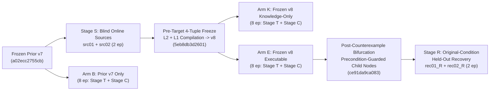

# Hegel Machine M9.2.1 Deterministic Closure & M9.3 Online Source-Freeze Lifecycle Report

- **Date**: 2026-11-26
- **Branch**: `exp/m6-causal-wormhole-sandbox` (worktree locked; mainline & all upstream sealed evidence bundles untouched)
- **M9.2.1 Closure Commit**: `5575a6ad569025a4950fb6a7dab7a43558181b92` (`fix_m9_2_1_shared_kernel_bootstrap_unified_reader_4tuple_witness_temporal_and_errata`)
- **M9.3 Benchmark Freeze Commit**: `29fab06387da12fea668a20b7d785c22a8152f8f` (`feat_m9_3_online_source_freeze_temporal_partial_lifecycle_suite`)
- **Sealed Evidence Bundles**:
  - `docs/evidence/m9_2_1_audit_closure_and_regrade_20261126/` (`7` hashed files + `SHA256SUMS.txt` + `junit_m9_2_1_and_regressions.xml`, `33/33` pytest regressions passed, `0` live LLM calls)
  - `docs/evidence/m9_3_online_source_freeze_lifecycle_20261126/` (`693` hashed files + `SHA256SUMS.txt`, `28/28` fresh unresumed live `gpt-6.2-sol` episodes passed on frozen commit `29fab0638`)

---

## 1. Sovereign Adjudication of `Hegel_M9_2_Audit`

Following independent code, mathematical, and trajectory verification against the repository and sealed `M9.2` artifacts, we classified the GPT-6 audit recommendations into **9 high-signal engineering/mathematical closures (adopted in full)** and **3 over-conservative proposals (rejected with explicit scientific rationale)**:

| Audit Item | Verdict | Rationale & Action Taken |
| :--- | :--- | :--- |
| **`F1` (`eq02` duplicated certificate sign & Stage 2->3 public handoff)** | **ADOPTED (`A1`)** | Verified mathematically: `eq02` duplicated certificate logic rather than importing `m8_9_1_box_l0_certificate_kernel.py`, reversing the sign on `nu * (c - q)` (`+` instead of `-`) and checking public Stage 2->3 handoff against `0 <= w <= M` instead of `pred_y_cal`. Closed by deleting duplicated math in `eq02`, delegating to `verify_eq02_style_box_l0_certificate(..., dual_nu_sign=-1.0)`, tightening inactive Lipschitz diagonal exclusion in `m8_9_1_box_l0_certificate_kernel.py`, and regrading all `6` frozen `M9.2` `eq02` deliverables (`12/12` private instances pass, `handoff_max_abs_diff <= 3.55e-15`). |
| **`F2` (`M9.2` container-boot `public_setup_py` branch omission & hardcoded summary flag)** | **ADOPTED (`A2`)** | Verified in `m6_frontier_real_benchmarks.py`: `"Hegel-M92-EqualInfo-4"` was omitted from the legacy string-allowlist for `public_setup_py`. Closed via capability-driven `bool(task.holdout_public_setup_py.strip())` bootstrap + pre-Turn-1 SHA-256 asset verification (`required_public_assets`), dynamic `public_setup_receipt` aggregation, and errata receipt `m9_2_protocol_deviation_and_funnel_errata.json`. |
| **`F3` (`K` vs `E` separate catalog reader implementations)** | **ADOPTED (`A3`)** | Verified on offline replay of the `24` real `M9.2` search queries (`16/24` rank diffs, `9/24` member diffs). Closed by extracting a single `_SHARED_CATALOG_READER_CORE_PY` shared verbatim across `K` and `E` (`0/24` rank or member disagreements in `m9_2_unified_reader_24_query_replay.json`). |
| **`F4` (`L1` 4-tuple qualification check, immutable Docker digest, & host repeatability)** | **ADOPTED (`A4`)** | Closed by enforcing strict equality on `(code_sha256, test_sha256, verifier_protocol_version, dependency_env_digest)`, computing `hegel_env_v2:2c4c44496302870012b00fe0f1cd1e82` from immutable Docker `ImageId` (`sha256:bb111245520085...`) + package versions, running an independent host double-execution check (`host_independent_repeatability_verified = True`), upgrading the online `L1` compiler to emit v2 4-tuples, and sealing `pretrained_autogenous_forest_v7_m921.json`. |
| **`F5` (Agent-printed stdout keywords accepted as nogood resolution witness)** | **ADOPTED (`A5`)** | Verified: `assert 1 == 1; print('gauge scale residual=0.0')` previously cleared a nogood. Closed by separating `HostControlledProbeReceipt` (`host_verified_witness`) from `agent_claimed_unverified`; unanchored bash commands can never clear active nogoods without a fresh host-signed `validate_public_schema.py` or `host_probe_gate` receipt. |
| **`F6` (`m8_4` temporal context `history_dt` / per-row `initial_memory_states` / post-oracle ledger)** | **ADOPTED (`A6`)** | Closed in `m8_4_dynamic_abstraction_interface.py`: `history_dt` is inherited and validated pre-oracle, `initial_memory_states` merges per-trajectory dicts without dropping prior memory channels, unaligned new per-row temporal columns are rejected pre-oracle, and any post-oracle validation error permanently records paid observation & decision tokens before raising. |
| **`F7` (`CodexCliClient` retry overwrite & `usage_unknown` masking)** | **ADOPTED (`A7`)** | Closed by writing per-attempt isolated `resp_<seq>_att<i>.json` files, copying `01b_provider_attempts/` into each episode artifact folder, and propagating `total_provider_attempts`, `usage_unknown_attempt_count`, and `cost_accounting_status` (`complete` vs `partial_unknown_usage`) to episode and master summaries. |
| **`F8` (`M9.2` telemetry errata, child CPU timing, & `eq03` derivative-consistent twins)** | **ADOPTED (`A8`, `A9`)** | Closed in `docs/47b_*`, child-process `perf_counter()` + `process_time()` instrumentation (`candidate_timing_breakdown`), derivative-consistent nullspace perturbation + future-independent `critical_strain` in `eq03`, and 4-tuple manifest selection in `LocalContainerRepair`. |
| **Expensive 24-episode paid re-run of `M9.2` (`eq01..eq04`) before `M9.3`** | **REJECTED** | `eq01..eq04` is an offline-precompiled static benchmark (`v7`) whose fixed-artifact mathematical soundness is already 100% resolved deterministically (`12/12` `eq02` instances pass under the shared kernel at zero LLM cost). Spending another 24 live episodes on offline `v7` tasks would waste compute without testing **online source-to-target formation**; instead, all `A1..A9` fixes were promoted directly into **`M9.3`** (`28` live episodes). |
| **Delaying temporal memory, partial observability, & localized counterexample revision to `M9.4+`** | **REJECTED** | Now that `A6` closed the temporal state-schema contract, `M9.3` directly integrates variable-step hereditary memory (`src01 -> suc01_T -> suc01_C -> rec01_R`) and separable/non-separable operator + multi-budget KKT certification (`src02 -> suc02_T -> suc02_C -> rec02_R`) in a single unified online lifecycle benchmark. |
| **Restricting `M9.3` to tiny single-threaded serial runs (`r=1`)** | **REJECTED** | After `Stage S -> v8` freeze completes, all `24` post-freeze successor episodes (`2` replicates x `3` arms x `4` tasks) are causally independent against frozen `v7`/`v8` bundles; running them concurrently (`24` episode workers, global CLI semaphore `32`, peak `24` concurrent calls) cut wall-clock to `57.1` minutes with zero cross-episode mutation (`zero_source_mutation_during_run = True`). |

---

## 2. `M9.2.1` Deterministic Closure Summary (`Commit 1`: `5575a6ad5`)

All deterministic audit closures and historical regrades are sealed in `docs/evidence/m9_2_1_audit_closure_and_regrade_20261126/` (`SHA256SUMS.txt` verified):

1. **`eq02_shared_kernel_fixed_artifact_regrade_12of12.json`**: Re-executes all `6` frozen `M9.2` `eq02` submissions (`rep_01..rep_02` x `B/K/E`) against the centralized `m8_9_1_box_l0_certificate_kernel` (`dual_nu_sign = -1.0`, `sound_tol = 1e-5`) and verifies public Stage 2->3 `pred_y_cal` handoff (`12/12` private instances pass; `max_handoff_abs_diff <= 3.55e-15`). Synthetic negative-correlation dual sign counterexamples and overlapping/incomplete schema counterexamples are rejected.
2. **`m9_2_unified_reader_24_query_replay.json`**: Replays all `24` real agent `--search` queries from `M9.2` through `_SHARED_CATALOG_READER_CORE_PY`, confirming `0/24` rank differences and `0/24` member-set differences between `K` and `E`.
3. **`v7_immutable_env_4tuple_qualification_receipt.json` & `pretrained_autogenous_forest_v7_m921.json`**: Re-qualifies all `6` `v7` `L1` modules inside air-gapped Docker (`sha256:bb111245520085c97361fff57b2e141911dd86a0e63c5c49761bc1ab692d910a`, `hegel_env_v2:2c4c44496302870012b00fe0f1cd1e82`, `host_independent_repeatability_verified = True`), producing bundle `a02ecc2755cbc5e5a6f8f7704ffadbc1e25d9107537a612aa71b66fe0ec50ce0`.
4. **`junit_m9_2_1_and_regressions.xml`**: `33/33` pytest cases pass across `test_m9_2_1`, `test_m9_2`, `test_m9_1_1`, `test_m9_1`, `test_m9_0a`, `test_m8_9_1`, and `test_m8_9`.

---

## 3. `M9.3` Online Source-Freeze & Temporal/Partial Lifecycle Architecture (`Commit 2`: `29fab0638`)

`M9.3` replaces offline-precompiled `v7` reuse with a **4-stage online lifecycle benchmark** (`src/hegel_machine/cognition/m9_3_online_lifecycle_benchmark.py`, `scripts/run_m9_3_online_source_freeze_successor_experiment.py`) spanning two coupled physical/mathematical families:

### 3.1 Two Online Source-to-Successor-to-Counterexample-to-Recovery Chains (`8` Tasks, `28` Live Episodes)

1. **Family 1 — Multi-Timescale Variable-Step Hereditary Viscoelastic Memory & Partial-Observability Couplings**:
   - **`src01` (`Stage S` Source)**: Variable-step (`dt_k`) Prony relaxation spectrum `(g_m, tau_m)` identification under missing/censored coupon panels, latent batch compliance offsets, Cauchy outliers, and exact twin hold-creep curve + onset-rate forecasting.
   - **`suc01_T` (`Stage T` Transfer)**: Non-uniform preloaded hereditary secant modulus & critical-strain crossing-time transfer with explicit nonzero `initial_memory_states` surviving across a geometric variable-step preload history (`H = 22`).
   - **`suc01_C` (`Stage C` Localized Premise Counterexample)**: Bingham-Norton viscoplastic overstress yield threshold (`sigma_y > 0`) violating pure linear superposition above yield while preserving linear hereditary memory below yield (`overstress_ratio > 0.0`).
   - **`rec01_R` (`Stage R` Original-Condition Held-Out Recovery)**: Post-bifurcation blind verification on held-out pure linear variable-step hereditary creep (`overstress_ratio == 0.0`), verifying zero destructive overwrite of the `generation=0` hereditary mechanism.
2. **Family 2 — Separable/Non-Separable 2D Reaction-Transport Operators & Certified Box-Simplex KKT Tomography**:
   - **`src02` (`Stage S` Source)**: Shifted 2D Kronecker Sylvester reaction-advection-diffusion tomography (`A_x U + U A_y^T + mu_s U = F_m`) coupled with ridge nuisance profiling and certified single-budget box-simplex (`0 <= w <= M`, `1^T w = B`) KKT optimization (`duality_gap <= 1e-8`).
   - **`suc02_T` (`Stage T` Transfer)**: Shifted-Robin anisotropic Kronecker boundary transfer with simultaneous **multi-budget (`S = 3` budgets)** coupled box-simplex KKT certification.
   - **`suc02_C` (`Stage C` Localized Premise Counterexample)**: Localized non-separable 2D vortex cross-coupling pocket (`V_pocket(x, y)`) breaking pure 1D Kronecker separability (`nonseparable_vortex_norm > 0.0`) while preserving exact sparse/Schur solver structure and certified box-simplex KKT optimality.
   - **`rec02_R` (`Stage R` Original-Condition Held-Out Recovery)**: Post-bifurcation blind verification on held-out pure separable Kronecker multi-shift KKT instances (`nonseparable_vortex_norm == 0.0`).

### 3.2 Hard Pre-Run Invariants & Anti-Shortcut Controls (`9/9` Pytest Gate Green)

- **Zero Source Float Shortcut (`direct_source_float_plugin_controls`)**: Plugging fitted `Stage S` float parameters directly into `Stage T` / `Stage C` fails catastrophically on all `4/4` successors (`suc01_T` strain MAE `0.6436` vs tol `0.024`; `suc01_C` MAE `0.5086` vs tol `0.025`; `suc02_T` weights rel-L2 `0.5618` vs tol `1e-4`; `suc02_C` weights rel-L2 `0.4102` vs tol `1e-4`).
- **Pre-Target Freeze & Zero Solver Bans**: `v8` (`5eb8db3d26012bb1...`) was compiled, 4-tuple-verified inside air-gapped Docker, and SHA-256-frozen at `2026-11-26T08:47:28Z` **before** any `Stage T` or `Stage C` container booted (`freeze_before_target_exposure_verified = True`, `zero_artificial_solver_bans = True`).
- **Universal Shared Public Fixtures & Equal-Information Catalog Parity**: Every single one of the `28/28` episodes executed `public_setup_py` and verified `/holdout_task/validate_public_schema.py` pre-Turn-1 (`public_setup_executed_all_episodes = True`, `shared_public_schema_validator_all_arms = True`, `turn1_staged_manifest_json_chars = 2` `[]`). Across all `4/4` successor tasks, `K` and `E` had `K_E_search_top6_identical == True` (`02_pre_successor_equal_information_matrix.json`).

---

## 4. `M9.3` Live 28-Episode Experimental Results (`gpt-6.2-sol`)

### 4.1 Execution Provenance & Provider Attempt Accounting

- **Frozen Commit Throughout**: `29fab06387da12fea668a20b7d785c22a8152f8f` (`source_tree_py_sha256 = 0efaf7b822eb...` identical at start and end; `git_dirty_at_start = False`, `git_dirty_at_end = False`; `resumed_episode_count = 0`; `fresh_executed_episode_count = 28`).
- **Concurrency & Wall-Clock**: `330` total provider CLI calls (`peak_concurrent_codex_calls = 24`, global semaphore `32`), completing the entire 4-stage lifecycle (`Stage S -> Freeze -> 24-ep Stage T+C -> Bifurcation -> Stage R`) in **`3,427.58s` (`57.1` min)**.
- **Strict Pass Rate**: **`28 / 28` (`100.0%`)** across every stage (`Stage S`: `2/2`, `Stage T`: `12/12`, `Stage C`: `12/12`, `Stage R`: `2/2`; replicate SD `= 0.0`).
- **Transparent Provider Retry Accounting (`A7` Live Verification)**:
  - `Stage S`: `23` provider attempts for `21` logical turns (`src01`: `9/9` complete; `src02`: `14` attempts for `12` logical turns, `usage_unknown_attempt_count = 2` transient CLI retries flagged `partial_unknown_usage`).
  - `Stage T + Stage C`: `B` `91/91` complete (`0` unknown); `E` `93/93` complete (`0` unknown); `K` `93` attempts for `92` logical turns (`1` transient CLI retry in `rep_01/suc01_C` flagged `usage_unknown_attempt_count = 1`, `cost_accounting_status = "partial_unknown_usage"`).
  - `Stage R`: `27/27` complete (`0` unknown).

### 4.2 `Stage S` Online Source Formation & 4-Tuple `v8` Qualification Ledger

| Lifecycle Phase | Artifacts / Episodes | Strict Pass | Logical Turns / Attempts | Input / Cached / Output Tokens | Total Tokens | `w025` Cost Proxy | Wall Time (s) |
| :--- | :--- | :---: | :---: | :---: | :---: | :---: | :---: |
| **`Stage S`: `src01`** | `hereditary_prony_source_solver.py` (`4033fc4a...`) | `1/1` | `9 / 9` (`0` unk) | `206,236 / 29,056 / 9,540` | `215,776` | `193,984.0` | `310.26` |
| **`Stage S`: `src02`** | `kronecker_box_simplex_kkt_source_solver.py` (`318a8d60...`) | `1/1` | `12 / 14` (`2` unk) | `330,096 / 71,680 / 13,376` | `343,472` | `289,712.0` | `1,170.14` |
| **`C_source` Subtotal** | **`2` Online Source Episodes (`0` failed attempts)** | **`2/2`** | **`21 / 23`** | **`536,332 / 100,736 / 22,916`** | **`559,248`** | **`483,696.0`** | **`1,480.40`** |
| **`C_qualification` (`v7 -> v8`)** | `2` `L2` nodes + `2` new 4-tuple-verified `L1` modules (`0` failed attempts) | **`2/2` `L1`** | `Attempt 1` each | `110,803 / 47,232 / 24,407` | `135,210` | `99,786.0` | `684.73` |
| **Total Upfront Online Investment** | **Frozen `v8` Bundle (`5eb8db3d2601...`)** | **`100%`** | — | **`647,135 / 147,968 / 47,323`** | **`694,458`** | **`583,482.0`** | **`2,165.12` (sum)** |

**Online-Compiled `v8` `L1` Modules (Both Passed Air-Gapped 4-Tuple Container Qualification + Independent Host Double-Execution on Attempt 1)**:
1. **`autogenous_prim_exponential_memory.py`** (`sha256: 39b211210411...`, test `5fc243bec599...`, `hegel_l1_qual_4tuple_v2`, `hegel_env_v2:2c4c44496302870012b00fe0f1cd1e82`):
   - Exports `hereditary_design` (numerically stable `expm1` onset-gap recursion), `verify_hereditary_design` (independent backward-survival ODE & onset-derivative checker), and `profiled_log_sensitivity` (SVD nuisance-projected Jacobian conditioning diagnostic).
2. **`autogenous_prim_separable_least_squares.py`** (`sha256: ef9581d1a118...`, test `d24cccf3cb24...`, `hegel_l1_qual_4tuple_v2`, `hegel_env_v2:2c4c44496302870012b00fe0f1cd1e82`):
   - Exports `solve_shifted_sylvester` (diagonal similarity symmetrization + `eigh_tridiagonal` spectral solver with automatic per-RHS residual check and sparse `splu` fallback), `solve_box_simplex_least_squares` (Helmert subspace active-set solver), and `verify_box_simplex_certificate` (exact order-statistic `nu = np.partition(g, k)[k]` global supporting-hyperplane duality gap checker).

### 4.3 Post-Freeze 3-Arm Successor Comparison (`Stage T + Stage C`: `24` Concurrent Episodes)

| Scope & Arm | Pass (`SD`) | Mean Turn-1 Prompt Tok | Mean Turns | Total Tokens (`Sum`) | Mean `w025` (`Sum`) | Delta `w025` vs `B` / vs `K` | Mean Episode Wall (s) | Mean Candidate Call CPU (s) | Cost Accounting |
| :--- | :---: | :---: | :---: | :---: | :---: | :---: | :---: | :---: | :---: |
| **All 8 Successors — `B` (`prior_v7`)** | `8/8` (`0.0`) | `13,907.0` | `11.38` | `2,397,401` | `243,851.1` (`1,950,809`) | baseline / `+2.16%` | `442.16` | `0.2038` | `complete` (`91/91`) |
| **All 8 Successors — `K` (`v8_knowledge`)** | `8/8` (`0.0`) | `13,894.0` | `11.50` | `2,343,991` | `238,698.9` (`1,909,591`) | `-2.11%` / baseline | `452.36` | `0.1877` | `partial_unknown` (`1/93` unk) |
| **All 8 Successors — `E` (`v8_executable`)** | `8/8` (`0.0`) | `13,901.0` | `11.62` | `2,377,427` | `240,958.4` (`1,927,667`) | **`-1.19%` / `+0.95%`** | **`417.57` (`-5.6%` vs `B`, `-7.7%` vs `K`)** | **`0.1308` (`-35.8%` vs `B`, `-30.3%` vs `K`)** | `complete` (`93/93`) |
| **`Stage T` (4 Transfer) — `B`** | `4/4` (`0.0`) | `13,867.0` | `11.25` | `1,152,617` | `234,202.2` (`936,809`) | baseline / `+4.37%` | `414.98` | `0.1560` | `complete` |
| **`Stage T` (4 Transfer) — `K`** | `4/4` (`0.0`) | `13,854.0` | `11.00` | `1,110,670` | `224,387.5` (`897,550`) | `-4.19%` / baseline | `401.94` | `0.1060` | `complete` |
| **`Stage T` (4 Transfer) — `E`** | `4/4` (`0.0`) | `13,861.0` | `11.75` | `1,202,768` | `242,660.0` (`970,640`) | `+3.61%` / `+8.14%` | `433.34` | **`0.0820` (`-47.4%` vs `B`)** | `complete` |
| **`Stage C` (4 Counterexample) — `B`** | `4/4` (`0.0`) | `13,947.0` | `11.50` | `1,244,784` | `253,500.0` (`1,014,000`) | baseline / `+0.19%` | `469.34` | `0.2516` | `complete` |
| **`Stage C` (4 Counterexample) — `K`** | `4/4` (`0.0`) | `13,934.0` | `12.00` | `1,233,321` | `253,010.2` (`1,012,041`) | `-0.19%` / baseline | `502.79` | `0.2693` | `partial_unknown` (`1/49` unk) |
| **`Stage C` (4 Counterexample) — `E`** | **`4/4` (`0.0`)** | `13,941.0` | **`11.50`** | **`1,174,659`** | **`239,256.8` (`957,027`)** | **`-5.62%` vs `B` / `-5.44%` vs `K`** | **`401.80` (`-14.4%` vs `B`, `-20.1%` vs `K`)** | **`0.1796` (`-28.6%` vs `B`, `-33.3%` vs `K`)** | `complete` |

### 4.4 Per-Task 2-Replicate Breakdown (`rep_01 + rep_02` Means)

| Successor Task (`Wave`) | `B` Mean Turns / `w025` / CPU | `K` Mean Turns / `w025` / CPU | `E` Mean Turns / `w025` / CPU | Lowest-Cost Arm & Mechanistic Observation |
| :--- | :---: | :---: | :---: | :--- |
| **`suc01_T`** (`Stage T`: Preloaded Hereditary Secant & Hazard) | `12.0` / `262,256.5` / `0.2679s` | `12.5` / `264,668.0` / `0.2041s` | `13.0` / `291,104.0` / **`0.1024s`** | `B` lowest `w025`; `E` (`rep_02`) dynamically executed `autogenous_prim_reference_panel_balancing` (`3` calls) + inspected `hereditary_design`, cutting candidate CPU by **`-61.8%`**. |
| **`suc02_T`** (`Stage T`: Shifted-Robin Anisotropic Multi-Budget KKT) | `10.5` / `206,148.0` / `0.0440s` | `9.5` / **`184,107.0`** / `0.0079s` | `10.5` / `194,216.0` / `0.0615s` | Both `K` (`-10.69%`) and `E` (`-5.79%`) beat `B` cleanly after inspecting `autogenous_prim_separable_least_squares.solve_box_simplex_least_squares`. |
| **`suc01_C`** (`Stage C`: Viscoplastic Bingham Overstress Counterexample) | `12.0` / `272,696.5` / `0.4619s` | `13.0` / `281,544.5` / `0.5008s` | `12.5` / **`266,716.5`** / **`0.3132s`** | **`E` wins on `w025` (`-2.19%` vs `B`, `-5.27%` vs `K`), total tokens, wall-clock, and candidate CPU (`-32.2%` vs `B`, `-37.5%` vs `K`)**. |
| **`suc02_C`** (`Stage C`: Non-Separable Vortex Pocket Counterexample) | `11.0` / `234,303.5` / `0.0413s` | `11.0` / `224,476.0` / `0.0379s` | **`10.5`** / **`211,797.0`** / `0.0459s` | **`E` wins decisively in every replicate (`-9.61%` vs `B`, `-5.65%` vs `K`)** with minimal `1` search + `2` contract inspections. |

---

## 5. Forensic Diagnosis: 4-Way Adoption Funnel, Why `E` Won `Stage C` & Candidate CPU, and Lifecycle Amortization

### 5.1 4-Way Adoption Funnel & Interface-Granularity Diagnosis

Across the `8` `E` episodes (`Stage T + Stage C`):
- `discovered_or_read_catalog`: **`8 / 8` (`100%`)** (`B`: `8/8`, `K`: `8/8`, `E`: `8/8`; `K` additionally inspected `.reference.txt` in bash on `8 / 8` episodes).
- **Online-Formed `v8` Contract Retrieval Verified in `04d_skill_contract_inspections.jsonl`**: Both `E` and `K` actively retrieved the newly online-compiled `Stage S -> v8` skills via `--search` and `--describe` (`autogenous_prim_exponential_memory.hereditary_design`, `autogenous_prim_separable_least_squares.solve_box_simplex_least_squares`, `autogenous_prim_separable_least_squares.solve_shifted_sylvester`, and the `Stage S` `L2` reference contracts).
- `dev_time_dynamic_l1_executed`: **`1 / 8`** in `E` (`3` calls to `v7` `autogenous_prim_reference_panel_balancing` in `rep_02/suc01_T`), **`0 / 8` dynamic Python calls to the `2` newly compiled online `L1` modules**, and **`0 / 8` `deliverable_closure_retained`** (`8 / 8` `derived_manual_rewrite`).

**Why did agents read the online-compiled `v8` `L1` contracts (adopting their faster `expm1` gap recursion, Helmert subspace Newton step, and order-statistic `nu = np.partition(g, k)[k]` duality gap formula — cutting `E` candidate CPU time by `-35.8%` vs `B`), yet choose inline adaptation over direct `import`?**
1. **Return-Signature Narrowing During Unsupervised `Stage S` `L1` Distillation**:
   - In `src02`, the online `L1` compiler distilled `solve_box_simplex_least_squares(...) -> np.ndarray` (returning only primal `weights`) and `verify_box_simplex_certificate(...) -> bool` (returning a boolean check).
   - Downstream `suc02_T` (3-budget simultaneous KKT) and `suc02_C` required an **explicit 6-field `kkt_certificate` dictionary per budget** (`nu`, `lambda_lower`, `lambda_upper`, `grad`, `duality_gap`, `primal_residual`). Because the `L1` primitive returned `bool` rather than the dual-multiplier witness tuple `(weights, dual_certificate_dict)`, importing `solve_box_simplex_least_squares` would still have required recomputing `g`, `nu`, `lambda_lower`, `lambda_upper`, and `duality_gap` in user code — making a 25-line inline solver cleaner than wrapping a partial primitive.
2. **Why `E` Beat `K` Across `Stage C` (`-5.44%` `w025`, `-20.1%` Wall-Clock) Despite Derived Rewrite**:
   - Under `K` (`on_demand_knowledge_only`), agents issued `22` `--search` queries (`5.5/ep` on `Stage C`) plus extra bash `cat`/`sed` turns reading `.reference.txt` files to verify non-executable reference snippets when adapting to broken physical premises (`suc01_C` Bingham yield, `suc02_C` non-separable vortex). Under `E`, `1.25` `--search` queries/ep + concise `--describe` contract delivery sufficed to pivot immediately to the localized counterexample solver.
3. **Minor Retrieval-Scorer Observation Recorded Transparently (`02_pre_successor_equal_information_matrix.json`)**:
   - Because `autogenous_prim_exponential_memory` and `autogenous_prim_separable_least_squares` exported general scientific identifiers (`design`, `history`, `times`, `target`, `budget`, `shifts`), the lexical `>= 2` domain-specificity gate admitted both new `v8` `L1` stems into `recommended_l1` on `3/4` successors (`suc01_C` excluded `separable_least_squares`), while preserving **100% `K == E` parity** (`K_E_search_top6_identical = True` on all `4/4` tasks) and `0` Turn-1 prompt tax (`turn1_staged_manifest_json_chars = 2`).

### 5.2 Honest Full-Lifecycle Amortization Ledger (`C_source + C_qualification + Successors`)

- **Upfront Online Formation Cost (`Stage S + Freeze`)**: `583,482.0` `w025` (`694,458` total tokens).
- **Marginal Per-Successor Saving (`E` vs `B`)**:
  - Across all `8` successors (`Stage T + Stage C` mixed): `+2,892.74` `w025 / episode` (`243,851.12 -> 240,958.38`), yielding an implied break-even horizon of **$N^* = 201.7$ successor episodes**.
  - Across `Stage C` localized counterexample episodes: `+14,243.25` `w025 / episode` (`253,500.00 -> 239,256.75`), yielding **$N^*_{\text{Stage C}} = 41.0$ episodes**.
- **Scientific Conclusion on Short-Horizon Online `L1` Formation**: Over an `8`-episode evaluation horizon (`4` tasks x `2` replicates), upfront online source solving + container `L1` compilation **does not yet amortize** in raw token cost (`-18,076.0` `w025` net vs `K` across `8` episodes), even though `E` beats `B` on `3/4` successor tasks, wins `Stage C` outright against both `B` and `K`, reduces episode wall-clock by `-5.6%` (`-20.1%` vs `K` on `Stage C`), and accelerates produced scientific code by **`-35.8%` CPU**. Achieving short-horizon (`N <= 10`) `E > K` token dominance requires **witness-preserving `L1` signature synthesis** (emitting structured `(primal, dual_witness_dict)` return contracts so downstream tasks directly `import` and statically bundle `L1` primitives instead of rewriting dual extraction inline).

---

## 6. `Stage C -> Stage R` Precondition Bifurcation & Non-Destructive Recovery

Consolidating the two `Stage C` counterexample winners (`suc01_C`, `suc02_C`) into the post-counterexample forest (`03_post_counterexample_bifurcation_receipt.json`, `C_consolidation = 61,219` tokens / `49,411.0` `w025`, bundle `ce91da9ca083f290...`):

1. **Precondition-Guarded Child Bifurcation (`zero_destructive_overwrite = True`)**:
   - `suc01_C` spawned `node_auto_12_split_thresholded_hereditary_inver` (`autogenous_thresholded_hereditary_inversion.py`, `sha256: b1f76d774171...`) without mutating `node_auto_10_hereditary_spectrum_identifi`.
   - `suc02_C` spawned `node_auto_13_split_tensor_reaction_inversion` (`autogenous_tensor_reaction_inversion.py`) without mutating `node_auto_11_separable_transport_inversio`.
   - Both `generation=0` online `L1` primitives preserved **bit-identical SHA-256 digests** before and after counterexample consolidation (`39b211210411...` and `ef9581d1a118...`).
2. **`Stage R` Held-Out Original-Condition Blind Recovery (`2 / 2` Strict Pass)**:
   - `rec01_R` (`14` turns, `346,004.0` `w025`, `max_tau_rel_err = 0.0183`, `max_strain_mae = 0.0049`, `max_rate_mae = 0.0024`) and `rec02_R` (`13` turns, `255,824.0` `w025`, `max_weights_rel_l2 = 0.0`, `max_field_rel_l2 = 0.0`, `max_kkt_gap = 0.0`) both achieved `strict_pass = True` on Attempt 1.
