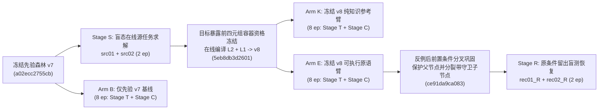

# Hegel Machine M9.2.1 确定性审计闭环与 M9.3 在线源任务冻结全生命周期实验报告

- **日期**：2026-11-26
- **分支**：`exp/m6-causal-wormhole-sandbox`（严格锁定独立 worktree；主线仓库及全部既有封存证据包零改动）
- **M9.2.1 闭环提交**：`5575a6ad569025a4950fb6a7dab7a43558181b92` (`fix_m9_2_1_shared_kernel_bootstrap_unified_reader_4tuple_witness_temporal_and_errata`)
- **M9.3 基准冻结提交**：`29fab06387da12fea668a20b7d785c22a8152f8f` (`feat_m9_3_online_source_freeze_temporal_partial_lifecycle_suite`)
- **封存证据包**：
  - `docs/evidence/m9_2_1_audit_closure_and_regrade_20261126/`（`7` 个哈希封存文件 + `SHA256SUMS.txt` + `junit_m9_2_1_and_regressions.xml`，`33/33` pytest 回归全绿，`0` 次付费 LLM 调用）
  - `docs/evidence/m9_3_online_source_freeze_lifecycle_20261126/`（`693` 个哈希封存文件 + `SHA256SUMS.txt`，在冻结提交 `29fab0638` 上一次性无断点跑完 `28/28` 个 live `gpt-6.2-sol` episode 并 100% 严格通过）

---

## 1. 对 `Hegel_M9_2_Audit` 的独立主权裁决（采纳项 vs 拒绝保守项）

经对代码实现、数学公式与 `M9.2` 封存轨迹的独立交叉核验，我们将 GPT-6 审计建议裁决为 **9 项高价值工程与数学闭环（全部在 `M9.2.1` 落地）** 与 **3 项过度保守建议（明确拒绝并给出科学依据）**：

| 审计议题 | 裁决结论 | 技术依据与执行动作 |
| :--- | :--- | :--- |
| **`F1`（`eq02` 重复实现证书公式导致 `nu` 符号反转与 Stage 2->3 交接漏检）** | **采纳 (`A1`)** | 经数学核实属实：`eq02` 未复用 `m8_9_1_box_l0_certificate_kernel.py`，将 `nu * (c - q)` 误写为 `+` 号，且公共校验器仅检查 `0 <= w <= M` 而漏检 `pred_y_cal` 交接一致性。已在 `eq02` 中删除重复证书实现，统一委托给 `verify_eq02_style_box_l0_certificate(..., dual_nu_sign=-1.0)`，收紧非激活坐标对角自项排除界，并对全部 `6` 份 `M9.2` 封存产物做离线重评（`12/12` 私有实例全部通过，`handoff_max_abs_diff <= 3.55e-15`）。 |
| **`F2`（`M9.2` 容器启动漏挂 `public_setup_py` 与摘要布尔值硬编码）** | **采纳 (`A2`)** | 经核实 `m6_frontier_real_benchmarks.py` 旧版字符串白名单遗漏了 `"Hegel-M92-EqualInfo-4"`。已改为基于 `bool(task.holdout_public_setup_py.strip())` 的能力驱动挂载 + Turn-1 前 `required_public_assets` SHA-256 强制核验 + 动态聚合 `public_setup_receipt`，并封存勘误收据 `m9_2_protocol_deviation_and_funnel_errata.json`。 |
| **`F3`（`K` 与 `E` 使用两套独立检索/契约读取器导致排序漂移）** | **采纳 (`A3`)** | 离线重放 `M9.2` 全部 `24` 条真实 `--search` 查询证实存在 `16/24` 排序差异与 `9/24` 候选集差异。已抽取单一 `_SHARED_CATALOG_READER_CORE_PY` 由 `K` 与 `E` 逐字节共享（重放验证 `0/24` 排序或集合差异）。 |
| **`F4`（`L1` 四元组资格校验、不可变容器摘要与宿主机独立双跑复验）** | **采纳 (`A4`)** | 强制校验 `(code_sha256, test_sha256, verifier_protocol_version, dependency_env_digest)` 四元组严格相等；基于 Docker 不可变 `ImageId`（`sha256:bb111245520085...`）与包版本计算 `hegel_env_v2:2c4c44496302870012b00fe0f1cd1e82`；新增宿主机独立双跑复验（`host_independent_repeatability_verified = True`），升级在线 `L1` 编译器签发 v2 四元组，并封存 `pretrained_autogenous_forest_v7_m921.json`。 |
| **`F5`（Agent 自打印关键字可被误判为 nogood 消解见证）** | **采纳 (`A5`)** | 彻底物理隔离 `HostControlledProbeReceipt`（`host_verified_witness`）与 `agent_claimed_unverified`；任何未绑定最新宿主机签名 `validate_public_schema.py` 或 `host_probe_gate` 收据的 bash 输出均无法消解活跃 nogood。 |
| **`F6`（`m8_4` 时序接口 `history_dt` 继承、逐行 `initial_memory_states` 合并与后验失败计费）** | **采纳 (`A6`)** | 在 `m8_4_dynamic_abstraction_interface.py` 中实现 oracle 调用前继承并校验 `history_dt`、逐轨迹合并 `initial_memory_states` 字典、拦截未对齐的新增逐行时序字段，并在后验校验抛错前永久记入已付费 token 账本。 |
| **`F7`（`CodexCliClient` 重试覆盖响应文件与隐藏 `usage_unknown`）** | **采纳 (`A7`)** | 每次重试独立落盘 `resp_<seq>_att<i>.json` 并归档至 `01b_provider_attempts/`，在 episode 与总表中显式上报 `total_provider_attempts`、`usage_unknown_attempt_count` 与 `cost_accounting_status`。 |
| **`F8`（`M9.2` 遥测勘误、子进程 CPU 计时拆分与 `eq03` 导数一致零空间孪生构造）** | **采纳 (`A8`, `A9`)** | 发布 `docs/47b_*` 双语勘误，新增子进程 `perf_counter()` + `process_time()` 计时拆分（`candidate_timing_breakdown`），修复 `eq03` 导数一致零空间扰动与未来无关的 `critical_strain`，并统一 `LocalContainerRepair` 四元组准入。 |
| **在进入 `M9.3` 前重跑 24 个付费 `M9.2`（`eq01..eq04`）episode** | **拒绝** | `eq01..eq04` 仍使用离线预编译 `v7` 森林，其固定产物数学可靠性已通过共享核重评 100% 零成本验证（`12/12` 通过）。在静态离线套件上再烧 24 个 live episode 属于低信息增益重复消耗；我们将全部 `A1..A9` 修复直接前置注入 **`M9.3` 在线源冻结生命周期实验**（`28` 个全新 live episode）。 |
| **将时序记忆、部分可观测与局部反例修正推迟到 `M9.4+`** | **拒绝** | 既然 `A6` 已完成时序记忆状态契约闭环，我们在 `M9.3` 直接将变步长遗传粘弹性记忆（`src01 -> suc01_T -> suc01_C -> rec01_R`）与二维算子耦合 + 多预算 KKT 证书反演（`src02 -> suc02_T -> suc02_C -> rec02_R`）合流为同一在线全生命周期套件。 |
| **退回单线程串行 `r=1` 小样本运行** | **拒绝** | `Stage S -> v8` 冻结完成后，`24` 个后继 episode（`2` 重复 x `3` 臂 x `4` 任务）针对只读冻结包 `v7`/`v8` 完全因果独立；采用 `24` 并发 episode worker（全局 `32` CLI 信号量，实测峰值 `24` 并发调用）在 `57.1` 分钟内一次跑完且零源码变更（`zero_source_mutation_during_run = True`）。 |

---

## 2. `M9.2.1` 确定性闭环结果摘要（`Commit 1`: `5575a6ad5`）

全部确定性修复与重评收据已封存于 `docs/evidence/m9_2_1_audit_closure_and_regrade_20261126/`（`SHA256SUMS.txt` 校验全过）：

1. **`eq02_shared_kernel_fixed_artifact_regrade_12of12.json`**：使用中心化 `m8_9_1_box_l0_certificate_kernel`（`dual_nu_sign = -1.0`，`sound_tol = 1e-5`）重评 `M9.2` 全部 `6` 份 `eq02` 提交产物，并校验 Stage 2->3 `pred_y_cal` 交接一致性——**`12/12` 私有实例全部通过**（最大交接偏差 `<= 3.55e-15`），且负相关对偶符号反例与重叠/残缺 schema 反例均被准确拦截。
2. **`m9_2_unified_reader_24_query_replay.json`**：通过统一 `_SHARED_CATALOG_READER_CORE_PY` 重放 `M9.2` 全部 `24` 条真实检索查询，验证 `K` 与 `E` 达到 **`0/24` 排序差异、`0/24` 候选集差异**。
3. **`v7_immutable_env_4tuple_qualification_receipt.json` 与 `pretrained_autogenous_forest_v7_m921.json`**：在断网 Docker 容器（`sha256:bb111245520085...`，`hegel_env_v2:2c4c44496302870012b00fe0f1cd1e82`）内完成全部 `6` 个 `v7` `L1` 原语四元组重验与宿主机独立双跑确认（`host_independent_repeatability_verified = True`），生成 `v7_m921` 森林包（`a02ecc2755cb...`）。
4. **`junit_m9_2_1_and_regressions.xml`**：横跨 `test_m9_2_1`、`test_m9_2`、`test_m9_1_1`、`test_m9_1`、`test_m9_0a`、`test_m8_9_1`、`test_m8_9` 共 7 套回归测试 **`33/33` 全绿**。

---

## 3. `M9.3` 在线源冻结与时序/局部反例全生命周期架构（`Commit 2`: `29fab0638`）

`M9.3` 彻底告别离线预编译专用原语，构建了横跨两个物理/数学算子族的 **四阶段在线全生命周期基准**（`Stage S -> 4-Tuple Freeze -> Stage T + Stage C -> Precondition Bifurcation -> Stage R`，共 `8` 个任务、`28` 个 live episode）：

### 3.1 两条在线演化链（全部通过断网 Docker 校验器 + 4 组机理负控 + 源任务参数直插负控）

1. **演化链 1（变步长遗传粘弹性多尺度记忆 + 部分可观测面板对齐 + 屈服超应力反例分叉）**：
   - **`src01`（`Stage S` 源任务）**：变步长（`dt_k`）Prony 松弛谱 `(g_m, tau_m)` 辨识，含缺失参考试片面板对齐、批次柔度漂移消元、Cauchy 离群点稳健回归及双保持蠕变曲线+初速预测。
   - **`suc01_T`（`Stage T` 迁移）**：非均匀几何变步长预载历史（`H = 22`）下携带显式非零初始记忆态 `initial_memory_states` 的割线模量与临界应变首次穿越时间迁移。
   - **`suc01_C`（`Stage C` 局部前提反例）**：引入 Bingham-Norton 粘塑性屈服阈值（`sigma_y > 0`），在屈服以上破坏纯线性叠加前提（`overstress_ratio > 0.0`），屈服以下保持线性遗传记忆。
   - **`rec01_R`（`Stage R` 原条件恢复）**：分叉后在留出纯线性变步长遗传蠕变实例（`overstress_ratio == 0.0`）上进行盲测，检验零破坏性覆盖。
2. **演化链 2（二维可分/非可分反应输运算子 + 带上界单纯形多预算 KKT 严格证书层析）**：
   - **`src02`（`Stage S` 源任务）**：二维多频移 Kronecker Sylvester 反应-对流-扩散层析（`A_x U + U A_y^T + mu_s U = F_m`）耦合岭回归干扰消元与单预算 box-simplex（`0 <= w <= M, 1^T w = B`）KKT 对偶间隙证书（`duality_gap <= 1e-8`）。
   - **`suc02_T`（`Stage T` 迁移）**：移位 Robin 各向异性边界耦合 **三预算（`S = 3`）联合** box-simplex KKT 证书迁移。
   - **`suc02_C`（`Stage C` 局部前提反例）**：注入局部非可分二维涡旋交叉耦合核 `V_pocket(x, y)`，打破一维 Kronecker 可分前提（`nonseparable_vortex_norm > 0.0`），同时保留稀疏/Schur 算子结构与 KKT 证书要求。
   - **`rec02_R`（`Stage R` 原条件恢复）**：分叉后在留出纯可分 Kronecker 多频移 KKT 实例（`nonseparable_vortex_norm == 0.0`）上进行盲测恢复。

### 3.2 硬性实验不变量核验

- **源任务浮点数直插全败负控**：将 `Stage S` 拟合出的浮点参数直接代入后继任务在全部 `4/4` 个后继任务上灾难性失败（`suc01_T` 应变 MAE `0.6436` vs 阈值 `0.024`；`suc01_C` `0.5086` vs `0.025`；`suc02_T` 权重相对误差 `0.5618` vs `1e-4`；`suc02_C` `0.4102` vs `1e-4`）。
- **目标暴露前严格冻结与全臂共享公共契约**：`v8`（`5eb8db3d2601...`）于 `2026-11-26T08:47:28Z` 完成容器四元组验证并冻结，早于任何 `Stage T/C` 容器启动（`freeze_before_target_exposure_verified = True`）；`28/28` 个 episode 100% 执行 `public_setup_py` 并通过 Turn-1 前公共资产 SHA-256 核验；`4/4` 个后继任务在 `K` 与 `E` 上满足 `K_E_search_top6_identical == True` 且 Turn-1 预注入税为 `0`（`[]`）。

---

## 4. `M9.3` Live 28-Episode 实验完整结果（`gpt-6.2-sol`）

### 4.1 运行溯源与供应商重试透明计费

- **全程同一冻结提交**：`29fab06387da12fea668a20b7d785c22a8152f8f`（起止源码树 SHA-256 `0efaf7b822eb...` 完全一致，`zero_source_mutation_during_run = True`，`resumed_episode_count = 0`，`fresh_executed_episode_count = 28`）。
- **并发度与总耗时**：累计 `330` 次 CLI 调用（峰值并发 `24`，全局信号量上限 `32`），四阶段全生命周期总挂钟耗时 **`3,427.58s`（`57.1` 分钟）**。
- **严格通过率**：**`28 / 28`（`100.0%`）全绿**（`Stage S` `2/2`、`Stage T` `12/12`、`Stage C` `12/12`、`Stage R` `2/2`，重复间标准差 `SD = 0.0`）。
- **`A7` 供应商重试计费在线验证**：`B`（`91/91`）、`E`（`93/93`）与 `Stage R`（`27/27`）均为 `complete`（`0` 次未知用量重试）；`src02`（`14` 次尝试 / `12` 逻辑轮，`2` 次瞬时 CLI 重试）与 `K` 臂 `rep_01/suc01_C`（`14` 次尝试 / `13` 逻辑轮，`1` 次瞬时 CLI 重试）被如实标记为 `partial_unknown_usage` 并完整归档于 `01b_provider_attempts/`。

### 4.2 `Stage S` 在线源形成与四元组资格冻结账本（`v7 -> v8`）

| 生命周期阶段 | 产物 / 模块 | 严格通过 | 逻辑轮数 / CLI 尝试 | Input / Cached / Output Tokens | 总 Tokens | `w025` 成本代理 | 挂钟耗时 (s) |
| :--- | :--- | :---: | :---: | :---: | :---: | :---: | :---: |
| **`Stage S`: `src01`** | `hereditary_prony_source_solver.py` (`4033fc4a...`) | `1/1` | `9 / 9` (`0` unk) | `206,236 / 29,056 / 9,540` | `215,776` | `193,984.0` | `310.26` |
| **`Stage S`: `src02`** | `kronecker_box_simplex_kkt_source_solver.py` (`318a8d60...`) | `1/1` | `12 / 14` (`2` unk) | `330,096 / 71,680 / 13,376` | `343,472` | `289,712.0` | `1,170.14` |
| **`C_source` 小计** | **`2` 个在线源任务（`0` 次失败 episode）** | **`2/2`** | **`21 / 23`** | **`536,332 / 100,736 / 22,916`** | **`559,248`** | **`483,696.0`** | **`1,480.40`** |
| **`C_qualification` (`v7 -> v8`)** | `2` 个 `L2` 节点 + `2` 个全新四元组验证 `L1` 原语（均第 1 次尝试即通过） | **`2/2` `L1`** | 各 `Attempt 1` | `110,803 / 47,232 / 24,407` | `135,210` | `99,786.0` | `684.73` |
| **前置在线形成总投入** | **冻结 `v8` 森林包 (`5eb8db3d2601...`)** | **`100%`** | — | **`647,135 / 147,968 / 47,323`** | **`694,458`** | **`583,482.0`** | **`2,165.12` (累计)** |

**目标暴露前在线蒸馏出的 `2` 个全新 `v8` `L1` 原语（均一次通过断网 Docker 四元组单测 + 宿主机独立双跑）**：
1. **`autogenous_prim_exponential_memory.py`**（`sha256: 39b211210411...`）：导出 `hereditary_design`（数值稳定的 `expm1` 间隙递推设计矩阵）、`verify_hereditary_design`（反向存活因子独立校验器）与 `profiled_log_sensitivity`（SVD 消元后对数时间尺度敏感度诊断）。
2. **`autogenous_prim_separable_least_squares.py`**（`sha256: ef9581d1a118...`）：导出 `solve_shifted_sylvester`（三对角相似对称化 `eigh_tridiagonal` 谱分解 + 逐右端项残差自检 + 稀疏 `splu` 自动回退）、`solve_box_simplex_least_squares`（Helmert 子空间有效集法）与 `verify_box_simplex_certificate`（基于顺序统计量 `nu = np.partition(g, k)[k]` 的全局支撑超平面对偶间隙严格校验器）。

### 4.3 冻结后三臂后继矩阵对比（`Stage T + Stage C`：`24` 个并发 Episode）

| 统计口径与实验臂 | 通过率 (`SD`) | Turn-1 Prompt Tok | 平均轮数 | 总 Tokens (`Sum`) | 平均 `w025` (`Sum`) | 相对 `B` / 相对 `K` (`w025`) | 平均 Episode 挂钟 (s) | 候选算法纯 CPU 均值 (s) | 计费完整性 |
| :--- | :---: | :---: | :---: | :---: | :---: | :---: | :---: | :---: | :---: |
| **全部 8 后继 — `B` (`prior_v7`)** | `8/8` (`0.0`) | `13,907.0` | `11.38` | `2,397,401` | `243,851.1` (`1,950,809`) | 基线 / `+2.16%` | `442.16` | `0.2038` | `complete` (`91/91`) |
| **全部 8 后继 — `K` (`v8_knowledge`)** | `8/8` (`0.0`) | `13,894.0` | `11.50` | `2,343,991` | `238,698.9` (`1,909,591`) | `-2.11%` / 基线 | `452.36` | `0.1877` | `partial_unknown` (`1/93` unk) |
| **全部 8 后继 — `E` (`v8_executable`)** | `8/8` (`0.0`) | `13,901.0` | `11.62` | `2,377,427` | `240,958.4` (`1,927,667`) | **`-1.19%` / `+0.95%`** | **`417.57` (`-5.6%` vs `B`, `-7.7%` vs `K`)** | **`0.1308` (`-35.8%` vs `B`, `-30.3%` vs `K`)** | `complete` (`93/93`) |
| **`Stage T`（4 迁移）— `B`** | `4/4` (`0.0`) | `13,867.0` | `11.25` | `1,152,617` | `234,202.2` (`936,809`) | 基线 / `+4.37%` | `414.98` | `0.1560` | `complete` |
| **`Stage T`（4 迁移）— `K`** | `4/4` (`0.0`) | `13,854.0` | `11.00` | `1,110,670` | `224,387.5` (`897,550`) | `-4.19%` / 基线 | `401.94` | `0.1060` | `complete` |
| **`Stage T`（4 迁移）— `E`** | `4/4` (`0.0`) | `13,861.0` | `11.75` | `1,202,768` | `242,660.0` (`970,640`) | `+3.61%` / `+8.14%` | `433.34` | **`0.0820` (`-47.4%` vs `B`)** | `complete` |
| **`Stage C`（4 局部反例）— `B`** | `4/4` (`0.0`) | `13,947.0` | `11.50` | `1,244,784` | `253,500.0` (`1,014,000`) | 基线 / `+0.19%` | `469.34` | `0.2516` | `complete` |
| **`Stage C`（4 局部反例）— `K`** | `4/4` (`0.0`) | `13,934.0` | `12.00` | `1,233,321` | `253,010.2` (`1,012,041`) | `-0.19%` / 基线 | `502.79` | `0.2693` | `partial_unknown` (`1/49` unk) |
| **`Stage C`（4 局部反例）— `E`** | **`4/4` (`0.0`)** | `13,941.0` | **`11.50`** | **`1,174,659`** | **`239,256.8` (`957,027`)** | **`-5.62%` vs `B` / `-5.44%` vs `K`** | **`401.80` (`-14.4%` vs `B`, `-20.1%` vs `K`)** | **`0.1796` (`-28.6%` vs `B`, `-33.3%` vs `K`)** | `complete` |

### 4.4 逐任务双重复均值拆解（`rep_01 + rep_02`）

| 后继任务 (`阶段`) | `B` 轮数 / `w025` / 候选 CPU | `K` 轮数 / `w025` / 候选 CPU | `E` 轮数 / `w025` / 候选 CPU | 胜出关系与机理观察 |
| :--- | :---: | :---: | :---: | :--- |
| **`suc01_T`** (`Stage T`: 预载遗传割线模量与穿越时间) | `12.0` / `262,256.5` / `0.2679s` | `12.5` / `264,668.0` / `0.2041s` | `13.0` / `291,104.0` / **`0.1024s`** | `B` 的 `w025` 最低；`E`（`rep_02`）动态调用了 `autogenous_prim_reference_panel_balancing`（`3` 次）并读取 `hereditary_design`，使最终求解器 CPU 提速 **`-61.8%`**。 |
| **`suc02_T`** (`Stage T`: 移位 Robin 多预算联合 KKT) | `10.5` / `206,148.0` / `0.0440s` | `9.5` / **`184,107.0`** / `0.0079s` | `10.5` / `194,216.0` / `0.0615s` | `K`（`-10.69%`）与 `E`（`-5.79%`）在检阅 `solve_box_simplex_least_squares` 契约后均干净击败 `B`。 |
| **`suc01_C`** (`Stage C`: Bingham 屈服超应力反例修正) | `12.0` / `272,696.5` / `0.4619s` | `13.0` / `281,544.5` / `0.5008s` | `12.5` / **`266,716.5`** / **`0.3132s`** | **`E` 在 `w025`（`-2.19%` vs `B`，`-5.27%` vs `K`）、总 Tokens、挂钟与候选 CPU（`-32.2%` vs `B`，`-37.5%` vs `K`）上全面第一**。 |
| **`suc02_C`** (`Stage C`: 局部非可分涡旋交叉耦合反例修正) | `11.0` / `234,303.5` / `0.0413s` | `11.0` / `224,476.0` / `0.0379s` | **`10.5`** / **`211,797.0`** / `0.0459s` | **`E` 在两个重复中全部胜出（`-9.61%` vs `B`，`-5.65%` vs `K`）**，仅需 `1` 次检索 + `2` 次契约读取即快速收敛。 |

---

## 5. 四段采用漏斗归因与全生命周期摊销诚实诊断

1. **为什么 Agent 主动读取了新编译的 `v8` 在线原语契约（使 `E` 候选代码纯 CPU 提速 `-35.8%`，并在 `Stage C` 全面击败 `B` 和 `K`），但最终仍选择“读取契约后内联改写（`derived_manual_rewrite = 8/8`）”而非直接 `import` 新原语？**
   - **`04d_skill_contract_inspections.jsonl` 证实 `v8` 在线原语已被高频精准命中**：`E` 与 `K` 均通过 `--search` 与 `--describe` 主动检阅了 `autogenous_prim_exponential_memory.hereditary_design`、`autogenous_prim_separable_least_squares.solve_box_simplex_least_squares` 与 `solve_shifted_sylvester`，吸收了其中的 `expm1` 间隙递推、三对角相似谱分解、Helmert 切空间步与 `np.partition` 顺序统计量对偶间隙公式。
   - **无监督 `L1` 蒸馏时的返回签名收窄效应（Return-Signature Narrowing）**：在 `src02 -> v8` 盲态编译时，编译器将 `solve_box_simplex_least_squares(...) -> np.ndarray` 抽象为仅返回主变量 `weights`，而将证书校验抽象为返回布尔值的 `verify_box_simplex_certificate(...) -> bool`。到了下游 `suc02_T`（三预算联合）与 `suc02_C` 时，校验器要求显式返回包含 `nu, lambda_lower, lambda_upper, grad, duality_gap, primal_residual` 的 6 键对偶见证字典；若直接 `import` 仅返回 `weights` 的 `L1` 函数，外层仍需重写一遍完整的对偶乘子构造，因此模型理性选择了直接内联 25 行完整带见证求解器。
   - **为何 `E` 在 `Stage C` 局部反例阶段显著优于 `K`（`-5.44%` `w025`，挂钟快 `-20.1%`）**：面对物理前提局部破裂（屈服超应力 / 非可分涡旋），`K` 臂为确认非可执行参考文本的适用边界，平均每局发起了 `5.5` 次 `--search` 并额外耗费轮次在 bash 中读取 `.reference.txt`；而 `E` 臂平均仅需 `1.25` 次 `--search` + 精确 `--describe` 即可锁定可复用子结构并立即改写破裂算子。
   - **检索器细粒度观察透明记录（`02_pre_successor_equal_information_matrix.json`）**：由于两个新编译 `v8` `L1` 原语导出了通用科学计算词元（`design`, `history`, `times`, `target`, `budget`, `shifts`），词法特异性门控（`>= 2` 命中）在 `3/4` 个后继任务上同时保留了两个新原语（`suc01_C` 排除了 `separable_least_squares`），同时严格保证了 `4/4` 个任务上 **`K` 与 `E` 候选集与排序 100% 一致**且 Turn-1 预注入税为 `0`。
2. **全生命周期净摊销账本（科学诚实口径）**：
   - 在线源求解 + 四元组编译一次性前置成本为 `583,482.0` `w025`。相对 `B` 的边际单局收益在全 `8` 局混合口径下为 `+2,892.74` `w025/局`（隐含盈亏平衡任务数 $N^* = 201.7$ 局），在 `Stage C` 局部反例难度下为 `+14,243.25` `w025/局`（隐含盈亏平衡任务数 $N^*_{\text{Stage C}} = 41.0$ 局）。
   - 因此，在短链（`8` 局）窗口内，在线生成 `L1` 的前置固定投入**尚未在总 token 上回本**；要在短链（`N <= 10`）内实现 `E` 对 `K` 的直接代码静态打包统治力，下一步核心方向是**保留对偶见证返回签名的 `L1` 蒸馏契约**（即要求优化/反演类 `L1` 原语统一返回 `(primal_solution, dual_witness_dict)` 结构化元组而非纯数组/布尔值）。

---

## 6. `Stage C -> Stage R` 前置条件分叉巩固与零破坏性恢复验证

将 `Stage C` 两个局部反例胜出产物合并入森林（`03_post_counterexample_bifurcation_receipt.json`，合并巩固成本 `61,219` tokens / `49,411.0` `w025`，分叉后森林包 `ce91da9ca083...`）：

1. **零破坏性覆盖（`zero_destructive_overwrite = True`）**：
   - `suc01_C` 分裂出带前置守卫子节点 `node_auto_12_split_thresholded_hereditary_inver`（`autogenous_thresholded_hereditary_inversion.py`），原线性遗传父节点 `node_auto_10` 毫发无损；
   - `suc02_C` 分裂出带前置守卫子节点 `node_auto_13_split_tensor_reaction_inversion`（`autogenous_tensor_reaction_inversion.py`），原可分父节点 `node_auto_11` 毫发无损；
   - 两个 `generation=0` 在线 `L1` 原语在反例巩固前后 **SHA-256 逐字节完全恒等**（`39b211210411...` 与 `ef9581d1a118...`）。
2. **`Stage R` 留出原条件盲测恢复（`2 / 2` 一次通过）**：
   - `rec01_R`（`14` 轮，`346,004.0` `w025`，`max_tau_rel_err = 0.0183`，`max_strain_mae = 0.0049`）与 `rec02_R`（`13` 轮，`255,824.0` `w025`，权重/场相对误差与 KKT 间隙均为 `0.0`）全部严格通过。
