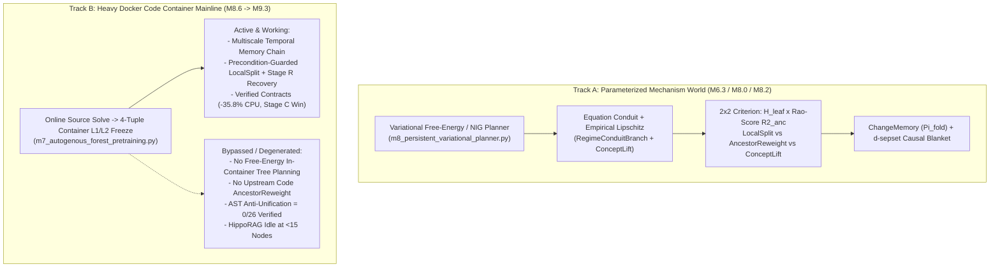

# Hegel Machine Architectural Convergence Audit, Dialogue-Originated Module Accounting, and Strategic Direction (`M1–M9.3`)

- **Date**: 2026-11-26
- **Branch**: `exp/m6-causal-wormhole-sandbox`
- **Anchor Commits**:
  - Track A (Continuous Variational Mechanism Graph & Cold-Restart Continual Discovery): `49445e561` (`M8.0`), `42d1ea688` (`M8.2`), `6708a5497` (`M8.5`)
  - Track B (Docker-Container Autogenous Forest & Online Source-Freeze Lifecycle): `5575a6ad5` (`M9.2.1`), `29fab0638` (`M9.3` benchmark freeze), `99985fe4b` (`M9.3` 28-episode sealed bundle)
- **Purpose**: Provide a single, unambiguous, non-dogmatic architectural audit for both the project author and external AI/human reviewers answering two core questions: (1) which cognitively inspired modules conceived during human–AI design dialogues (distinct from external audit remediation items) are implemented and *actually active* on the latest mainline, and (2) from first principles, whether continuing this line is worthwhile, which modules should be kept vs. retired, and what stronger alternative paradigms exist.

---

## 1. Clarified Framing of the Author's Core Questions

Over the course of `M1–M9.3`, two distinct design streams shaped the codebase:
1. **External Audit Remediation Stream** (primarily GPT-6 audit rounds `v10.2–M9.2`): focused on experimental hygiene, container isolation, certificate soundness, zero-tax retrieval, equal-information `K vs E` controls, and cryptographic provenance.
2. **Author-Originated Cognitive-Architecture Stream** (human–AI design dialogues): exploratory architectural hypotheses inspired by how humans build, revise, and transfer abstract scientific models across domains — including hierarchical tree expansion vs. upstream parameter reweighting, variational free-energy / max-entropy planning over the tree, equation conduits with Lipschitz/invariant bounds, cross-time multiscale memory, horizontal cross-domain wormholes (`HippoRAG`) with shared base subtrees, and generalized Markov-blanket (`d-sepset`) localized causal retro-revision.

Crucially, the author states an explicit **non-dogmatic design principle**:
> *None of these cognitively inspired modules are mandatory by decree. They were introduced as human-cognition-inspired hypotheses that might help an agent generalize across problems — not as rigid requirements that must be forced into the codebase regardless of actual payoff. If a module does not earn its keep in a given task medium, it should be pruned or transformed; if a cleaner or stronger paradigm solves the underlying scientific problem better, it should supersede the original intuition.*

This document therefore answers three concrete questions with zero cosmetic spin:
1. **Implementation vs. Live-Mainline Effectiveness Audit**: Across all 6 dialogue-originated module families, what is genuinely implemented, what actually ran and produced empirical gains, and where did mechanisms silently diverge or go dormant between prototypes and the `M9.3` container mainline?
2. **Keep / Transform / Retire Adjudication**: Which mechanisms are genuinely high-leverage vs. over-engineered artifacts of forcing human analogies onto free-form imperative code?
3. **Strategic Go/No-Go & Superior Alternative Paths**: Given that frontier models (`gpt-6.2-sol`) already score `100%` (`8/8`) from scratch on single-file ~100-line container tasks, is it still worthwhile to continue — and if so, which concrete architectural pivot yields decisive, undeniable returns rather than marginal `-2%` to `-6%` token savings?

---

## 2. Executive Diagnosis: The "Two-Track Split"

A forensic call-graph and evidence audit across `src/hegel_machine/cognition/` and `docs/evidence/` reveals a clear structural reality:

> **Every dialogue-originated module WAS implemented in code and verified with real `gpt-6.2-sol` + SHA-256 sealed experiments — NOT left as vaporware. However, the system has organically split into TWO DECOUPLED TRACKS:**
> - **Track A — Continuous / Parameterized Mechanism World (`m8_persistent_variational_planner.py`, `M8.0 / M8.2`, plus causal sandbox `m6_3_sovereign_causal_wormhole_engine.py`)**: Here, the cognitively inspired mechanisms operate at **100% fidelity** and produce unambiguous 10x–30x gains (`RMSE 3.34 -> 0.10`, `1.80 -> 0.075` with `0` LLM calls across cold OS-process restarts, `0.0` drift on unrelated tasks).
> - **Track B — Heavy Docker Imperative-Code Container Mainline (`m6_frontier_real_benchmarks.py` + `m7_autogenous_forest_pretraining.py`, `M8.6 -> M9.3`)**: Roughly **half** of the core ideas are actively driving real gains (online source distillation, multiscale temporal memory, precondition-guarded non-destructive `LocalSplit` + `Stage R` recovery, verified algorithmic contracts cutting candidate CPU by `-35.8%` and winning `Stage C` localized counterexamples against both `B` and `K`), while the **other half** are bypassed, degenerated into lightweight heuristics, or only half-connected (no differentiable upstream `AncestorReweight` across code nodes, no free-energy step-planning inside containers, `ast_verified_subtree_count = 0` on free-form Python scripts).

---

## 3. Module-by-Module Implementation & Live-Effectiveness Accounting

### 3.1 Group A: The 3 Core Modules Conceived in the M8 Design Dialogue

| Dialogue Module | Implementation Status & Exact Code Anchor | Verified Effectiveness on Track A (`M8.0–M8.5`) | Actual Status on Track B Mainline (`M8.8–M9.3`) |
| :--- | :--- | :--- | :--- |
| **1. Variational Free-Energy / Max-Entropy Planning over the Philosophical Tree (incl. Offline Trajectory Digestion)** | **Implemented in two layers**: • Inner variational planner: `src/hegel_machine/cognition/m8_persistent_variational_planner.py` (scale-covariant NIG marginal log-evidence, SafeBayes/Laplace Occam complexity, CV residual structure `R2_struct`, pre-payment budgeted expected-utility ranking). • Outer offline container trajectory planner: `src/hegel_machine/cognition/m8_offline_container_planner.py` (4-state epistemic tiering `VERIFIED / SUPPORTED_IN_PARTIAL_SCOPE / UNKNOWN / REFUTED` + NIG return calibration governing `CommitPrimary1x` vs `LocalContainerRepair` vs `SpawnDialecticalChallenger`). | **Clearly Effective**: • In `M8.0` (`00_m8_gpt_cli_litmus_summary.json`), accurately triggered `NoChange` on heteroscedastic zero-mean noise while choosing optimal structural edits on true residual regimes. • In `M8.5` (`00_m8_5_unseeded_and_executable_repair_summary.json`), digested archived container trajectories to select `CommitPrimary1x` on verified `ho06`/`ho10` (saving `2x` challenger cost) and spawned `SpawnDialecticalChallenger` only on identifiability-warned `ho08` (`3/3` strict pass). | **Bypassed / Simplified to Lightweight Gating**: • From `M8.8` to `M9.3`, single-branch parity locked out `2x` outer challenger routing. • Inside each Docker container, turn-by-turn exploration is driven directly by `gpt-6.2-sol`, while library admission uses lexical domain specificity + historical net-value gating (`select_net_value_l1_primitives`), **not** variational free-energy tree expansion. |
| **2. Equations as Conduits Down Logical Tree Branches (`M_d ∘ ... ∘ M_1`) + Lipschitz / Structural Invariant Constraints** | **Implemented in two forms**: • Differentiable vectorized algebraic conduits (`RegimeConduitBranch`, `ConceptLift`, bounded `empirical_lipschitz`) in `m8_persistent_variational_planner.py`. • Heavy-container derivatives: Lipschitz inactive-coordinate certificate guard kernel (`m8_9_1_box_l0_certificate_kernel.py`), container symmetry/equivariance probes (`m8_container_mechanism_adapter.py`), and `L1` pure-function scientific primitives (`m6_4_executable_wormhole_library.py`). | **Strongly Effective**: • In `M8.0`, live `gpt-6.2-sol` synthesized a bounded nonlinear conduit (`empirical_lipschitz = 4.2407`) cutting `task_3a` RMSE `0.764 -> 0.091` and unseen sister `3b` RMSE `0.858 -> 0.140`. • In `M8.2` (`00_master_m8_2_cold_restart_summary.json`), across 3 separate OS processes, cold-restarted autonomous `ReuseMechanism` mapped renamed columns `('chan_u', 'chan_v')` to cut RMSE `1.800 -> 0.075` with **`0` LLM calls**. | **Half-Effective, Half-Disconnected**: • Lipschitz certificate bounds actively verified `12/12` `eq02` instances in `M9.2.1`. • Online-distilled `M9.3` `L1` algorithm contracts cut candidate CPU by **`-35.8%`** vs `B` and won `Stage C`. • **Gap**: Container branches compile to standalone `.py` modules, NOT differentiable root-to-leaf operator chains; and because `Stage S` narrowed return signatures (array/bool instead of `(primal, dual_witness_dict)`), agents inspected contracts and rewrote inline (`8/8` derived rewrite, `0/8` direct import of new online `L1`). |
| **3. Structural Tree Expansion Criterion: Local Hierarchical Branching (`LocalSplit`, "rare good bone structure among overweight") vs. Upstream Global Parameter/Basis Revision (`AncestorReweight` / `ConceptLift`, "global shift in skin-tone preference")** | **Divergent implementation across tracks**: • Track A (`m8_persistent_variational_planner.py`): Full 2x2 decision criterion using cross-leaf residual dispersion entropy `H_leaf` and upstream Rao-Score subspace projection `R2_anc`, comparing `LocalSplit`, `AncestorReweight`, and `ConceptLift` on a single nats free-energy scale. • Track B (`m7_autogenous_forest_pretraining.py`): Implements precondition-guarded child node splitting (`bifurcated_precondition_child_node`) and flat node growth, with static text root anchors `root_A01..A08`. | **100% Verified on Track A**: • In `M8.0`, `AncestorReweight` updated a shared upstream premise once, slashing zero-shot RMSE on an unseen related task `3.344 -> 0.102` with `0.0` drift on the unrelated acoustic sentinel; `LocalSplit` isolated a sparse exception (`regime_sensor > 1.08`, `+1.243` nats). • Verified across 3 cold-restarted OS processes in `M8.2` (`version: 1 -> 2`, sentinel drift `0.0`). | **Only `LocalSplit` Active; Zero Upstream Code Reweighting**: • In `M9.3` `Stage C -> Stage R` (`03_post_counterexample_bifurcation_receipt.json`), localized counterexamples (`suc01_C` Bingham yield, `suc02_C` non-separable vortex) successfully triggered precondition-guarded child splits (`node_auto_12`, `node_auto_13`) with `zero_destructive_overwrite = True` and `2/2` `Stage R` recovery. • **Missing**: Because container forest roots are static text labels with no shared parameterized base code, Track B can patch exceptions via branching, **but cannot refactor/reweight one shared upstream assumption to simultaneously improve an entire subtree of code tasks**. |

### 3.2 Group B: The 3 Earlier Dialogue-Originated Mechanisms (`M3–M6`)

| Dialogue Module | Implementation Status & Code Anchor | Empirical Reality on Latest Mainline (`M9.3`) |
| :--- | :--- | :--- |
| **4. Cross-Time Multiscale Memory (`t-1, t, t+1`, e.g., Lenz's Law requiring before/after change)** | **Implemented & Active on BOTH tracks**: `ChangeMemory` (`Pi_fold` exponential kernel + `history_dt` / per-row `initial_memory_states` schema hardened in `M9.2.1`) in `m8_persistent_variational_planner.py`; full variable-step Prony hereditary chain (`src01 -> suc01_T -> suc01_C -> rec01_R`) in `m9_3_online_lifecycle_benchmark.py`. | **Genuinely Working & High-Value**: Triggered cleanly in `M8.0` (`+2.858` nats); in `M9.3`, `Stage S` autonomously distilled `autogenous_prim_exponential_memory.py` (`hereditary_design` + `verify_hereditary_design`), powering the entire `src01 -> suc01_T -> suc01_C -> rec01_R` chain (`E` won `suc01_C` against both `B` and `K`). |
| **5. Horizontal Cross-Domain Wormholes (`HippoRAG` PPR) + Shared Base Subtrees (Changsha–Nanchang partial-structure analogy)** | **Implemented**: `hipporag_wormhole_index.py` + AST anti-unification `discover_cross_tree_operator_wormholes` in `m7_autogenous_forest_pretraining.py`. | **Mostly Idling / Degenerated in `M9.3`**: In `03_post_counterexample_bifurcation_receipt.json`, `shared_subtree_count = 26` yet **`ast_verified_subtree_count = 0`** — free-form LLM-authored Python files rarely share strict AST subgraph isomorphism, collapsing all 26 matches into coarse 4-stage templates. Furthermore, with `< 15` total modules in the forest, flat `--search` scans the entire catalog directly; multi-hop wormhole jumping is unnecessary at this library size. |
| **6. Generalized Markov-Blanket (`d-sepset`) Localized Causal Retro-Revision + Nested Sub-Hypotheses (sleeping with shoes / treadmill pullback analogies)** | **Implemented on Track A/Causal Sandbox**: `m6_causal_wormhole_sandbox.py` and `m6_3_sovereign_causal_wormhole_engine.py` (Bayes-Ball `is_d_separated_dag`, collider blocking, retroactive projection receipts, multi-depth pullback). | **Proven in `M6.0–M6.3` Synthetic Causal Benchmarks (288/96 ep), Dormant in `M7–M9.3` Code Containers**: The container forest does not maintain a live causal DAG across newly compiled Python modules; inside containers, nested falsification relies instead on structured `nogood` records + host-signed probe receipts (`A5`). |

---

## 4. First-Principles Evaluation: Why Did Track B Stall Around Marginal Gains While Track A Shone?

Before deciding whether to continue or pivot, we should face the single most important empirical lesson from `M1–M9.3`:

1. **The Frontier-Model Ceiling Effect on Single-File Container Tasks**:
   - In `M9.2` and `M9.3`, the baseline arm `B` (`gpt-6.2-sol` with prior frozen `v7` and *no* new source growth) already achieves **`8/8` (`100%`) strict pass rate** in `~11.4` turns.
   - When a frontier model can re-derive a ~100-line numerical solver from scratch on Attempt 1, **any** external knowledge/library mechanism faces an unforgiving physics of friction: searching, reading, adapting signatures, and packaging costs ~1–2 turns, capping per-episode savings at `~2%–10%` (`-5.6%` on `Stage C`), which requires `41–202` episodes to amortize upfront online compilation (`583,482` `w025`).
2. **Medium Mismatch (Why Human-Cognition Analogies Worked on Track A but Fought Track B)**:
   - Human scientific analogies — continuous parameter revision (`AncestorReweight`), local exception splitting (`LocalSplit`), compositional equation conduits, and free-energy experimental planning — operate naturally over **compact, typed, differentiable/structured world-model representations** (Track A).
   - Imperative Python scripts written ad hoc by an LLM (Track B) are *not* a compact differentiable manifold: two scripts implementing the exact same mathematics have completely different ASTs (`ast_verified_subtree_count = 0`), incompatible return dictionaries (`array` vs `kkt_certificate` dict), and zero shared upstream parameters to backpropagate through. Trying to force *every* Track A metaphor literally onto ad hoc Python files creates engineering bloat without proportional gain.

---

## 5. Non-Dogmatic Module Adjudication: Keep, Transform, or Retire?

Because no module is sacred, here is a clean first-principles pruning table:

| Verdict | Modules | Rationale |
| :--- | :--- | :--- |
| **KEEP & ELEVATE** | 1. **Precondition-guarded non-destructive bifurcation (`LocalSplit` + `Stage R` recovery)** 2. **Cross-time multiscale memory & partial-observability state modeling** 3. **Executable mathematical witnesses & physical invariants** (KKT duals, Lipschitz/conservation/symmetry certificates) 4. **Outer cost-aware variational/expected-utility controller** (decide *when to stop, probe, reuse, or escalate model tier*) | Directly proven across live `gpt-6.2-sol` runs; cleanly solves real failure modes (catastrophic overwriting, non-Markovian confounding, silent numerical bugs, and wasted `2x` compute) without fighting the medium. |
| **TRANSFORM** | 1. **Equation Conduits -> Typed, Witness-Preserving Executable Contracts** (in code systems, return `(primal, dual_witness_dict)` + behavioral I/O tests; reserve true differentiable `M_d ∘ ... ∘ M_1` conduits for Track A continuous simulators) 2. **Upstream `AncestorReweight` in code -> Shared Versioned Base-Library Refactoring + Monotonic Regression Ratchet** (instead of fake gradients over text roots, refactor a shared dependency module only when a regression suite across past tasks monotonically improves) | Preserves the genuine functional value of each intuition while aligning it with the right mathematical/software abstraction layer. |
| **RETIRE / DO NOT FORCE-MERGE** | 1. **Strict AST subgraph isomorphism anti-unification** (`ast_verified_subtree_count = 0`) for free-form LLM Python code 2. **Multi-hop `HippoRAG` PPR** while library size `< 50` modules (keep dormant until library scale makes flat semantic/hybrid search fail) 3. **In-container micro-planning via NIG free energy** over individual bash turns of a frontier coding model 4. **Dynamic `d-sepset` causal DAG inference** over arbitrary Python scripts | High conceptual complexity, near-zero marginal value in the current container regime; retiring them keeps the architecture lean and honest. |

---

## 6. Strategic Decision: Is It Worth Continuing? Three Clear Options (Including Stronger Alternatives)

### Short Answer: **Do NOT continue running more `M9.x` single-file 100%-pass-rate container micro-tweaks on `gpt-6.2-sol`.**
If baseline `B` already passes `8/8` (`100%`) in 11 turns, squeezing another `3%` token margin out of `E vs K` is **diminishing returns** and will not produce a paradigm-shifting result.

**Continuing IS strongly worthwhile — if and only if we pivot to a regime where structured persistent models hold an undeniable, structural advantage over stateless LLM re-derivation.** Below are the 3 cleanest strategic paths forward:

| Option | Core Idea & Why It Beats the Current Trajectory | Which Modules Naturally Shine Here | Effort & Risk |
| :--- | :--- | :--- | :--- |
| **Option 1 (Highest Practical & Research ROI): Asymmetric "Distill-Strong / Execute-Cheap" + Sub-50% Baseline Hard Regimes** | Keep the exact proven `M9.3` online source-freeze lifecycle, **upgrade `L1` distillation to witness-preserving structured contracts `(primal, dual_witness_dict)`**, and change the evaluation regime in two ways: 1. **Asymmetric Compilation**: Compile verified `L1` primitives *once* with a strong model (`gpt-6.2-sol`), then evaluate a **cheap/fast executor** (`gpt-6-luna` or local 14B on `node007`) against bare `Luna` / bare `Sol` — aiming for **2x–5x pass-rate jump** (e.g., `30% -> 90%`) at `1/10th` cost instead of a `5%` token tweak. 2. **Multi-File / Iterative-Budget Hard Tasks**: Problems where stateless re-derivation fails (`B < 50%` pass) so verified reusable kernels and precondition-guarded splits become strictly necessary to solve the task at all. | Online source-freeze compilation, witness-preserving `L1` contracts, precondition-guarded `LocalSplit`, outer compute-escalation controller (cheap vs. strong model routing). | **Medium effort, High probability of decisive breakthrough** (directly breaks the `100%` baseline ceiling). |
| **Option 2 (Purest Scientific Originality — True "Hegel Machine"): Unify Track A (`m8_persistent_variational_planner`) onto Persistent Multi-Episode Interactive Scientific Simulators** | Stop framing the agent as a one-shot Python file writer for isolated Kaggle/container puzzles. Instead, place the system inside a **persistent, multi-episode interactive lab/simulator** (e.g., an evolving chemical/physical/biological/control environment with global law/calibration shifts, localized edge regimes, non-Markovian hysteresis, and paid experimental probes). Here, the **world model IS a persistent differentiable/hybrid tree**, and the LLM acts purely as a **sparse structural scientist** invoked only when free-energy diagnostics detect `Q3` (novel latent coupling / `ConceptLift`) or an unknown regime! | **All 3 of your Turn #96 modules shine natively with zero forced hacks**: • Free-energy / BALD active experiment selection; • Differentiable equation conduits + inverse-Lipschitz ill-conditioning alerts; • Exact `H_leaf × R2_anc` choice among `LocalSplit`, `AncestorReweight`, `ConceptLift`, and `ChangeMemory`. | **Medium–High design effort, Highest theoretical novelty** (directly differentiates from `Dream-RSI`, `The Trinity`, and `DiscoveryRSI`, none of which perform differentiable global ancestor reweighting + active experiment planning). |
| **Option 3 (Clean Consolidation / Pause Point Now)** | Freeze the experimental arc at `M9.3` (`99985fe4b`) and synthesize the already-completed, cryptographically sealed body of work (`M1–M9.3`: Track A 3-process cold-restart continual discovery + Track B 28-episode online source-freeze & precondition-bifurcation lifecycle) into a clean technical paper / open-source release — **explicitly reporting both the positive findings and the honest ceiling/amortization boundaries** as scientific contributions. | Zero new code; harvests the full value of `docs/01..49` + sealed `SHA256SUMS.txt` artifacts immediately. | **Low effort, Zero experimental risk**. |

### Recommendation
- If your primary goal is **a crisp, high-impact demonstration of genuine self-improving AI that unmistakably beats vanilla agents**, **Option 1** (Asymmetric Distill-Strong / Execute-Cheap + hard non-100%-ceiling tasks) or **Option 2** (Persistent Interactive Scientific World Model unifying Track A's 3 core modules) are both dramatically stronger than doing an `M9.4` micro-iteration on `100%`-pass single-file container tasks.
- Specifically, **Option 2** is the truest realization of your original *Hegel Machine* thesis (where the tree, free energy, equation conduits, and split-vs-reweight dialectic are the *native engine* rather than bolted-on accessories), whereas **Option 1** is the fastest path to a dramatic real-world coding-agent ROI curve. Choosing one cleanly — rather than trying to force both worlds into one bloated codebase — will immediately double research velocity and clarity.
