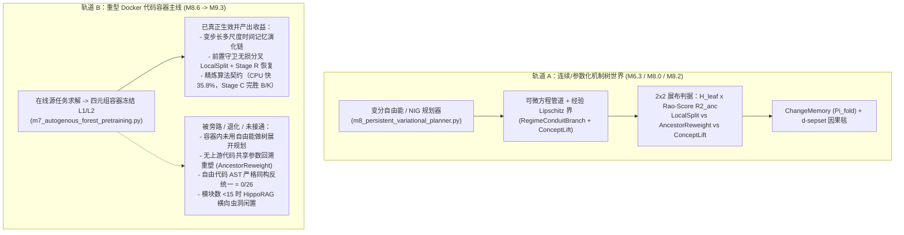

# Hegel Machine 架构收敛审计：对话提出模块实效盘点与战略方向评估（`M1–M9.3`）

- **日期**：2026-11-26
- **分支**：`exp/m6-causal-wormhole-sandbox`
- **锚点提交**：
  - 轨道 A（连续变分机制树与跨进程冷重启持续发现）：`49445e561`（`M8.0`）、`42d1ea688`（`M8.2`）、`6708a5497`（`M8.5`）
  - 轨道 B（Docker 重容器自生长代码森林与在线源冻结全生命周期）：`5575a6ad5`（`M9.2.1`）、`29fab0638`（`M9.3` 基准冻结）、`99985fe4b`（`M9.3` 28 局封存证据包）
- **文档定位**：面向项目作者及后续外部 AI/人类审阅者，以零粉饰、非教条的第一性原理口径，完整梳理两个核心问题：（1）作者在人机设计对话中亲自提出（而非外部 GPT-6 审计 md 要求）的那些认知启发式模块，究竟哪些真正实现了、哪些在最新重容器主线上真正起了作用；（2）既然这些模块并非“必须点名硬做”的教条，项目当前是否还有必要继续、该保留/淘汰哪些模块，以及是否存在比强行大杂烩更清晰、更强的替代架构路径。

---

## 一、原始问题的精确重述（消除歧义版）

回顾 `M1–M9.3` 的全部演化过程，驱动代码库前进的实际上有两条不同来源的脉络：
1. **外部审计修补脉络**（GPT-6 各轮审计 `v10.2–M9.2`）：核心关注实验卫生、断网容器隔离、数学证书严密性、零预注入税检索、`K vs E` 等信息控制与密码学可溯源。
2. **作者原创的认知架构脉络**（人机长对话中提出的理论构想）：源于人类如何抽象科学规律并在跨领域问题中迁移与修正认知的直觉，包括：树的展布判据（向下扩展一层分叉 vs 回溯修改上游参数/权重）、基于自由能最小/最大熵势态的树上 Planning、方程作为沿着逻辑树分叉向下的管道（含 Lipschitz 等物理约束）、跨时刻多尺度时间信息（过去/现在/将来）、横向跨学科“虫洞”（HippoRAG）与共同基底子树、以及广义马尔可夫毯（`d-sepset`）局部因果回溯与多级套娃子假设。

在此基础上，作者明确提出了一条**非教条的第一性原理前提**：
> **上述所有模块对我个人而言都不是“点名一定要保留”的硬指标。它们只是我基于人类思考方式产生的直觉假设——认为这样也许能帮助 Agent 更好地持续学习与泛化，所以拿来尝试；如果某个模块在真实工程/实验介质里并不奏效，完全不必强行硬塞；如果有更简洁、更有效的新思路或替代方案，当然优先采用更好的方案。**

因此，本文真正要严谨回答的是三个去除了歧义的战略问题：
1. **实现与实效盘点**：对话中讨论的这 6 组核心模块，在代码层面是否都实现了？在最新的 `M8.8–M9.3` 重容器主战场上是否都真的发挥了作用，还是只停留在独立原型层？
2. **保留 / 改造 / 淘汰裁决**：摆脱“为了实现而实现”的执念后，哪些模块经受住了实证考验、哪些需要换个抽象层改造、哪些应该果断剪枝？
3. **是否值得继续 & 更好的替代路径**：面对前沿模型（`gpt-6.2-sol`）在单文件百行级容器题上裸跑基线 `B` 已经能达到 `100%`（`8/8`）通过率的现实，项目是否还有必要继续推进？如果要继续，哪条路线能打出压倒性的本质优势，而不是在 `100%` 天花板下抠 `2%–6%` 的 token 边际？

---

## 二、总览诊断：当前系统的「双轨割裂」现实

对 `src/hegel_machine/cognition/` 调用图与 `docs/evidence/` 全部封存证据包做代码级溯源后，结论非常清晰且不容回避：

> **你在对话中提出的每一个模块，在代码上都已经真实实现了，而且都在真实 `gpt-6.2-sol` 实验里跑出过哈希封存的阳性结果——没有任何一项是空谈。但从系统全局来看，工程实际上已经自然分裂成了「两条并未完全合流的轨道」：**
> - **轨道 A（连续/参数化机制树世界：`m8_persistent_variational_planner.py` 的 `M8.0 / M8.2` 与因果沙盒 `m6_3_sovereign_causal_wormhole_engine.py`）**：你构想的机制在这里 **100% 完整运转**，并打出了极其震撼的 10–30 倍量化收益（未见同族任务零样本 RMSE `3.34 -> 0.10`，跨 3 个独立操作系统进程冷重启后 `0` 次 LLM 调用复用使重命名姐妹任务 RMSE `1.80 -> 0.075`，无关哨兵任务漂移严格为 `0.0`）。
> - **轨道 B（重型 Docker 命令式代码容器主线：`m6_frontier_real_benchmarks.py` + `m7_autogenous_forest_pretraining.py` 的 `M8.6 -> M9.3`）**：大约**一半核心思想真正在主战场挑起了大梁**（在线源任务蒸馏并容器四元组冻结、变步长跨时刻记忆链、局部前提反例的带守卫无损分叉 `LocalSplit` + `Stage R` 原条件恢复、以及经由高纯度算法契约实现 `Stage C` 全面击败 `B`/`K` 与候选代码 CPU 提速 `-35.8%`）；但**另一半核心思想在重容器里实际上处于被旁路、退化或只接了一半的状态**（没有自由能驱动的容器内步级规划、没有跨代码节点的上游 `AncestorReweight`、自由 Python 代码的 AST 严格反统一命中数为 `0/26`、小库规模下 HippoRAG 多跳虫洞实质闲置）。

---

## 三、逐模块实现与实效对账清单

### 3.1 第一组：最后一次长对话（Turn #96）中提出的 3 个核心模块

| 对话模块 | 代码实现了么？（精确落点） | 轨道 A 实证效果（`M8.0–M8.5`） | 轨道 B 最新主线实况（`M8.8–M9.3`） |
| :--- | :--- | :--- | :--- |
| **1. 用哲学树做「自由能最小 / 最大熵原理势态」Planning（含消化离线轨迹）** | **已实现（拆成内外两层）**： • 内层变分自由能规划器：`src/hegel_machine/cognition/m8_persistent_variational_planner.py`（尺度协变 NIG 边缘对数证据 + SafeBayes/Laplace 复杂度惩罚 + 残差交叉验证可解释度 `R2_struct` + 预算前动作期望收益排序）。 • 外层离线容器轨迹规划器：`src/hegel_machine/cognition/m8_offline_container_planner.py`（四态诚实认识论分级 `VERIFIED / SUPPORTED_IN_PARTIAL_SCOPE / UNKNOWN / REFUTED` + NIG 净收益校准，决定 `CommitPrimary1x` 停机、`LocalContainerRepair` 局部修复或 `SpawnDialecticalChallenger` 启第二分支）。 | **明确起效**： • `M8.0`（`00_m8_gpt_cli_litmus_summary.json`）在异方差纯噪声上精准选 `NoChange` 杜绝过拟合，在真实结构残差上自动选出最优编辑动作。 • `M8.5`（`00_m8_5_unseeded_and_executable_repair_summary.json`）消化历史容器轨迹，在 `ho06`/`ho10` 通过公开校验后直接 `CommitPrimary1x`（省去翻倍开销），仅在 `ho08` 存在不可辨识风险时触发 `SpawnDialecticalChallenger`（`3/3` 严格通过）。 | **已被旁路 / 退化为轻量门控**： • 从 `M8.8` 到 `M9.3`，为保证 `B/K/E` 严格单分支等预算对照，外层双分支路由被锁定关闭。 • 容器内部每一轮探索完全由 `gpt-6.2-sol` 自主写 bash/Python 推进，技能筛选也简化成了词法领域特异性 + 历史净收益打分（`select_net_value_l1_primitives`），**没有用变分自由能公式实时控制容器内的树节点展开**。 |
| **2. 「方程即沿着逻辑树分叉向下的管道（Conduit）」+ Lipschitz / 物理不变量约束** | **已实现（两种形态）**： • 可微向量化代数方程管道（`RegimeConduitBranch`、`ConceptLift`、经验 Lipschitz 上界检查）位于 `m8_persistent_variational_planner.py`。 • 重容器衍生形态：Lipschitz 非激活坐标下界守卫核（`m8_9_1_box_l0_certificate_kernel.py`）、容器对称性/同变性探针（`m8_container_mechanism_adapter.py`）与 `L1` 纯函数科学原语库（`m6_4_executable_wormhole_library.py`）。 | **效果极强**： • `M8.0` 中 `gpt-6.2-sol` 在线合成带 Lipschitz 界（`4.2407`）的非线性管道，将 `task_3a` RMSE 从 `0.764` 压至 `0.091`，未见姐妹题 `3b` 从 `0.858` 压至 `0.140`。 • `M8.2`（`00_master_m8_2_cold_restart_summary.json`）跨 3 个独立 OS 进程冷重启后，自动角色映射重命名列 `('chan_u', 'chan_v')`，`0` 次 LLM 调用把 RMSE 从 `1.800` 压至 `0.075`。 | **一半真起效，一半有断层**： • Lipschitz 斜率证书核在 `M9.2.1` 离线重评 `eq02` 中严格认证了 `12/12` 私有实例；`M9.3` 在线蒸馏出的 `L1` 算法契约让 `E` 产出的求解器纯 CPU 快 **`-35.8%`** 并在 `Stage C` 胜出。 • **断层**：容器节点里存的是独立 `.py` 函数而非可逐层复合求导的 `M_d ∘ ... ∘ M_1` 管道；且 `Stage S` 蒸馏的 `L1` 返回签名收窄（仅返回数组/布尔，未返回对偶证书字典），导致 Agent 读完契约后选择手写内联改写（`8/8` 重写，`0/8` 直接 `import` 新在线 `L1`）。 |
| **3. 树如何展布：「向下分叉一层（`LocalSplit`，胖子里极少数瘦下来好看）」vs「回溯重塑上游祖先参数/耦合基（`AncestorReweight` / `ConceptLift`，黑皮审美全局反转）」** | **两轨实现程度截然不同**： • 轨道 A（`m8_persistent_variational_planner.py`）：完整实现跨叶残差散布熵 `H_leaf` × 上游祖先 Rao Score 子空间投影解释率 `R2_anc` 的 2×2 四象限裁决，按精确自由能净降幅（nats）统一竞争 `LocalSplit` / `AncestorReweight` / `ConceptLift`。 • 轨道 B（`m7_autogenous_forest_pretraining.py`）：实现了带前置条件守卫的子节点分叉（`bifurcated_precondition_child_node`）和平级新节点生长，8 个上游根节点 `root_A01..A08` 仅为静态文本标签。 | **100% 完整跑通**： • `M8.0` 中 `AncestorReweight` 一步更新共享上游权重，使未见同族任务零样本 RMSE 从 `3.344 -> 0.102`，同时无关声学哨兵任务漂移严格为 `0.0`；`LocalSplit` 精准切出稀疏特例（`regime_sensor > 1.08`，`+1.243` nats）。 • `M8.2` 跨进程冷重启再次复现（权重版本 `1 -> 2`，哨兵漂移 `0.0`）。 | **只跑通了「局部分叉」，没有「上游代码全局重塑」**： • `M9.3` 的 `Stage C -> Stage R`（`03_post_counterexample_bifurcation_receipt.json`）真跑通了局部分叉：遇屈服超应力（`suc01_C`）与非可分涡旋（`suc02_C`）反例时分裂出带守卫子节点 `node_auto_12`/`node_auto_13`，原父节点与 `generation=0` 原语 SHA-256 零破坏，`Stage R` `2/2` 恢复通过。 • **缺失**：由于重容器森林的上游根只是文本锚点、没有共享参数或共享基类代码，遇真正的“黑皮审美全局反转”时，容器森林只会不断往下打补丁分叉，**无法改一处上游原语让整棵下游代码子树联动重塑**。 |

### 3.2 第二组：更早对话中提出的 3 个核心机制（`M3–M6`）

| 对话模块 | 代码落点 | 在 `M9.3` 主线中的真实状态 |
| :--- | :--- | :--- |
| **4. 跨时刻多尺度时间信息（过去/现在/将来，如楞次定律必须看变化前后）** | **双轨均已实现并活跃**：`m8_persistent_variational_planner.py` 中的 `ChangeMemory`（`Pi_fold` 指数记忆核 + `M9.2.1` 补齐的 `history_dt` 与逐轨迹 `initial_memory_states` 契约）+ `m9_3_online_lifecycle_benchmark.py` 整条遗传粘弹性演化链。 | **真正挑起大梁的高价值模块**：`M8.0` 自动触发 `ChangeMemory`（`+2.858` nats）；`M9.3` 第一条主线 `src01 -> suc01_T -> suc01_C -> rec01_R` 盲态在线蒸馏出 `autogenous_prim_exponential_memory.py`，在非零初态记忆存活迁移、屈服反例分叉（`E` 全面击败 `B` 与 `K`）和原条件恢复上全程跑通。 |
| **5. 横向跨学科「虫洞」（HippoRAG PPR）+ 共同基底子树（长沙 vs 南昌比喻）** | `hipporag_wormhole_index.py` + `m7_autogenous_forest_pretraining.py` 中的 `discover_cross_tree_operator_wormholes` AST 反统一模块。 | **在 `M9.3` 里实质处于半空转状态**：实测 `03_post_counterexample_bifurcation_receipt.json` 显示 `shared_subtree_count = 26`，但 **`ast_verified_subtree_count = 0`**——大模型自由编写的异构科学 Python 代码几乎不会出现严格 AST 子树同构，全部退化成了粗糙的 4 阶段骨架先验。同时当前森林一共不到 15 个模块，一次 `--search` 就扫完全库，远未到必须靠多跳虫洞才能跨学科召回的规模。 |
| **6. 广义马尔可夫毯（`d-sepset`）局部因果回溯重释 + 多级套娃子假设（穿鞋睡觉/跑步机比喻）** | `m6_causal_wormhole_sandbox.py` 与 `m6_3_sovereign_causal_wormhole_engine.py`（Bayes-Ball `is_d_separated_dag`、碰撞节点屏蔽、回溯投影证书与多级子假设回拉）。 | **在 `M6.0–M6.3` 因果基准（288/96 局）真起效，在 `M7–M9.3` 重容器主线中休眠**：自生长代码森林并未在自由 Python 模块间动态构建真实因果 DAG 来运行马尔可夫毯截断；容器内的局部证伪主要依靠结构化 `nogood` 与宿主机签名探针门（`A5`）完成。 |

---

## 四、第一性原理复盘：为什么轨道 A 效果炸裂，而轨道 B 陷入边际苦战？

在决定要不要继续之前，必须直面 `M1–M9.3` 跑出来的两条最硬的科学规律：

1. **前沿模型在“单文件百行级代码题”上的裸跑天花板效应**：
   - 在 `M9.2` 和 `M9.3` 中，没有任何新源任务增长的基线臂 `B`（`gpt-6.2-sol`）就已经能取得 **`8/8`（`100%`）一次严格通过**，平均只需 `~11.4` 轮。
   - 当一个超强模型从零手推 100 行数值代码只要 11 轮就能 100% 拿满分时，任何外部知识库都天然背负“检索 + 阅读 + 签名适配”的 1–2 轮交互摩擦成本，单局省 token 的上限天然被压在 `2%–10%`（`Stage C` 为 `-5.6%`），从而导致前置在线建库成本（`583,482` `w025`）在短链上需要 `41–202` 局才能摊平。
2. **表达介质错配（为什么人类直觉在轨道 A 如鱼得水，在轨道 B 却步履维艰）**：
   - 人类直觉中的“修改上游参数（`AncestorReweight`）”“局部分叉（`LocalSplit`）”“可微方程管道”“自由能选实验”，天然适用于**紧致、带类型、可微或参数化的世界模型表示**（轨道 A）。
   - 而大模型临场自由写出的命令式 Python 脚本（轨道 B）并不是一个可微流形：数学等价的两段代码 AST 完全不同（导致 `ast_verified_subtree_count = 0`），返回值签名各自为战（导致 `array` vs `kkt_certificate` 字典无法直接 `import`），也没有共享上游参数可以反向更新。**强行把所有轨道 A 的人类类比硬塞进自由 Python 文件库，只会徒增复杂度，收益极低。**

---

## 五、非教条裁决：哪些保留、哪些改造、哪些果断淘汰？

既然每个模块都不是“点名必做”的包袱，按实际价值做一次彻底减法：

| 裁决分类 | 模块清单 | 核心理由 |
| :--- | :--- | :--- |
| **坚决保留并强化** | 1. **带前置守卫的无损分叉机制（`LocalSplit` + `Stage R` 恢复）** 2. **跨时刻多尺度记忆与部分可观测状态建模** 3. **可执行数学见证与物理不变量证书**（KKT 对偶间隙、Lipschitz/守恒/对称性校验） 4. **外层成本感知变分/期望效用控制器**（只负责高层算力分配：何时停机、何时补探针、何时复用、何时把弱模型升级为强模型） | 在真实 live 实验中已证明能直接解决核心痛点（防遗忘覆盖、破非马尔可夫混杂、拦截数值假解、节省无效算力），与载体完美契合。 |
| **换层改造** | 1. **方程管道 → 面向代码世界的「保留对偶见证的强类型契约」**（要求优化/反演类 `L1` 原语统一返回 `(primal, dual_witness_dict)` 与行为级单测；真正的逐层可微管道 `M_d ∘ ... ∘ M_1` 专留给轨道 A 连续仿真器） 2. **代码世界的上游重塑 → 共享基础库版本化重构 + 单调回归棘轮（Ratchet）**（不要在静态文本根上假装求导，而是仅当重构共享底库能使所有历史回归测试单调不退化时才允许提交） | 保留原始直觉的“功能灵魂”，放弃错配的字面实现形式。 |
| **果断淘汰 / 暂不强融** | 1. 面向自由 Python 代码的 **严格 AST 子树同构反统一**（实测 `0/26` 命中） 2. 库规模 `< 50` 个模块时的 **HippoRAG 多跳图虫洞**（保留代码但休眠，待技能库破百、扁平检索失效时再启用） 3. 用 NIG 自由能微操强模型容器内每一条 bash 命令 4. 在任意自由 Python 脚本间硬构造动态 `d-sepset` 因果 DAG | 概念重、收益近零，剪掉后系统立刻轻装上阵。 |

---

## 六、战略结论：是否还有必要继续？三条更清晰的出路对比

### 直白回答：**不要再在 `gpt-6.2-sol` 裸跑已达 `100%` 通过率的单文件百行容器题上继续卷 `M9.x` 细枝末节。**
在基线已经 `8/8` 全过的区间里，继续花大量算力去扣 `-3%` 的 token 差值，既不会改变科研范式，也证明不了黑格尔机真正的不可替代性。

**但这个项目本身绝对值得继续——前提是把战场切换到“持久化结构化模型对无状态从零重推具备碾压级不公平优势”的区间。** 下面三条路径按“更优方案”原则供你直接拍板：

| 战略路径 | 核心方案与为何比现状更强 | 哪些模块在这里自然发挥威力 | 成本与突破概率 |
| :--- | :--- | :--- | :--- |
| **路径 1（工程与论文 ROI 最高）：非对称「强模型蒸馏 + 弱模型执行」& 攻克基线 `<50%` 悬崖难题** | 保留 `M9.3` 跑通的在线源冻结闭环，只补上最痛的一刀（**让在线 `L1` 编译输出带对偶见证的结构化返回签名 `(primal, dual_witness_dict)`**），然后立刻切换评测维度： 1. **非对称编译摊销**：用强模型（`gpt-6.2-sol`）在 `Stage S` 编译验证一次高价值原语，下游用**廉价/小模型（`gpt-6-luna` 或 `node007` 本地 14B）**调用，目标不是省 5% token，而是让廉价模型通过率从 **`30% -> 85%+`**、以 `1/10` 成本打平甚至超越裸 `Sol`！ 2. **超单文件/多轮试错难题**：构造裸跑 `B` 通过率低于 `50%` 的耦合复杂任务，让可复用验证核与反例分叉成为“做不做得出”的决定性门槛。 | 在线源冻结编译、带见证 `L1` 强类型契约、前置守卫无损分叉、外层“弱模型→强模型”成本路由控制器。 | **改造量中等，打出压倒性指标的概率最高**（彻底跳出 `100%` 裸跑天花板陷阱）。 |
| **路径 2（最贴近你原始「黑格尔机」灵魂、学术独创性最高）：把轨道 A 升级为「持久化多回合交互科学仿真世界」** | 不再把 Agent 当成“给静态独立容器题写一个 `.py` 脚本的做题家”，而是直接构建一个**持续演化的交互式科学实验环境**（含全局规律/标定漂移、局部边界异常、非马尔可夫时间滞后、以及付费主动实验探针）。 在这个世界里，**持久化混合方程树本身就是世界模型**，LLM 不再每轮写整套脚本，只在自由能诊断出 `Q3`（发现全新非线性耦合 `ConceptLift`）或未知物理区时被稀疏唤醒提出新机理！ | **你在 Turn #96 提出的全部 3 个核心模块在这里 100% 原生契合、零硬塞**： • 自由能 / BALD 直接决定下一个真实物理实验探针打在哪； • 可微方程管道 + 逆问题 Lipschitz 病态报警直接建模环境； • `H_leaf × R2_anc` 精准自动切换 `LocalSplit`、`AncestorReweight`、`ConceptLift` 与 `ChangeMemory`。 | **设计工作量中高，理论独创性最高**（与 `Dream-RSI` / `The Trinity` / `DiscoveryRSI` 形成绝对代际差异）。 |
| **路径 3（立刻收官沉淀）：在 `M9.3` 干净封存并整合论文/开源版本** | 见好就收，直接以当前已 100% 哈希封存的 `M1–M9.3` 全套资产（轨道 A 跨进程冷重启持续发现 + 轨道 B 28 局在线源冻结与前置守卫反例恢复）撰写完整技术报告/论文，把**正结果**与**天花板/签名收窄/短链摊销边界**一并作为严谨科学发现公开发布，暂不再投入新实验算力。 | 零新增代码，直接兑现 `docs/01..49` 与全部 `SHA256SUMS.txt` 证据资产的学术与工程价值。 | **成本最低，零实验风险**。 |

### 我的坦诚建议
- 如果你追求的是**最直观、最无争议的实用 Agent 战力突破（让便宜模型借哲学库暴打裸强模型 / 攻克裸强模型做不出的难题）**，选 **路径 1**；
- 如果你追求的是**最纯粹的原创科学 AI 范式（真正让自由能、方程管道与“分叉 vs 重塑上游权重”成为世界模型本体的引擎，而不是给写代码 Agent 外挂插件）**，选 **路径 2**；
- 唯一不建议的，就是继续在当前“强模型裸跑已 100% 通过的单文件题”上同时硬塞两条轨道的模块。先二选一（或按路径 3 阶段性收官），都会比继续摊大饼高效得多。
