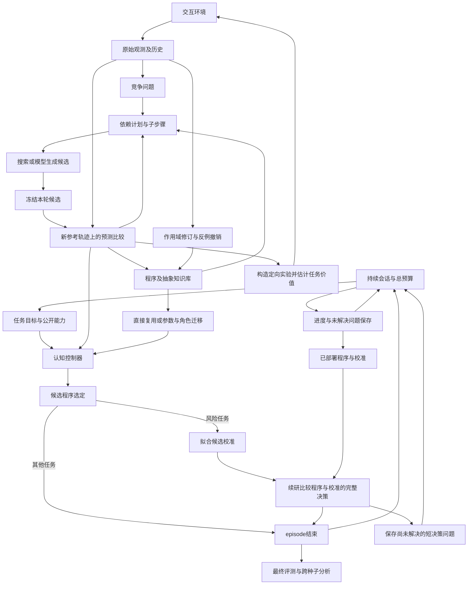

# 黑格尔机认知研究架构

0.85将已实测区分轨迹及其原完整解释随参数研究程序保存。后继调用继续用源解释解释源响应，再把参数约束应用于当前组合；新任务的总量、事件和窗口不混用历史响应标签。当前实测反驳继承区间，或已确认输入修订时，当前研究撤下对应历史约束、重开进入原研究时保存的参数域，源知识和原定义继续保留。等价概念也会补写本次研究证据；方法重放按实际拟合项与系数组合参数模板。局部校正因暂时没有激励而被拟合器删列时，实测重拟合完整源程序；它同样解释当前数据时保留原参数研究，额外拟合费用计入预算。

普通Code的`run(channels=...)`、`evaluate`和`finish`共享付费观测的投影视图，`fit`接受同一组训练行。保留模型携带该训练文件进入终测；所有原始观测和前后转移仍可读取。给定源规律同时导出命令与细测的普通Python入口，由Agent选择并提交。

0.84.1的关系参数选择同时消费全体观测和已实际区分竞争解释的独立轨迹，复用本轮预测误差，防止反例被其他好数据稀释；仪器重绑定后在新完整程序中重算，保留修正输入解释的可能。

0.84在关系实验反驳全部解释，或竞争参数可能掩盖未测仪器边界时，重测同一完整轨迹。`relation_input_diagnosis` 将已有调用还原到测量字段，分别评估仪器预测与响应规律；仪器正确时继续关系研究，仪器被反驳时从其学得比较条件提出未测端点，成批取得读数，再拟合、独立检验并重绑定原机制。参数研究从原始区间重新消费全部已付证据，方法反馈等待配对诊断。未决参数模板沿真实调用的输入槽恢复测量含义，派生定义可沿用参数签名完全一致的原测量定义绑定。

0.83.1的条件方法召回从已保存实测的完整响应角色恢复控制背景，再重解当前条件相关轴。背景按当前完整响应角色重绑定，支持控制改名；模拟不增加旧方法的支持次数。冻结0.83.0及后续开发结果分列于[关系条件合成](hegel_machine_relation_condition_synthesis_20260914.md)。

0.83将关系条件变成普通程序：`relation_sum` 在边的源/目标位置与数量上执行比较和 AND/OR，词法参数与外层调用参数分开。`relation_conditions` 按实际残差生成原子和组合条件；`propose_relation_revisions` 先比较原解释、方向替换、少量半径修订与条件候选的完整响应误差，再分配后续搜索。候选内容不读取实验室的隐含条件标签。

关系替换保存独立定义并保留完整标定实参；后续区间研究继续保存该调用边界。`relocatable_programs` 根据已有概念的输入契约恢复派生定义的测量角色，研究图和候选步骤随之重绑定。`RelationIntervalResearch` 用真实有向距离和已学边条件生成半径问题，`UnifiedResearchAgent` 用完整事件与窗口预测规划并购买区分实验。迁移条件先规范化并去重，再以唯一非空条件控制枚举规模，显式保留是否完整；相同观测上的条件与标定子式共享实际求值，维持原有双侧求值和缺历史行为。实现与实际开发结果见[关系条件合成](hegel_machine_relation_condition_synthesis_20260914.md)。

0.82在`propose_relation_revisions`中让残差触发关系类型竞争。对称、向右和向左关系共用实际对象角色；有向关系逐边输运，源对象减去的量等量加到目标。候选将类型替换带过完整事件与窗口，以原调用加局部差额构成完整解释，再整体拟合，避免通过任意混合旧关系和另一方向伪装成一次类型识别。已有解释能拟合证据时不扩展类型。

`UnifiedResearchAgent`为类型替换生成正反位置次序的条件问题，按当前仪器绑定规划完整响应，经真实配对观测比较后继续研究。类型进入代数等价、实验边界和参数区间的消费；相同半径的不同类型保持独立。旧定义、当前调用与研究程序来源分别保留，改名及JSON恢复后继续使用。实现、成本与边界见[关系类型修订](hegel_machine_relation_type_revision_20260914.md)。

0.81的`RelationIntervalResearch`把已有关系区间绑定到完整程序的实际调用及参数位置。首次学习、短迁移确认和组合后的程序均可按全部已付证据提出竞争参数；紧凑条件求解使用已有仪器绑定，完整预测经实测配对数据检验。未变调用直接保留，改调用内部时通过局部差额维持事件与窗口语义，首次结构及已有修正中的显式参数直接绑定。最后一批实测立即进入研究证据，随机确认不能覆盖已知反例。

收窄的可执行参数模板和区间进入既有`research_program.selection_steps`，测量输入转换同时转换模板；派生概念经JSON恢复、改名和实际参数调用后继续消费该区间。当前证据可反驳整个旧区间并重开机制研究。原定义不变，研究程序来源与最终执行调用来源分别保存。实现及运行结果见[关系不确定性与后继调用](hegel_machine_inherited_relation_intervals_20260914.md)。

0.80.2将`relation_revisions`接入已学组合：先用实测比较保留调用，再展开相关子程序，按已有距离提名内部关系修订，并保留完整时间上下文。`refine_relation_space`用全部已付证据收窄连续区间并重新提出候选；此前用于比较的观测在此后计作拟合证据，最终另取独立确认。待修关系生成紧凑边界问题，实际采购仍由完整程序预测分歧决定；复用步骤不能激励响应时，在同一预算内继续求解新实验。已付反例仍无法解释时采购原矛盾轨迹的仪器读数，修订标定后复用组合。旧输入模型须解释全部已买配对证据，新标定和转换后的控制程序也接受反例检验。正式比较、开发失败与修复见[本批结果](hegel_machine_object_relation_revision_20260913.md)。

0.79在已有控制解释被观测反驳后，先调用`RetainedControlRevisions`：展开原程序实际包含的多项式交互，重拟合系数，再比较已有时间依赖的局部移动。候选接受新控制轨迹验证和原有独立确认；不足以解释数据时继续采购仪器。搜索与追加观测沿用本题预算，旧标定及原概念保留。六台新装置的三臂比较见[研究修订与重复实验](hegel_machine_dynamic_research_replication_20260913.md)。

0.78让`UnifiedCodeSession`与完整黑格尔机执行同一动态仪器序列，分别恢复自身知识，并在双方学习结束后使用相同新轨迹终测。普通Code在没有多测量视图的实验室中，也按`spec_for(channels)`投影评分输入；付费原始资料仍可用于拟合。实际运行与成本见[真实Code对照](hegel_machine_dynamic_code_comparison_20260913.md)。

0.77接通实验准备步骤的局部修订。`ProgramExperimentMethods`先尝试已有方法，全部无效后才处理其中失败的时序坐标求解；`temporal_experiment_methods`保留当前谓词和目标，只调整相关准备时刻，再执行原求解操作并预测完整响应。实测成功才保存带`parent_method_id`的派生方法；失败候选保留无支持的反例记录。父方法、派生方法各保留自己的步骤与反馈，跨任务恢复后继续接受适用条件检验，所有检索与修订共用既有4000计算额度。实际结果见[准备步骤修订](hegel_machine_preparation_revision_20260913.md)。

0.76让已实测有效的时序实验进入`ProgramExperimentMethods`。方法记录测量谓词角色、相对时刻、控制依赖、准备历史、目标区间策略和求解操作；`temporal_experiment_methods`按当前标定和阈值重建控制序列，使用已学步骤求解，并检查完整程序预测的分歧。知识库恢复、共享条件和调用迁移均消费这些记录。实际反馈才增加支持；标定反例限制旧映射，重新标定后再次检验方法的适用性。复用与新搜索仍共用既有预算。实际结果见[时序方法研究](hegel_machine_temporal_methods_20260913.md)。

0.75把有限历史的仪器模型接入普通测量接口。静态标定失败后，`instrument_models`用已购读数拟合当前控制与受重置条件保护的历史项；优先检验统一多项式，仍有残差时才增加独立启动项。后一条实测轨迹决定字段是否可用。原测量机制保留为调用，仪器失配时取得新读数、更新标定并重新绑定；响应机制变化而读数模型仍正确时保留标定。最终命令程序接受独立轨迹确认，见[动态仪器研究](hegel_machine_dynamic_instruments_20260913.md)。

`scale_bindings`替换历史测量时累加已有延迟并保留重置边界。`temporal_control_probes`把有限历史条件展开到真实控制序列的各时刻，沿用当前数值求解器和6000单位额度；恢复序列后预报完整响应与仪器读数。普通和共享条件规划均使用这条路径。0.75首先将求解轨迹用于研究；0.76补上时序求解步骤的跨任务保存与复用。

0.74的`SharedTransferFitter`让短迁移中的多个调用版本共享已付资料的输入列、依赖执行和完全相同的标准化线性系统。每个版本仍用自己的原始项重建程序，实测后追加数据只计算新增列值；训练与验证按测量视图分开，资料变化时更新对应缓存。训练、验证损失针对实际可执行程序计算，后续独立确认继续决定采用。`shared_transfer_fit`与`shared_transfer_validation`记录实际新计算和复用量，见[共享拟合](hegel_machine_shared_fitting_20260913.md)。

0.73将条件问题从完整响应程序中提取出来。`TransferConditionResearch`在一次任务内共享相同谓词及历史深度的实测阶段和程序预测，后续仅计算新增观测或新的修订程序；目标、字段或历史发生变化时重新计算。当前程序的正确性与各原调用的反例仍分别保存。

`condition_questions`用简短的条件程序求解待测区域，并重建当前所需的进入、保持、退出轨迹；多代响应定义不再反复进入求解器。主循环随后对完整竞争程序及仪器读数重新预报，实际响应没有分歧时继续尝试其他问题，全部尝试共用原6000求解上限。方法检索依据真实完整程序匹配失败条件，也保留完整响应所需的坏标定限制。结果见[共享条件研究](hegel_machine_shared_conditions_20260913.md)。

0.72把条件研究接入已学程序的短迁移。`transfer_condition_research`保留原调用及不同输入绑定；短样本拟合成常量时，原条件仍参与竞争。实测已解释的区域退出下一次提案范围，完整程序继续用于预测比较。新观测先检验冻结解释与方法，再进入系数拟合；旧条件失效而程序退化为常量时，带着已付反例重新研究其他解释。纯历史可用性保护不增加输入条件实验。

原调用与修订调用共同参与选择，实际支持的旧程序可直接保留。完整`KnowledgeLibrary`保存和恢复后仍执行上述过程；更换测量或重开普通研究时复用已有观测，并为恢复研究保留预算。见[迁移条件研究](hegel_machine_transfer_conditions_20260913.md)。

历史条件增加进入、保持、退出的完整激励，方法恢复时按当前历史深度重建。各阶段由实际轨迹支持；历史不足时的初始化零响应不作进入见证，因此单侧观测不能提前确定事件调用及其平方的系数。相同激活条件在提案中合并，完整竞争程序及各自实测反例仍保留。

0.71的`program_condition_sets`从分支提取组合条件，在公共控制域内共同求解全部当前阈值。路径枚举与数值求解共用原6000计算限额，完整预测分歧决定是否提出实验。方法保存全部条件的共享变量关系；失败字段的标定映射和具体任务条件各自形成适用限制，新实测校准后可恢复原方法。已知坏映射会触发配对测量，不再继续用它预报分歧。

`UnifiedResearchAgent`也为一般可控候选中的多个独立条件购买实验，实际观测进入重新拟合与选择；后续随机确认不能抹掉已取得的反例。0.71的运行范围见[组合实验与适用范围](hegel_machine_compound_experiments_20260913.md)。

0.70将联合控制求解和可迁移实验步骤接入共同研究流程。单控制无法形成完整程序分歧时，`program_disagreement_probes`沿可行线段共同求解谓词涉及的控制，反向或耦合标定由有界坐标更新形成新的区间。它与原路径共用6000计算上限。

`program_experiment_methods`从实际有效的实验保存谓词角色、激励上下文、边界求解与保持或脉冲步骤。后继按当前字段、阈值和已学标定重新执行；完整预测仍有分歧时才参与采购选择。方法检索与新求解共用生成预算，通用实验继续竞争。主循环在实测后支持或撤销方法，再修订仪器与机制；全部旧机制被反驳也可形成有用研究经验。`KnowledgeLibrary`与`UnifiedResearchSession`保存这些步骤及反馈。实际效果与当前范围见[联合实验与步骤迁移](hegel_machine_joint_experiment_methods_20260913.md)。

0.69的`program_disagreement_probes`从可执行条件与相互作用阈值提取分歧区间，在公开控制范围内通过已学标定求解输入；完整程序的预报决定候选是否有区分力。维持或脉冲轨迹支持已有滞后、窗口与事件程序，调用展开后也能参与。`competing_object_experiments`在同一预算内比较定向候选与通用候选，记录生成费用、选中来源和没有采购的原因。

主循环将竞争规划合并进原有边界研究轮次，每次实测修订后重新使用当前竞争程序；冻结预测先与实际字段及响应比较，再修订仪器或机制。已有程序仍解释全部资料和新增实测时，暂缓重复搜索已尝试而无程序的划分；所有可用解释失配后重开搜索。未决划分继续保存。见[程序分歧驱动的实验](hegel_machine_program_disagreement_20260913.md)。

0.68将非等价对象解释接入共同研究：`competing_object_programs`按证据许可的划分独立拟合，保存支持程序、未决区间与被新实测反驳的旧定义；程序必须同时解释全部已付资料和本批新增反例。旧家族共同失配时重新开放其他家族，预算不足时仍保留已验证可用的程序；已被实测反驳的同一程序不能凭下一条随机轨迹的一致重新采用。

`competing_object_experiments`用公开控制域与已学仪器模型预报竞争程序的响应，选择分歧轨迹，由主循环实际购买测量。冻结预测分别与实测字段、实际响应比较；校准失配进入仪器修订，机制失配进入竞争程序修订。恢复阶段新找到的结构回到同一主动研究过程。竞争状态进入对象模型和元先验，后继仍通过实际检验选择已有调用。见[竞争解释与实测修订](hegel_machine_object_competition_20260913.md)。

0.67通过`object_alternatives`枚举部分图所许可的完整划分，`equivalent_object_programs`将机制在全部划分下重绑定，按程序代数一致的解释共享一次拟合。候选附带全部备选划分，主循环的边界修订仍检查这些划分；只有已识别关系进入共享对象schema。确认后的函数可调用、保存和恢复，部分图的使用不要求先确定唯一对象身份。

焦点归属由选择性直接驱动的实测对比支持，避免两对象守恒造成错误归属也能线性拟合。位置的局部直接效应作为可撤销的归属锚定：新转移反驳旧依赖时重开研究，锚定条件消失时恢复歧义。见[可执行对象等价报告](hegel_machine_object_equivalence_20260913.md)。

0.66使部分对象图直接参与研究。`partial_object_knowledge` 从已确认的角色提出归约、差分、窗口与累积候选，未识别的归属保持未知；`instrument_models` 使用这些字段的实际控制依赖校准读数。主循环分别保存部分图和完整 schema；部分角色只作为知识绑定元数据，不授权需要完整归属的结构搜索。后继实测支持部分解释时继续复用，当前响应需要缺失角色时复放已有区分实验、取得当前响应，再扩充对象图。

对象角色本身也参与竞争：`object_induction` 比较不同数量背景下的控制效应，区分纯加性输入、仅改变相互作用的坐标，以及同时具有直接效应的坐标。已支持的角色定义保存区分实验；后继即使命令到读数的映射未变，新转移中的依赖改变仍可反驳旧定义，重开对象研究。研究目标的变化不会单独撤销转移角色。运行结果见[部分对象与角色修订](hegel_machine_partial_objects_20260913.md)。

`research_programs` 可将学到的观测函数按当前对象逐个重绑定选择参数，再汇总输出，并与差分和窗口组成候选。原函数定义及来源保留；这个操作改变可执行假设，不代替实验室观测，候选仍由随后取得的真实响应选择。

结构实验也消费对象知识：实付命令与读数的配对确定选择器对应哪个对象，置换时同步移动焦点，局部性实验改变非焦点对象，边界实验保持待测对象对的数量差。匿名列表次序不再决定实验实际作用于谁。

0.65让对象划分成为研究结果。`AnonymousObjectLab` 只公开匿名控制、传感字段和付费转移观测；`object_induction` 根据前后变化及控制干预提出数量、驱动、位置与选择归属的竞争解释。`object_interventions` 针对仍未区分的依赖生成实验，复用相同历史前缀的已付证据；没有足够响应差异时保留多个归属。完整对象模型只附加到研究者自己的观测规格，随后进入现有结构搜索、仪器学习和概念组合。

对象模型、控制到读数的模型和归属见证共同进入 `KnowledgeLibrary.object_models`。后继先用新实测检验旧读数预测，通过后复用对象知识；同名接线变化导致失配时，保留旧模型及反例并重新研究。高阶输入绑定使用当前发现的传感角色，随后组合现有概念。知识可随 `UnifiedResearchSession` 保存和恢复；对象恢复准确性在学习结束后独立评价。运行入口是[匿名对象研究配置](../config/cognition_object_induction.json)，范围与结果见[对象发现报告](hegel_machine_object_induction_20260913.md)。

组合研究还能对已学调用和当前角色共同作时间变换，从实测中消除状态项，保留旧调用中的局部作用，再生成事件和窗口程序。研究图保存实际采用的分解与组合步骤。`noise_replication` 对仍拟解释为噪声的残差安排一次独立重复实验：完整实测输入历史相同时，响应稳定而模型误差明显，会撤回噪声解释并继续研究；重复观测及计算仍计入原任务预算。

0.64将高阶概念和研究程序的测量输入从旧校准中分离。`relocatable_programs` 保留原测量概念的冻结定义，展开其中固化的输入绑定，保存可重新绑定的 `input_program`；`research_program_inputs` 同步转换研究图、残差节点和候选步骤，保存 `input_research_program`。新的输入依赖先在已付控制轨迹上验证等价，再进入知识库。后继命令预测失配时，研究者购买读数，比较原机制在实测坐标中是否仍成立；成立则只更新校准，并在新命令轨迹确认。

实测坐标仍有残差时，`research_programs` 共同拟合保留调用与公开对象角色的聚合、焦点量、时间差分和窗口项，生成可重放的局部机制修订计划；原调用定义保持可用。短试验按同次实验记录的控制量与读数比较候选，命令程序的噪声判断同时面对已付测量中的残差解释。运行配置为[输入依赖与机制修订](../config/cognition_revisable_inputs.json)。

0.63让仪器输入本身成为可学习、可替换的知识。`instrument_models` 从同批已付读数与控制量拟合多项式和区间表示，在下一条已购轨迹上比较字段预测；`UnifiedResearchAgent` 保留原测量概念，把读数模型绑定到函数实参，再用新的仅控制量轨迹决定是否免去仪器。字段模型进入 `KnowledgeLibrary.instrument_models`，可跨测量改名和细到粗尺度重绑定，历史响应仍按原程序执行。后继命令预测失配时重新购买读数，实际字段误差决定撤回和修订校准；短试验保留完整旧调用及其新组合，让候选共用新观测后再选择。运行配置为[仪器知识与校准变化](../config/cognition_instrument_knowledge.json)。

0.62使已学结构参与新研究程序的构造。`scale_bindings` 把粗测量参数绑定为细对象归约表达式，并保留历史与函数定义；`research_programs` 按实测残差选择已学调用、乘积、事件、窗口与累积操作，共同拟合贡献并保存依赖图。`UnifiedResearchAgent` 在新轨迹上比较这些候选，通过确认后将程序、实际来源和研究方法存入同一知识库。后继任务可直接调用新概念，或重新执行已选测量依赖并拟合新系数；重放还接受当前对象角色映射。`max_question_depth=0` 同时关闭程序生成、程序重放及原有递归残差修订。关系搜索先比较候选族，再精修领先解释的测量边界；同族参数在两批证据上冲突时，合并已付费观测重新拟合，随后独立确认。运行配置为 [组合研究](../config/cognition_unified_composition.json)。

0.61将对象、局部关系、事件和时间窗口并入同一候选比较。`UnifiedObjectLab` 提供公开对象角色及可选测量尺度；细测量可汇总为粗表示，选定后按实际视图计费。`unified_structure` 使用已付观测提出结构，再用配对干预检验守恒、平移、置换和局部性，用边界实验修订作用范围。结构角色进入可调用概念绑定，失配时保留反例并恢复研究。`unified_structure_transfer` 将已学关系族转成当前参数与作用边界的研究方法，结果经付费干预和多样新轨迹比较后采用，方法来源记录为新概念父节点。标量、状态、风险和对象任务共享 `UnifiedResearchSession`；[统一结构研究](hegel_machine_unified_structure_20260913.md)记录本轮实现与比较。

0.60以来，`UnifiedResearchAgent` 对公开测量接口执行参数、历史、表示与仪器联合研究；连续状态与固定风险残差修订使用同一候选竞争，非零误差通过新轨迹上的噪声相容性与结构反例判断。`ResearchGraph` 中的残差子答案组成父程序修订候选并参与选择。已学完整程序决定短试验的测量需求，新验证和冻结确认支持复用，失败时保留普通研究预算。`UnifiedResearchSession` 在任务之间保存同一知识库，学习结束后独立评分；`cognition unified --memory` 可与既有元先验主线交换知识。`FixedExperimentResearchAgent` 使用预先确定的轨迹和仪器，普通Python对照由 `UnifiedCodeSession` 执行。[连续状态与风险研究](hegel_machine_state_and_risk_20260912.md)记录实际效果；普通代码训练反馈与终评也使用公开固定的任务风险损失。

0.58的 `MetaPriorSession.run_deploy` 逐题执行研究、优化和修订回传，再启动下一题；已有研究前缀先部署，研究内部暂停时保留当前工作区。`cognition prior --optimize` 与保存了优化配置的恢复均走此路径，终局评价在整场学习结束后进行。`available_prior_ids` 保存研究开始时的知识范围，实际消费仍由可执行程序的调用决定。[完成度与方向复核](hegel_machine_advice_goal_status_20260909.md)说明本次跨任务收益及下一步整机整合。

0.57的[约束知识保留](hegel_machine_constraint_knowledge_20260912.md)在机制通过未来验证后，以已有范围内观测建立参数与控制点偏差的联合后验。接受的程序可拆成独立加法项；整体仿射模型、固定程序和独立项模型由后续实测竞争，混合不确定性继续进入SC-KG选点。该路径位于`constraint_retention.py`与`sc_kg_environment.py`。

0.42 的[边界探索与局部预测更新](hegel_machine_supported_exploration_20260910.md)让有实测邻域和模型支持的方向竞争实验机会，并在换用目标表示后完整更新已付标签的局部后验。

0.41 的[实验收益估值精度与证书复测](hegel_machine_value_precision_20260910.md)在末段估值全部截为零时追加有限共同模拟；实测较好但未获可行性证书的点也可竞争复测，取得新证据后重新选择。

0.40 的[末段观测价值与逐次重选](hegel_machine_terminal_value_20260910.md)将新位置、经验赢家与预测赢家放入同一轮 SC-KG 评分；模型经实测验证后，每次观测均重新选择，未决机制研究继续优先。

0.39 的[目标与约束共享取证](hegel_machine_joint_evidence_20260910.md)让同一次真实实验同时推进两类候选；目标反例可触发约束适用性复测，确认后修订范围，否决则恢复原计划。已有实测支持的目标预测器、证据范围和噪声状态独立保留，约束重建只替换约束部分。此前[研究范围与目标预测器修订](hegel_machine_revisable_research_scope_20260910.md)保留全部配对结果与回退。

0.30 的[元先验自主研究与 SC-KG 接通](hegel_machine_meta_prior_research_20260910.md)连接无机制标签的假设生成、区分实验、递归残差答案和真实 SC-KG 程序消费，并修订旧反例触发的同通道表示。22 项元先验尚未全部成为通用自主编译器；具体实测收益与余项见该报告。

更新：2026-09-13。当前认知主线 0.71.0；当前[原目标完成度](hegel_machine_advice_goal_status_20260909.md)与[能力地图](hegel_machine_capability_map_20260909.md)。0.29 的[知识指导测量投入](hegel_machine_measurement_acquisition_20260909.md)将取得经验接入初始通道与操作覆盖选择；此前[表示跨任务复用](hegel_machine_measurement_transfer_20260909.md)将已学完整程序的实际调用接入仪器初选和重选；此前[仪器与表示修订](hegel_machine_measurement_revision_20260909.md)连接持续残差、已付测量复用和非线性状态读出重拟合；此前[模拟器、结构与持续代码研究](hegel_machine_completion_20260909.md)接通模拟预测修订、结构干预与跨任务代码研究；此前[共享前置研究](hegel_machine_shared_research_20260909.md)连接跨任务依赖与知识消费；此前初始校准和完整预算见[0.23 记录](hegel_machine_complete_research_agenda_20260909.md)。

0.26 已完成 24 阶段整机和 600 项完整认知回归；新增结构与模拟器都实际改变实验、解释或后续调用。八题跨任务普通代码比较已完成，7 个后继实际复用共享代码；此前任务序列与评价器效果保留在对应版本报告中。

系统围绕一个问题组织：怎样让一次经验改变之后提出假设、观察问题和解决任务的方式？当前代码位于 `src/hegel_machine/cognition/`。本文描述整机及其认知循环；[整机完成路线](hegel_machine_system_completion_20260908.md)将 [GPT6 的审视](../markdown/GPT6_advice.md)落实为持续研究目标，[0.8.0 运行报告](cognitive_runtime_v6_results.md)与[持续落实记录](../markdown/GPT6_advice_Implementation_20260907.md)记录实现和证据。[0.7.0 结果](cognitive_runtime_v5_results.md)、[0.6.0 结果](cognitive_runtime_v4_results.md)及更早报告保留历史口径。

研究对象是冻结执行器内的选择过程：失配出现后，agent 怎样分配搜索工作、取得区分证据、采用或保留一个解释，并把实际有用的结构留给下一任务。新增算子、搜索过程和调度策略属于开发者对被测系统的修改；这些修改是否改善上述选择过程，需要由执行后的质量与成本判断。

## 持续研究会话与整机状态

`ResearchSession` 连接任务日程、单任务控制器和持久知识库。它接受仅提供 `spec` 与 `observe` 的环境对象，或返回这些对象的工厂；先覆盖任务，再依据学习侧仍未消除的相对初始损失安排重访。任务按列表位置管理，同一任务标识下的后续条件变化可以保留为另一次任务。

会话保存配置、任务进度、未解决问题、访问结果、调度理由、总资源和包含研究经验的知识库。每次调用 `CognitiveAgent` 前，单任务预算受剩余总观测和总计算约束；每个任务的最大访问次数限制进一步研究。`completed` 表示允许的访问结束，未解决任务另列；预算不足时保存待办。

当前恢复发生在完整任务访问之间。`ResearchWorkspace` 保存实际观测及各自历史、参考观测、查询、当前及竞争程序、决策校准、研究图和待反馈动作。完整修订恢复进入 `CognitiveAgent.run`；保存的短决策问题进入 `run_decision_research`。仅新查询增加观测支出。`ResearchGraph` 保留计划的下一步骤和中间程序，新证据决定分支继续、解决或重开。

0.19 的 `research_frontier` 从访问结束时的实际证据规划下一次区分实验，保存具体控制轨迹、尚未确定的区间及后续比较所需观测额度。`ResearchSession` 可以因此重新访问拟合误差为零的任务；恢复后先执行保存实验，再拟合与比较。外部新证据改变工作区后重新规划，已不适用的旧计划退出。每个任务的访问上限和整场预算仍限制追加投入。

0.20 的 `ResearchOpportunities` 把保存实验、具体方法步骤和残差修订作为同一投入选择的候选。已得新参考轨迹的归一化收益、整轮实际观测与计算费用进入知识库，报价按过往实际支出修正。未知具体问题获得一次探索机会；区间宽度本身不充当收益。调度器将选中的研究种类写入工作区，控制器执行相应入口，只有实际执行的机会才接收该轮回报。未支付得起的计划继续待办，新的外部实验交付可以重开分析。

0.25 的 `ResearchEvaluator` 将公开证据与研究报价映射到可执行收益函数。已有实际续研反馈生成候选，后续冻结预测与实际收益支持采用、改写或撤销；未完成反馈保持未知。`ResearchSession` 与 `ResearchAgenda` 使用同一次报价完成排序和选择，执行后的反馈更新同一模型。推断、比较与拟合单独计入总计算，下一次完整研究的费用先保留；报告读取和暂停不付费训练。任务损失与最终评测定义固定。

`add_environment` 接收新到达的任务；`add_evidence` 把实际外部实验结果加入旧问题并计入观测支出。新概念产生后，会话在有界计算内尝试用它解释旧问题的证据；有用的候选直接进入对应工作池，并以 `new_knowledge` 激活研究。总预算和每任务访问上限继续约束运行。

0.21 的 `decision_frontier` 从已取得轨迹上筛出仍可能改善行动的具体方案，保存当前程序与校准、至多两个挑战者和两条后续轨迹的报价。`ResearchSession` 将其作为 `kind="decision"` 的机会，与实验、方法和完整残差修订共同选择。选中后直接执行有限决策比较；已有拟合与校准保持固定，访问只支付新观测、方案比较和结果计分。反馈按实际完整行动的收益更新同一机会库。

新知识重开任务时，`_offer_new_knowledge` 将已付费适配且改善旧观测的候选结构带入普通修订报价。以前同类修订的零收益仍约束旧候选，却不会掩盖新结构。非正收益覆盖其已试候选子集，数值参数漂移不会重新获得探索机会；正收益不直接推广到子集。旧保存记录中缺少这两类候选字段时按空集合读取，原来的停止经验继续生效。

风险任务的非零损失单独保留。最近一次 `evidence_gain` 与分散程度仍为普通残差修订提供报价依据；保存的决策问题则提供另一条有明确候选与费用的研究路径。未取得比较结果、已比较但不支持替换，以及没有仍值得查询的候选，分别形成后续安排。任务上限与总资源继续限制这些机会。

`cognition session --checkpoint PATH` 每完成一次任务访问就保存进度。`--steps` 在完整访问之间暂停；再次运行默认继承原配置及资源，显式增大总预算或最大访问次数可以继续余下问题。`--partitions` 将多个分区组成有序任务来源，任务顺序随 checkpoint 保存。环境工厂每次访问重建同一任务，控制器查询种子由任务索引与访问次数确定；外部持久环境由调用方维持或重新连接。

研究会话负责从一项任务走到下一项；控制器负责一次有界研究；程序知识和研究经验分别改变后续解释与资源分配。独立最终评测由实验入口在学习结束后组织。

## 可选测量与连续状态

`MeasurementLab` 提供可控制输入与按行计费的仪器通道；`ProcessMeasurementLab` 通过本地 Python 子进程执行相同接口。`feature_bounds` 描述可控制量，`feature_names` 包含已选择的测量。实际 probe 仅改变控制；两种实验选择器把已购传感器路径作为未来读数情景，费用包含各情景下的预测。

`MeasurementResearchAgent` 用两条已购轨迹拟合并比较测量组合，再将全部试验观测、当前模型和参考证据交给普通控制器。`MeasurementSession` 在四题间共享知识，每完成一题保存 checkpoint，并在学习结束后取得独立长轨迹评估。训练观测、仪器支出、研究计算和评估计算分开记录。

`MeasurementAcquisitionMemory` 保存实际用过的仪器、首个研究阶段的操作覆盖与后续失配位置。后继装置先按可用完整概念购买所需通道；旧程序不成立时，已付的廉价视图仍可支持新表示搜索。完成前若尚未达到兼容经历的操作覆盖，就追加当前通道的真实轨迹，以近期修订后的模型检验；残差重开仪器或程序研究。换仪器重播仍计费，但不增加操作覆盖。覆盖不足保留待办，扩充预算后继续同一工作区。

`FrontierSession` 的 `adaptive_measurements` 阶段向 `MeasurementSession` 传入当前知识库，再把测量研究形成的程序与概念交给后续实验、机制和结构阶段。统一研究入口现在包含 25 个可恢复阶段，其中新增模拟器研究及五类结构的成立／破坏实例。

`Program("accumulate")` 从给定初始值沿输入轨迹递推；`continuous_state_candidates` 从观测拟合至多两个衰减模式、驱动和读出。普通控制器可选择 `continuous_state` 动作，为完整搜索和后续比较拨款，再用新轨迹反馈其收益。它与二值可见状态搜索共同扩展状态解释。递推程序参与抽象、调用、变量绑定和 JSON 恢复。

续研或已选择表示修订时，轮预算同时包含完整基础表示搜索、最多八个筛选候选与当前/父/累计解释的比较，以及启动和探测工作。其他状态搜索使用扣除普通拟合承诺后的余量，避免重复消费证据却没有完成一次历史拟合。

累计证据候选 `evidence_champion` 参与后续完整比较，防止候选抽样遗漏已被更多观测支持的解释。新轨迹不反对、且训练和参考两侧收益都覆盖新增复杂度时，可以恢复较大解释；新观测明确反对时不据此恢复。

## 实验模拟模型与有限结构研究

`ExperimentSimulator` 学习对当前预测的均值修正与条件方差。普通控制器在实际查询前冻结预测，随后以实测结果比较候选；采用的模型进入 `choose_valuable_probe` 的观测通道，改变候选如何模拟实验结果和选实验。仪器条件使用已取得的外生读数路径；模拟输出保留其情景含义。模型、后续比较和待反馈数据随对应工作区保存。

`MechanismLab` 提供可控制的向量或标量装置。`run_mechanism_research` 从付费响应拟合矩阵、投影、模块、动态模式或连接，再按学得结构设计干预并比较新轨迹。通过比较的组件成为可调用概念，结构改变时保留仍有效的组件。`response_profile` 依据实测次序、重复响应和局部边界实验修订分段程序；未定区间中的不同候选继续保留，`profile_prediction` 返回未知与实际需要的查询。

`CodeResearchSession` 保存普通代理自主产出的 Python 与经验、已有读数及全局资源。`CodeComparisonSession` 让两臂处理同一系列新装置实例，保持各自知识与自主观测选择；任意 Python 时间、模型 tokens 与认知搜索计数分别报告。

## 可调用概念与共享计算

`Definition` 保存参数与可执行正文，`Program("call")` 绑定实参。定义可调用先前学到的定义；条件分支按需读取实参，因此历史尚不存在时仍可执行启动模型。`expanded()` 供语法分析和语义复杂度使用；预测直接执行定义。JSON 在每个程序的定义表中保存所依赖的正文，调用节点保留引用。

`KnowledgeLibrary.learn` 从已采纳程序产生定义，`callable_atoms` 按当前变量角色提供搜索原子。整体定义保留嵌套调用；参数模板继续用于重新拟合。条件更新改变定义正文时保留旧调用的原定义，并为新的正文建立版本。删除或撤销来源会影响依赖知识的可用性。

稀疏搜索在普通坐标留下残差时回调知识库，用当前证据选择可调用原子。依赖计划继续传递实际产生的中间程序。数值搜索可将一个已学计算和它的平方共同拟合，下一次学习还能把这一组合建立为更高层定义。`EvaluationContext` 限定一条观测，在线性拟合及候选比较中共享同一绑定的调用结果；新观测建立新上下文。现有预算继续使用候选乘观测行数，实际 primitive 执行量另行测量。

## 1. 共同认知状态

`TaskSpec` 给定任务目标、可见特征、连续控制边界、最大 probe 长度、初始观测能力和行动成本。`Observation` 保存原始输入、当前结果和已有历史；历史中的 `__target__` 是过去已经取得的结果。候选在环境轨迹上执行时读取这些真实历史，内部模拟实验时才把自身预测接入假想历史。

控制器维护全部已取得的观测、覆盖公开控制范围的参考观测、竞争程序、当前解释及其父解释、研究问题、依赖计划、中间表示、预算和知识库。程序表达预测关系；抽象为之后的搜索提供可参数化结构；probe 与行动策略决定怎样获得或使用证据。



最终评测只在 `CognitiveAgent.run` 返回后由实验模块取得。环境分区、机制类别和任务关系保留在评测 metadata。

## 2. 问题、依赖计划与候选

0.19 的 `branch_support` 读取完整程序中的历史机制与成熟分支条件。`retain_history_frontier` 使用已经比较过的证据，为最多两类仍未区分的历史结构保留候选位置，并让代表实验具备执行这些机制所需的长度。纯粹包在 `available` 中的当前表达式不会获得历史保留；新证据已反对的候选也不再保留。采样筛选若需确认完整证据，所需预测直接占用筛选预算。

`method_revision` 从真实来源拟合和后续新轨迹反馈判断修补是否已在同一适用条件下耗尽。反复没有闭合残差的来源不再自动重拟合；`ResearchMethods.revise_plan` 在可支付动作中提出结构后继。取得必要新覆盖的中间实验可以通过 `requires_actions` 留在方法序列中。结构或证据覆盖变化后，之前失效的方法可以重新获得适用机会。

`diagnosis` 根据残差、历史相关性与当前程序复杂度建立竞争研究问题。`planning` 将选出的方向组织成可执行步骤，例如表示→组合、关系→组合、模型→不确定性。步骤记录依赖、生成程序、训练结果和实际计算量。

计划中的子步骤接收前一步的中间程序；这些中间程序参与后续合成，最终工作假说由统一比较决定。步骤不要求逐一提高当前分数。不同大小的中间表达式可以共同保留，减少短小原子过早挤掉组合表示的情形。

`RevisionPlan.next_step`、`frontier` 和状态保存实际执行进度。预算中断保留已完成的中间程序，后续调用从剩余步骤继续；当前诊断不再提出该问题时结束其分支。新观测仍暴露问题时可重新展开已经完成的计划。动作记录和收益分配只计本次新增步骤。

`selection.PlanAllocation.remember` 将研究经验接入知识库，按实际观测形成 binary、numeric、risk 与单输入/多输入的上下文。经验由新参考轨迹上的相对改善和实际计算投入更新，随后影响搜索配额。不同任务的收益先相对其当前损失归一化，减少响应尺度的支配。`state_transition`、`joint_coordinates` 与依赖计划都进入反馈，状态搜索与数值组合之间的预算也因此改变。没有得到可比较新预测的已执行研究记为零收益，并保留探索份额。`learn_research_policy=False` 保留当前任务内反馈，关闭跨任务经验使用。

`synthesis` 在共享 `Program` AST 上搜索，支持数值、阈值、Boolean、条件、交互及多步历史。参数拟合、历史表示、关系组合、简化和残差修订共用执行语义与预算。

`sparse_search` 默认使用 `joint_search="beam"`，为数值任务联合选择坐标及历史深度。它先联合拟合当前变量、平方和变量乘积，再加入各深度的历史项；系数剪枝控制保留的变量组合。每个历史深度保留少量竞争组合，随后用有界的添加、删除和替换步骤修订先前选择，重新拟合所有保留项的系数。缓存的观测列与同组拟合结果在本次数据内复用。`joint_search="greedy"` 保留此前只向前添加坐标的搜索过程，用于检验新搜索带来的差异。

无历史模型使用全部观测，各历史深度模型使用该深度已经可见的所有行。较深切片上发现的表达式若实际上只需要更短历史，会按其真实需求重新拟合，以恢复可利用的早期数据。参数拟合产生候选，完整启动及成熟轨迹上的后续预测比较决定采用哪一个。

历史表示还需要解释轨迹的起始阶段。`selection.warm_start_candidates` 分两阶段使用预算：先从每个成熟模型提取已有的当前坐标，在各历史深度之间轮转拟合启动系数；再把剩余配额分给更一般的启动程序搜索和比较。这样，浅历史候选的额外搜索不会先占用所有深度的基础拟合机会。最终组合为：

```text
if(available(k), historical_program, learned_startup_program)
```

`available(k)` 查询已经取得的历史长度，条件分支按需执行。有限 `lag` 程序的 `history_depth` 表示最长历史距离；`accumulate` 的该值至少为 1，用于标记历史依赖，实际递推读取整条已见前缀。`minimum_history_depth` 表示执行当前程序至少需要的历史。完整程序可在启动行预测；尚无可用启动模型的历史候选使用共同的已拟合初始预测。所有轨迹行都进入比较，起始行当前可见的信号也能参与学习。

`state_search.state_candidates` 从恰好两个实际输出值建立有限的可见状态解释。它按历史输出分组，拟合正向或反向阈值，并与无历史规则及常量解释竞争。0.8.0 将联合坐标接入这条路径：从多个输入和前态分组拟合共同方向，再用实际投影观测分别拟合状态阈值。原始变量规则仍作为较便宜的竞争解释。进入、退出和起始条件可以具有不同阈值，历史深度和启动方式继续竞争。

坐标与状态规则都编译为共享 AST，使用普通加法、乘法、条件、`lag(__target__, k)` 和 `available(k)` 执行。坐标拟合、阈值拟合及组合支出进入真实预算；新坐标可以进一步被提取为参数与角色抽象。`joint_state_coordinates=False` 保留原始变量状态搜索。

观测尚不能确定的阈值区间保留少量不同切点，供下一次实验区分。`state_search=False` 关闭这一专门搜索器；通用 Boolean、条件和历史语言仍然可用。输出值、特征角色、阈值及初始行为由当前数据决定。

0.14.0 的 `startup_revision_candidates` 识别已经带有启动分支的 `if(available(k), mature, startup)`，保留守卫与成熟子树，只根据实际启动观测修订启动规则。控制器传入当前程序和保留候选中排名靠前的两个程序，去重后共享启动分组与坐标拟合工作，给竞争解释继续解决局部问题的机会。优先复用原有联合坐标和可调用计算，再考虑原始变量；只有启动错误减少的候选才进入完整比较。它使用原启动搜索预算，不要求重新发现已经学会的成熟机制。新参考预测打平时，仅由程序变短支持的简化还须保留旧训练及参考证据上的准确性。

## 3. 实验的任务价值与前瞻比较

`probing.construct_probes` 使用公布的特征范围、当前候选边界和历史需求生成新轨迹。可构造正反扫描、终点相同而历史不同的序列、阈值附近交替输入和随机连续干预。已查询轨迹和相同控制序列参与去重。

`transition_probe` 从候选阈值及按前态分组的观测寻找未确定间隙。联合状态实验解析可执行坐标，将候选边界映回公开输入范围内的控制组合，在边界附近改变多个输入，并用不同历史准备比较相同当前控制。沿边界改变其他控制也可挑战只使用一个变量的解释。原始变量转换实验继续提供轴向测试；启动行与有历史行分别处理。`joint_state_probes=False` 保留旧转换实验，`transition_probes=False` 使用一般实验选择路径。

0.19 用同一预算安排多个不同边界；只剩下一次比较机会时，可以合并启动点和成熟状态准备，未安排部分留在 `pending_boundaries`。`transition_outcome` 按实际返回历史核对目标状态是否达到，结果进入动作反馈与实验知识。不能达到条件的观测仍可区分候选，但不会作为准备成功的可复用程序保存；更新同一轨迹时也会撤去过期的成功条件。

默认的 `choose_valuable_probe` 估计每个观测点带来的任务风险下降。它从当前证据中选择少量候选并赋予权重，在公开控制范围内构造内部参考轨迹，以候选预测充当可能结果，估计查询后的权重变化及参考任务风险。预测任务使用既定预测损失，行动任务使用 `TaskSpec` 给定的低估与高估代价。计算的是有限候选集合上的预期价值；内部参考轨迹的结果来自候选模拟。

控制与历史覆盖参与实验排序，并在尚无有用竞争解释或价值计算预算不足时提供探索方向。原始预测分歧策略保留为可执行对照。两种策略都要支付真实查询成本，任务价值估计另计本地计算量。

0.14.0 将启动点和成熟状态的准备序列分别作为短实验候选，按完整程序的实际预测分歧与所需观测行数选择。只有在已得证据上尚未区分的最佳候选才能贡献短实验分歧；控制器复用已经支付的候选评分，单独调用时支付相应预测工作。成熟状态尚未定位的相对区间不少于启动区间且预算可支付时，先构造原有配对状态覆盖实验；避免少量启动点占满有限研究轮。启动区间主导、没有有效成熟边界或长实验不可支付时，才使用可执行的短实验。启动可以单独执行一行，成熟实验保留候选所需历史；既有实验知识继续保存、换名和缩放这些实际序列。未解决的候选分歧与边界间隙都能要求继续研究。

0.15.0 的 `boundary_support` 保存选中实验所依据的相反响应区间、历史深度、前态、可执行坐标及自由控制变量。行动选择优先处理相对宽度超过两倍最小改善门槛的实际边界，结合该实验的资源占用决定先测哪一个；区间缩小或不可支付时继续使用已有行动收益策略。这使当前候选在样本上全部答对时仍能提出有针对性的实验。

`ResearchActionPolicy` 进一步比较状态转换实验、任务价值实验、额外代表观测与已有证据上的重拟合。经验按固定损失目标、输入形态及迁移反例、新反例、模型残差等实际情境保存。后续共同轨迹上的前后损失与实际支出更新动作价值；待反馈动作跨访问保存，反馈回到执行时的情境。校准投入也使用这套经验。选择重拟合时，先对当前解释的完整结构拟合参数，再比较便宜的当前变量模型。

为了检验某个修订是否改善更广泛的任务表现，控制器每轮先冻结候选，再向环境查询覆盖公开控制范围的新参考轨迹。各输入列独立分层取样并打乱，减少定向 probe 中变量共同变化对选择的影响。`adaptive_horizon` 根据竞争程序的最长历史安排轨迹长度：目标长度为 `max(8, 4 * depth + 4)`，同时受环境公布的最大长度和剩余观测预算限制。较长轨迹能给深历史规律提供更多启动之后的区分证据；固定长度策略保留为对照。

完成本轮候选比较后才取得定向实验，用于增补拟合证据与区分结构。新参考轨迹在本轮候选重新拟合之前计分，之后才并入下一轮训练资料。若定向观测暴露当前程序的失配，`targeted_prediction_check` 要求继续修订；未解决的状态阈值间隙也阻止提前结束。控制器为下一轮参考比较保留观测额度，对没有下一轮修订机会的非风险任务不再安排终轮定向查询。

控制器先用有界训练样本初筛宽候选池，同等最佳拟合下优先保留读取不同观测变量的解释，再对短名单比较完整已有证据、累计参考和本轮新预测，并计入复杂度。这样，多个同轴阈值候选不会提前占满联合表示参与新实验的机会。

二值响应任务还将已经支付的旧观测与本轮新观测按实际行数合并比较，排除总响应损失更大的候选，再在其余候选间权衡复杂度与前瞻收益。一次新轨迹上修正一个状态，不能掩盖重新弄错多个已知状态的代价；同时保留正确局部机制的完整候选仍能采用。研究计划反馈使用这些可采用候选，避免只因局部新轨迹变好就奖励破坏旧解释的搜索方向。

采用修订同时考虑损失差、复杂度和新证据。非风险任务中，更大的解释若消除了明确的已有反例，改善超过新增复杂度，且累计参考与新参考预测不劣，可以得到采用支持；大小不增加的修正也继续使用已有反例。当前解释和父解释保留在比较中，后续证据仍可使系统恢复父解释。

`AssessedCandidate.evidence_loss`、`reference_loss`、`fresh_loss` 分别保存上述三种证据损失；`score` 是用于调度的加权损失加复杂度项。默认 `selection_policy="prospective"` 为本轮新预测保留单独的选择权重，并按任务的证据规则检查修订支持。回顾式对照仍记录新预测，设置 `fresh_weight=0`，这些新损失不参与该轮采用决定。`origins` 保存共享同一程序评分的实际来源。

对开启 `risk_learning` 和 `tail_fit` 的行动任务，采用与回退使用累计代表轨迹上的配对损失差。`compare.evidence_gain` 是该累计差的均值，`fresh_gain` 仍只描述本轮新轨迹。`fresh_weight=min(0.5, n_fresh/n_reference_all)` 随代表观测累积而减小，减少单条短尾部轨迹对决定的支配。记录中的 `decision_evidence="accumulated_risk_trajectories"` 标识这一口径；关闭 `tail_fit` 恢复 0.6.0 的单条新轨迹余量及权重。

每个 probe 独立重置时序。同一轨迹重复查询重放其随机实现；新构造轨迹首次查询取得本地 seeded 随机流中的新实现。评测使用另一个随机流。

`observed_classes` 按当前观测上的预测向量记录经验分组。新的实验可以拆开原来一致的候选；这些分组用于观察证据怎样改变区分能力。程序身份及有限候选保留由 AST 和搜索预算处理，当前样本上的一致行为不能把不同结构永久合并。

## 4. 知识对象与结构迁移

`Concept` 保存具体程序、来源、父依赖、代际、使用记录、观测支持范围及反例。`AbstractTemplate` 从完整程序与有用子表达式提取角色槽和常数槽。实例化仍生成同一 AST，因此新旧候选进入相同执行与计分路径。

后续任务有两种分别计量的复用：

- `reuse`：直接执行此前学到的程序。
- `abstract_reuse`：实例化已学结构，按需映射特征角色，保留或重新拟合参数，再执行派生程序。

`KnowledgeLibrary.propose` 分两阶段安排迁移工作。第一阶段按历史深度、结构类别及已有迁移经验排定模板和角色映射，给学到的计算结构拟合一个低成本线性组合，并用完整训练轨迹比较结果；历史不足的起始行也进入损失。第二阶段对靠前的结构及保留的历史深度候选继续拟合内部参数或阈值。已能准确解释训练数据的结构可以结束额外参数搜索；它仍要接受后续真实参考轨迹的检验。

开启 `transfer_scheduling` 时，`propose(..., preserve_parameters=True)` 将角色映射后的源参数也作为候选保留，与当前数据重新拟合的参数共同比较。原参数测量最多使用剩余额度的四分之一，覆盖至多八个独立程序，优先给完整模型和尚无成熟历史证据的结构机会，保留至多四个实例。特征名称改变并不要求同时改写已学系数或阈值；少量新观测上的拟合优势也不会提前删除源参数解释。原参数验证、结构筛选和深层拟合都在迁移预算内计费。

等价的参数化 AST 形状可以在本次数据上共享一次拟合，结果映回各自来源。共享键保留观测变量、历史步长和运算结构，常数作为可拟合槽；改变数据后重新拟合。完整 AST 相同的候选在同一次控制器比较中共享评分，仍保留全部实际来源，并把这次测得的损失记录到各自迁移经验中。

`record_transfer_result` 保存新参考轨迹上测得的迁移损失、比较对象、采用结果和角色映射，并以 `parameter_mode="preserved"/"refitted"` 区分参数来源，影响之后的检索顺序。已被某一情境排除的具体规律仍可提供结构模板，实例化后由当前观测重新检验；采用派生程序记录为结构复用，结构可用本身不等同于原规律在新情境成立。`last_search` 提供模板绑定数、共享后的结构数及轨迹筛选损失，`parameter_compute`、`screen_compute`、`fit_compute` 分解实际成本，`parameter_trials` 和 `preserved_parameter_candidates` 记录原参数的测量及保留数量。

迁移程序在已有证据、累计参考观测和本轮新参考上都达到当前充分性阈值，且没有待解决的状态切换间隙时，非风险任务可按 `supported_transfer_stop` 提前结束。已有观测和新预测上都较差的迁移候选不再占用后续候选池，知识库仍保存来源与失败经验。关闭 `transfer_scheduling` 保留此前重拟合及继续搜索的行为。

对角色映射的贡献使用 `without_structural_mapping` 比较；对抽象本身使用 `without_abstractions` 比较。指定概念删除沿父依赖传递到派生程序与模板，并记录实际删除的标识。

0.7.0 的 `transfer_refit_first` 处理初始拟合良好、却被新代表轨迹证伪的迁移：当前解释仍失配时，暂不购买第二条定向轨迹，直接用已取得的反例进入下一轮拟合。它改变的是观测与修订的先后安排。

## 5. 条件作用域和撤销

知识学习时记录当前及历史观测变量的支持区间。反例进入 `record_counterexample` 后，与来源情境、支持范围及过去使用证据比较。

在支持范围外出现可分隔反例时，系统可以形成阈值条件；检索把条件编译为程序分派。0.9.0 同时保存实际支持样本，支持域内部的反例可以通过新观测变量或仿射联合条件区分时，保留原规律有效侧。例外侧的简单拟合进入候选，条件整体参与模板迁移。不可区分的同情境冲突仍撤销具体程序及其抽象；不同情境中无法建立可观察分隔时保留情境级排除。

已支持情境由实际成功任务及明确的 `system_id` 联系。观测数值区间重叠、单位相同或查询接口相同，不能自动建立共同机制。带条件复用的观测只扩展条件实际覆盖的支持范围，条件外备用预测的成功与原规律的支持区间分别处理。

范围修订、直接复用、抽象重拟合和撤销分别记录。共同计量的是该程序在什么证据下仍可用，以及之后任务如何实际使用这些知识。

## 6. 不确定性与行动

任务固定预测分位点和低估/高估的行动代价。`risk_search.risk_candidates(..., tail_fit=True)` 在同一预算内比较直接条件分位数与共享位置、尺度的尾部模型。后者先拟合当前位置关系，最多三次 Huber 重加权降低孤立极端值对位置系数的影响；截断尺度为当前绝对残差中位数的 1.5 倍。随后用绝对值坐标拟合绝对残差尺度，再从全部标准化残差估计任务分位点。尺度下限由平均绝对残差的 0.2 倍确定，产生可直接执行的 `max`、乘法和加法 AST。

完整池化工作最多花费 `12 × 训练行数` 的拟合与预测单位，领取当前额度至多一半。可完成该工作时，共比较经验常量、共享位置的全局尾部、共享位置和尺度的尾部，以及直接条件 pinball 拟合四个候选。直接拟合的剩余预算集中用于当前变量及绝对值坐标的斜率更新。额度不足时使用原有坐标搜索。拟合参数与候选选择由观测决定；重加权次数、尺度比例和预算规则是执行器的固定设置。

最终预测程序选定后，研究策略决定是否使用预留观测预算取得校准轨迹。默认 16 行预留分为一条 8 行拟合轨迹与两条独立重启的 4 行后续轨迹，保持预测程序固定。第一条进入 `fit_decision_model` 的 `validation`，后两条不进入拟合。较小预算按实际可支付长度分配。此前学习观测作为 `training`，记录 `calibration_source="new_trajectory_after_program_selection"`。

0.21 的 `select_decision_plan` 比较两套完整的程序与校准。旧校准始终附着于旧程序，新校准围绕新程序拟合；即使预测程序改变，也保留已部署的完整方案。至少两条未参与候选拟合的新轨迹分别产生配对行动收益，均值超过最小改善及两倍轨迹标准误时才替换。程序相同时继续由 `select_decision_model` 提供原校准比较接口。

程序改变而单独校准方法未被选中时，控制器从剩余预留观测中安排两条后续比较轨迹；已有拟合资料与这些新轨迹分开。支持不足或比较不可支付时，恢复原程序及原校准，挑战程序仍留在候选池。`compare_decision_plan`、`compare_calibration` 与 `retain_decision_plan` 记录实际选择；最终预测损失依据最终返回程序重新计分。完整方案比较支付每行两次决策求值，取得一次观测只支付一次查询费用。

访问结束时，`plan_decision_frontier` 用已有轨迹筛查保存候选的完整行动。至少一条旧轨迹有利、且轨迹间差异仍容许有用收益的候选，可以形成保存的短问题；已有损失只用于提出该问题。`run_decision_research` 固定这些方案后取得两条新轨迹，逐个与部署方案比较，采用获得支持的较优方案或保留原方案。报价包括观测、每个挑战者的配对比较、最终预测计分和续研收益。该路径进入普通跨任务机会调度，实际结果也继续决定是否值得再次投入。实现和针对性运行见[0.21 决策研究](hegel_machine_decision_research_20260909.md)。

`uncertainty` 在已有训练轨迹之间交叉比较零残差偏移、全局偏移及依赖当前变量或绝对值的条件偏移。选择目标是固定代价下的实际结果损失；当收益小于轨迹间变异时，优先保留较简单的残差结构。选好结构后，以其训练行动残差构造分位点位于零的先验分布，赋予 `min(n_train, 1/min(q,1-q))` 的总质量；真实校准残差各有单位质量。行动修正是合并分布的加权分位数。这使一个极端校准值的作用取决于它占据的质量，而连续一致的新证据可以推动较大的修正。训练只有一条轨迹时，留出轨迹用于结构比较，不再同时声称独立校准。

残差模型和行动规则分别记录：

| 字段 | 当前含义 |
|---|---|
| `kind` | `nominal` 表示选中零残差偏移，`global_interval` 表示全局偏移，`conditional_interval` 表示条件偏移。三者仍可带有训练残差区间及后校准修正 |
| `action_rule="empirical_cost_quantile"` | 根据固定代价对应的经验分位数采取行动；结果为程序预测加残差偏移及 `calibration_offset` |
| `selection_source`、`comparison_scope` | 通常为整轨迹交叉比较，范围是给定固定预测程序后的残差模型，即 `residual_models_conditional_on_fixed_predictor` |
| `validation_decision_loss` | 所选残差模型在预留观测上、应用校准修正之前的实际行动损失 |
| `calibration_decision_loss` | 同批校准观测上、修正之后的损失；它描述校准拟合效果 |
| `calibration_rows`、`calibration_offset` | 实际用于校准的观测量及最终行动修正 |
| `calibration_method` | `pooled_centered_residual_distribution` 为合并分布后取分位数；`shrunk_calibration_quantile` 为 0.6.0 的经验分位数线性缩放 |
| `calibration_prior_rows`、`calibration_weight` | 先验总质量及新校准观测在合并分布中的质量比例；新算法的 `calibration_weight` 不再是偏移的线性乘数 |
| `interval_source="training_residual_quantiles"` | 显示区间来自训练残差分位数；区间与行动使用的代价分位点各有含义 |

`risk_learning=False` 关闭直接分位数候选生成，并让 `fit_decision_model(adaptive=False)` 执行 0.5.0 的区间端点行动与短留出比较，作为实际消融。缺少新 `action_rule` 的旧区间记录继续按其端点决策语义解释。

`tail_fit=False` 保持风险学习开启，恢复 0.6.0 的多形状分位数坐标搜索、单条新参考证据决策与单条校准轨迹。`fit_decision_model(..., tail_fit=False)` 将校准经验分位数按样本权重向零缩放。这一对照检验尾部拟合、代表证据与校准调度的共同改动。

最终评测使用 `evaluation.decision_metrics` 计算真实结果上的 `mean_decision_loss`、覆盖和平均区间宽度。`worst_case_loss` 计算所学区间两端的行动损失；它的取值取决于该经验区间。总体预测摘要中的 `validation_loss` 仍是预测程序的参考损失，与风险模型的行动损失分别记录。

## 7. 模型生成接口

`proposers` 通过本机配置的 Codex CLI 请求候选 AST 和 probe。传入内容包括训练观测、当前程序、公开能力、固定目标和剩余预算。模型生成的程序、实验和解析失败均进入使用记录；候选仍经同一执行比较。

`search` 使用本地程序搜索；`codex` 使用模型生成；`hybrid` 组合两者。比较命令默认本地搜索，显式 `--include-llm` 才增加模型对照。模型调用次数、实际耗时和报告的 token 用量与本地计算单位分开记录。

## 8. 资源、前瞻证据与结果分母

根控制器在每轮生成候选前，依据已有行数、预计轨迹长度和可负担的候选槽位预留完整比较成本；启动拟合、初筛和实验价值计算各领取有界配额，其余预算用于候选搜索与依赖计划。新候选和保留候选交错进入初筛。取得新参考轨迹前再次按实际长度确认整份短名单有可支付的比较成本，使已取得的实验有对应的计分安排。

风险学习还从任务总额中预留结束阶段的决策计算与新校准观测；这些支出都计入同一任务预算。参数试验、结构筛选、候选预测、实验价值计算及校准拟合分别消耗相应行数单位。最终结果记录实测学习时间、模型用量、各步骤和依赖计划的成本。检索出的来源数量、进入实际评分的程序及新轨迹上的复用比较分别记录，模板枚举数不能代替实际检验次数。

`compare` 记录本轮冻结候选的新参考预测、证据来源、改善幅度和采用决定；`prediction_check` 记录修订程序与父程序的随后比较，`rollback` 记录实际恢复父程序的事件。`targeted_prediction_check` 记录定向实验是否要求继续修订；`reuse_check` 保存被测复用程序及其新参考损失。参考轨迹也是运行内自适应研究资料，随着下一轮训练继续使用；这些记录表达当时证据对决定的支持程度。

独立最终评测另用保存的修订前后 AST、回退与恢复 AST 进行反事实比较，统计错误接受和错误回退。它只发生在 episode 返回后，不能修改已结束的学习动作或知识。评测的计算行数与耗时单列，缺失程序的事件保留在相应覆盖记录。

失败 episode 继续留在尝试任务分母。已完成预测覆盖、失败、拒绝、修订、直接复用、抽象复用、作用域收缩与撤销分别报告。无法取得的失败成本和 token 用量保留为未知。

## 9. 开发者能力与运行内选择

| 能力 | 开发者提供的执行器 | agent 在运行内完成的工作 |
|---|---|---|
| 表示与程序 | AST 算子、`lag`、`available`、数值及 Boolean 执行语义 | 选择历史长度、拟合参数、生成和比较具体表达式，组合启动与成熟阶段 |
| 残差修订 | 坐标集合、联合拟合和有界束搜索、分位数坐标更新及位置/尺度池化 | 修订坐标组合和系数，比较不同历史深度及固定代价下的风险行动 |
| 可见状态 | 二值输出发现、前态分组、联合坐标与阈值搜索 | 从结果发现状态值，拟合组合方向，选择历史步长、阈值及启动解释 |
| 问题与计划 | 诊断规则、有限依赖计划模板、研究经验归类与分配规则 | 从观测建立问题，执行子步骤，保存新预测收益并改变后续任务的配额 |
| 实验 | 可控接口、多输入轨迹构造、状态间隙查询、价值估计与参考取样 | 根据候选坐标和历史需求构造输入，安排准备历史、启动观测及下一查询 |
| 知识积累 | 模板提取、参数槽、角色映射、条件作用域及删除语义 | 从实际学到的程序提取结构，在新任务拟合和使用，记录反例并修订适用范围 |
| 持续研究 | 会话保存、共享预算、先覆盖后重访的调度过程 | 运行多个任务，保留未解决问题，恢复后继续使用知识与研究经验 |

执行器提供这些搜索与组合能力，任务运行产生具体选择、程序、实验和知识记录。运行中的 agent 可以在该语言内改变表示及假设；扩充原始算子、增加新的搜索器或修改控制器仍由开发过程完成。

## 10. 开发、确认与配对研究

`environments` 提供带明确分区的开发与评测序列。参数变化、多步历史、关系组合、角色重命名、无关规律和同一任务的机制变化提供不同的迁移与反例条件。分区及任务关系用于运行后的研究分析。

`experiments` 组织固定模型、共享语言搜索、实验策略、候选选择、依赖计划、抽象、角色映射及知识删除的对照。`scripts/run_cognition_v6_research.py` 使用保存的 0.7.0 算法包比较当前实现，分别关闭联合状态坐标、多输入状态实验、跨任务研究经验、主动实验及知识，并加入固定模型和普通程序搜索，共九臂。`research_protocol` 按同种子、同 episode 配对，以种子计算 bootstrap 区间；质量、观测、计算和时间分别表达收益与支出。五个公开分区均已用于开发；整机会话与算法对照使用各自的运行入口。

## 11. 模块与正式轨道

| 模块 | 职责 |
|---|---|
| `session` | 整场研究、任务重访、共享总资源、保存与恢复 |
| `decision_probing`、`decision_evidence`、`decision_frontier`、`decision_research` | 历史区分实验、完整方案的分批证据累积、未决问题保存与短研究执行 |
| `research_opportunities` | 将实际研究收益和全部支出用于跨任务机会选择，未决反馈保留未知收益 |
| `workspace`、`research_graph` | 已取得证据、竞争解释、可恢复中间程序和研究分支 |
| `action_policy`、`condition_learning` | 按实际情境学习研究收益、从支持样本与反例学习有效条件 |
| `models`、`diagnosis`、`planning` | 共同对象、研究问题、依赖步骤 |
| `language`、`synthesis`、`sparse_search`、`state_search`、`risk_search`、`proposers` | 程序语义、联合坐标、可见状态、分位数拟合与候选生成 |
| `selection` | 可调长度的代表轨迹、初筛与前瞻比较、启动模型和计划配额 |
| `continuous_state` | 从轨迹学习连续递推、驱动方向和有限读出 |
| `measurement_lab`、`measurement_research`、`measurement_acquisition`、`measurement_session` | 仪器操作、测量选择、取得经验、进程装置及恢复会话 |
| `probing`、`environments` | 干预构造、执行观测、经验分组 |
| `abstractions`、`memory`、`concept_selection` | 抽象实例化、研究经验、作用域、复用与撤销 |
| `uncertainty`、`evaluation` | 残差模型、完整程序与校准的保留和比较、行动与计分 |
| `controller`、`experiments`、`research_protocol` | 学习调度、对照和研究分析 |
| `cli` | 运行入口与小型结果输出 |

既有正式轨道继续支持有限结构规律、闭包、membership 和证书命题。需要其局部能力时可以接入明确的研究问题；对应冻结状态按专门协议读取。[正式轨道历史架构](history/formal_track_architecture_20260907.md)与[历史首页](history/formal_track_readme_20260907.md)保留原设计，[工程决策规则](engineering_decision_authority.md)说明各自适用范围。

## 区分实验与逐批决策证据（0.22）

`decision_probing` 用已拟合候选和已购残差路径设计相同末端控制、不同准备历史的实验；可能响应由候选机制生成，方案共享同一模拟历史。设计逐次支付预测计算，并预留两条代表轨迹。Controller 先购买定向证据、再执行本轮拟合、最后在冻结候选后取得代表轨迹比较。`ResearchWorkspace` 保存已执行的结构问题，避免数值修补重复同一个实验。

`decision_evidence` 保存两个完整程序及校准、已付费的逐轨迹比较和累计支持幅度。初始比较可以直接导入；后续 `extend_decision_evidence` 仅计算新轨迹。平均配对收益仍需大于最小改善及两倍轨迹标准误才采用候选；当前支持不足但有用改善仍可能存在时，为下一对代表轨迹报价。完整访问与短研究都能在本次余量内追加一对，未决状态保留精确方案与证据，下一访问继续。

`decision_frontier.evidence_states` 把已经开始的完整决策问题传给 `run_decision_research`。累计比较只适用于这对冻结方案；一旦采用新方案，旧基准上的未决比较结束。初始短问题可选择历史区分实验，定向观测进入工作区，代表轨迹用于实际收益判断。`continuation_feedback.execution_complete` 区分已回答与未决，机会库记录未决支出及未知收益，方法库不将其当成完成的零收益。

## Limitations

- 程序语言、坐标候选及计划模板由开发者给定；联合搜索只保留有界数量的变量组合，依赖计划采用有限深度，动作调度和预算分配使用启发式。二值状态搜索针对已观察输出值及阈值，连续状态搜索限于两个衰减模式和有限读出，不等同于任意隐状态发现。机制扩展本身不能作为运行内自主发现的证据。
- probe 价值是有限候选预测和公开控制范围上的近似。真实参考轨迹覆盖公布的控制域，未获得外部任务分布时不能代表任意使用分布；前瞻改善的离散余量也不是统计显著性证明。
- 角色映射与参数槽抽象在给定可观察变量和 AST 内工作；范围条件来自支持区间及有限阈值/仿射分隔，尚不覆盖一般机制条件识别。
- 残差模型交叉比较只针对固定预测器，不能解释为整条程序搜索管线的交叉验证。完整决策比较使用少量后续轨迹和启发式支持幅度，噪声仍会影响保留与采纳；尾部样本稀少仍会影响分位数和校准。经验区间、独立后校准及区间端点损失都不构成覆盖保证或外部最坏风险保证。
- 仓库中的五个环境分区公开且均已用于开发；更广泛的外部环境能力需要实际接入与结果。通用先验当前覆盖压缩、组合、历史、状态、作用域和不确定性的部分执行路径，完整守恒、对称、一般低秩、拓扑及更丰富的潜在状态学习仍需具体表示与操作。
- 前瞻指标描述当时证据一致性；独立最终误接受/误回退是相对父程序的预测损失口径，不包含复杂度取舍或最佳操作真值。模型 token 可能不可得，CLI 请求的 token 预算不保证构成硬上限；少量种子的区间也可能不稳定。


## 可修订的研究知识与整合运行

`ExperimentKnowledge` 将真实区分结果保存为可重绑定的控制轨迹。后续任务先用当前竞争程序检验它的区分力，再购买实验。`ResearchMethods` 从后续共同观测的收益形成可执行动作序列，移除无益步骤；新任务的结果能够限制方法适用条件。`ResearchSession` 根据尚未完成的方法及其实际历史支出安排跨任务投入。

`KnowledgeEvolution` 固定其他调用并拟合局部残差；观测等价的调用可合并共享执行，并由新反例重新拆开。一般研究图保存子问题、可变依赖、实际观测和待测变量，子问题答案成为后续程序的实参。控制器把这些结论放进普通新轨迹比较，并保留累计证据更支持的解释。

对象装置提供可选对象集合和聚合尺度。`structural_discovery` 比较对象归约、邻域作用、事件增量与时间窗口，从观测估计参数，再主动实验支持或反驳守恒、对称与局部性。尺度选择改变后续实际测量费；已学结构程序与假设保存在知识库，新环境可保留旧支持并产生修订。

`DelayedFeedback` 在独立进程执行已提交的实验。会话保存等待票据，在实验未完成时继续其他任务；结果到达后接着已获得的证据研究。`CodeAgent` 使用实际配置的模型编写、运行、修改普通 Python，通过同一公开装置查询观测；程序执行时间、模型用量和评分计算分别记录。

`FrontierSession` 使持续任务、局部机制、实验迁移、结构发现和延迟反馈共享知识，并逐阶段保存。完整普通代码 Agent 对照通过 `cognition code-compare` 运行，再由整合报告引用其实际结果。运行数据与范围见[0.12.0 报告](hegel_machine_integrated_research_20260908.md)。


## 方法适用与实际续研收益（0.13.0）

`method_conditions.method_profile` 从公开目标、当前程序及已购观测提取表示、历史、控制覆盖与残差。`method_applicability` 区分证据支持、待探索和当前不适用；重拟合需要相应表示，表示修订则允许从原始变量进入已获历史。旧方法缺失情境时可以探索。已完整执行但在同一表示和实质相同证据下无益的动作，不能通过另一个方法编号重复安排；未完成基本拟合的反馈保留探索机会。

`ResearchMethods.opportunity` 把源收益限制在目标剩余误差范围内，按下一步实际费用和目标数据规模估算成本，同时检查单次访问与全会话的可支付资源。只有证据支持且机会价值超过新题时，才优先调度旧题。已开始的多步方法可以跨越中性准备步骤。

`state_search_work` 给启动、开态与关态的完整基本拟合报价；状态拟合先获得这笔配额，额外联合坐标和深历史使用余量。`screen_candidates` 在原预算内保留当前解释的真实反例及代表样本，筛后仍以完整旧证据和新轨迹作比较。

每次继续已有问题产生 `continuation_feedback`，在共同的新增代表轨迹上计算保存解释和最终解释的损失差。`ResearchSession` 将实际收益和总支出放回任务状态；无益追加访问不会仅因旧残差继续排队，新证据、新知识或另一个适用步骤仍可重开问题。此反馈属于学习侧自适应观测，独立后评估单独运行。

方法首次执行时还要与普通行动竞争：未确认或情境不匹配的首步不能替换不同的普通计划，匹配的行动仍积累迁移反馈；当前有明确区分力的实验优先于没有当前区分证据的覆盖采样。已开始的方法继续执行尚未完成的步骤。逐步费用先按源观测数归一，再由目标数据规模换算，避免更新费用后再次重复放大。

## 0.15.0 实验程序与方法收益

`ExperimentKnowledge` 保存产生实际区分结果的边界实验程序，召回时在目标当前观测上重新定位区间；既有归一化数值轨迹也继续保留。控制器共享已支付的候选损失和边界构造结果。确定性二值响应下，已经被目标证据否定的程序不再单独制造召回理由。数值和风险任务保留原有竞争集合。

`method_profile` 将总体控制覆盖进一步分成启动、前一响应低与高的条件覆盖，并记录当前实验针对的边界分支。方法分别积累带条件的步骤收益与整次续研收益；会话仅在实际执行调度方法后回写保存程序与最终程序的共同新轨迹损失、总观测和计算费用。同条件下取得零续研收益后，旧源任务的正收益不再覆盖这条新结果。多步方法保留余下步骤的收益，同时按下一可执行步骤判断费用。`changes_action` 区分方法改变行动与方法恰好推荐普通策略已选中的行动。

## 0.16.0 等价表示与知识研究价值

`Program.simplified()` 在候选比较和知识学习时消除支持语言中的局部等价冗余。零衰减、常数初态、当前输入驱动的累积器可还原为当前输入；真实非零记忆、历史可用性、调用定义与惰性参数保持原执行语义。有限常数折叠和中性算子移除不重排求和、不舍入拟合参数。调用展开后的简化结果用于比较知识是否等价，实际共享调用仍保留。

`KnowledgeLibrary` 记录每次实际迁移的配对新轨迹收益、最终解释是否保留该程序，以及已经支付的共享适配和比较费用。只有拟合而未进入比较的来源也留下费用记录，状态为 `proposal_not_compared`，没有推定收益。整个研究访问的费用只作上下文；它不会被归给每个被召回概念。检索和模板分配使用目标已得观测条件下的保留收益与费用，条件由公开目标、控制覆盖与历史构成。

## 0.17.0 知识生产回报与不同边界的实验覆盖

`controller.credit_actions` 保留已执行方法与从结果形成的方法两个身份。概念学习结束时，`KnowledgeLibrary.record_knowledge_production` 将最终可执行程序关联到实际取得正收益的生产步骤；后续访问的 `finish_transfer_episode` 把来源专属的适配、比较和最终保留回报传给 `ResearchMethods.observe_knowledge_transfer`。共享拟合与等价来源保持共享关系。

方法返回当前改善与后续知识回报两个估计，`choose` 与 `opportunity` 使用二者和相应费用安排研究；`ResearchSession` 直接使用该机会价值选择下一次投入。当前任务的残余误差只限制当期改善。方法报价按生产时的已观察条件匹配，之后消费知识的条件另行保留。

`probing.transition_probe` 的联合控制设计区分轨迹起始状态与成熟状态，先覆盖不同未决边界，再分配同一边界的额外控制切片。控制器把后续代表性比较的观测报价传入实验选择，短实验和联合实验按完整观测开销竞争。实现及运行结果见[知识生产与边界实验](hegel_machine_knowledge_production_and_boundaries_20260909.md)。


## 0.18.0 具体迁移修订改变研究步骤

迁移解释出现反例后，控制器在本轮搜索额度内限定当前概念来源，重新绑定和拟合已有模板。拟合与比较最多使用 500 计算，候选进入普通新轨迹比较。具体参数修订解释了当前残差时，暂缓尚未执行的宽泛结构搜索，并将后续实测收益反馈给实际的重拟合动作；无法解释时继续原研究。恢复时被替代的方法步骤改为延期事件，避免会话把续研收益归给未执行的方法。

零衰减累积器的化简扩展至只依赖当前输入的复合驱动，保留运算顺序和可调用定义。非零状态继续沿历史执行。完整运行及剩余问题见[本轮报告](hegel_machine_transfer_repair_20260909.md)。

## 持续仪器研究与概念演化

`MeasurementResearchAgent` 保存当前通道、同一认知工作区、实际测量批次、阶段与待解仪器问题。普通研究暴露持续残差后，购买新仪器比较轨迹，以保留程序和新增读数拟合共同竞争，再继续原问题。`MeasurementSession.active_task` 与 `FrontierSession` 的研究步检查点连接，中断恢复重建装置的已付请求序列和原有费用。

`KnowledgeEvolution.record_comparison` 读取已经付费的候选比较，按实际选中程序识别合并采纳、保留或拆分；选择经由 rollback 发生时同样记录。`bind_concept` 将结果与知识库中的可调用产物及原组件来源关联。后续任务继续由普通候选竞争选择，演化示例同时运行合并仍正确的对照。

## 完整访问与动态议程（0.23）

`continuation_plan` 将选中的方法或残差修订编译为一次有限访问，`ResearchSession` 按其观测、计算和轮次上限执行。拟合、代表比较与报告在搜索前预留；知识适配和候选检索共享其余启动额度，知识库增大也不能挤占已承诺的拟合工作。风险任务另外保留校准与后续行动比较。初始校准与名义行动也接受新轨迹上的完整比较，未完成保持未知收益。

`ResearchAgenda` 在同一知识库和四类资源下调度普通任务、逐步仪器研究、有限对象研究和延迟实验。条目动态到达，回执重新打开问题，已测回报改变后续选择。`MechanismLab` 的投影、模块、动态、拓扑与响应问题也可加入同一议程。`FrontierSession` 的 25 阶段表承担固定能力整合运行。

## 共享前置研究（0.24）

议程复用 `ResearchGraph` 保存各问题的依赖和实际答案。多个未完成后继对同一前置的需求影响未知收益机会的探索次序；已有实测收益继续参与原有选择。前置须有满足任务误差要求的实际知识产物，且没有未决实验或决策前沿，才能解除阻塞；后继通过普通知识检索、拟合和比较消费成果。新证据、已用知识撤销与依赖变化重开受影响节点。仪器重开保留原观测和装置历史，新增研究额度接受全局资源检查，实际费用只计新增部分。运行记录见[共享研究](hegel_machine_shared_research_20260909.md)。
