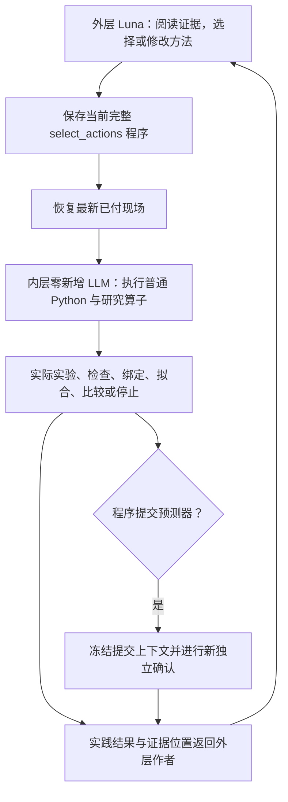

# 当前假设表示与子研究使用说明

更新日期：2026-10-20。本文解释当前 Hegel Machine 的 Common／普通 Python 研究接口，以及最近的 Luna 源方法修订线。运行进展和逐次证据继续记在[同一研究报告](hegel_machine_executable_evidence_repair_20261013.md)，历史能力从[复用总入口](hegel_machine_reuse_hub_20261006.md)查找。

当前系统能够记录问题、执行作者提出的实验与检查、保存可执行组件、使过期依赖失效，并让父模型实际消费选定的子结果。提出什么解释、怎样拆题、使用哪些证据以及怎样合成预测器，仍由研究者或其编写的程序决定。本轮实际执行采用“外层 Luna 作者＋内层零新增 LLM 的方法实践”；不能把通用在线 Common 的子 Luna 调度描述成本轮已经发生的行为。

## 1. 当前的“假设”由哪些对象组成

当前主线没有要求把一切装入同一个 `Hypothesis` 对象。理解一项研究时，可以概括为：**问题、适用范围、可执行模型或关系检查、参数与拟合上下文、证据、父子依赖、当前状态**。这是对现有记录的说明，不是新增 schema。

首先区分三个科学工作层级：

| 层级 | 当前载体 | 它能回答什么 |
| --- | --- | --- |
| 预测模型 | 普通 Python 预测器、拟合程序、保留的训练上下文；`manifest.hypotheses[]` 指向实际路径 | 给定公共输入与历史，产生可评价的预测 |
| 局部关系与组件 | 带实测行号和范围的数值检查、参数工作区域，或作者定义的条件组件 | 某个局部关系是否成立；某一测量视图下的预测器表现怎样；父模型可以选用哪些约束或子预测器 |
| 研究方法 | 带 `select_actions` 的程序；`manifest.research_programs[]` 与方法实践记录 | 何时取证、拟合、比较、修订、停止或提交 |

模型登记需指向真实 Python 文件，最终提交的模型也必须出现在假设清单中，见 [manifest 校验](../src/hegel_machine/cognition/online_inquiry_llm.py#L658)。登记可发布方法时，源码、研究角色和实践支持一起保留，见 [register_published_method](../src/hegel_machine/cognition/temporal_method_learning.py#L155)。清单和登记提供可追溯性，不产生新的科学支持。

研究问题本身是字典记录。首次创建保存原始 `assignment`，包含 `id/question/parent_id/depends_on`；同一 ID 可以更新当前问题文字，原委派仍保留，见 [open_assigned_question](../src/hegel_machine/cognition/online_inquiry_llm.py#L30)。随后记录会累积证据、实验、分析、答案和状态。

几个身份不能混为一谈：

- 问题 ID 标识持续的研究工作；修改问题文字不等于完成了拟合或消费了证据。
- 模型路径标识一个执行入口；同名文件后来重拟合，不能继承旧提交的确认结论。恢复和比较还要识别具体源码、拟合数据范围与保留上下文。
- 条件组件 ID 标识作者定义的关系及其输入视图；它不是目标量的固定名称。
- 方法标识研究决策程序；选用了旧方法，不等于它已在当前现场获得新确认。

这些身份支持记录关联与执行定位。当前接口没有通过 ID 或文本相似度自动认定两个科学解释相同。

## 2. 本轮实际怎样运行

当前付费源修订入口是 [run_native_method_compilation.py](../scripts/run_native_method_compilation.py#L40)。`run_paid_source_repair` 建立外层 `SourceProcedureRepairLearner`，把真实 provider 交给 Luna，由它阅读原方法、修改 `shared/consolidated_method.py` 或选择完整研究程序，见[作者构造](../scripts/run_native_method_compilation.py#L116)。

每次实践恢复最新已付现场。内层构造明确使用 `SingleSubmissionMethodAgent(None, ...)`，并将 `max_model_calls` 固定为继承现场已用调用数，见 [paid_scene_trial_preparer](../src/hegel_machine/cognition/anonymous_method_learning.py#L813)。因此内层没有 live provider，也没有新增模型调用余额。



内层仍能声明问题、执行嵌套 `procedure`、分析已付证据、创建组件、绑定结果、拟合和比较。其操作及证据位置会交回外层，见 [实践结果回传](../src/hegel_machine/cognition/anonymous_method_learning.py#L601)。`SingleSubmissionMethodAgent` 在第一次最终提交后执行普通确认，子程序提出的模型先返回其调用者，见[执行与提交](../src/hegel_machine/cognition/anonymous_method_learning.py#L228)。

本轮开子题的主要科学决策发生在外层：Luna 可以用 `procedure` 选择完整程序并声明研究问题，也可以在普通 `write/run` 中提供 `research_question`。同 ID 延续原工作，新 ID 建立同一源修订父题下的另一项调查，见[工作选择](../src/hegel_machine/cognition/anonymous_method_learning.py#L564)和[作者动作处理](../src/hegel_machine/cognition/anonymous_method_learning.py#L735)。

## 3. 怎样判断现有假设“不够用”

系统有可计算的判定，也有必须由作者完成的科学判断。两者承担不同工作。

### 内层当前仍会执行的硬判定

1. **代码或拟合没有成功执行。** 返回错误、超时或未完成状态，保留实际开销。这是执行或计算未决，不能据此排除一个模型族。
2. **实际预测误差。** `evaluate` 在已付证据上执行候选；`refit` 可以报告独立轨迹留出的验证结果；二者都与新独立确认分列。新数据加入后，旧评价会标为 `new_paid_rows_unscored`，不能继续当作覆盖全部当前数据。
3. **明确暴露的表示冲突。** 模型采用实际 `represent/predict_features` 合同时，系统检查完整捕获表示的精确重复值。相同表示对应不同目标时计算已评数据上的经验 MSE 下界。若下界超过配置阈值，候选标为 `representation_conflict`，并登记一个“哪些公共区别被表示丢失”的问题，见[表示诊断](../src/hegel_machine/cognition/representation_diagnostics.py#L31)和[评价后记录](../src/hegel_machine/cognition/executable_evidence.py#L359)。
4. **声明依赖过期。** 子答案、组件版本或已选关系的分析版本改变，使相应父候选需要重建、重拟合或重新评价；旧评价不再被当作当前有效证据。
5. **新独立确认未通过。** 成功执行的预测误差超过阈值时，这次提交没有获得确认；执行错误则单独记录。两者取得的新观测都保留，后续可以成为已付证据。

“表示冲突”能定位当前表示在这些数据上的不足，但不会给出缺失变量或正确机制；没有发现冲突，也不证明表示在未见输入上充分。具体执行接口及诊断范围见 [representation_diagnostics.py](../src/hegel_machine/cognition/representation_diagnostics.py#L6)。

### 通用在线 Common 另有的 live 调度

如果 Common 实例拥有 live provider 和剩余预算，它还可以自动安排继续研究：

| 实际触发 | 调度内容 | 科学内容由谁决定 |
| --- | --- | --- |
| 一次成功评分但失败的新确认，且未处理过、资源足够 | 创建 `scientific_revision_N`，携带真实提交、冻结范围、误差与反例 | 子研究者区分参数误差、表示不足或其他解释 |
| 至少两次符合要求的“已付拟合达标、后续确认失败” | 升级为预测方法修订，并调用现有整轨迹复核路径 | 作者修订拟合方法或模型；不是宿主宣布整个模型族被否定 |
| 当前候选误差未达标且表示未暴露，或父研究仍处于相应未评估阶段 | 开表示调查 | 作者先暴露真实输入／拟合合同，再决定修改 |
| 失败确认后的父研究处于方法修订，且满足资源与历史状态条件 | 安排一次结构提案实践 | 作者提出坐标、项、适用范围和候选程序 |

入口分别见[确认失败研究义务](../src/hegel_machine/cognition/common_archive_inquiry.py#L720)、[连续泛化失败筛选](../src/hegel_machine/cognition/scientific_generalization.py#L7)、[表示调查](../src/hegel_machine/cognition/representation_inquiry.py#L33)和[结构提案](../src/hegel_machine/cognition/structural_proposal.py#L35)。这些条件还检查调用、时间、token、观测余额和当前问题栈，不是无条件触发。

**上述 live 子会话没有在本轮内层运行。** `provider=None` 时，`inquire` 直接拒绝 live 委派，见 [Common 的入口检查](../src/hegel_machine/cognition/common_archive_inquiry.py#L537)。表示冲突等普通执行记录仍然生效，是否由外层把它变成下一项科学研究，要看 Luna 实际选择与执行。

### 必须由作者判断的部分

总误差大、某段残差集中、两个候选预测分歧，都是研究线索。它们不会自动告诉系统“应该增加历史”“应该改变条件”“应该换机制”或“应开哪个子题”。作者需要说明待区分的解释，找到现有证据的具体不足，再选择分析、拟合、实验或停止。没有必要为了形式上拥有子题而重复购测；现有证据足够时，可以直接分析和修订。

## 4. 子题怎样形成可检查的答案

作者可以对已经购买的记录调用 `analyze_evidence`，或对带事前预测的实验调用 `analyze_revision`。读出返回 `supported/refuted/inconclusive`、答案和实测行号；可选 `checks` 将局部关系变成可执行数值检查，见[读出合同](../src/hegel_machine/cognition/inquiry_revision.py#L20)。

系统保留作者原答复，再执行所声明的检查。违反检查不能继续返回数值上被支持的状态；没有检查的文字仍是作者解释，不能直接支持受管理的参数绑定。参数工作区域还需作者提供适用条件和边界，见[实际分析执行](../src/hegel_machine/cognition/inquiry_revision.py#L566)。

这里要分别读三个量：

- `evidence_status/check_results`：历史作者断言与当时实测证据的检查结果。
- `measured_value`：选定实测行构成的实际局部关系值。
- `predicted_value/residual`：当前受评候选对同一关系的预测及偏差。

历史断言满足，不代表当前预测准确；历史断言被反驳，也不妨碍一个新模型正确预测那个实测关系。代码已明确这些字段含义，见 [PAID_RELATION_FIELD_MEANINGS](../src/hegel_machine/cognition/executable_evidence.py#L14)。

分析得到的答案会追加到父题 `child_answers`，父题重新打开，见[子答案返回](../src/hegel_machine/cognition/common_archive_inquiry.py#L1081)。通用 live 子研究的局部结束、原委派已回答且依赖已支持、调用耗尽，都可以导致返回；只有实际执行了检查或交付了已评模型，才登记相应科学返回，见[科学返回记录](../src/hegel_machine/cognition/common_archive_inquiry.py#L632)和[子研究返回条件](../src/hegel_machine/cognition/common_archive_inquiry.py#L682)。

## 5. 返回以后，父模型怎样真正消费子结果

父子关系和 `depends_on` 只表达研究组织。模型不会因为记录里出现一个子题 ID 就改变参数。当前有两种明确的数据入口。

### 参数工作区域与已测局部关系

作者显式选择输入，例如以下接口示意只说明数据连接，不提供当前任务的科学答案：

```text
run {operator:'bind_research', model:'parent.py',
     inputs:{selected_slot:'local_question'}}

# 或选取某个已存在分析中的实际局部检查：
inputs:{selected_slot:{revision_index:已有分析编号, check_ids:['已有检查ID']}}
```

参数区域需要当前答案及数值证据都为 `supported`；局部关系可保留满足或违反旧期待的真实检查，父模型使用的是测得的值和见证行。作者必须自己决定其拟合含义，并避免把留出标签作为同一验证分区的训练输入。物化实现见 [materialize](../src/hegel_machine/cognition/executable_evidence.py#L299)。

子区域答案版本改变后，声明消费者变为 `needs_rebuild`；重新物化输入或改变组件后变为 `needs_refit`，旧评价被清除，见[答案版本](../src/hegel_machine/cognition/executable_evidence.py#L171)和[依赖刷新](../src/hegel_machine/cognition/executable_evidence.py#L97)。在 Hegel 再次评价候选前，系统更新其已声明输入，失去支持的组件会阻断使用，见 [before_candidate](../src/hegel_machine/cognition/executable_evidence.py#L331)。

实际加载模型时，系统先调用父模型的 `bind_research(inputs)`，然后执行 `fit/fit_features`；有参数区域时，再检查 `get_parameters()` 暴露的实际值是否在区域内。局部关系另报告拟合后预测与实测的偏差。见 [load_model](../src/hegel_machine/cognition/code_agent.py#L568)。因此，保存一份绑定声明与模型实际报告消费，是两项不同的执行事实。

一个示意：子题只返回“可能需要更多历史”时，父题得到一条解释；若子题返回带范围、行号和检查的局部实测关系，父题得到可选的证据对象；只有作者明确绑定，并让父拟合程序使用它，才形成会改变预测的连接。运行时检查这条声明的数据流及参数一致性，不替作者证明任意 Python 的科学语义。

### 子预测器与条件组件

条件组件的 `view.bind(public_spec, observations, memory)` 由作者从实际测量提取输入、目标和证据行。它冻结了“正在研究哪种关系”的坐标定义。父模型通过 `bindings` 选择保留的组件，由 `bind_models` 接收可调用的子预测器；父模型自己构造子调用的输入，见[条件组件合同](../src/hegel_machine/cognition/conditional_research.py#L19)和[递归模型加载](../src/hegel_machine/cognition/code_agent.py#L579)。最终响应预测器仍只能获得公开控制与历史，不能把未来测量当作免费输入。

同一冻结 view 下，可以沿用同一个 component ID 比较新预测器；改变 view 则需要新的 component ID，因为问题的输入／目标解释发生了变化。实现检查 view 路径与冻结源码，见 [evaluate_component](../src/hegel_machine/cognition/conditional_research.py#L128)。这是接口中的问题身份约束，不是自动科学等价判定。新模型即便优于旧模型，也可能仍是 `refuted_on_paid_rows`；保留较好候选不等于确认通过。

## 6. 比较、实验与独立确认分别证明什么

**已付评价**回答候选在现有证据上的表现。**固定划分比较**回答在同一组轨迹、分区和聚合规则下，两个具体程序谁表现更好。训练误差、单折最好分数、五折总分应分别记录，不能互相代替。已经保存的比较应优先读取原报告、分折参数和逐记录预测，不重复拟合来重新得到同一结果。

**带事前预测的实验**先保存每个候选的源码、拟合截止点及对公共动作轨迹的预测，随后才购买标签。实测后的 prospective MSE 使用这些保存的预测，不能事后重拟合再冒充事前预测。具体机制见 [prepare_revision](../src/hegel_machine/cognition/inquiry_revision.py#L196)。解释实验时还要核对整条控制轨迹和实际记录范围；一个数值对比并不自动成为隔离了单一因素的干预。

**新独立确认**在提交时保留候选及拟合上下文，把新标签隔离到评分结束后才加入工作区；成功执行且 MSE 达到实际配置阈值，才记为通过。失败行随后成为可继续研究的已付证据，见[确认执行](../src/hegel_machine/cognition/online_inquiry_llm.py#L582)。当前付费源修订协议的基础实践配置是 96 行、MSE 阈值 `1e-6`，见[协议](../scripts/run_native_method_compilation.py#L55)；具体运行以其已保存 `protocol` 和确认记录为准，不从其他入口的默认值推断。

父研究的 `awaiting_independent_confirmation` 只是候选已具备请求确认的当前证据状态；父研究只有新 `fresh_confirmation.passed=True` 才记录成功，见[父阶段判定](../src/hegel_machine/cognition/common_archive_inquiry.py#L814)和[确认成功记录](../src/hegel_machine/cognition/common_archive_inquiry.py#L935)。

## 7. 入口、返回状态与“未决”

当前付费源入口支持 `--repair-paid-source`、`--continue-author`、`--research-brief` 和 `--retain-comparison-report`；参数定义见[入口 CLI](../scripts/run_native_method_compilation.py#L1307)。它恢复现场和已有账户，由作者继续同一研究。调用额度的增加是显式操作，不是科学状态自动触发。

作者可使用的关键动作与返回含义如下：

| 位置 | 动作／状态 | 含义 |
| --- | --- | --- |
| 外层作者 | `write/run` 修改方法；`practice`；`procedure` 选择完整程序 | 将方法实际放入当前已付现场执行；执行结果返回作者 |
| 内层程序 | `analyze_evidence/analyze_revision`、`bind_research`、`evaluate/refit`、嵌套 `procedure` | 做已声明的分析、消费、拟合与评价；各自留下实际执行记录 |
| 内层实践 | `confirmation_failed` | 本次新提交的确认失败；反例和开销保留 |
| 通用 live 子会话 | `inquiry_finished/answered/model_call_budget_exhausted` | 一次局部会话结束或交回；这些状态本身不确认父预测器 |
| 外层局部返回 | `source_work_returned` | 当前工作未决或结束，原 `source_method_repair` 父题仍为 open，作者可以选下一项研究 |
| 外层父题 | `source_repair_inconclusive` | 作者明确把父题也作为未决结束；没有确认、发布或迁移 |
| 外层父题 | `source_repair_confirmed` | 当前同一方法稿、同一研究工作已有所需新实践确认；保留该稿，尚不等于方法发布或跨任务成功 |

局部 `finish {inconclusive:true,...}` 与显式结束 `question_id:'source_method_repair'` 分开处理；无活动子题时返回 `source_repair_pending`，不会暗中结束父题，见[未决处理](../src/hegel_machine/cognition/anonymous_method_learning.py#L756)。成功 finish 校验当前源码及研究工作对应的新实践确认，见[当前稿门槛](../src/hegel_machine/cognition/anonymous_method_learning.py#L780)。

未决可以表示计算未完成、证据仍不足、候选被拒绝后尚无下一项有依据的动作，或作者主动停止。它保留已经完成的实验、拟合、失败和局部结论；不能被重述成“什么也没执行”，也不能被重述成“整个假设族已被否定”。

## 8. 历史能力怎样复用

先查[复用总入口](hegel_machine_reuse_hub_20261006.md)和[同一能力目录](../src/hegel_machine/cognition/historical_capabilities.json)，再定位当前调用者、需要的输入和原始证据。现有只读检索例子，在 Hegel Machine 根目录执行：

```bash
PYTHONPATH=src python3 -m hegel_machine cognition historical --query '子问题' --compact
PYTHONPATH=src python3 -m hegel_machine cognition historical --query refit --compact
PYTHONPATH=src python3 -m hegel_machine cognition historical --version 0.59 --compact
```

检索实现对目录字段及关联路由做关键词匹配，执行入口则将选定版本分派到已有原生 CLI，见 [historical_capabilities.py](../src/hegel_machine/cognition/historical_capabilities.py#L12)。它帮助找到“以前做过什么、现在哪里可调用”；目录维护、检索或文件维护成功，都不构成两个科学解释相同的判定。检索没命中也不能直接推出算法从未实现。

旧原生有限搜索／DSL 路线已有 `Program/Candidate/ResearchQuestion` 等结构，见[原生模型记录](../src/hegel_machine/cognition/models.py#L93)。它们是可复用的历史能力，不是当前源作者每次调用时自动经过的统一推理层。例如该配置的 `max_question_depth=2`，不能当作当前 Common live 问题栈的深度规则。旧能力只有通过明确的现行入口被选用并实际执行，才算当前采用。

当前已有子题返回、读出、绑定、联合拟合、固定比较和确认接口。下一步若未发生，先区分：算法缺失、接线缺失，还是作者尚未采用。最近报告已记录接口接通和实际实践，因此不能仅凭未确认就再次宣称“没有递归或合成接口”。

## 9. 当前证据、限制与下一步

截至本说明对应的终态，039 与 041 是两个实际可执行预测程序：039 原五折 MSE 为 `1.9482443501`；041 在同一划分上增加历史交互表示，MSE 为 `2.414801`，五折均差于 039。两者检验的是不同特征表示与同配置 HGB 组合成的具体程序，不能称作已经严格编码了两个互斥机制的二元对照。该结果只否定了本次 041 替换稿在这项开发比较中的价值，不能否定所有交互或状态模型。

后续三次自主实验新增 176 行，并在购测前执行两套旧算法的预测；旧模型确实用扩充数据重拟合。没有产生新结构预测器、原五折重评或新独立确认。竞争解释仍未落实为新的可执行预测模型；其中一次作者分臂统计还曾错用偏移，框架总分正确，纠正值已保留。精确数据和来源继续见[研究报告 2026-10-19 的 039–041 及终态段落](hegel_machine_executable_evidence_repair_20261013.md)。

当前限制集中在以下范围：

- 数值检查证明的是声明范围内的实测关系，参数工作区域不是唯一全局参数的证明。
- 运行时能检查声明的绑定与执行结果，不能替作者证明任意 Python 程序的物理语义，也没有自动科学语义判同器。
- 表示下界针对实际捕获输入及已评数据；不构成未来风险或完整隐藏状态的证明。
- 开发五折被多次使用后的改善，仍需新独立确认；方法确认、发布、跨任务迁移与相对其他 Agent 的优势分别需要各自证据。
- 本轮自主实验和接口采用已经发生，但尚不足以证明自主递归合成成功或递归组织的独立收益。

下一步应先读取已保存的逐记录预测和纠正后的同源反馈，选取一项真实实测约束，由 Luna 改写一个可执行候选，让选定证据实际进入拟合；沿原固定划分与保留稿比较，再决定是否值得请求新确认。无需先确定唯一机制，也无需重复购买已有证据、重新恢复已存 OOF 或重建现成接口。该步骤是下一项有依据的研究交付，不代表本文启动了实验或追加了预算。
