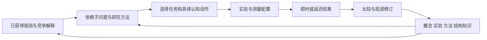

# 黑格尔机 0.12.0：可修订的整合研究系统

日期：2026-09-08。对应本地认知主线工作树。继续采用 [GPT6 建议](../markdown/GPT6_advice.md)及其[具体审视方案](../markdown/Hegel_Machine_Vision_Progress_and_Research_Critique.md)，承接 [0.10.0 可调用概念](hegel_machine_callable_concepts_20260908.md)与 [0.11.0 测量和状态](hegel_machine_measurement_and_state_20260908.md)列出的功能余项。

本轮把实验方案、研究方法、可调用机制与结构假设都变成可以执行和修订的研究知识。新增统一入口 `cognition frontier`，让持续任务、实验迁移、方法投入、局部理论修订、对象结构和延迟实验共用知识库，并在每个阶段后保存。普通 Python Agent 对照已经实际调用模型、查询同一装置、写代码、执行和修正，三题全部完成。

## 余项怎样进入实际执行

| 原报告中的方向 | 当前实现与作用 |
|---|---|
| 区分实验成为可迁移知识 | 保存真实区分结果、当时的竞争程序和控制轨迹；新任务按公开变量角色与范围重绑定，先检验当前区分力，再实际购买实验。新结果决定当前赢家。 |
| 方法和步骤自身修订 | 根据后续共同观测的实际收益形成动作序列，去除无益步骤；新任务的反馈支持或限制方法适用条件。方法会改变控制器实际执行的步骤。 |
| 跨任务投入选择 | 比较具体未完成方法的已测收益、观测费与计算费；被选中的方法步骤进入该任务的研究状态并执行。已做完的方法不再被当作尚存机会。 |
| 递归子问题与可变依赖 | 研究节点保存问题、依赖、候选答案和必要测量。缺失读数会阻塞节点；真实观测解除阻塞，子答案绑定到父程序。依赖修改使受影响答案重新求解。已学计算仍有残差时可自动生成子问题。 |
| 局部机制替换 | 保持其他调用不动，从失配观测拟合失效部分；已有有效域的证据约束新候选。局部修订接受普通新轨迹比较。 |
| 概念合并与拆分 | 观测支持等价时提出共享调用，用实际执行减少判断价值；保存原定义，新反例可恢复分别执行。合并和拆分均进入普通控制器。 |
| 对象、事件与尺度 | 可执行对象归约、邻域作用、事件差分与时间窗口；根据已付细尺度观测比较对象集合和聚合尺度，后续实际按所选尺度测量并扣费。 |
| 结构及元先验修订 | 从数值观测估计局部耦合、作用半径和低维读出；通过平移、置换、远处扰动和守恒残差检验结构。旧结构程序跨任务召回，新反例保留旧支持并产生情境修订。 |
| 延迟外部反馈 | 实验由独立本地进程执行；等待任务让出调度机会。保存与恢复保留票据和资源预留，结果到达后进入原工作区继续研究。 |
| 完整普通代码 Agent | 配置的模型自主选择查询、文件写入、Python 执行、预测评估和提交；真实执行错误返回模型，由模型修改代码。双方使用相同公开控制、仪器和观测契约。 |

证据选择概念、累计证据支持的较优解释、连续状态和已有条件知识继续参与同一控制器。扩展后的图答案与机制修订必须与当前解释共同接受新观测比较；测量改变后的程序也回到这个循环。



## 可复现入口

在项目目录执行整合研究，第二次命令会从保存的阶段继续：

```bash
PYTHONPATH=src python3 -m hegel_machine cognition frontier \
  --checkpoint artifacts/frontier.json --steps 1

PYTHONPATH=src python3 -m hegel_machine cognition frontier \
  --checkpoint artifacts/frontier.json
```

若最后的外部实验尚未返回，会话保存为 `waiting_for_feedback`；结果到达后用同一命令继续。普通代码 Agent 对照使用实际配置的模型：

```bash
PYTHONPATH=src python3 -m hegel_machine cognition code-compare \
  --workspace artifacts/code_workspace --output artifacts/code_comparison.json

PYTHONPATH=src python3 -m hegel_machine cognition frontier \
  --checkpoint artifacts/frontier.json --code-comparison artifacts/code_comparison.json
```

指定 `--code-results` 和 `--hegel-results` 可复用已有对应结果，避免重复运行模型。整合报告引用本次实际完成的对照。

独立对象研究可以把所得结构继续保存到共同知识库：

```bash
PYTHONPATH=src python3 -m hegel_machine cognition structure \
  --readout window --variant exchange \
  --memory artifacts/structure_knowledge.json --output artifacts/structure_window.json
```

已有普通 `cognition session` 可以提交延迟实验。请求文件包含 `task_index`、`probe`（`probe_id` 与完整控制 `sequence`），可选 `delay_seconds`、`channels` 和 `source`：

```bash
PYTHONPATH=src python3 -m hegel_machine cognition experiment \
  --checkpoint artifacts/session.json --request experiment.json

PYTHONPATH=src python3 -m hegel_machine cognition session \
  --checkpoint artifacts/session.json --steps 1

PYTHONPATH=src python3 -m hegel_machine cognition experiment \
  --checkpoint artifacts/session.json
```

Python 接口分别为 `ExperimentalResearch`、`ResearchMethods`、`ResearchGraph`、`KnowledgeEvolution`、`run_structural_research`、`ResearchSession.submit_experiment` 和 `run_code_comparison`。保存文件包含继续求解所需的实际程序和观测。

## 最终整合运行

[12 阶段整合摘要](../artifacts/hegel_machine_v012_complete_research_20260908_summary.json)与[完整状态](../artifacts/hegel_machine_v012_complete_research_20260908.json)已保存。先完成持续任务阶段并退出，再由新进程继续；最后的外部实验曾处于等待状态，下一次命令交付结果并完成原问题，最终 `completed`、待办阶段为零。

- 实验迁移中，两个普通认知任务先学出 `x` 和 `x²`；新问题从相同初始预测中学得区分实验。换名为 `u`、控制范围扩展后，实际回放探针，并根据新结果由平方解释改选线性解释，64 个新输入的 MSE 为 0。
- 跨任务方法研究先留下误差约 1.163 的旧问题；后续研究学得可用步骤，调度重新选择旧问题并实际执行。第一步 refit 的真实收益为 0，后续表示修订收益为 1，旧问题误差降至 3.30e-16，另一新问题仍保留待办。
- 局部机制修订保留旧域 MSE 1.23e-19，新域 MSE 6.52e-20；概念合并在 16 行上的实际执行由 560 减至 224，反例后的拆分误差为 6.35e-15。真实仪器读数解除递归子问题阻塞，依赖答案进入普通控制器，新取得的比较数据上 MSE 为 0。
- 延迟实验等待时另一任务先运行，保存恢复后继续原问题。最终两题完成，总计 65 条观测、1 次外部实验尝试；独立 CLI 提交与收取也完成了真实进程运行。

七种对象研究均在同一持续知识库上完成，每种结束后另测 64 行。测量费按实际读取的字段计数；所选尺度 4 对应将四个对象聚合观察，每行测量费由 12 降至 3。

| 研究 | 所选尺度 | 新数据 MSE | 观测 / 测量 / 研究计算 |
|---|---:|---:|---:|
| 总量与守恒 | 4 | 3.37e-32 | 92 / 708 / 38682 |
| 局部邻域 | 1 | 1.31e-20 | 142 / 1704 / 136054 |
| 时间窗口 | 1 | 1.97e-21 | 162 / 1944 / 159955 |
| 事件增量 | 1 | 6.8e-22 | 136 / 1632 / 139903 |
| 漏损后的结构修订 | 4 | 1.42e-20 | 80 / 672 / 45242 |
| 对称破坏 | 1 | 1.17e-19 | 140 / 1680 / 149890 |
| 远处作用 | 1 | 1.39e-20 | 132 / 1584 / 134531 |

新的配对实验在漏损系统中反驳守恒，在锚定系统中反驳守恒、平移和置换对称；反例与原结构的支持记录同时保存。低维读出、修订程序和实际购买的测量视图都进入后续普通控制器。

[294 项认知测试](../artifacts/cognition_v012_complete_tests_20260908.log)全部通过，覆盖原有认知机制及本轮新增的实际执行、保存恢复、方法续步、变量角色重绑定与宽对象迁移。命令为 `PYTHONPATH=src python3 -m pytest -o addopts='' -q tests/test_cognition_*.py`。

## 65 任务中的收益与退化

[最终会话摘要](../artifacts/hegel_machine_v012_complete_session_summary_20260908.json)和[后评测摘要](../artifacts/hegel_machine_v012_complete_evaluation_20260908_summary.json)来自同样五分区、seed 809 的完整会话。先运行十次访问，再由新进程恢复，前十次程序与记录原样保留。最终 65 题、69 次访问；54 题达到学习侧阈值，11 题仍未解决。学得方法实际影响 46 次动作选择，跨任务安排的步骤实际执行 4 次，已有实验实际回放 42 次。

| 指标 | 0.11.0 | 0.12.0 |
|---|---:|---:|
| 平方误差任务末次平均 MSE（58 题） | 0.00235351 | 0.00411489 |
| 尾部任务末次平均 pinball（7 题） | 0.217312 | 0.220949 |
| 观测行 | 4216 | 3806 |
| 研究计算 | 1311026 | 946956 |
| 学习侧达标题数 | 56 | 54 |

这轮投入减少，预测质量下降。四次追加访问在独立评估中均未达到明确改善或恶化的幅度；方法和实验已经参与真实选择，但其粗适用条件仍会把旧经验用于收益不足的研究。新的七类对象任务与专门机制修订场景展示了扩展后的行为，65 题结果仍作为整体质量的负结果保留。后续重点是改进方法适用条件与追加研究的实际价值，使新增能力产生更稳定的累计收益。

## 真实普通代码 Agent 对照

[三题完整对照](../artifacts/code_comparison_20260908.json)及[小摘要](../artifacts/code_comparison_20260908_summary.json)记录实际模型调用、代码、执行错误、修复和独立轨迹结果。每题观测上限 128、仪器费上限 512；每题结束后评估 4 条新的 64 步轨迹。

| 任务 | 普通代码 Agent MSE | 黑格尔机 MSE | 代码 Agent 观测 / 测量 | 黑格尔机观测 / 测量 |
|---|---:|---:|---:|---:|
| 连续过程 0 | 0 | 1.32e-18 | 64 / 320 | 90 / 282 |
| 平方读出 1 | 0 | 6.51e-11 | 64 / 320 | 86 / 278 |
| 连续过程 2 | 2.06e-32 | 6.57e-18 | 38 / 166 | 86 / 278 |

两者都取得近零预测误差。普通代码 Agent 在这三题使用更少观测；黑格尔机在前两题使用更少仪器费，三题合计仍是普通代码 Agent 更少。这组结果尚未显示黑格尔机相对完整普通代码 Agent 的累计学习优势。

代码 Agent 三次完成运行分别使用 5、5、9 次模型调用，报告 token 为 69608、88875、127129；任务 2 真实遭遇接口 `KeyError` 后自行修改模型。Python 子进程执行时间合计约 0.755 秒，模型时间另外保留。黑格尔机记录搜索的候选乘行支出；普通代码记录评分行数、任意 Python 执行时间与模型用量，计算维度分别报告。

## 整合中修正的实际连接问题

多步方法现在区分步骤回报和完整方法回报。第一步暂未改善预测时，已开始的方法仍可执行其依赖步骤；完整方法结束后才更新整体收益和费用。跨任务选择的实验步骤在续研拟合之前实际采集，使单轮访问也能完成实验、拟合与新的共同比较。

对象结构的迁移保持对象和字段角色，并按当前预算可支付的候选数量生成变量绑定。这个改变使学到宽对象程序之后的下一任务能够继续运行。对象图的作用半径只由真正参与当前读出的对象对约束；尺度验证选出表达族后，已有两条轨迹共同确定拟合区间，再购买进一步的边界实验。

聚合尺度下，控制指令与测量读数分别保留。实验覆盖由已执行的真实控制序列计算，预测程序只获得已购买的测量视图。原始整合试跑和失败记录保留在各自文件，最终数据单独写出。

## Limitations

- 当前功能覆盖有限的公开数值任务、预设可用仪器、对象字段和可执行语言。对象集合与尺度候选、方法基本动作、结构检验族仍由实现提供；任意新本体、任意模拟器与开放世界理论发明仍是研究目标。
- 方法序列由后续收益提出并在迁移中检验。早期步骤即使当时没有直接收益，也可能为后续步骤提供条件；自动删步仍属于需要后续验证的方法假设。结构压缩与方法经验不能保证所有任务都改善。
- 对照中的代码评分行数不包含全部自由 Python 拟合运算，因此不能与黑格尔机搜索行数直接作总计算排名。模型 token 阈值在调用之间检查，最后一次返回可能越过阈值；任务 2 超过 120000 阈值 7129 tokens。此前 task0 的 60000 阈值试跑耗尽预算，失败结果独立保存在 `code_agent_actual_20260908.json`。
- 延迟装置费用按已交付观测与仪器读数结算，失败和取消计一次实验尝试。它是具体可运行的本地进程装置，不表示已经连接其他实体实验设备。
