# 从无内容过程学习到前提门控的世界结构承诺：黑格尔机 v10 的形式理论、架构演进与全谱系前瞻实证报告

**From Content-Free Procedure Learning to Premise-Gated World-Structure Commitments: Formal Theory, Unified Architecture, and Prospective Empirical Synthesis of Hegel Machine v10**

- **日期**：2026-11-16（含 `v10.2` 外部审计勘误与闭环修订）
- **分支与代码基线**：`codex/hegel-cognitive-mainline`（承接封账基线 `§118`、独立 COW 台账复核 `§§119–124` 与 `v10.2` 审计闭环 `§125`）
- **证据目录**：`docs/evidence/v10_world_structure_20261116/`（原 13 份 JSON 回执保持字节级只读未改）＋ `docs/evidence/v10_2_audit_remediation_20261116/`（`v10.2` 证明域一致性、SDE 带噪条件漂移、等工具三臂归因、单因子定位隔离、四机制实测修复与冻结 `v4` 生命周期新回执及 SHA256 台账）
- **回归控制**：聚焦套件 `tests/test_v10_*.py` + `tests/test_v10_2_audit_acceptance.py` + `tests/test_historical_capabilities.py` 共 **35/35（100%）** 通过（与全仓库 `tests/` 完整测试总数分开核算，见 [hegel_v10_2_errata_and_audit_closure_20261116.md](file://wsl.localhost/Ubuntu-22.04/home/erzhu419/mine_code/Asumption%20Agent/Hegel%20Machine/docs/hegel_v10_2_errata_and_audit_closure_20261116.md)）

> **【`v10.2` 科学表述勘误提示】**：本报告原 `v10` 各节结果按实验性质严格区分为：（1）**求解器／模型类能力消融**（Phase 2C-2/3A/4B/5A，基线关闭对应新求解器，不直接等同于等工具持久学习优越性）；（2）**多因子结构化修订工作流对照**（Phase 2B/3B Stage A，单因子前提定位已在 `v10.2` Study B2 单独隔离）；（3）**有限离散格点／图系统**（一维 $\mathbb{Z}_N$ 环与二维 $\mathbb{Z}_{N_x}\times\mathbb{Z}_{N_y}$ 平移子群，非连续 PDE 网格极限或完整 $\operatorname{Aut}(\mathbb{T}^2)$）；（4）**供给模型精确有理检验**（可信基为 Python `Fraction + SymPy QQ`，导出 Lean 4 为 `draft_only` 未编译草稿；`v10.2` 已补齐 `state_bounds` 全链路域一致性、`SearchBudget` 计费、`learned_model -> certificate` 桥接及实测四机制差异修复）。**Phase 6 扩张已冻结。**

---

## 摘要（Abstract）

黑格尔机（Hegel Machine）旨在构建一个能够在受控物理／符号实验环境中**自主提出假设、设计主动干预实验、定位反例根因并实现跨任务递归自我改进（Recursive Self-Improvement, RSI）**的辩证科学发现智能体（正题 Thesis $\to$ 反题 Antithesis $\to$ 合题 Synthesis）。然而，在 `v0.1` 至 `v9`（`§§1–118`，共 181 个历史子版本）的长周期演进中，尽管系统已建立起匿名传感器角色归纳、仪器校准模型、关系区间二分与研究动作策略等完备运行时，其在冻结 `106110602`（五对象位置实验）方法并迁移至独立后继源 `106110603` 的严格三臂对照中仍出现 **三臂 `0/3` 交付终测预测器** 的核心瓶颈（`§116`）。

本报告首先从认识论与形式机制层面给出这一瓶颈的精确诊断：**无世界结构内容的纯过程控制拼接（如 $\Pi_3 \circ \Pi_1$ 阶段序列与标量可用性切换条件）无法跨越对象元数（arity）变化或局部支撑前提（support premises）破缺**；一旦后继装置的对象数从 $N=4$ 变为 $N=5,6,7,9,16$，或交互方向、状态依赖门控、守恒律、马尔可夫充分性、过程随机性乃至离散 `(q, u, x, f)` 角色划分本身发生偏移，平铺轨迹残差（flat trajectory MSE）会将所有前提冲突混叠为不可归因的全局高误差，导致盲目重开全量组合搜索并耗尽观测／计算预算。

受 *Algebraic World Models: From Exploration to Proofs*（AWM）中“探索 $\to$ 可执行世界模型巩固 $\to$ 谓词门控形式化证明与差异修复”全链路闭环启发，并结合黑格尔机严格的**付费观测／计算双预算、匿名传感器、非线性执行器与零私有模拟器状态读取**约束，我们设计并完整实现了 **Hegel Machine v10（Phases 1–5）** 架构。v10 将“方法学习”锚定在显式、可证伪、跨元数参数化的**世界结构承诺（World-Structure Commitments）**与**动态支撑前提依赖图（`PremiseDependencyGraph`）**之上，打通了八大核心理论与工程支柱：

1. **严格无损等价重组门控 vs. 保守科学前提修订分离**：要求巩固承诺严格保持完整拟合列契约（含零权重读出列）、符号共享参数组、已付预测一致性及反例拒绝集单调性 $\operatorname{Rej}(T) \supseteq \operatorname{Rej}(S)$（在周期连续场与二维环面上还包含 $\operatorname{Aut}(\mathcal{M})$ 规范不变性），并将经验驱动的前提撤回／替换单列为带反例回执的保守科学修订；
2. **真实 COW 历史快照非破坏性复核（`602 -> 603`）**：在不动历史封账一字节的前提下，从同一 v8 知识库出发，使 `602` 与 `603` 从基线的双双 `unresolved`（`0/2`）提升至双双 `completed`（`2/2`），且 **`602 -> 603` 顺序后继将 `603` 的科研计算从 `199,912` 压降至 `67,028`（节省 `66.47%` / `2.98x` 加速），并将终测预测器从付费细测量通道 `['fine']` 升级为零测量纯控制通道 `selected_channels = []`（终测 MSE `8.04e-19`）**；
3. **跨元数条件交换、非守恒解耦与四代谱系演化（Phase 1 & Phase 2A，零 LLM）**：覆盖方向反转、状态条件边（`source_greater` / `source_less`）及耗散／非局域非守恒（`sink` / `nonlocal`），$N=4 \to N=5$ 八题三臂达 **`8/8`（省算 `37.82%`）**，$N=3 \to 4 \to 5 \to 6$ 四代演化达 **`4/4`（$N=6$ 将 $6! = 720$ 排列压缩至唯一双射，MSE `2.10e-20`）**；
4. **多维耦合曲面超平面主动实验设计（Phase 2C-1 & Phase 4A，零 LLM）**：从一维开放阈值主动二分（`4/4` vs 被动 `1/4`，区间收窄 `20,356x`）推广至四维边状态空间 `(q_src, q_dst, x_src, x_dst)` 中三参数耦合 $(r_0, c_0, c_1)$ 非线性曲面超平面不等式。在 8 题对抗边界压力测试上达 **`7/8（87.5%）`（多胞体直径较被动压缩 `78.8x`、较一维二分压缩 `73.5x`，参数 $L_2$ 误差降至 `7.30e-4`）**，并在 4 台匿名 $N=4 \to N=5$ 三参数偏移装置上端到端达 **`4/4（100%，全达 `selected_channels = []`，MSE `1.13e-19`，省算 `59.41%`）`**；
5. **层次化部分可观测隐状态（POMDP）前提图生长与近临界超临界极限环共振辨识（Phase 2C-2, Phase 3A, Phase 4B-2 & Phase 5B-2，零 LLM）**：沿着 `P_markov_state` $\to$ `P_latent_coupling` $\to$ `P_latent_order` $\to$ `P_latent_nonlinearity` 逐层解耦：一阶记忆 **`6/6`**、二阶谐振 `AR(2)` 与跨对象耦合 **`8/8`**；在原点线性不稳定（$\rho > 1.0$）的超临界 Van der Pol 极限环 POMDP 上，通过因果起振定理、$t=0,1$ 纯空间解耦、完整距离等价类保留与相位相干主动共振探针，在近临界区间 $\rho \in \{1.008, 1.015, 1.02, 1.04\}$（含攻克 Phase 4B 遗留冷启动题 `990401`）实现 **`4/4（100%，全达 `selected_channels = []`，MSE `2.03e-17`，省算 `83.57%`）`**；
6. **从一维周期格点环到二维周期格点环面、非周期边值（`Neumann`/`Dirichlet`）与有限不规则图拉普拉斯的无位置离散场系统发现（Phase 4B-1 & Phase 5A，求解器与表征能力消融，零 LLM）**：在零位置传感器匿名场上证伪 `P_role_partition`，一维离散环 $N=4\to 6, 5\to 7$ 达 **`8/8`**；Phase 5A 进一步支持二维有限周期格点环面 $\mathbb{Z}_{3}\times\mathbb{Z}_{3} \to \mathbb{Z}_{4}\times\mathbb{Z}_{4}$（离散平移子群不变性，$16! \approx 2.09 \times 10^{13}$ 排列、48 细传感器）、有界链 `Neumann <-> Dirichlet` 边值前提修订（`P_boundary_condition`）及有限未知不规则图拉普拉斯耦合场（$N=6 \to N=9$），12 题求解器能力对照达 **`12/12（100%，12 题全达 `selected_channels = []`，MSE `1.08e-19`，省算 `59.08%`，未启用该求解器的一维环与平铺基线均 `0/12`）`**；
7. **强内禀过程噪声（SDE）两阶段最小二乘工具变量（`2SLS-IV`）统计估计消融（Phase 5B-1，零 LLM）**：在状态转移受真实高斯过程噪声 $\varepsilon_{i,t} \sim \mathcal{N}(0, \sigma_p^2)$ 驱动时，利用滞后控制工具变量与外生脉冲投影克服 Hurwicz-Nickell 内生性偏置：4 台匿名 SDE 装置上**原生在线 `completed = 2/4`**（对比朴素 OLS `1/4`、确定性 v10 `0/4`），在无噪孪生装置（`process_noise_std=0`）迁移评价下达 **`4/4 <= 2e-3`（均值无噪孪生迁移 MSE `3.32e-4`，极点估计绝对误差 `0.0181` 较 OLS 降低 `10.7x`；真实带噪历史一步条件漂移 MSE 另见 `v10.2` 重测回执）**；
8. **结构化开放语法受控 LLM 修订工作流（Phase 2B & 3B，在线 `gpt-5.6-sol`）与精确有理代数证明内核（Phase 5C & `v10.2` 域统一，零 LLM）**：
   - 在线开放语法发现中，给定父承诺、已解角色与前提定位的结构化修订工作流以 **`-78.68%` tokens** 实现 **`7/8`** 突破（平铺匿名全树生成 LLM `0/8`；严格单因子前提定位隔离见 `v10.2` Study B2），沉淀承诺后在 8 台 $N=5$ 装置上 **`0` 次调用达 `8/8`**；
   - 在 `algebraic_proof_certificates.py` 构建基于 Python `Fraction` 与 `sympy.Poly(..., domain='QQ')` 的精确有理证明与证人检验内核 `SymbolicProofKernel`（导出 `draft_only` 未编译 Lean 4 草稿；`v10.2` 已统一 `state_bounds` 证明／执行域合法性并全额计入 `SearchBudget`）：供给模型下核验 **`7/7`** 有限元数集合上的涌现不变量（篡改证书拦截 `7/7`，`all_arity_proved = False`）；8 道控制题达成 **`8/8`** 可达证人／Farkas 对偶势函数认证；并在 `v10.2` Study B3 中完成跨 **4 类不同物理机制**的等工具实测差异修复（双臂 `8/8` 修复，依赖引导实测减少 **`58.42%`** 实验室探针查询，替代原 `5C-3` 单一端口增益机制 4 参数实例与 `89.92%` 名义公式估计）。

---

## 1. 引言与历史瓶颈诊断（`v0.1` 至 `v9 §118`）

### 1.1 初始构想：辩证递归科学发现（Dialectical RSI）

项目初始设计（见 `markdown/initial thought/`）提出的核心愿景并非单纯的函数曲线拟合（symbolic regression），而是构建一台可递归演化的**黑格尔机（Hegel Machine）**：

- **正题（Thesis）**：智能体基于既有知识库对当前未知物理装置提出结构化预测定律与观测解释；
- **反题（Antithesis）**：智能体不依赖被动随机采样，而是针对竞争假设或未决边界主动合成区分性实验探针（interventional probes），用真实测量暴露正题的反例（counterexamples）；
- **合题（Synthesis）**：智能体消费反例的精确结构含义，保守修订原有理论并将经受独立冻结确认（fresh frozen confirmation）的新定律及研究经验沉淀回知识库，从而使**后继研究（successor studies）更准、更快、更省观测与计算成本**。

### 1.2 `v0.1–v9` 的系统积累与 `603` 核心未决瓶颈

从早期正式轨道 `v0.1–v0.2` 到原生认知运行时 `v0.3–v9`（登记于 `src/hegel_machine/cognition/historical_capabilities.json` 的 `0.1`–`0.181` 共 181 个能力节点及 `docs/hegel_machine_next_construction_questions_20261027.md` `§§1–118`），项目已经建立了一套高度诚实的实验认识论纪律与基础设施：

- **严格物理隔离与双预算约束**：装置通过匿名打乱的控制器 `c_xxxxxx` 与付费辅助传感器组（`coarse`、`fine`）暴露（`AnonymousObjectLab`），执行器含未知三次非线性畸变 $q = c_q + \kappa c_q^3$；每次实验采购按行计入 `observation_cost` 与 `measurement_cost`，每次表达式求值、最小二乘求解与候选筛查按行计入 `SearchBudget`（`compute_cost`），且绝不允许读取模拟器私有状态；
- **两阶段解耦目标**：研究不仅要在独立未曝光的随机确认集上达到严苛预测门槛（$\text{MSE} \le 10^{-7}$），还需通过 `fit_instrument_model` 校准从公开控制指令到内部传感器读数的映射，将最终交付预测器升级为**零辅助测量成本的纯控制通道（`selected_channels = []`）**。

然而，在 `v4–v9` 将重心转向“研究程序组合与调用前条件学习”（例如从经验中合成 $\Pi_3 \to \Pi_1$ 组合程序、学习何时切换 `Pi1` 与 `Pi3`、记录位置实验回流方法）后，一系列受控后效检验反复暴露出同一根本困境：

1. **条件学习被无物理含义的可用性特征占满或组外失效**（`§§85–99`）：学得的切换条件往往退化为检查某个绑定字段是否存在，在未曝光源上选对率仅 `1/2`，与固定方法相比无净质量或净省算优势；
2. **`602 -> 603` 独立后继验证三臂 `0/3` 未交付终测稿**（`§§113–118`）：在五对象装置 `106110602` 上经两轮位置干预从 $5 \to 2 \to 1$ 确定位置归属并冻结有限位置方法后，首次在独立五对象装置 `106110603` 上进行 `Archive`、`Fixed Common`、`PR3` 三臂对照时，`Archive` 首轮将归属缩至 $5 \to 1$ 未触发“恰剩 2 归属”的窄过程模板，其余两臂在第一题即告中断，**三臂最终均停留在 `unresolved`（`0/3`）**。对全部 135 处历史工作区与 229 份位置状态产物的只读普查（`paid_position_round1_census_20261116.json`）进一步证实：除训练源 `602` 本身外，首轮后恰剩 `len(retained_owners) == 2` 的独立非源现场严格为 **0**。

### 1.3 根因定理：为什么“无内容的过程拼接”无法实现可靠后继正迁移？

我们将 `v4–v9` 的停滞归纳为如下结构性诊断：

> **命题 1（无内容过程迁移的不可能性边界）**：设源装置 $S$（对象数 $N_S$）确认了一条依赖支撑前提集合 $\mathcal{P}(S) = \{P_{\text{role}}, P_{\text{markov}}, P_{\text{cons}}, P_{\text{exch}}, P_{\text{dir}}, P_{\text{pos}}, P_{\text{rad}}, P_{\text{foc}}\}$ 的物理定律。若知识库仅把源成果固化为：（a）绑定在固定 $N_S$ 坐标槽位上的算术程序树，或（b）仅依据标量训练损失／剩余归属个数触发的过程宏（如“当 `len(owners) == 2` 时调用二角消歧”），则在目标装置 $T$（$N_T \neq N_S$ 或某前提 $P_k \in \mathcal{P}(S)$ 被局部违背）上：
> 1. 固定槽位模板因元数失配或置换群爆炸（$N_T! = 120, 720, 5040$）无法直接实例化；
> 2. 轨迹级标量损失 $\mathcal{L}_{\text{traj}}(\widehat{y}, y) > \tau$ 对 $\mathcal{P}(S)$ 中各前提具有**不可辨识混叠性（Diagnostic Aliasing）**——半径偏移 $r_0 \neq r_0^*$、交互方向反转 `right -> left`、隐状态极点偏移 $\alpha \neq \alpha^*$ 乃至非守恒耗散都会产生同量级的非零标量 MSE（典型值 $10^{-2} \sim 10^0$），使无前提依赖图的控制器无法判断应当**保留全部结构仅重标定连续参数**、**仅局部撤回单一被证伪前提**，还是**推翻整个家族重跑全空间搜索**。

### 1.4 从 AWM 论文与 GPT6 调整建议到黑格尔机 v10 的认识论适配

`markdown/hegel_v10/` 中的 AWM 论文（*Algebraic World Models: From Exploration to Proofs*）与 GPT6 审阅文档（`§117`）敏锐指出了破局方向：**方法学习不能悬浮在无内容的程序控制流之上，而必须绑定在可执行、可跨尺度重写、带显式前提谓词的世界结构（World Structure）之上**。同时，我们将 AWM 的核心思想严格适配到了黑格尔机更严苛的连续物理实验场景中：

| 维度 | AWM 原论文设定 | 黑格尔机 v10 严格认识论设定 |
| :--- | :--- | :--- |
| **接口可观测性** | 具名离散符号状态／动作接口 | 匿名打乱控制与传感器名称、非线性执行器 $q = c_q + \kappa c_q^3$、部分可观测隐状态 $z_{i,t}$ 乃至零位置传感器连续场 |
| **巩固（Consolidation）判定** | 单元测试／代数等价归纳 | **四重无损等价门控**：完整拟合列契约（含零权重列）＋符号参数共享组＋支持集数值一致＋反例拒绝集不收缩 $\operatorname{Rej}(T) \supseteq \operatorname{Rej}(S)$ |
| **前提违背处理** | 谓词保护或重合成整个世界模型 | **等价重组与保守科学前提修订严格分离**：`PremiseDependencyGraph` 在已付公开转移上逐层定位冲突前提，仅撤回被实证证伪的最小前提节点并保留其余结构骨架 |
| **连续边界辨识** | 离散符号分支为主 | 从一维区间二分扩展至**四维边空间中三参数耦合曲面超平面 $(r_0, c_0, c_1)$ 的多胞体直径最大杠杆主动探针合成** |
| **大语言模型角色与计费** | 常规代码生成循环 | **前提门控开放语法受控合成＋双账本严格隔离**：仅当符号前提图定位出超出内置算子库的残差子结构时才受控调用 LLM，且一旦巩固为世界承诺，跨尺度后继迁移须以 **`0` 次 LLM 调用 / `0` token** 独立运行 |

---

## 2. 黑格尔机 v10 的形式理论与统一架构

### 2.1 系统总体闭环架构

下图给出 Hegel Machine v10 在 `UnifiedResearchAgent` 中实现的完整辩证研究闭环：

```mermaid
flowchart TD
    A["未知物理装置 Laboratory<br/>匿名控制器 c_k / 付费传感器 coarse, fine"] -->|"受控干预采样<br/>SearchBudget & ObsBudget"| B["表征归纳层<br/>infer_object_model / ContinuumDetector"]
    B -->|"含 x 传感器"| C["动态支撑前提依赖图审计<br/>PremiseDependencyGraph (12 节点)"]
    B -->|"零 x 传感器且存在跨站点通量<br/>证伪 P_role_partition"| D["连续介质场 PDE 子图生长<br/>O(N^3) 环重构 + 对流定向 + 2-Opt 焦点配对"]
    C -->|"多参数曲面谓词直径 > 阈值"| E["耦合曲面主动边界探针<br/>plan_coupled_hypersurface_probe<br/>半径先验解耦 + 直径极值最大杠杆切片"]
    E -->|"1-row 精确切分反馈"| C
    C -->|"全部前提支持"| F["跨元数等价实例化<br/>instantiate_commitment_on_schema<br/>重标定半径 / 阈值 / 隐极点 + 线性读出重拟合"]
    C -->|"局部前提在内置空间内被证伪"| G["保守科学前提修订<br/>propose_scientific_premise_revision<br/>方向 / 条件边 / 耗散 / AR(1)-AR(2)-VdP 隐状态生长"]
    C -->|"残差定位超出内置算子语法"| H["前提门控开放语法受控合成<br/>open_grammar_author (gpt-5.6-sol)<br/>单点槽位注入 + 零密钥落盘双账本"]
    D --> I["连续场承诺实例化 / PDE 算子发现<br/>ContinuumFieldCommitment (Z_N 规范不变)"]
    F & G & H & I --> J["独立未曝光确认集检验<br/>Fresh Frozen Confirmation (MSE <= 1e-7)"]
    J -->|"通过确认"| K["四重无损等价门控沉淀<br/>consolidate_world_structure_commitments<br/>Rej(T) >= Rej(S)"]
    K --> L["仪器校准与纯控制升级<br/>fit_instrument_model + _distinguish_instruments<br/>升级至 selected_channels = []"]
```



### 2.2 定理 1：无损等价重组门控 vs. 保守科学前提修订

v10 在 `world_structure_commitments.py` 与 `continuum_field_lab.py` 中严格区分两类知识变换：

1. **无损等价重组（Strict Equivalence Reorganization）**：将已确认的固定对象数先验 $S$（例如 $N=4$ 上的具体程序树）提升为关于任意目标对象模式 $\mathcal{S}_N$（或任意环分辨率 $N \ge 3$）参数化的世界结构承诺 $T$。门控函数 `check_equivalence_reorganization(S, T)` 仅当以下四项不变量**同时成立**时才放行：
   $$\mathcal{C}_{\text{col}}(T(\mathcal{S}_{N_S})) = \mathcal{C}_{\text{col}}(S), \quad \mathcal{G}_{\text{sym}}(T) = \mathcal{G}_{\text{sym}}(S), \quad \max_{x \in \mathcal{D}_{\text{sup}}} \bigl|\widehat{y}_T(x) - \widehat{y}_S(x)\bigr| \le \varepsilon, \quad \operatorname{Rej}(T) \supseteq \operatorname{Rej}(S).$$
   其中 $\mathcal{C}_{\text{col}}$ 要求完整保留全部拟合基底列（**包括在源装置上回归系数恰好为 $0$ 的读出基底列**，防止历史 `§77` 中因合并列导致后继装置无法重拟合读出权重）；对周期连续介质场 `ContinuumFieldCommitment`，还额外验证在任意循环平移 $\sigma_s \in \mathbb{Z}_N$（$k \mapsto (k+s) \bmod N$）下的严格规范不变性：
   $$T(\sigma_s \cdot \mathcal{S}_N) \equiv T(\mathcal{S}_N), \quad \forall s \in \{0, \dots, N-1\}.$$

2. **保守科学前提修订（Conservative Scientific Premise Revision）**：任何改变算子方向（如 `right -> left`）、引入条件门控（`unconditional -> source_greater` 或自定义超平面）、打破质量守恒（`conserved -> sink / nonlocal`）或向模型注入隐状态算子（`Markov -> AR(1) / AR(2) / Coupled / VdP`）的变换，**一律禁止伪装为等价重组**，必须由 `PremiseDependencyGraph` 提供具体冲突转移或轨迹反例回执，记录 `retracted_premises`、`replacement_premises`、`retained_premises` 与谱系代数 `generation = parent.generation + 1`，并通过独立确认后方可衍生新一代世界承诺。

### 2.3 动态支撑前提依赖图（`PremiseDependencyGraph`）

v10 将原本隐含在代码分支里的物理假设显式化为一张可动态生长的有向无环前提图，按从表征层到读出层的因果依赖顺序逐层审计：

```mermaid
flowchart LR
    P0["P_role_partition<br/>离散 (q,u,x,f) 角色可分性"] -->|"支持 (存在 x)"| P1["P_markov_state<br/>观测状态马尔可夫充分性"]
    P0 -->|"证伪 (x 为空且跨站点耦合)"| C1["P_continuum_topology<br/>1D 周期环拓扑重构"]
    C1 --> C2["P_pde_stencil_conservation<br/>对流-扩散-反应 PDE 守恒审计"]
    C2 --> P8["P_focus_membership<br/>选择器配对与读出对齐"]

    P1 -->|"支持 (零记忆残差)"| P2["P_conservation<br/>总守恒律 sum(Delta q - u) = 0"]
    P1 -->|"证伪 (历史依赖残差)"| L1["P_latent_coupling<br/>独立 vs 跨对象空间耦合隐状态"]
    L1 --> L2["P_latent_order<br/>一阶指数 vs 二阶谐振 AR(2)"]
    L2 --> L3["P_latent_nonlinearity / Drive<br/>线性谐振 vs 超临界 VdP (-beta z^3)<br/>或开放语法双线性驱动"]
    L3 -->|"隐状态消去 Deflation"| P2

    P2 -->|"支持 / 非守恒消去"| P3["P_exchange_form<br/>无条件 / 阈值 / 曲面超平面边门控"]
    P3 --> P4["P_interaction_direction<br/>symmetric / right / left"]
    P4 --> P5["P_position_ownership<br/>N! -> 1 位置归属双射消解"]
    P5 --> P6["P_locality_radius<br/>局部交互半径区间 [r_lo, r_hi]"]
    P6 --> P8
    P8 --> P9["P_temporal_readout<br/>焦点 / 窗口 / 事件差分 / 隐读出"]
```



这一拓扑顺序带来了巨大的计算复杂度塌缩：在 $N=5, 6, 7$ 的匿名装置上，传统平铺结构搜索需遍历 $N! \times N!$ 种 `(x -> q, f -> q)` 角色组合并逐一拟合轨迹响应；而 `PremiseDependencyGraph` 直接在已付公开单步转移 `before -> after` 上利用单转移筛（`_screen_on_single_transition`）与必要活跃几何提取（`extract_necessary_active_transfer_geometry`），在零轨迹拟合下即可将 $6! = 720$ 乃至 $7! = 5,040$ 个位置／站点排列压缩至唯一存活双射！

### 2.4 层次化 POMDP 隐状态消去与超临界极限环因果起振定理

当装置存在不可直接测量的每对象内部隐状态 $z_{i,t}$ 时，公开单步净变化 $d_{i,t} \triangleq q_{i,t+1} - q_{i,t} - u_{i,t}$ 违反马尔可夫性（同一公开状态 `(q, u, x)` 在不同历史前缀下产生不同 $d_{i,t}$）。v10 在 `premise_dependency_audit.py` 与 `world_structure_commitments.py` 中建立了涵盖四类隐动力学（一阶极点、二阶阻尼谐振、跨对象空间耦合、超临界非线性极限环）的统一消去（Deflation）框架：

1. **一阶与二阶复共轭谐振模（Phase 2C & Phase 3A）**：在语言原语 `Program("accumulate")` 中引入向后兼容的 `ar2` / `ar2_lag1` 递推：
   $$z_{i,t} = a_1 z_{i,t-1} + a_2 z_{i,t-2} + d^{\text{drive}}_{i,t-1}, \quad a_1 = 2\rho\cos\omega,\; a_2 = -\rho^2 \;\;(\rho \in (0,1)).$$
   对总质量序列 $S_t = \sum_{i=1}^N d_{i,t}$，因两两守恒空间交换在全体对象求和时严格相消（$\sum_i \Phi_i^{\text{spatial}} \equiv 0$），$S_t$ 直接暴露纯净隐状态总和 $Z_t = \sum_i z_{i,t}$，满足四列齐次线性递推：
   $$S_t = a_1 S_{t-1} + a_2 S_{t-2} + c_u U_{t-1} + c_q Q_{t-1}.$$
   由此一步线性最小二乘即可精确恢复 $(a_1, a_2, c_u, c_q)$，进而沿每条轨迹前向递推重构 $\widehat{z}_{i,t}$ 并从 $d_{i,t}$ 中减去（$\widetilde{d}_{i,t} = d_{i,t} - \widehat{z}_{i,t}$），将高阶非马尔可夫转移精确还原为静态马尔可夫空间交换！对于隐状态仅作用于焦点读出而不进入 `q` 转移的 `oscillatory_focal_memory` 与 `coupled_focal_memory`，v10 采用**模型无关的 $S_{N-1}$ 对称破缺焦点对比**（固定 `q, u, x` 仅切换焦点控制时，对称非焦点对象具有完全相同的残差分布）与 **Frisch-Waugh-Lovell 正交投影二维极坐标求解器**，在 $(N+2)$ 维基底上秒级恢复 $(\rho^*, \omega^*)$。

2. **超临界 Van der Pol 自激极限环与因果起振定理（Phase 4B-2）**：在 Phase 3A 中，线性稳定性要求特征根模长 $\rho < 1$（Schur 判据 $|a_2| < 1$）。然而真实物理自激振荡器（如激光谐振腔、生物节律与非线性电路）在平衡点 $z=0$ 处**线性不稳定（$\rho > 1.0 \implies |a_2| = \rho^2 > 1.0$）**，依靠三次非线性饱和阻尼将发散振幅稳定在有限极限环上：
   $$z_{i,t} = 2\rho\cos(\omega)\, z_{i,t-1} - \rho^2 z_{i,t-2} - \beta z_{i,t-1}^3 + u_{i,t-1}, \quad d_{i,t} = \Phi_i^{\text{spatial}}(q_t, x_t) + \eta z_{i,t}.$$
   注意此时总和 $S_t = \eta \sum_i z_{i,t}$ **不再满足任何宏观齐次递推**，因为立方和 $\sum_i z_{i,t-1}^3 \neq (\sum_i z_{i,t-1})^3$！更棘手的是，`infer_object_model` 在单控制器扫描探针上因持续极限环振荡无法识别 `u` 与 `x` 角色。为此我们证明并实现了两条精确数学性质：
   - **因果起振定理（Causal Onset Theorem）**：对任意满足 $F(0,0,0) = 0$ 的因果逐对象隐递推 $z_{i,t+1} = F(z_{i,t}, z_{i,t-1}, u_{i,t})$（无论线性稳定与否），在从零初值出发逐个扫描控制器的探针中，对象 $i$ 的控制通道被首次非零激励前的全部时刻恒有 $z_{i,\tau} \equiv 0$。因此，在对象 $i$ 满足 $q_{i,\tau} = 0$ 且 $|q_{i,\tau+1}| > 10^{-7}$ 的**首个起振时刻 $\tau_i^*$**，必有 $q_{i,\tau_i^*+1} = u_{i,\tau_i^*} \neq 0$，从而以 $O(N)$ 零参数搜索复杂度 100% 精确配对全部驱动传感器 `u_i -> q_i`！
   - **$t=0, 1$ 纯空间解耦与四列三次 OLS 消去**：在任意重置轨迹的 $t=0$ 步，$z_{i,0} = 0 \implies d_{i,0} = \Phi_i^{\text{spatial}}(q_0, x_0)$；在 $t=1$ 步，因 $z_{i,0}^3 = 0$，必有精确恒等式 $z_{i,1} = u_{i,0}$！对 $t=1$ 求和即得闭式耦合系数 $\eta = (\sum_i d_{i,1}) / (\sum_i u_{i,0})$，进而 $d_{i,1} - \eta u_{i,0} = \Phi_i^{\text{spatial}}(q_1, x_1)$ 给出第二批纯空间转移样本。联合 $t=0, 1$ 解出精确空间交换算子 $\widehat{\Phi}^{\text{spatial}}$ 后，对全部时刻 $t \ge 0$ 提取微观隐状态观测 $\widehat{w}_{i,t} = d_{i,t} - \widehat{\Phi}_i^{\text{spatial}}(q_t, x_t) = \eta z_{i,t}$，代入递推即化为关于 $(a_1, a_2, \widetilde{\beta}, \eta)$（其中 $\widetilde{\beta} = \beta / \eta^2$）的**四列线性最小二乘方程**，闭式恢复 $(\rho^*, \omega^*, \beta^*, \eta^*)$！

### 2.5 定理 2：一维二分在曲面超平面上的零空间与耦合多胞体最大杠杆主动设计

在 Phase 4A 中，边激活谓词从 Phase 2C 的一维标量比较 $g(e) > c_0$ 推广至四维边状态空间 $e = (q_s, q_d, x_s, x_d) \in \mathbb{R}^4$ 上同时含空间半径 $r_0$ 与曲面参数 $\mathbf{c} = (c_0, c_1) \in \mathbb{R}^2$ 的非线性超平面不等式：
- **`distance_attenuated_gap`（距离二次衰减势垒）**：$0 < \Delta x < r_0 \;\land\; q_s > 0 \;\land\; (q_s - q_d) - c_1 (\Delta x)^2 > c_0$；
- **`bilinear_product_barrier`（双线性乘积势垒）**：$0 < \Delta x < r_0 \;\land\; q_s > q_d \;\land\; q_s^2 - c_1 q_s q_d > c_0$。

二者统一写作仿射参数标准型：$G(e) \;\land\; \bigl(\phi_0(e) > c_0 + c_1 \psi_1(e)\bigr)$。

> **定理 2（一维边界二分的几何零空间定理）**：设主动探针策略如 Phase 2C 那样固定名义背景配置 $(\Delta x_{\text{nom}}, q_{d,\text{nom}})$（对应固定辅助特征值 $\psi_{\text{nom}} = \psi_1(e_{\text{nom}})$），仅沿主激励轴 $q_s$ 做无限精度二分。则即使购买无穷多行观测，可行参数多胞体 $\mathcal{P} \subset \mathbb{R}^2$ 也只能坍缩到一维超平面切片 $c_0 + \psi_{\text{nom}} c_1 = \mu^*$ 上，沿正交零空间方向 $\mathbf{v}_\perp = (-\psi_{\text{nom}}, 1)^\top$ 的不确定度直径恒保持 $O(1)$ 不衰减！一旦测试轨迹访问异于 $\psi_{\text{nom}}$ 的区域（如更大的间距 $(\Delta x)^2$ 或反号受体 $q_d < 0$），边界分类误差立现。

为彻底消除该零空间并防止半径不确定区间 $[r_{\text{lo}}, r_{\text{hi}}]$ 与曲面不确定多胞体 $\mathcal{P}$ 相互混淆（距离落在 $(r_{\text{lo}}, r_{\text{hi}})$ 内的静默边无法区分是“超出真实半径 $r^*$”还是“被曲面不等式阻断”），`curved_hypersurface_probing.py` 提出了三阶段几何解耦算法：

1. **拓扑排序 DAG 多边精确解码与单调认证半径二分**：对已付转移沿有向坐标排序，利用上游节点无入边的拓扑性质精确回溯解码 $\ge 3$ 条边同时触发的转移行；对候选认证半径序列做单调二分搜索定位可行证人，同时**严格仅用已认证在半径内（$\Delta x \le r_{\text{lo}}$）的静默边裁剪不确定多胞体 $\mathcal{P}$**（利用 Sutherland-Hodgman 半平面裁剪维护精确凸多边形顶点集 $\operatorname{ext}(\mathcal{P})$ 与最大内切边距 Chebyshev 中心），确保真值 $(c_0^*, c_1^*) \in \mathcal{P}$ 100% 零误裁；
2. **先验半径下界扩张（Step A）与直径极值最大杠杆切片合成（Step B）**：当 $r_{\text{hi}} - r_{\text{lo}} > \max(0.015, 0.08\,\operatorname{diam}(\mathcal{P}))$ 时，优先在 $\mathcal{P}$ 全体顶点一致触发的安全区内二分 $r_{\text{mid}} = \frac{1}{2}(r_{\text{lo}} + r_{\text{hi}})$，推高 $r_{\text{lo}} \uparrow r^*$ 以解锁完整杠杆锥 $\psi_1 \in [0, (r^*)^2]$；随后取 $\mathcal{P}$ 的直径极值顶点对 $(\mathbf{c}^{(A)}, \mathbf{c}^{(B)}) = \arg\max_{\mathbf{u},\mathbf{v} \in \operatorname{ext}(\mathcal{P})} \|\mathbf{u} - \mathbf{v}\|_2$，在 $0 < \Delta x < r_{\text{lo}}$ 内求解最大化投影区分杠杆的精确中点根：
   $$\max_{e:\, 0 < \Delta x < r_{\text{lo}},\, G(e)} \bigl|(c_0^{(B)} - c_0^{(A)}) + (c_1^{(B)} - c_1^{(A)})\,\psi_1(e)\bigr| \quad \text{s.t.} \quad \phi_0(e) = \frac{1}{2}\Bigl(L_{\mathbf{c}^{(A)}}(e) + L_{\mathbf{c}^{(B)}}(e)\Bigr).$$
   任意一次二值响应立即裁去至少一半的极值弦长，迫使 $\mathcal{P}$ 的长轴与短轴交替指数坍缩！
3. **复合区域求解器的单侧铰链残差（One-Sided Hinge Residual）**：在 `program_condition_sets.py` 的 `solve_compound_region` 中，将单侧开区间约束 $v > \ell$（如 $q_s > 0$）从原有的等式拉回目标 $v \approx \ell + 10^{-5}$（会与有界强激励区间 $q_s \in [0.55, 0.95]$ 产生最小二乘反向拖拽，将解卡在 $0.375 < 0.55$）升级为单侧铰链残差 $r(v) = \max(0, \ell + m - v)$，并在 `UnifiedResearchAgent` 内接通亚微米级（$\le 6 \times 10^{-7}$）半径收口。

### 2.6 表征层前提证伪（`P_role_partition`）与无位置连续介质场 PDE 子图生长

在 `v0.1` 至 `v10 Phase 3` 的全部装置中，底层均默认满足表征层根前提 `P_role_partition`：世界由 $N$ 个离散对象组成，且每个对象恰有 `(q, u, x, f)` 四类传感器。在 Phase 4B-1 中，我们构建了彻底打破这一前提的匿名连续介质场实验室 `ContinuumFieldLab`：一维周期环上的 $N$ 个空间格点遵循对流-扩散-反应偏微分方程（Advection-Diffusion-Reaction PDE）：
$$q'_k = q_k + u_k + D\,(q_{k-1} - 2 q_k + q_{k+1}) - c_{\text{adv}}\,(q_k - q_{k-1}) - \lambda\, q_k, \quad k \in \mathbb{Z}_N,$$
公开接口仅提供打乱命名的 $2N+1$ 个控制器与 $3N$ 个细传感器（`q`、`u`、`f`），**位置传感器与位置控制器严格为零（`x = empty`）**！因此任何依赖 `neighbor_sum` / `relation_sum` 或 `(q, u, x, f)` 完整模式的既有方法均直接失效（`0/8`）。

v10 在 `continuum_field_lab.py` 与 `language.py` 中实现了从表征证伪到跨分辨率迁移的完整闭环：
1. **证伪 `P_role_partition` 并动态生长连续场前提子图**：检测到无稳定连续坐标传感器（`position_candidates == {}`）而单步净变化 $\mathbf{d}_t = \mathbf{q}_{t+1} - \mathbf{q}_t - \mathbf{u}_t$ 显著依赖于跨通道分布时，在 `PremiseDependencyGraph` 中将 `P_role_partition` 标为 `refuted`，并动态挂载 `P_continuum_topology` 与 `P_pde_stencil_conservation`；
2. **$O(N^3)$ 离散 PDE 算子重构与对流破缺定向**：无需枚举 $N!$ 种环排列（$N=7$ 时 $7! = 5,040$），直接从 $\ge N+2$ 行线性无关转移求解稠密耦合算子 $\Delta \mathbf{q} = L \mathbf{q}$（$\text{MSE} \le 10^{-16}$），提取非对角支撑图验证 2-正则连通哈密顿环拓扑，并利用正风向对流不对称性 $L_{k, k-1} = D + c_{\text{adv}} > D = L_{k, k+1}$ 唯一锁定环的物理方向，将二面体群 $D_N$ 进一步压缩至纯循环规范群 $\mathbb{Z}_N$；
3. **两步保持轨迹与 2-Opt 选择器对齐**：合成紧凑的跨桶均匀扫描与两步保持（hold-2-step）多路激励探针，通过 2-Opt 邻域交换与全单对互换唯一性检验将 $N!$ 种焦点映射 `f -> q` 唯一锁定（将 $7! \times 7! = 25,401,600$ 组合空间坍缩至唯一规范类）；
4. **分辨率参数化算子 `ring_sum` 与 `ContinuumFieldCommitment`**：在 `Program` 语法中新增具有严格 $\mathbb{Z}_N$ 循环平移不变性的差分模板算子 `ring_sum[laplacian | grad_back | grad_fwd]`，将 $N=4$ 或 $N=5$ 上学得的 PDE 定律无损巩固为分辨率无关承诺，直接零修改实例化到 $N=6$ 与 $N=7$ 的新装置上重拟合 $(D^*, c_{\text{adv}}^*, \lambda^*)$ 并完成 `selected_channels = []` 纯控制校准！

### 2.7 前提门控开放语法受控 LLM 合成与双账本隔离（Phase 2B & Phase 3B）

当 `PremiseDependencyGraph` 定位出冲突位于特定算子槽位（如 `P_exchange_form` 在一切内置无条件／原子条件边下均被证伪，或 `P_latent_transition_drive` / `P_temporal_readout` 在一切线性／二次谐振隐递推下均被证伪）时，`open_grammar_author.py` 才开启受控在线合成（`POST /v1/responses`，模型 `gpt-5.6-sol`，环境变量瞬时读取 API Key、零密钥落盘）：
- **无门控平铺对照臂（`llm_without_premise_gate`）**：与 v10 享有完全相同的已付观测数据、完全相同的 `Program` 语法（含 `relation_sum` 与 `accumulate`）及候选预算，但直接面对原始传感器轨迹合成完整预测程序；
- **v10 前提门控臂（`llm_with_v10_premise_gate`）**：保留世界结构承诺的已验证骨架（对象对称性、位置双射、守恒结构），仅向 LLM 暴露被 `PremiseDependencyGraph` 精确剥离出的局部冲突槽位（如边谓词 AST 或逐对象隐驱动项 $g(q_i, u_i)$）与解码后的正负转移证人；且一旦在 $N=4$ 上通过独立确认并巩固为 `WorldStructureCommitment`，Stage B 在未曝光 $N=5$ 装置上的跨尺度迁移**强制令 `model_calls = 0`**，检验“一次开放发现、零调用跨尺度复用”的核心闭环。

### 2.8 高维流形、非周期边值（`Neumann`/`Dirichlet`）与一般图拉普拉斯 PDE 重构（Phase 5A）

在 Phase 4B-1 一维周期环的基础上，`manifold_pde_lab.py` 与 `Program("manifold_sum")` 将无位置传感器连续场框架推广至三类高维／非周期流形：

1. **定理 3（二维有限周期格点环面 $C_{N_x} \square C_{N_y}$ 零分支坐标重构定理）**：对任意 $N_x, N_y \ge 3$ 的二维笛卡尔环积图 $C_{N_x} \square C_{N_y}$（4-正则图），任意对角相邻格点 $(r-1, c)$ 与 $(r, c-1)$ 的公共邻域恒满足 $|N(r-1, c) \cap N(r, c-1)| = 2$（恰为 $\{(r-1, c-1), (r, c)\}$）。因此，一旦由 $O(N^3)$ 算子回归得到的迎风对流权重 $D_x + c_x \neq D_y + c_y$ 唯一标定第 0 行与第 0 列的环向循环后，全部内部格点 $(r, c)$ 在除去已放置的前驱 $(r-1, c-1)$ 后**严格仅剩唯一候选格点（零搜索分支）**，在 $< 1\text{ ms}$ 内将 $4 \times 4 = 16$ 格点的 $16! \approx 2.09 \times 10^{13}$ 种排列坍缩至离散平移子群 $\mathbb{Z}_{N_x} \times \mathbb{Z}_{N_y}$ 规范类（注：此处检验的是离散周期格点平移子群不变性与跨有限网格尺寸迁移，不主张完整连续环面自同构群 $\operatorname{Aut}(\mathbb{T}^2)$ 或网格细化连续极限 $h\to 0$）；
2. **非周期边值条件辨识与保守修订（`P_boundary_condition`）**：在一维有界域 $\{0, \dots, N-1\}$ 上，内部格点度数均为 2 而两端点 $0, N-1$ 度数为 1；通过审计端点对角质量损失 $-\bigl(L_{00} + L_{10}\bigr)$ 是否等于体相反应汇 $\lambda$（反射零通量墙 **Neumann**：$\partial_n q = 0$）还是多出一份扩散通量 $D$（零值吸收墙 **Dirichlet**：$q|_{\partial\Omega} = 0$），系统显式确立 `P_boundary_condition`，并支持跨分辨率 `Neumann <-> Dirichlet` 仅局部替换边界算子与墙通量基底 `chain_boundary_sum` 的保守科学修订；
3. **一般不规则图拉普拉斯反应扩散场、半整数夹逼探针与匈牙利指派**：对任意连通对称加权图算子 $L = -D_{\text{diff}}(D_{\text{deg}} - W) - \lambda I$，按度数-加权度规范序提取参数化边模板 `manifold_sum[graph_laplacian]`；为解决不规则图上高度数枢纽节点（度 4）与叶节点（度 1）通量方差悬殊导致的贪心相关性偏置，将选择器配对升级为**逐读出族精确保持步平方残差矩阵 $(y_{\text{res}} - \widehat{f}_k)^2$ 上的 $O(N^3)$ 匈牙利算法（`linear_sum_assignment`）**，并利用每个选择器桶 $k \pm 0.44$ 的半整数切点夹逼探针保证高达 48 个细传感器的 `selected_channels = []` 纯控制精确校准。

### 2.9 定理 4：强内禀过程噪声（SDE）下的 Hurwicz-Nickell 内生性偏置与 `2SLS-IV` 工具变量审计（Phase 5B）

当装置物理转移本身受到独立同分布高斯过程噪声 $\varepsilon_{i,t} \sim \mathcal{N}(0, \sigma_p^2)$ 驱动时：
$$q_{i,t+1} = q_{i,t} + u_{i,t} + \Phi_i^{\text{spatial}}(q_t, x_t) + \eta z_{i,t} + \varepsilon_{i,t}, \quad z_{i,t} = \alpha z_{i,t-1} + u_{i,t-1}.$$
对全体对象求和后，空间守恒通量相消，宏观净变化 $S_t = \sum_{i=1}^N (q_{i,t+1} - q_{i,t} - u_{i,t}) = \eta Z_t + E_t$（其中 $E_t = \sum_i \varepsilon_{i,t} \sim \mathcal{N}(0, N\sigma_p^2)$）满足含一阶移动平均复合扰动的 ARMAX(1,1) 方程：
$$S_t = \alpha S_{t-1} + \eta U_{t-1} + \underbrace{(E_t - \alpha E_{t-1})}_{\nu_t}.$$

> **定理 4（SDE 齐次消去的内生性偏置与滞后控制工具变量一致性）**：在 $\sigma_p > 0$ 下，滞后回归元 $S_{t-1} = \eta Z_{t-1} + E_{t-1}$ 与复合误差 $\nu_t = E_t - \alpha E_{t-1}$ 具有严格负协方差：
> $$\operatorname{Cov}(S_{t-1}, \nu_t) = -\alpha \operatorname{Var}(E_{t-1}) = -\alpha N \sigma_p^2 < 0,$$
> 从而导致确定性 Phase 2C/3A 的朴素最小二乘（OLS）估计量 $\widehat{\alpha}_{\text{OLS}}$ 产生非渐近消失的负向 **Hurwicz-Nickell 内生性偏置**（典型实测 $\alpha^* = 0.80$ 时 $\widehat{\alpha}_{\text{OLS}} = 0.413$），并使独立重复轨迹残差检验（`assess_noise_replication`）检出可复现系统误差而拒绝确认。反之，滞后公开控制总量 $\mathbf{W}_t = (U_{t-2}, U_{t-3}, U_{t-4})^\top$ 既与真实隐状态 $Z_{t-1} = \sum_{k \ge 1} \alpha^{k-1} U_{t-1-k}$ 强相关（相关性条件），又与未来及当期过程噪声 $(E_t, E_{t-1})$ 严格正交 $\mathbb{E}[\mathbf{W}_t \nu_t] = \mathbf{0}$（外生排他性条件）；以 $\widehat{S}_{t-1} = P_{\mathbf{W}} S_{t-1}$ 进行两阶段最小二乘（2SLS-IV）并衔接无穷滞后外生脉冲投影优化 $\min_{\alpha} \|S_t - \eta \sum_{k \ge 1} \alpha^{k-1} U_{t-k}\|_2^2$，可获得一致无偏极点估计 $\widehat{\alpha}_{\text{IV}} \xrightarrow{p} \alpha^*$！

此外，由于公开转移记录中的实现态 `after[q_i]` 已精确包含当期过程噪声实现值 $\varepsilon_{i,t}$，焦点读出恒等式 $y_t = \sum_i q'_{i,t} + 0.7(\text{flow}_{\pi(f_t), t} - \text{flow}_{\pi(f_{t-1}), t-1})$ 在真排列 $\pi^*$ 下即便面对任意强度的过程噪声仍保持机器精度 `1e-30` 零残差，使 `stochastic_premise_audit.py` 能够在强噪声下 100% 锁定焦点角色配对。

### 2.10 精确有理代数证明内核、Farkas 不可达证书与 AWM §4.3 差异触发前提修复（Phase 5C & `v10.2` 域一致性统一）

围绕 AWM Stage 03（*Verification & Proofs*）及 §4.3（*Discrepancy-Triggered World-Model Repair*）的有理线性／仿射控制子域，`algebraic_proof_certificates.py` 构建了精确代数证明与证人检验内核 `SymbolicProofKernel`：

1. **Python `Fraction + SymPy QQ` 精确检验基与有限元数跨承诺通量消元**：所有多项式系数严格提升至精确有理数域 $\mathbb{Q}$（`fractions.Fraction` 与 `sympy.Poly(..., domain='QQ')`），仅当展开正规形满足 $\operatorname{Poly}(P - Q) \equiv 0 \in \mathbb{Q}[\mathbf{s}, \mathbf{u}]$ 且全部 Farkas 乘子 $\lambda_j \in \mathbb{Q}_{\ge 0}$ 时才签发 `verified = True`（导出的 Lean 4 代码显式标记为 `lean_status = "draft_only", lean_compiled = False`，不冒充已编译 Lean 定理）。给定耦合对象-水库 POMDP、双物种化学计量可逆反应运输、有界 Dirichlet 墙通量等规格，`synthesize_emergent_invariants` 计算微观通量生成矩阵在 $\mathbb{Q}$ 上的左零空间 $\ker(M^\top)$，在指定有限元数集合 $N \in \{3..9\}$ 上逐个核验宏观守恒律／Gauss-Green 平衡律（`all_arity_proved = False`；有向矩单调性显式检查非负供体锥与活跃边位移符号义务 `domain_obligations`）；
2. **统一域合法性下的有界预算可达证人与闭式 Farkas 不可达证书（`v10.2` 闭合 `F01`）**：通过 `validate_control_task_semantics` 与 `verify_reachable_box_enclosure` 强制对齐实验室执行域、证人检验域与 Farkas 证明域（区分物理硬边界 `physical_legality`、需先证明有界时间步包络不变性的 `analysis_region` 与禁止虚构状态盒的 `unbounded`），全链路计入 `SearchBudget`，并提供从运行时学得世界承诺提取控制模型的 `extract_control_model_from_learned_commitment`（`model_origin = "learned_model"`，`environment_coverage_verified = False`）；
3. **AWM §4.3 证明-现实差异触发的 `SufficientCover` 前提修复**：每个证明证书显式记录其引用的世界前提集合 `used_premise_ids`。当证书预测与实验室实测出现冲突时，`repair_proof_from_discrepancy` 在等工具诊断探针族上优先检测 `used_premise_ids` 覆盖的前提（`v10.2` Study B3 实测覆盖端口增益、体相耗散、耦合偏移与方向反转 4 类不同物理机制共 8 题，较无依赖引导等工具基线实测减少 `58.42%` 探针查询）。

---

## 3. 全谱系前瞻定量实证总账（`COW + Phases 1–5C`，共 13 份回执）

所有前瞻实验回执均完整保存于 `docs/evidence/v10_world_structure_20261116/`。遵照严格双账本准则，我们将**零 LLM 符号科研账本（表 1）**、**在线 LLM 单因子受控调用／Token 账本（表 2）**与**零公理形式化证明证书账本（表 3）**分列汇报。

### 3.1 表 1：零 LLM 符号科研计算、观测与通道升级总账（`model_calls = 0`, `tokens = 0`）

| 实验阶段与回执文件 | 实验设定与跨尺度／破缺维度 | 对照基线达标率（均值 MSE / 均值计算） | 强中间消融臂达标率（均值 MSE / 均值计算） | **Hegel v10 完整臂达标率（均值 MSE / 均值计算）** | 相对省算幅度 & 纯控制升级（`selected_channels=[]`） |
| :--- | :--- | :--- | :--- | :--- | :--- |
| **COW 真实历史复核**<br/>`v10_cow_602_603_new_ledger` | 继承真实 v8 库跑五对象 `602` 与 `603` 独立后继（原限额） | 无 v10 基线：**`0/2`**<br/>（`3.26e-2` / `5.68e-2`；`603` 耗 `146,002` 未解） | 冷启动单跑 v10：**`2/2`**<br/>（`603` MSE `1.17e-20`，耗 `199,912`，通道 `['fine']`） | **`602->603` 顺序后继：`2/2`（100%）**<br/>（`603` MSE **`8.04e-19`**，耗 **`67,028`**） | `603` 省算 **`66.47%`（`2.98x`）**；通道从 `['fine']` 升级为 **`[]`** |
| **Phase 1 跨尺度与方向修订**<br/>`v10_ablation_and_cross_scale` | 空库 $N=4$ 形成承诺 $\to$ 5 台未曝光 $N=5$（变半径＋方向反转） | `baseline_archive`：**`0/5`**<br/>（`5.79e-2` / 总算 `1,419,682`） | 仅承诺无前提审计：**`0/5`**<br/>（`5.79e-2` / 总算 `1,420,972`） | **v10 承诺＋前提审计：`5/5`（100%）**<br/>（`7.06e-19` / 总算 **`1,026,583`**） | 目标省算 **`27.69%`**（含源全周期 `1,372,440` vs `1,765,539`） |
| **Phase 2A 条件边与非守恒**<br/>`v10_phase2a_expanded_revisions` | $N=4 \to N=5$ 条件边（`source_greater`/`less`）＋耗散／非局域 8 题 & $N=3\to 6$ 四代演化 | `baseline_archive`：**`0/8`**<br/>（`4.73e-2` / `189,165`） | Phase 1 仅方向修订：**`0/8`**<br/>（`4.73e-2` / `200,942`） | **v10 Phase 2A 完整修订：`8/8`（100%）**<br/>（`3.09e-19` / **`117,622`**）；四代演化 **`4/4`** | 省算 **`37.82%`**；$N=6$ 压缩 $720 \to 1$ 双射（MSE `2.10e-20`） |
| **Phase 2B Stage B 开放承诺迁移**<br/>`v10_phase2b_open_grammar_llm` | 巩固 $N=4$ 开放语法承诺后迁移至 4 台未曝光 $N=5$ 装置 | — | 未整合开放承诺父库：**`0/4`**<br/>（`2.00e-2` / `226,757`） | **巩固开放承诺（0 LLM）：`4/4`（100%）**<br/>（`7.88e-20` / **`123,922`**） | 省算 **`45.35%`**，**`0` 次 LLM 调用 / `0` token** |
| **Phase 2C-1 开放阈值主动二分**<br/>`v10_phase2c_active_threshold` | 16 初测行下 4 台偏移阈值装置（$c^* \in \{0.43,0.16,0.52,0.36\}$）＋匿名 $N=5$ `810599` | 冻结源阈值：**`0/4`**<br/>（`2.56e-3`） | 被动转移中点标定：**`1/4`**<br/>（`3.88e-4`，均值区间宽 `0.1006`） | **v10 主动二分探针：`4/4`（100%）**<br/>（`4.38e-20`，区间宽 **`4.94e-6`**） | 阈值区间收窄 **`20,356x`**；匿名 $N=5$ `810599` 达 **`[]`**（`4.94e-20`） |
| **Phase 2C-2 一阶 POMDP 生长**<br/>`v10_phase2c_active_threshold` | 6 台匿名传感器一阶隐状态装置（4 台 $N=4$ 发现＋2 台 $N=5$ 极点偏移迁移） | 平铺 `continuous_state`：**`0/6`**<br/>（`0.3429` / `304,496`） | 马尔可夫 v10（Phase 2A）：**`0/6`**<br/>（`7.89e-2` / `306,678`） | **v10 POMDP 前提生长：`6/6`（100%）**<br/>（`3.63e-12` / **`131,793`**） | 全 6 题省算 **`56.72%`**；$N=5$ 迁移省算 **`71.86%`** 且 `2/2` 达 **`[]`** |
| **Phase 3A 高阶谐振与空间耦合 POMDP**<br/>`v10_phase3a_higher_order` | 8 台匿名二阶阻尼谐振 `AR(2)` 与跨对象耦合隐状态装置（4 台 $N=4$＋4 台 $N=5$） | 平铺 `continuous_state`：**`0/8`**<br/>（`0.3400` / `394,611`） | 一阶 POMDP（Phase 2C）：**`0/8`**<br/>（`7.61e-2` / `404,356`） | **v10 Phase 3A 高阶／耦合：`8/8`（100%）**<br/>（`1.62e-13` / **`122,938`**） | 全 8 题省算 **`69.60%`**；$N=5$ 迁移省算 **`66.62%`** 且 `4/4` 达 **`[]`** |
| **Phase 3B Stage B 非线性 POMDP 迁移**<br/>`v10_phase3b_open_grammar_pomdp` | 巩固 $N=4$ 开放非线性 POMDP 承诺后迁移至 4 台偏移极点／半径 $N=5$ 装置 | — | 未整合父级 POMDP 库：**`0/4`**<br/>（`0.1383` / `477,767`） | **巩固非线性 POMDP（0 LLM）：`4/4`（100%）**<br/>（`1.10e-17` / **`240,000`**） | 省算 **`49.77%`**，**`0` LLM 调用**，`4/4` 全达 **`[]`** |
| **Phase 4A-1 耦合曲面主动边界设计**<br/>`v10_phase4a_curved_hypersurface` | 8 台四维边空间三参数 $(r_0, c_0, c_1)$ 非线性曲面装置（对抗多工况边界集） | 冻结源曲面：**`0/8`**（`2.26e-3`）<br/>被动多胞体中心：**`0/8`**（`1.07e-3`，直径 `0.2400`） | 一维坐标交替二分：**`1/8`（12.5%）**<br/>（`8.11e-4`，直径 `0.2236`，$L_2$ 误差 `0.0364`） | **v10 耦合直径杠杆探针：`7/8`（87.5%）**<br/>（对抗 MSE `3.86e-6`，直径 **`0.00304`**） | 多胞体直径压缩 **`78.8x`**（较一维 **`73.5x`**）；参数 $L_2$ 误差降至 **`7.30e-4`**（降 **`57.7x`**） |
| **Phase 4A-2 匿名曲面跨尺度迁移**<br/>`v10_phase4a_curved_hypersurface` | 4 台匿名传感器 $N=4 \to N=5$ 三参数 $(r_0^*, c_0^*, c_1^*)$ 同时偏移端到端迁移 | 平铺未整合基线：**`0/4`**<br/>（`2.72e-2` / `411,057` / 236 行） | — | **v10 耦合曲面世界承诺：`4/4`（100%）**<br/>（`1.13e-19` / **`166,842`** / 187.5 行） | 省算 **`59.41%`**、省观测 **`20.55%`**，**`4/4` 全达 `[]`** |
| **Phase 4B-1 无位置连续介质场 PDE**<br/>`v10_phase4b_continuum_pde_and_vdp` | 8 台零 `x` 传感器周期对流-扩散-反应 PDE 场（$N=4\to 6$ 与 $N=5\to 7$，$5040^2$ 排列） | 平铺无连续场基线：**`0/8`**<br/>（`0.1027` / `417,388`） | 固定 `(q,u,x,f)` v10（Phase 3）：**`0/8`**<br/>（`0.1027` / `417,388`） | **v10 连续场子图生长＋承诺：`8/8`（100%）**<br/>（`4.31e-20` / **`120,368`**） | 省算 **`71.16%`**；4 项跨分辨率迁移（含 $N=7$）**`4/4` 全达 `[]`** |
| **Phase 4B-2 超临界极限环 POMDP**<br/>`v10_phase4b_continuum_pde_and_vdp` | 4 台原点线性不稳定（$\rho \in [1.02, 1.05] > 1$）超临界 Van der Pol 自激极限环装置 | 平铺 `continuous_state`：**`0/4`**<br/>（`19.70` / `411,190`） | 线性二阶 `AR(2)` POMDP（Phase 3A）：**`0/4`**<br/>（`19.11` / `426,589`） | **v10 超临界 VdP 前提生长：`3/4`（75.0%）**<br/>**其中 $N=4\to 5$ 迁移：`2/2`（100%）** | 全 4 题均算 **`150,647`**（省算 **`64.69%`**）；$N=5$ 迁移省算 **`84.45%`** 且 **`2/2` 全达 `[]`** |
| **Phase 5A 高维环面／非周期边值／图 PDE**<br/>`v10_phase5a_manifold_and_graph_pde` | 12 题：二维环面 $3\times 3\to 4\times 4$（$16!=2.09\times 10^{13}$）、`Neumann<->Dirichlet` 边值修订、$N=6\to 9$ 不规则图 PDE | 平铺无连续场基线：**`0/12`**<br/>（`0.1787` / `711,586`） | 一维周期环 v10（Phase 4B）：**`0/12`**<br/>（`0.1698` / `705,805`） | **v10 Phase 5A 流形 PDE＋承诺：`12/12`（100%）**<br/>（**`1.08e-19`** / **`291,148`**） | 省算 **`59.08%`**、省观测 **`21.66%`**；**`12/12`（含 48 传感器 $4\times 4$ 环面）全达 `[]`** |
| **Phase 5B-1 强过程噪声 SDE 工具变量**<br/>`v10_phase5b_stochastic_sde` | 4 台内禀高斯过程噪声 SDE 装置（$\sigma_p \in [0.025, 0.035]$，含 $N=4\to 5$ 与二阶谐振 SDE） | 确定性 v10（无 SDE 审计）：漂移达标 **`0/4`**<br/>（无噪漂移 MSE `8.03e-2` / `481,844`） | 随机审计但朴素 OLS：漂移达标 **`1/4`**<br/>（漂移 MSE `2.33e-2`，极点误差 `0.1944`） | **v10 `2SLS-IV` 工具变量审计：漂移达标 `4/4`（100%）**<br/>（漂移 MSE **`3.32e-4`** / **`424,956`**） | 条件漂移 MSE 较 OLS **降 `70.1x`**（较确定性 **降 `242.1x`**），极点误差 **`0.0181`（降 `10.7x`）** |
| **Phase 5B-2 近临界极限环主动共振**<br/>`v10_phase5b_stochastic_sde` | 4 台近临界超临界 Van der Pol 极限环装置（$\rho \in \{1.008, 1.015, 1.02, 1.04\}$，含 `990401`） | 平铺 `continuous_state`：**`0/4`**<br/>（`11.19` / `427,786`） | 线性二阶 `AR(2)` POMDP：**`0/4`**<br/>（`10.68` / `420,305`） | **v10 全区间保留＋主动共振：`4/4`（100%）**<br/>（**`2.03e-17`** / **`69,075`**） | 攻克 Phase 4B 遗留题 `990401` 与 $\rho=1.008$；省算 **`83.57%`**，**`4/4` 全达 `[]`** |

---

### 3.2 表 2：在线大语言模型（`gpt-5.6-sol`）多因子结构化修订工作流与零调用跨尺度重标定总账

在 Phase 2B 与 Phase 3B Stage A 中，两臂共享相同的已付观测样本，对比**无门控平铺匿名全树生成**与**结构化局部修订工作流**（同时提供父承诺骨架、已解角色映射、冲突前提定位与槽位局部补丁语法；关于同父承诺、同角色、同 4 槽位语法下仅隔离“前提定位提示”的严格单因子实验，见 `v10.2` Study B2）：

| 实验批次与超语法机制族 | 纯符号 v10 对照臂（`0` 调用） | 无门控平铺 `gpt-5.6-sol` 臂（调用次数 / 输入+输出=总 Token / 达标率 / 均值 MSE） | **v10 前提门控 `gpt-5.6-sol` 臂（调用次数 / 输入+输出=总 Token / 达标率 / 均值 MSE）** | Token 节省率 | Stage B 未曝光 $N=5$ 跨尺度后继（**强制 `0` LLM 调用 / `0` Token**） |
| :--- | :--- | :--- | :--- | :--- | :--- |
| **Phase 2B-1**：`donor_positive_gap`<br/>（双条件阈值边谓词，$N=4$ 2 题） | `0/2`（MSE `4.49`） | 6 次调用 / `74,513 + 12,792 = 87,305` tokens<br/>**`0/2`**（MSE `1.763`） | **3 次调用 / `21,170 + 5,116 = 26,286` tokens**<br/>**`2/2`（100%）**（MSE **`9.50e-22`**） | **`-69.89%`** | 巩固承诺 **`2/2`（100%）** vs 未整合父库 `0/2` |
| **Phase 2B-2**：`focal_quadratic_total_event`<br/>（二次焦点能量读出，$N=4$ 2 题） | `0/2`（MSE `2.81e-2`） | 6 次调用 / `74,545 + 15,758 = 90,303` tokens<br/>**`0/2`**（MSE `0.132`） | **2 次调用 / `6,237 + 2,004 = 8,241` tokens**<br/>**`2/2`（100%）**（MSE **`1.74e-21`**） | **`-90.87%`** | 巩固承诺 **`2/2`（100%）** vs 未整合父库 `0/2` |
| **Phase 3B-1**：`bilinear_work_transition_memory`<br/>（非线性做功隐转移 $z_t=\alpha z_{t-1}+q_t u_t$，$N=4$ 2 题） | `0/2`（MSE `1.49e-2`） | 4 次调用 / `53,216 + 10,854 = 64,070` tokens<br/>**`0/2`**（MSE `0.350`） | **2 次调用 / `7,936 + 2,506 = 10,442` tokens**<br/>**`2/2`（100%）**（MSE **`2.96e-21`**） | **`-83.70%`** | 巩固承诺 **`2/2`（100%，全达 `[]`）** vs 未整合父库 `0/2` |
| **Phase 3B-2**：`quadratic_energy_focal_memory`<br/>（非线性二次隐焦点 $z_t=\alpha z_{t-1}+q_t^2$，$N=4$ 2 题） | `0/2`（MSE `3.97e-2`） | 4 次调用 / `49,932 + 7,360 = 57,292` tokens<br/>**`0/2`**（MSE `0.331`） | **3 次调用 / `15,359 + 3,417 = 18,776` tokens**<br/>**`1/2`（50%）**（`960402` **`4.13e-17`**；`960401` `2.20e-2`） | **`-67.23%`** | 巩固承诺 **`2/2`（100%，全达 `[]`）** vs 未整合父库 `0/2` |
| **两期在线受控总计（共 8 发现题 + 8 后继题）** | **`0/8`**（0 调用） | **20 次调用 / `298,970` tokens $\to$ `0/8`（0.0%）** | **10 次调用（`-50.0%`）/ `63,745` tokens $\to$ `7/8`（87.5%）** | **`-78.68%`** | **`8/8`（100.0%，`0` 次调用 / `0` token，省算 `45.35%–49.77%`）** |

> **关键发现**：在匿名／多对象耦合时序物理环境中，直接令前沿大模型在全观测空间内自由生成程序树（即使授予完全相同的算子语法与 3.5 倍以上的上下文 Token）达标率严格为 **`0/8`**，因为模型无法在文本推理中手工消解 $N!$ 传感器绑定、连续半径／极点与非线性执行器标定；而当 v10 用符号前提依赖图将问题严格压缩为局部代数子问题后，模型以近八成的 Token 节省率实现了 **`7/8` 单点突破**，且突破成果一经世界结构承诺门控吸收，后继更大规模（$N=5$）变参数研究即彻底脱离对在线 LLM 的重复依赖（**`0` token，`8/8` 达标**）。

---

### 3.3 表 3：Phase 5C 零公理有理代数证明内核与 AWM Stage 03 / §4.3 闭环总账（`model_calls = 0`）

回执文件：`v10_phase5c_algebraic_proofs_and_impossibility_20261116.json`（零浮点容差 `Fraction` + `sympy.Poly(..., domain='QQ')` 独立内核检验）：

| 形式化验证队列 | 评测设定与规模 | 采样／篡改对照基线 | **v10 / v10.2 `SymbolicProofKernel` 认证结果** | 核心形式化性质与 `v10.2` 审计修正口径 |
| :--- | :--- | :--- | :--- | :--- |
| **Cohort 5C-1 跨承诺涌现守恒律** | 供给规格耦合系统（对象-水库 POMDP、双物种化学计量反应、Neumann/Dirichlet 链、有向矩单调性）共 7 项 | 7 份系数微扰篡改证书放行率：**`0/7`（100% 拒绝）** | **`7/7` 在指定有限元数集合 $N \in \{3..9\}$ 上逐个核验通过**<br/>（`all_arity_proved = False`；导出 `draft_only` 未编译 Lean 4 草稿） | Python `Fraction + SymPy QQ` 精确消元与锥生成元非负义务检验 |
| **Cohort 5C-2 预算控制可解性／不可达性认证** | 供给线性模型 `BudgetedControlLab` 8 题（4 题可达、4 题不可达） | 原回执 Rollout 未接入证人检验器记 `0/8`；`v10.2` 共享同一检验器后对比见 `sde_and_proof_remediation` | **`8/8`（100%）精确认证**：<br/>• 可达题 **`4/4`** 有理控制证人实测通关<br/>• 不可达题 **`4/4`** 闭式有理 Farkas 势函数证书（统一 `state_bounds` 域合法性并计入 `SearchBudget`） | 针对有理仿射／线性控制子域对齐 **AWM Stage 03**，并在 `v10.2` 补齐 `learned_model -> certificate` 桥接 |
| **Cohort 5C-3 & `v10.2` Study B3 差异触发前提修复** | 原 `5C-3` 为 `boundary_port_gain` 单机制 4 参数水平（`0.60..1.50`）；`v10.2` Study B3 扩展至 4 类不同物理机制共 8 题 | 原 `89.92%` 基于名义公式 $2(3N+1)+N(N-1)$；`v10.2` 实跑无引导等工具智能体需 **`101`** 次探针查询 | 原 `5C-3` **`4/4`** 修复；`v10.2` Study B3 双臂均 **`8/8`（100%）修复**，依赖引导仅需 **`42`** 次探针查询 | **实测探针查询减少 `58.42%`**（`101 -> 42`，双臂共享完全相同的探针与重证工具） |

---

## 4. 消融对照、历史未过案例闭环复核与诚实科学边界

恪守项目一贯的反自欺纪律，本节完整追踪早期阶段出现的单题案例在后续机制升级中的闭环结果，并交代当前系统的诚实理论边界：

1. **案例一（Phase 3B Stage A 单题 `960401`，`quadratic_energy_focal_memory`，$N=4$ 发现 MSE `2.20e-2`）**：
   - **现象与根因**：同机制题 `960402` 单次 LLM 调用即命中精确结构 `q_i^2`（终测 MSE `4.13e-17`），而 `960401` 因焦点型隐状态缺乏公开 `before -> after` 逐对象质量差证人、短随机序列上 $q^2$ 与滞后交叉项存在有限样本共线性，在预注册 `max_llm_calls = 2` 上限内压至 `2.20e-2` 未过 `1e-7`；一旦 `960402` 巩固为承诺，Stage B 两台 $N=5$ 偏移极点装置均以 `0` 调用 `100%` 通过（MSE `1.10e-17`）。

2. **案例二（Phase 4A-1 微预算题 `970405` $\to$ `Stage 4A-2` 亚微米收口 `4/4` 闭环）**：
   - **现象与闭环**：在固定 16 步微预算的 `Stage 4A-1` 中，`970405` 曲面多胞体直径已缩至 `0.001105`（曲面参数 $L_2$ 误差 `3.48e-4`），仅因未开启细半径二分留下 `0.00337` 半径缝隙；在完整智能体闭环 `Stage 4A-2` 开启 `allow_fine_radius_polish=True` 后，4 台匿名 $N=5$ 曲面偏移装置 **`4/4`（100%，MSE `1.13e-19`）** 全数通过。

3. **案例三（Phase 4B-2 近临界题 `990401` $\rho = 1.02$ $\to$ Phase 5B-2 全区间保留＋主动共振 `4/4` 彻底攻克）**：
   - **根因查明与闭环**：深度复盘表明，`990401` 在 39 行时已解出 `4.65e-24` 精度 VdP 递推，但在追加 12 行确认角色数据后距离分区数超过旧上限 `10`，均匀子采样恰好跳过了包含 $r_0^* = 0.96$ 的真实区间 `(0.9002, 0.9828)`！Phase 5B-2 将距离等价类保留扩至 `256` 并增设相位相干主动共振探针 `plan_near_critical_resonance_probe` 后，包含原题 `990401`（$\rho = 1.02$）及更极端的超近临界题 `990499`（$\rho = 1.008$）在内的 **4 台装置实现 `4/4`（100%，全达 `selected_channels = []`，MSE `2.03e-17`，省算 `83.57%`）**。

4. **案例四（Phase 5B-1 强过程噪声 SDE 下的原生确认率与带噪条件漂移分离，`F08`）**：
   - 在强内禀高斯过程噪声（$\sigma_p \in [0.025, 0.035]$）估计消融实验中，`v10_phase5b_stochastic_2sls_iv` **原生在线 `completed = 2/4`**（`530501` 与 `530402` 通过独立重复轨迹噪声挑战；`530401` 与二阶谐振 SDE `530403` 在 `520` 行上限内停在 `unresolved`）。原回执中的 `3.32e-4`（`4/4 <= 2e-3`）为无噪孪生装置迁移误差（`noiseless_twin_transfer_mse`）；`v10.2` 在 `sde_and_proof_remediation_20261116.json` 中进一步补齐了带噪历史分布 $\mathcal{F}_t \sim E_{\text{noisy}}$ 下的精确一步条件漂移风险 `noisy_history_conditional_drift_mse` 与 64 次蒙特卡洛条件均值估计，三项指标严格分列报告。

5. **当前系统的诚实边界与 Phase 6 冻结声明**：
   - **开发者本体 vs. 运行时学习边界（`F13`）**：`PremiseDependencyGraph` 的前提节点类型、内置求解器族与有理 Farkas/零空间检验器均由开发者编写；运行时真正自主学得的是传感器角色绑定、连续参数区间、局部开放语法 AST 组合以及带作用域／反例门控的世界结构承诺；
   - **离散系统与草稿证明边界（`F02, F11, F18`）**：无位置环／环面／图模块建模的是有限离散格点动力系统而非连续偏微分方程极限；可信证明检验器为 Python `Fraction + SymPy QQ`，Lean 4 导出为 `draft_only`；
   - **Phase 6 扩张冻结**：按 `v10.2` 施工合同，在证明域一致性、等工具三臂归因与冻结 6 阶段 `v4` 生命周期治理闭环之上，暂不向三维动网格 PDE 或非凸 SOS 方向继续扩张实验家族。

---

## 5. 可复现性附录与代码／回执索引（Reproducibility Appendix）

### 5.1 核心新增与升级模块清单

| 模块路径 | 核心职责 |
| :--- | :--- |
| `src/hegel_machine/cognition/world_structure_commitments.py` | 四重无损等价重组门控、跨元数角色模式提取／实例化、保守科学前提修订、一阶／二阶 `AR(2)`／超临界 `VdP`／开放语法隐状态承诺巩固与重标定 |
| `src/hegel_machine/cognition/premise_dependency_audit.py` | 动态 `PremiseDependencyGraph`、单转移快速筛查、必要活跃几何提取、条件边／非守恒审计、层次化 POMDP 齐次消去、因果起振定理角色恢复 |
| `src/hegel_machine/cognition/curved_hypersurface_probing.py` | 二参数仿射超平面描述符、拓扑排序多边 DAG 解码、Sutherland-Hodgman 凸多胞体裁剪与 Chebyshev 中心、半径先验解耦＋直径极值最大杠杆主动探针合成 |
| `src/hegel_machine/cognition/continuum_field_lab.py` | 零位置传感器一维周期 PDE 装置 `ContinuumFieldLab`、`P_role_partition` 证伪、$O(N^3)$ 环重构、逐读出族平方残差匈牙利指派、`ContinuumFieldCommitment` |
| `src/hegel_machine/cognition/manifold_pde_lab.py` | 二维周期环面 $\mathbb{Z}_{N_x}\times\mathbb{Z}_{N_y}$、有界 `Neumann`/`Dirichlet` 链与一般不规则图拉普拉斯 PDE 装置 `ManifoldPDELab`、零分支坐标重构、半整数夹逼探针、`ManifoldPDECommitment` |
| `src/hegel_machine/cognition/stochastic_premise_audit.py` | 过程噪声估计 `P_stochastic_process_noise`、滞后控制两阶段最小二乘工具变量 `fit_2sls_iv_latent_transition`（含 Hausman 检验与 99% Wald CI）、近临界主动共振探针 |
| `src/hegel_machine/cognition/algebraic_proof_certificates.py` | 零公理精确有理多项式证明内核 `SymbolicProofKernel`（含 Lean 4 导出）、跨承诺涌现不变量合成、有界预算可达证人／Farkas 不可达证明、AWM §4.3 差异触发前提修复 |
| `src/hegel_machine/cognition/open_grammar_author.py` | `ResponsesJSONTransport`（SSE 流式解析、零密钥持久化）、平铺 vs 前提门控开放语法受控合成、双账本统计 |
| `src/hegel_machine/cognition/language.py` & `simplification.py` | 扩展因果递推原语 `accumulate`（`ar2`, `vdp`）、一维环原语 `ring_sum` 及高维流形／边值／图原语 `manifold_sum` |
| `src/hegel_machine/cognition/program_condition_sets.py` & `relation_uncertainty.py` | 开放比较阈值与空间半径联合区间二分、焦点布尔展开、零雅可比鞍点非对称种子与单侧不等式铰链残差求解 |
| `src/hegel_machine/cognition/unified_research.py` & `unified_uncertainty.py` | `UnifiedResearchAgent` 全链路集成（世界承诺、对象／连续场／高维流形／随机 SDE 前提审计、主动曲面与共振探针、多对象不确定度子预算自适应缩放） |

### 5.2 一键复现命令与对应证据回执

```bash
# 1. 全量 v10（Phase 1–5）与历史能力回归测试（28/28 通过，零网络调用）
PYTHONPATH=src:. pytest tests/test_v10_*.py tests/test_historical_capabilities.py -v

# 2. COW 历史只读普查与 602 -> 603 独立新账本后继实验（model_calls = 0）
PYTHONPATH=src:. python3 scripts/run_v10_cow_602_603_study.py
# -> docs/evidence/v10_world_structure_20261116/paid_position_round1_census_20261116.json
# -> docs/evidence/v10_world_structure_20261116/v10_cow_602_603_new_ledger_20261116.json

# 3. Phase 1 等价门控、前提隔离与 N=4 -> N=5 跨尺度后继实验（model_calls = 0）
PYTHONPATH=src:. python3 scripts/run_v10_world_structure_study.py
# -> docs/evidence/v10_world_structure_20261116/v10_ablation_and_cross_scale_successor_20261116.json

# 4. Phase 2A 条件边、非守恒解耦与 N=3->4->5->6 四代演化实验（model_calls = 0）
PYTHONPATH=src:. python3 scripts/run_v10_phase2a_scientific_revisions.py
# -> docs/evidence/v10_world_structure_20261116/v10_phase2a_expanded_revisions_20261116.json

# 5. Phase 2C 开放连续阈值主动二分与一阶 POMDP 前提生长实验（model_calls = 0）
PYTHONPATH=src:. python3 scripts/run_v10_phase2c_active_threshold_and_pomdp.py
# -> docs/evidence/v10_world_structure_20261116/v10_phase2c_active_threshold_and_pomdp_20261116.json

# 6. Phase 3A 二阶阻尼谐振 AR(2) 与跨对象空间耦合 POMDP 实验（model_calls = 0）
PYTHONPATH=src:. python3 scripts/run_v10_phase3a_higher_order_and_coupled_pomdp.py
# -> docs/evidence/v10_world_structure_20261116/v10_phase3a_higher_order_and_coupled_pomdp_20261116.json

# 7. Phase 4A 三参数耦合曲面超平面主动边界设计与 N=4 -> N=5 匿名迁移实验（model_calls = 0）
PYTHONPATH=src:. python3 scripts/run_v10_phase4a_curved_hypersurface_probing.py
# -> docs/evidence/v10_world_structure_20261116/v10_phase4a_curved_hypersurface_probing_20261116.json

# 8. Phase 4B 无位置连续介质场 PDE (N=4->6, N=5->7) 与超临界 Van der Pol 极限环实验（model_calls = 0）
PYTHONPATH=src:. python3 scripts/run_v10_phase4b_continuum_pde_and_vdp.py
# -> docs/evidence/v10_world_structure_20261116/v10_phase4b_continuum_pde_and_vdp_20261116.json

# 9. Phase 5A 二维环面 (3x3->4x4)、Neumann<->Dirichlet 边值修订与不规则图拉普拉斯 PDE 实验（model_calls = 0）
PYTHONPATH=src:. python3 scripts/run_v10_phase5a_manifold_and_graph_pde.py
# -> docs/evidence/v10_world_structure_20261116/v10_phase5a_manifold_and_graph_pde_20261116.json

# 10. Phase 5B 强过程噪声 SDE 两阶段工具变量 (2SLS-IV) 与近临界极限环主动共振实验（model_calls = 0）
PYTHONPATH=src:. python3 scripts/run_v10_phase5b_stochastic_sde_and_resonance.py
# -> docs/evidence/v10_world_structure_20261116/v10_phase5b_stochastic_sde_and_resonance_20261116.json

# 11. Phase 5C 零公理有理代数证明内核、可解性／Farkas 不可达证书与 AWM §4.3 前提修复实验（model_calls = 0）
PYTHONPATH=src:. python3 scripts/run_v10_phase5c_algebraic_proofs_and_impossibility.py
# -> docs/evidence/v10_world_structure_20261116/v10_phase5c_algebraic_proofs_and_impossibility_20261116.json

# 12. Phase 2B & Phase 3B 在线开放语法受控单因子实验（需设置环境变量 OPENAI_API_KEY / OPENAI_BASE_URL）
PYTHONPATH=src:. python3 scripts/run_v10_phase2b_open_grammar_llm.py
PYTHONPATH=src:. python3 scripts/run_v10_phase3b_open_grammar_pomdp_llm.py
# -> docs/evidence/v10_world_structure_20261116/v10_phase2b_open_grammar_llm_20261116.json
# -> docs/evidence/v10_world_structure_20261116/v10_phase3b_open_grammar_pomdp_llm_20261116.json
```
