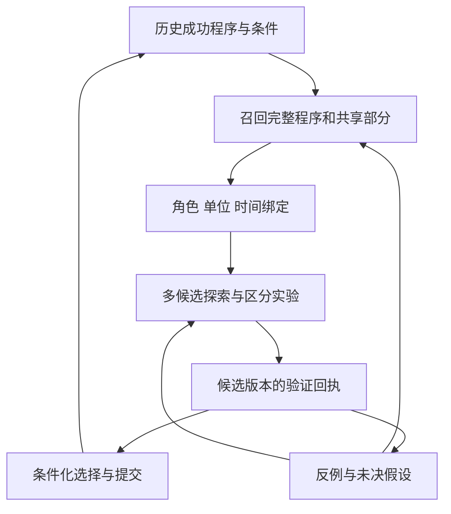

# Hegel M6.3 至 M6.7 后续计划与实施调整

本计划基于提交 `948e2d57a48b74369158ba2fbdee87bd32102403` 的冻结诊断。它是可供下一轮实现的施工方案；未修改仓库、未运行新的在线评测。建议采用 B′先行、A 后续的顺序，保留复杂跨时刻关系、多尺度动力学、潜变量、记忆核以及跨领域部分共性结构。

## 1 调整项目的近期验收目标

将“挂上工具库后稳定 15/20，双轨后稳定 16–17/20”改为分层目标：

1. 已经成功的完整求解过程能够被无损留存、独立重建。
2. 已学程序和部分结构能够完成目标角色、时间、单位和数据接口绑定。
3. 后继确实执行了这些学得对象，并可区分有效消费、无效消费、拒绝和收益。
4. 公共选择程序能在自身适用范围内保护当前已确认稿，并测量择错率。
5. 在完整预算记账与冻结新实例上，检验系统整体是否有稳定净收益。
6. 在上述机制成立后，优化产生改进的方法本身，验证元策略迁移收益。

这把 RSI 主张分成可测的两个层次：任务程序/知识的积累，以及产生、适配、验证这些程序的方法是否也能改善并跨任务复用。人工每次看失败日志后改六个固定工具，不等于自动元改进已经成立，但可作为构建其训练和评估环境的阶段。

不要求每个探索步骤都改善分数。探索允许暂时退步、互相矛盾的模型和复杂的未决结构；提交与知识档案负责保留历史和有证据的适用边界。

## 2 修改计划文档中的具体承诺

| 现有承诺或隐含前提 | 应替换的正式表述 | 必须新增的验收 |
|---|---|---|
| 跨版本15/20或16/20已经是可收割能力 | 历史研发覆盖，需分别证明留存、重建、适配及选中 | 原题重放、目标迁移、选择后悔分别报告 |
| Track A Pareto库已完整跑通，Frontier只差挂载 | Track A特定修复已过；Frontier需要完整模块与文件ABI桥接 | 真正历史成功producer经该桥在后继调用 |
| 调用越多说明算法越有效 | 调用是中间事件，收益取决于绑定、采纳及结果 | called/completed/validated/adopted/improved逐层记账 |
| host gate静默、无损、低于2秒 | 按适用性与实测预算运行；可能无收益或有错误 | 有状态回执、分项计时、原稿保留、取消行为 |
| 正反合两轨可直接达到16–17 | 互补候选与公开选择器的受控预算实验 | 同总预算普通多起点；oracle与selected分列 |
| 7/7审计全绿证明零泄漏和机制有效 | 原工程完整性检查通过；每类科学声明需专门证据 | 评分一致性、设计期暴露、消费与效果证据 |
| 新理论解释旧理论即均值投影全绿 | 在注明观测条件与适用域下比较真实旧模型与新模型读出 | 改变旧模型必须改变投影；非恒等、多尺度例子 |

Plan20 中多尺度时间与共享子树的目标继续保留，新增一张“计划字段→运行器对象→调用位置→证据”的接线表。未进入 Frontier 主路径的能力应标为未接通，不因同名 helper 已存在便标已完成。

## 3 阶段零 先恢复可信的结果和候选身份

### 3.1 单一结果台账

保留全部原始 episode 及判定，追加 `RegradeReceipt`，至少含：原 run/episode ID、原 candidate hash、原 verifier hash、重评候选 hash、任务/镜像/评测版本、资源、并发隔离、计时全部重复值、新 stdout/CTRF/reward、重评理由。聚合器验证这些字段后生成原生和重评两列。

本轮先完成无需付费运行的勘误：M6.1/M6.2重评后应为11/12；M6.4原生12及重评声明分列；89 fresh而非129；nano 29属性；clinical、symbolic、certificate的门控时序；sparse时间归属。

新的 `study_id` 由源码、模型配置、提示、任务、镜像、完整库/图内容、预算及并发策略形成；缓存必须绑定此身份。日志里的工具版本不能仅写文件名。

### 3.2 三种证据不要相互替代

| 证据 | 能证明 | 不能直接证明 |
|---|---|---|
| SHA和DAG链 | 文件完整、事件关系合法 | 声明为真、没有泄漏、机制改善 |
| 源任务确认 | 特定程序在特定源条件表现 | 目标域角色与机制仍成立 |
| 目标公共验证 | 指定目标契约和公开评估结果 | 未观测属性、隐藏任务、全分布保证 |

**本阶段出口：**聚合表每个分数均有唯一可追溯判定；新报告全部由机器台账生成；统计勘误不需要先耗费一轮20题在线运行。

## 4 阶段一 保存完整成功能力并建立版本关系

### 4.1 保存对象

沿现有候选 archive 和 checkpoint storage 增加一个完整的程序包清单。名称可以叫 `ExecutableSkillManifest`，但关键是实际内容，而非另起一个并行存储框架：

```text
identity:
  artifact_id, source_hash, parent_ids, source_episode_id
producer:
  sources, helper_dependencies, constants, build_recipe, entrypoints
state:
  fitted_parameters, checkpoints, random_state, refit_recipe
interface:
  data_roles, shapes, units, sign_conventions, output_schema
temporal:
  dt, tau, windows, horizon, t0, readout, latent_state, memory_terms
conditions:
  source_environment, known_support, invariants, unresolved_assumptions
evidence:
  source_receipts, target_binding_receipts, target_validation_receipts
cost:
  formation_cost, fit_cost, invoke_cost, memory, measured_environment
structure:
  full_program, shared_parts, adapters, residual_parts, open_slots
```

大型JSON、模型参数、二进制和编译产物使用内容寻址引用；不要把512KB文本展示限制当作科学能力的保存限制。保存输入版本与可合法获得的原公开数据路径；私有真值不进入生产技能。

### 4.2 完整保留先于成功抽象

当前 `first4 + 60–2200 chars + 无helper依赖` 过滤应退出能力保存主路径。一个复杂求解器暂时无法拆解，仍然可以作为完整可执行模块留下，并标注 `binding_status=unresolved`；等到角色、依赖或目标接口得到验证，再让它进入对应候选路径。

完整程序保留与部分共性抽取并行存在：完整对象确保能力不丢，子结构使后继不必每次复用整套算法。不能只留下小助手，然后误认为高层组合也被保存。

对 AST 的提取、作用域和变量来源分析使用可靠支持的子集。未解析的闭包、动态常量、关键字传参和类应显式记录，不作不可靠重写。允许 opaque callable、Python模块、编译求解器和 typed Program通过统一适配接口并存。

### 4.3 真正的候选档案

修 `_append_pareto_candidate`：变量集合不再作为程序身份。保留来源版本、结构、适用域和时间条件；只在同一评价契约下比较误差、边界失败、计算成本与复杂度。不能在不同任务不同数据上直接混合标量RMSE判支配。被淘汰的活动候选可退出检索优先集，但不可删除历史版本。

活动集合大小由目标契约与预算控制，允许分层召回和低成本筛选；不要默认最小变量数的前两项代表全部可行机制。复杂度只在性能与适用证据允许时作偏好，不自动否决高维状态、长记忆核或高阶组合。

**本阶段出口：**优先恢复 M6.3 baseline-free/certificate、M6.4 symbolic/clinical/traffic、M6.6 sparse/AMR、M6.5/6 nano阶段读出的成功过程。每个包在干净容器、相同公开输入下重建并复现原产物性质；缺失源程序必须标缺失。原题重放属于能力保存验收，不追加为新泛化成绩。

## 5 阶段二 把多尺度和部分共性真正接入 Frontier

### 5.1 复用已有模块而非重建独立框架

| 现有入口 | 应接入的职责 | 需要补的边界 |
|---|---|---|
| `code_agent.retain_evaluated_python_model` / `archive_confirmed_python_model` | 评估稿留存、确认后晋升 | 扩展到文件/状态/编译依赖，保留精确版本 |
| `checkpoint_storage` | 持久化与增量写入 | 完整包与大型对象引用，容器销毁前强制落盘 |
| `extract_and_translate_authored_ast_v2` | 程序依赖、角色适配 | 修常量key、闭包/作用域，支持显式opaque适配 |
| `resolve_verified_writeback_owner` | 核心、派生、复合归属 | 核心角色已覆盖与完整模型依赖分别记录 |
| `branch_reconciliation.align_semantics_roles_units_and_time` | 目标语义/角色/单位/时间绑定 | 从typed Program向Frontier程序包建立adapter |
| `anti_unify_programs` / `anti_unify_program_family` | 共享部分与开放槽 | 条件化的子图匹配，不能要求整程序同构 |
| `m5_temporal_multiscale_and_base_subtree.predict_via_pi_fold_mode` | 多尺度读出与历史预测 | 真正使用目标时钟、窗口、核和潜状态 |
| `extract_shared_base_subtree_from_sources` | 多源公共结构候选 | 保留各源独有残差、单位/角色差异与成立条件 |
| `adjudicate_branches_on_paid_evidence` | 按版本、证据和预算比较候选 | 适配真实公共验证，避免重复使用已曝光标签 |
| `propagate_premise_retraction_invalidation` | 反例只撤销受影响派生关系 | 不因局部失败把整个复杂家族删掉 |
| `experiment_runtime` / `parallel_prediction` | 资源、并发、计时、预测执行 | 替代脚本多处monkeypatch，修嵌套读锁 |

这些旧能力具有各自接口与假设，并非导入函数后自动可用。使用同一个当前 study runner 的配置选项接线，保持当前证据目录与登记系统，避免每版新增一套难以比较的独立runner。

### 5.2 每次迁移的顺序

先召回候选及其部分结构，再对目标数据建立映射；检查角色、单位、时间和初边值条件；按需要重拟合状态或参数；执行小规模目标pilot；记录是否有资格参与选择。PPR、任务家族和图路径用于召回，不能自行授予科学适用资格。

跨时间与多尺度的候选必须明确：哪些状态被消去、哪些历史量仍影响未来、粗粒读出如何从细粒状态产生、时间变换是否改变参数、观察窗口是否包含识别信息。在证据支持的情况下保留非Markov记忆核、分布式状态及多模态候选；没有必要为了易解释而删除它们。

部分共性也不必全部一次兑现。例如一个传播模型的几何路径可共享，而色散/反射核保持域特定；一个ODE模型可以共享线性观测校准子问题，而保留不同非线性状态动力学。候选合成要留下共享部分、适配器、域特定残差与未知槽的来源。

### 5.3 修正旧新理论回溯验证

传入真实旧程序与真实新模型，使用它们各自注明的观测条件。只有在同一可比较读出下才计算旧模型预测与新模型边缘化读出的差异；潜变量必须来自已识别状态估计或声明的条件分布，不能以标签y充当z令投影恒成立。

回执保存投影误差、支持域、样本量、观测选择和不确定性；旧模型故意改错应触发相应失败。若旧模型本来在新环境失效，记录失效前提与保留的旧成功域，而不是强迫新理论在所有域模拟旧错误。

### 5.4 区分图路由与因果运输

Bayes-ball可用于给定图中的条件独立问题。不同环境之间的运输还需要声明哪些机制不变、哪些选择/干预/测量发生变化，以及这些假设由什么数据支持。修复当前“角色覆盖已完全决定候选，d-sep仅改日志”的冗余路径：构造角色可绑定但因果前提不成立的真实受控案例，并确认机制改变最终授权，而非只改变计数。

**本阶段出口：**有一条从源成功完整程序到目标实际调用的完整回执，并有相应的无迁移/错误绑定/移除共享部分控制；不能只展示导出文件、图边或文本提示。

## 6 阶段三 修复探针和选择器

### 6.1 状态分层

用明确事件替代两个bool和一个调用数：

状态依次记录为 `retrieved`、`bound`、`executed`、`validated`、`adopted`、`retained`；各环节另有 `failed`、`unsupported`、`uncertain`，不能把这些终态压成同一个空数组。

这里每个箭头都有不同的证据。调用失败也记录执行尝试；只有返回并满足接口才是completed；通过公开目标验证才是validated；终稿确实引用该候选才是adopted；收益需要同条件比较。生产自测单独记为smoke_test，不计入目标能力消费。

每个 `ProbeResult` 保留候选哈希、适用性、验证数据身份、实际耗时、返回码、stderr和部分报告。失败与不适用不永久消耗本题所有资格；同一候选、同一条件下已完成的探针不重复执行。

### 6.2 触发时机由对象和预算决定

当第一个可运行候选形成、探针有适用数据且预期信息收益大于成本时，执行目标pilot。发现确定接口错误可即时提示；研究性搜索则需要独立预算与修复余量。末端仅做成本可预测的完整性、导入、schema、finite和必要的短验证。

不把所有复杂验证塞到第18或27轮；轮次只是预算状态之一。将剩余token、工具elapsed、锁等待和预计验证时间都纳入触发。`<1s`或`<2s`必须由相应输入规模的测量支持，不能由“改成NumPy”推出。

### 6.3 候选晋升与最终提交

保留探索工作区、当前已确认incumbent和历史档案。新稿先生成独立版本，在同一公开契约上与incumbent比较；确认结果绑定精确哈希。比较不足时可以继续探索或保留条件化并列，不自动覆盖。

最终 `commit(candidate_hash)` 只选择有相应回执的版本，并检查没有在验证后继续修改。预算到期时宿主从已有确认稿交付，不额外要求LLM再做一次文字声明。若没有任何合格候选，诚实记录未完成；不要打印文件名就解除验证债。

这只能减少已知退化和协议性损失，不构成隐藏指标的无损保证。公开代理不能判断的风险仍需通过新数据、区分实验或合理不确定性处理。

### 6.4 公共选择器先测自身的择错风险

先在历史开发候选上运行一个看不到最终私有判定的公共selector，然后由离线审计比较其选择与已知结果。记录：候选池oracle coverage、实际selected成绩、选择后悔、拒绝/不确定比例、误晋升和运行成本。

该离线分析可用于开发选择策略，不能算新的盲测。固定规则后，在未参与开发的新任务/新实例检验。代理选择采用任务相关loss：LOPO只说明稳定性，PDE残差只说明方程一致，训练先验差异只说明分布不同；不能让任一代理独占“正确性”角色。MDL/复杂度可用于适用证据近似相当时的偏好，避免主动偏向欠拟合简单模型。

## 7 分任务修改建议

| 任务 | 实施调整 | 公共验证与验收 |
|---|---|---|
| symbolic | 把特征/支持/组合/频率搜索也放进外层训练；内层调参数和阈值；冻结最终候选后才用确认集 | 对整条训练程序交叉验证；记录所有自适应候选次数；禁止将固定支持OOF称独立结构证据 |
| clinical | 保留早期对齐有效部分；真实cohort/批次分层；训练过滤未标注-1；阈值选择与外层评价分开 | 同候选/同切片比较；训练先验差异只告警；重现M6.7正确拒绝有取舍替换的行为 |
| nano | 复用不同版本成功阶段分割与读出；保持无修正/物理修正/不同蠕变估计候选 | 参数来自公开曲线、独立校准或跨阶段一致性；检验敏感度；不以已知私有3.41反调0.65 |
| certificate | 恢复完整成功构建程序与证书；分开优化叶枚举、父cube界、对偶求解、I/O | 每次合并都有合法witness、覆盖不重不漏；记录子求解耗时与截止；用public objective和proof验收 |
| sparse-network | 恢复已过版本完整初始化/续接/多段射击；保留多个状态—gain—forcing候选 | 公共不同时间窗/传感器留出；物理gain约束和符号；识别等价类；独立积分与外推分别验证 |
| Koopman | 保存完整算子/参数/状态；比较不同观测算子、时间窗和正则假设下的候选 | 残差/密度拟合之外诊断漂移可辨识性；不能用一项低频拟合压掉其他适用机制 |
| AMR | 恢复成功快速求解器；统一资源调度；先正确再优化热点 | 同隔离条件配对计时、完整重复值、官方聚合；性能证据绑定硬件与线程条件 |
| baseline-free | 几何、传播/色散和偏移分层，保留结构歧义 | LOPO/LOSO仅作脆弱性检查；用可公开验证的校准、残差形状与稳健情景比较 |
| guided/virtual wave | 不把相近family直接当同一观测模型；区分直达、反射、温度/色散与基线机制 | 先重放公开合成/校准条件，明确尚未可识别部分；不承诺只加一个共享locator就过 |
| hb024 | 研究实体识别、输出schema和证据完整性；保留已有成功实体检索流程 | 公开材料来源核对和完整最终答案检查；不要用科学算子门控掩盖文献/实体缺口 |
| 已稳定通过其余题 | 保存生成程序、任务读入及检查过程；避免无关门控干扰 | 作为小规模回归集，验证新的共享机制不会破坏接口与交付 |

以上表格覆盖优先处理方向。每题具体失败数值、不同版本变化、公开日志及原生验证器链接见逐题附录，不能用一张表替代必要的领域模型验证。

## 8 A 与 B 的实验设计

### 8.1 B′的第一轮只验证已修复链路

先做不调用模型的确定性控制：动态key成功程序被保留；同键多机制共存；完整包可重建；NaN/shape检查失败；LOCO无-1；闭包作用域正确；回溯确实依赖旧模型；门控超时有状态；提交绑定精确哈希；嵌套锁不死锁。只测试修复风险，不无限扩大全套测试。

再选择少量受影响题做配对回放或小规模在线试验，比较同候选在“无干预”和“有资格干预”下的产物变化。恢复已过候选而不改题，衡量的是保存与执行，不能冒充未知泛化。

当这些结果成立，再冻结完整B′版本与同期Bare对照。两者使用相同模型配置、资源/任务版本与总预算口径。每题28轮可以保留为兼容上限，但同时报告实际模型token、缓存、工具执行、宿主探针、候选形成、选择和judge开销；训练/库形成成本单列并报告摊销。

### 8.2 A 的第二轨必须证明互补与可选择

A保留作为随后的一项配置，不再自动固定“干净28轮+虫洞28轮”。可以按预算允许选择两个较短分支或顺序深化；是否启动第二分支由第一稿的不确定性、可用部分结构和剩余成本决定。

最小有解释力的比较：

| 条件 | 目的 |
|---|---|
| 一条普通轨迹，预算B | 单轨基线 |
| B′，总预算B | 同成本机制增益 |
| 两条普通轨迹加同一公共selector，总预算2B | 更多采样与选择器本身的收益 |
| A式互补结构分支加同一selector，总预算2B | 黑格尔结构组织在相同多轨预算下的额外价值 |

若成本受限，可先完成前两项，再仅对有互补迹象的任务进行后两项；不要一次新增大量未校准臂。每项都报告实际selected与oracle，而不是只报其中好看的指标。

当版本已经冻结并且评估资源稳定，才为少量关键结论做独立重复并报告不确定性。现有20题每版一次，不能估出自然方差；同一题开发多次也不能当全新独立样本。稳定优势应由新任务/新实例及合理重复支持。

### 8.3 同内容控制

从一份冻结源receipt构建同一候选库，再复制给不同组织方式。分别控制检索/排序、角色运输、前提展开与因果授权；把当前两臂各自学习不同代码的协议保留为系统级对照，但不称纯图组织消融。固定专家库、学得源码库、部分结构合成、元策略优化分别登记来源和形成成本。

## 9 建议的提交与验收顺序

| 次序 | 主要修改文件或入口 | 必须达到的结果 |
|---|---|---|
| P0a 证据勘误 | 报告29/30、study汇总、审计器、regrade聚合 | 原始/重评分列；所有数字可机械生成；错误时序归因删除 |
| P0b 能力保留 | Frontier快照/归档、checkpoint、M6.3候选表 | 真实成功producer/状态/依赖不丢；原题可重建 |
| P0c 验证事务 | `run_frontier_episode`、host probes、telemetry | 候选哈希绑定；异常不吞；完整计时；提交使用确认稿 |
| P1a 迁移适配 | M6.3 extractor/owner/pilot、branch reconciliation、M5 fold/subtree | 多尺度及部分结构进入实际调用；不适用warm-start不关闭诊断 |
| P1b 选择校准 | symbolic/clinical/wave/sparse公共评估 | 结构选择与确认分离；公共代理各有适用范围；可测择错 |
| P1c 具体算法 | 分任务表中的热点/识别/读出 | 配对证据证明修的是已定位问题；不追私有阈值常量 |
| P2 冻结评估 | 当前study runner配置、manifest、同期基线 | 同预算B′有可重复净收益；再做A的2B比较 |

每个提交保留原文件与证据，更新现有历史能力登记和reuse hub。避免为这轮诊断再造一套离线展示系统却不被主运行器调用。完成日期取决于恢复历史producer的难度与可用在线预算，本计划不以猜测工期替代验收。

## 10 最终应形成的能力链



这个闭环允许复杂理论积累，也允许旧理论在特定域保留、新理论扩展适用范围、反例只修订相关前提。若完整链路带来真实的后继收益，再让同一机制改进检索、探针分配、组合和选择方法，才有坚实的递归自我改进证据。

## 11 现有源码入口

- [Plan20 多尺度与共享子树主计划](https://github.com/erzhu419/Assumption-Agent/blob/948e2d57a48b74369158ba2fbdee87bd32102403/Hegel%20Machine/markdown/hegel_v16_5_multi_precision_plan/20_Hegel_M5_Final_Master_Plan_Temporal_MultiScale_and_Shared_Base_Subtree.md)。
- [branch_reconciliation.py](https://github.com/erzhu419/Assumption-Agent/blob/948e2d57a48b74369158ba2fbdee87bd32102403/Hegel%20Machine/src/hegel_machine/cognition/branch_reconciliation.py)。
- [m5_temporal_multiscale_and_base_subtree.py](https://github.com/erzhu419/Assumption-Agent/blob/948e2d57a48b74369158ba2fbdee87bd32102403/Hegel%20Machine/src/hegel_machine/cognition/m5_temporal_multiscale_and_base_subtree.py)。
- [code_agent.py](https://github.com/erzhu419/Assumption-Agent/blob/948e2d57a48b74369158ba2fbdee87bd32102403/Hegel%20Machine/src/hegel_machine/cognition/code_agent.py)。
- [Frontier 主运行器](https://github.com/erzhu419/Assumption-Agent/blob/948e2d57a48b74369158ba2fbdee87bd32102403/Hegel%20Machine/src/hegel_machine/cognition/m6_frontier_real_benchmarks.py)。

与计划对应的已经发生的缺陷、局部反例和证据边界，分别见同包整体诊断、Track A、可执行库、运行器及逐题结果报告。
