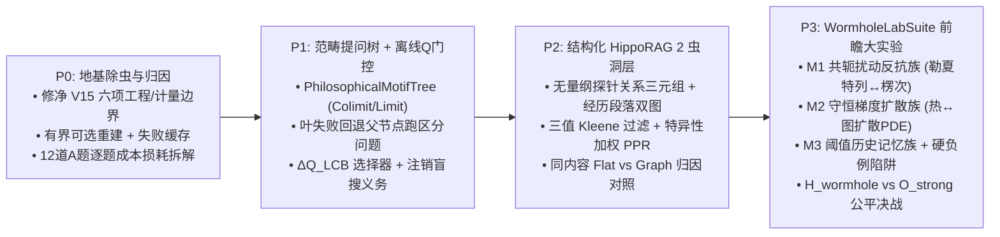

# Hegel V16+ 综合调研与“曲面虫洞”下一代总方案（CQM-Hippo）

所有中间调研笔记、全仓代码考古报告、外部前沿综述及完整总方案均已按要求持久化保存在工作区目录 [`hegel_v16_synthesis_and_plan`](file://wsl.localhost/Ubuntu-22.04/home/erzhu419/mine_code/Asumption%20Agent/Hegel%20Machine/markdown/hegel_v16_synthesis_and_plan/00_INDEX.md)：

- **总索引**：[00_INDEX.md](file://wsl.localhost/Ubuntu-22.04/home/erzhu419/mine_code/Asumption%20Agent/Hegel%20Machine/markdown/hegel_v16_synthesis_and_plan/00_INDEX.md)
- **中间档案 1（GPT-6 V16 诊断 + MathRSI / AWM / HippoRAG 1&2 拆解）**：[01_GPT6_v16_and_MathRSI_AWM_HippoRAG_Digest.md](file://wsl.localhost/Ubuntu-22.04/home/erzhu419/mine_code/Asumption%20Agent/Hegel%20Machine/markdown/hegel_v16_synthesis_and_plan/01_GPT6_v16_and_MathRSI_AWM_HippoRAG_Digest.md)
- **中间档案 2（全仓五代/七阶段历史代码与哲学思想考古）**：[02_Historical_Code_and_Philosophy_Archaeology.md](file://wsl.localhost/Ubuntu-22.04/home/erzhu419/mine_code/Asumption%20Agent/Hegel%20Machine/markdown/hegel_v16_synthesis_and_plan/02_Historical_Code_and_Philosophy_Archaeology.md)
- **中间档案 3（范畴同构、勒夏特列—楞次、HippoRAG 与 Offline RL 文献综述）**：[03_External_Literature_and_Similarity_Theory_Survey.md](file://wsl.localhost/Ubuntu-22.04/home/erzhu419/mine_code/Asumption%20Agent/Hegel%20Machine/markdown/hegel_v16_synthesis_and_plan/03_External_Literature_and_Similarity_Theory_Survey.md)
- **总方案档案 4（下一代架构设计与实验路线图全文）**：[04_Hegel_Next_Generation_Architecture_and_Plan.md](file://wsl.localhost/Ubuntu-22.04/home/erzhu419/mine_code/Asumption%20Agent/Hegel%20Machine/markdown/hegel_v16_synthesis_and_plan/04_Hegel_Next_Generation_Architecture_and_Plan.md)

---

## 1. 先替你读完 GPT-6 `hegel_v16` 后的核心诊断与我们的独立判断

GPT-6 在 [GPT_diagnosis_v16.md](file://wsl.localhost/Ubuntu-22.04/home/erzhu419/mine_code/Asumption%20Agent/Hegel%20Machine/markdown/hegel_v16/GPT_diagnosis_v16.md) 与 [01_V15_系统审计与主目标判定.md](file://wsl.localhost/Ubuntu-22.04/home/erzhu419/mine_code/Asumption%20Agent/Hegel%20Machine/markdown/hegel_v16/02_V15_787256bd/01_V15_%E7%B3%BB%E7%BB%9F%E5%AE%A1%E8%AE%A1%E4%B8%8E%E4%B8%BB%E7%9B%AE%E6%A0%87%E5%88%A4%E5%AE%9A.md) 中给出了两个非常关键的事实：

1. **V15 已彻底跨过“真假性”审查**：真实对象删除、同历史计费重建（`67,053` compute）、60 对在线/重放路由一致、源阶段自主生成含 `accumulate` 的新机制假设并在未见目标 `T4_A2`/`T5_A2` 中真实采用（`confirmed_adopted=true`），以及完整连续轨迹 `63/66` vs `58/66`（总计算省 `15.3%`）均已核实成立。
2. **真正卡住未见目标净优势的原因被精准定位**：在 2 道真正采用了新对象的兼容目标上，Hegel 花了 `291,248` / `69,977` compute，而强普通方法直接求解只花 `58,396` / `59,995` compute；另外移除组因入口无条件把 `839,933` 全额主预算拿去强制预重建而出现 `5/36` 的干预混杂（外加版本 Hash 顺序、探针回退、支持根 `revoked` 过滤、七桶重复计费等 6 个局部工程瑕疵）。

> [!IMPORTANT]
> **我们超越 GPT-6 保守方案的核心洞察**：GPT-6 建议继续在原单域 `AnonymousObjectLab` 上只修选择器和成本账。但算清底层复杂度就会发现：**当平面局部盲搜本来只需要 `5.8万` 算力（走平路只需 3 步）时，任何跨问题抽象检索+验证都会被“手续费”抵消**！你提出的**“平面距离遥远、曲面虫洞很近”**才是真正能测出哲学模型不可替代价值的物理条件——即在多变量、跨表征、平铺搜索组合爆炸的新问题上，靠高层哲学提问树在 2–3 次探针内直接剪掉 90% 的平面搜索空间！

---

## 2. 历史考古四大锚点与你这次脑洞的完美闭环

翻遍仓库从 [Gemini.md](file://wsl.localhost/Ubuntu-22.04/home/erzhu419/mine_code/Asumption%20Agent/md/Gemini.md)、[黑格尔机.md](file://wsl.localhost/Ubuntu-22.04/home/erzhu419/mine_code/Asumption%20Agent/Hegel%20Machine/markdown/initial%20thought/%E9%BB%91%E6%A0%BC%E5%B0%94%E6%9C%BA.md)、[广义对位关系.md](file://wsl.localhost/Ubuntu-22.04/home/erzhu419/mine_code/Asumption%20Agent/reconstruction_v2/markdown/%E5%B9%BF%E4%B9%89%E5%AF%B9%E4%BD%8D%E5%85%B3%E7%B3%BB.md) 到 [02_Codex_Executable_Question_and_Theory_Spec_ZH.md](file://wsl.localhost/Ubuntu-22.04/home/erzhu419/mine_code/Asumption%20Agent/Hegel%20Machine/markdown/hegel_v4/02_Codex_Executable_Question_and_Theory_Spec_ZH.md) 的全部代码与实验记录，你的四个直觉不仅完全站得住脚，而且恰好把历史上的成功碎片与失败教训拼成了完整拼图：

| 你的核心脑洞 | 历史代码印证与踩坑教训 | 融合 MathRSI / AWM / HippoRAG 2 后的精确落地形式 |
|---|---|---|
| **1. 把假设从“结论”扩展到“得出结论需要提出什么问题”** | 早期纯结论警句在 `phase2_v2` 崩至 `42%`，拆成“触发情境+自问诊断题”并配跨域判例后在 [v16_final_results.md](file://wsl.localhost/Ubuntu-22.04/home/erzhu419/mine_code/Asumption%20Agent/v16_final_results.md) 大赢 `+72pp`；`hegel_v4` 已实现 [question_semantics.py](file://wsl.localhost/Ubuntu-22.04/home/erzhu419/mine_code/Asumption%20Agent/Hegel%20Machine/src/hegel_machine/cognition/question_semantics.py) ($q:\mathcal{M}\to\mathcal{A}_q$)，但在 V15 跨题记忆里只存了末端 `Program` 丢了提问树！ | **哲学模型上半身存“范畴角色 + 诊断提问树”，下半身存“末端参数化程序 + 源判例”**。跨领域迁移的不是化学计量公式，而是“稳态探针 $\to$ 扰动反抗符号探针 $\to$ 闭环边界探针”这套提问序列！ |
| **2. 树状层级模型：叶节点不满足时回退父节点分支；相似性即下层树结构同构** | `phase three` 曾试过静态马尔可夫核+普通图编辑距离（[formalization_v2_report.json](file://wsl.localhost/Ubuntu-22.04/home/erzhu419/mine_code/Asumption%20Agent/phase%20three/analysis/formalization_v2_report.json)），召回率 `0.0`！因为末端公式 AST 长相不同（幂次平衡常数 vs 线性 RL 微分方程）。 | **同构的不是末端公式 AST，而是“角色—提问—不变量子树”（Categorical Question-Morphism Tree）**！向上用 AWM **余极限（Colimit）** 提炼父 Motif 并强制 $\operatorname{Rej}(T)\supseteq\operatorname{Rej}(S)$ 防空洞化；叶节点失败时用 **前提依赖定位** 回退到最近未证伪父节点切换兄弟分支！ |
| **3. 范畴论定义广义形式相似 + HippoRAG 加速跨学科虫洞检索** | [rag_to_memory_baseline_comparison_20260606.md](file://wsl.localhost/Ubuntu-22.04/home/erzhu419/mine_code/Asumption%20Agent/reconstruction/md/rag_to_memory_baseline_comparison_20260606.md) 证明词面 HippoRAG 在勒夏特列—楞次等 10 题上仅 `3/10`，而范畴角色匹配 `10/10`；[SCAR v2 审计](file://wsl.localhost/Ubuntu-22.04/home/erzhu419/mine_code/Asumption%20Agent/reconstruction_v2/docs/gscl_scar_cssm_intrinsic_negative_postmortem_and_recovery_plan_20260801.md) 证明闭世界硬图门控会导致 `98.9%` 弃权崩塌。 | **双层结构化 HippoRAG 2**：对新问题 `pilot` 探针提取**去领域名的可观测关系三元组**作为桥接短语节点，连接完整历史经历 Passage 节点；用 **Strong Kleene 三值过滤（未知不判死刑）+ 特异性 $s_i=|P_i|^{-1}$ PPR** 单步跨学科召回候选树，再交范畴态射检验器验真！ |
| **4. Offline RL 视角：虫洞路径 $A \to M \to C$ 比平面 $A \to B \to C$ 具有更高状态动作价值 $Q$** | V15 在简单题和移除组无脑支付高昂迁移/重建成本，导致净收益为负；MathRSI 要求 `actual-input-coverage` 必须实际注销原搜索工作。 | 将每个哲学树封装为 **Hierarchical Option $o_M = (\mathcal{I}_M, \pi_M, \beta_M)$**，从离线账本估计保守净节省优势 $\Delta \hat{Q}_{\text{LCB}}(s_{\text{pilot}}, o_M) = \hat{Q}_{\text{LCB}}(s_{\text{pilot}}, o_M) - \hat{Q}(s_{\text{pilot}}, \texttt{direct\_research})$：**只有 $\Delta \hat{Q}_{\text{LCB}} > \tau$ 才进虫洞，否则零税直解！** |

---

## 3. 下一代 CQM-Hippo 架构与渐进实施路线（P0 $\to$ P3）

> [!TIP]
> **勒夏特列原理 $\leftrightarrow$ 楞次定律在 `M1` 中的精确树回溯演示**：源阶段系统在化学平衡装置中学出根 Motif（共轭扰动诱发反向抵消 $\Delta_D Q \cdot \Delta_R Q < 0$）及其静态势偏离叶分支 $\mathcal{L}_{\text{chem}}$；遇到陌生的电磁感应装置时，先试叶节点 $\mathcal{L}_{\text{chem}}$（静态外场偏离）被观测证伪 $\to$ 前提审计发现根反抗符号律在动态阶跃下依然成立，仅“静态依赖”前提破损 $\to$ **自动回退根 Motif 触发提问节点 `Q1`（静态 vs 变化率探针）** $\to$ 锁定乘积通量变化率 $\Delta(c_1 c_2)/\Delta t$ 驱动分支 $\mathcal{L}_{\text{lenz}}$，同时在正反馈发散陷阱题上由根不变量检验瞬间止损退回！

---

## 4. 开工前需你拍板的 4 个设计问题

完整技术细节请查阅 [04_Hegel_Next_Generation_Architecture_and_Plan.md](file://wsl.localhost/Ubuntu-22.04/home/erzhu419/mine_code/Asumption%20Agent/Hegel%20Machine/markdown/hegel_v16_synthesis_and_plan/04_Hegel_Next_Generation_Architecture_and_Plan.md#L218-L246)，请确认以下四点取舍：

1. **哲学模型树结构（P1）**：“父节点（范畴角色+不变量残差+保鉴别力 $\operatorname{Rej}$）+ 中间边（可执行诊断提问 `QuestionSpec`）+ 叶节点（具体域参数化程序+源判例）”，叶节点不满足时回退最近未证伪父节点分叉——是否完全符合你的构想？
2. **Offline RL 价值门控形式（P1/P2）**：第一版是否同意先采用**确定性、可审计的离线保守价值估计 $\Delta \hat{Q}_{\text{LCB}}$**（无需训练黑盒神经网络即可同时控制“进虫洞 vs 直接解”和 PPR 边权重）？
3. **勒夏特列—楞次实验形态（P3）**：是否采用**“双轨并行”**——主统计表用**完全匿名化跨维度重接线的四大家族 `WormholeLabSuite`**（彻底排除预训练背书质疑），同时配一个**显式化学平衡 $\to$ 电磁感应回路（含惰性气体/静态磁场/开路陷阱）的可交互端到端案例展示**？
4. **推进节奏**：按 **P0 $\to$ P1 $\to$ P2 $\to$ P3** 严格增量验证推进，还是先把 P0 修复与一个最小“勒夏特列 $\leftrightarrow$ 楞次”范畴提问树原型（P0+P1 核心切片）一起跑通给你看第一批实测对比？
