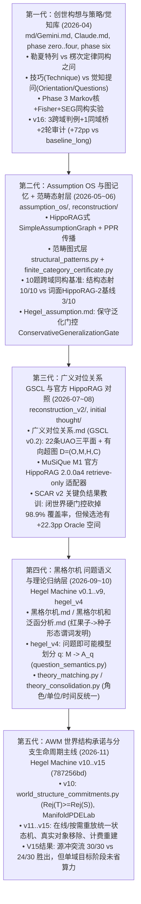

# 02 — 全仓库历史大版本与核心思想考古报告（从 `md/Gemini.md` 到 `Hegel Machine V15`）

**保存日期**：2026-11-18  
**检索范围**：`Asumption Agent/` 全量 35 个顶层目录、全部历史 Markdown 档案、`phase zero..six`、`assumption_os/`、`reconstruction/`、`reconstruction_v2/`、`Hegel Machine/legacy/`、`Hegel Machine/markdown/initial thought/`、`Hegel Machine/markdown/hegel_v4..v16/`、`Hegel Machine/src/hegel_machine/cognition/`。  
**文档定位**：中间研究档案（把你记忆中提到的四个关键历史锚点——① `/initial thought` 里的勒夏特列与楞次定律、② “把假设从结论扩展到得出结论所需提出的问题”、③ 范畴论版 Assumption Agent、④ HippoRAG 1/2 历史实验——全部定位到精确源码文件、数据结构、实验数字与成败教训，确保下一步不重蹈历史覆辙，同时把真正发光的历史资产捡回来）。

---

## 一、全项目演进五代谱系总图（Intellectual & Code Lineage）

---

## 二、四大历史记忆锚点的精确还原与源码/数据核验

### 锚点 1：`/initial thought` 与创世文档中的“勒夏特列原理 vs 楞次定律 / 热传导 vs 扩散 / 红果子”

你记忆中提到的最初设想分布在以下精确文件中：

1. **[`md/Gemini.md`](file://wsl.localhost/Ubuntu-22.04/home/erzhu419/mine_code/Asumption%20Agent/md/Gemini.md#L3-L55) & [`md/Claude.md`](file://wsl.localhost/Ubuntu-22.04/home/erzhu419/mine_code/Asumption%20Agent/md/Claude.md#L15-L79)**：
   - 全仓库的**第一句话**就是你的提问：*“数学上有没有工具能表述清一个（数学/哲学上的）最一般的假设概念？例如勒夏特列原理和楞次定律的相似性，是否可以度量，以及如何度量”*。
   - `Claude.md` 当时做了一个至今依然极其准确的纠偏：勒夏特列作用于热力学势（吉布斯自由能二阶导正定 $\frac{\partial^2 G}{\partial \xi^2} > 0$ 的约束平衡），楞次定律作用于电磁感应耗散动力学（$L \frac{di}{dt} + R i = -\frac{d\Phi}{dt}$），**不能粗糙地说它们微分方程一模一样，而必须在“受扰动—诱发反向响应—耗散恢复”的结构态射层建立同态，并用实验信息度量偏差**。
   - 你在 `Claude.md` 第 220 行还提到了另一个精彩同构：**RL 的状态价值函数 / 奖励传播机制与物理学场论中的点源格林函数（Green's Function）同构**！
2. **[`Hegel Machine/markdown/initial thought/黑格尔机.md`](file://wsl.localhost/Ubuntu-22.04/home/erzhu419/mine_code/Asumption%20Agent/Hegel%20Machine/markdown/initial%20thought/%E9%BB%91%E6%A0%BC%E5%B0%94%E6%9C%BA.md#L1-L55) & [`Hegel_assumption.md`](file://wsl.localhost/Ubuntu-22.04/home/erzhu419/mine_code/Asumption%20Agent/Hegel%20Machine/markdown/initial%20thought/Hegel_assumption.md#L14-L69)**：
   - 明确提出了**“红果子 $\to$ 部分红果有毒 $\to$ 种子形态分类”**的递归演化范式，以及黑格尔式核心准则：**“新提出的哲学框架必须是旧框架的保守泛化（Conservative Generalization）——解释新残差、保留旧成功、在旧作用域下退化回旧框架，且在小样本上靠哲学元约束避免过拟合（不会把毒蘑菇颜色当成可吃）”**。
3. **[`Hegel Machine/markdown/initial thought/黑格尔机和泛函分析.md`](file://wsl.localhost/Ubuntu-22.04/home/erzhu419/mine_code/Asumption%20Agent/Hegel%20Machine/markdown/initial%20thought/%E9%BB%91%E6%A0%BC%E5%B0%94%E6%9C%BA%E5%92%8C%E6%B3%9B%E5%87%BD%E5%88%86%E6%9E%90.md#L469-L790)**：
   - 确立了多尺度判定泛函 $\delta(D, H \mid \tau) = \inf_{\theta, b, s} [V_H(D; \theta, b, s, \tau) + \lambda_b C(b) + \lambda_s C(s)]$：勒夏特列与楞次在词汇尺度距离极远、微观方程尺度不同，但在**“扰动—诱发响应—减少净偏差”的控制结构尺度 $s_{\text{ctrl}}$** 上距离接近零！
4. **[`Hegel Machine/src/hegel_machine/cognition/continuum_field_lab.py`](file://wsl.localhost/Ubuntu-22.04/home/erzhu419/mine_code/Asumption%20Agent/Hegel%20Machine/src/hegel_machine/cognition/continuum_field_lab.py#L1-L25) & [`manifold_pde_lab.py`](file://wsl.localhost/Ubuntu-22.04/home/erzhu419/mine_code/Asumption%20Agent/Hegel%20Machine/src/hegel_machine/cognition/manifold_pde_lab.py#L1-L26)**：
   - 在 `v10 Phase 4B/5A` 中，仓库其实已经实现了你说的《数学物理方程》热传导/扩散/对流反应 PDE 匿名实验台（含 Neumann 保守边界 vs Dirichlet 泄漏边界、2D 环面与一般图拉普拉斯算子）！只是当时只测了同 PDE 族变分辨率（`3x3 -> 4x4`），还没有和离散对象域、电磁/化学平衡域放在同一个**跨机制族“虫洞检索”**框架下联测！

---

### 锚点 2：“把假设从结论扩展到了得出这个结论需要提出什么问题”——历史上发生过两次关键跃迁！

你的记忆非常准！翻遍全仓，这一思想演进在两个阶段分别落地成了代码与规格：

#### 第一次跃迁（自然语言/认知层，2026-04）：从“步骤结论（Technique）”改为“启发式提问与觉知朝向（Orientation & Heuristic Questions）”
- **核心文档**：[`reflection_wisdom_vs_technique.md`](file://wsl.localhost/Ubuntu-22.04/home/erzhu419/mine_code/Asumption%20Agent/reflection_wisdom_vs_technique.md#L38-L143) 与 `phase zero/kb/strategies_canonical/*.json`、`strategies_orientation/*.json`。
- **当时发生了什么**：
  - 早期把 Polya、Popper、控制变量法写成死板的 `operational_steps`（第一步做什么、第二步做什么），结果在 A/B 测试里只有 `47%`，和 Self-Discover 持平。
  - 你指出这把“意识/哲学”降格成了“技巧”。于是仓库把 27 条策略重构为 `strategies_canonical` / `strategies_orientation`，核心字段不再是结论规则，而是 **`heuristic_questions_zh/en`（为了解决这个问题该怎么发问）** 与 **`attention_priors`（面对陌生情境先自问哪 3 个问题）**！
  - 紧接着在 [`v16_final_results.md`](file://wsl.localhost/Ubuntu-22.04/home/erzhu419/mine_code/Asumption%20Agent/v16_final_results.md#L6-L83) 中，结合你的“大陆法条必须配判例”洞察，给每条哲学原则配上 **3 个跨领域最远判例（抽象锚点）+ 1 个同领域判例（具体化桥梁）+ 第 2 轮自审发问**，一举在 100 题基准上**大胜 `baseline_long` `+72pp`、大胜 `Self-Discover` `+22pp`**！

#### 第二次跃迁（可执行科学世界模型层，2026-10）：从“函数即假设 $y=f(x)$”升级为“可执行问题程序 $q: \mathcal{M} \to \mathcal{A}_q$”
- **核心文档与源码**：
  - 对话源头：[`Hegel Machine/markdown/hegel_v4/GPT_diagnosis_v4.md`](file://wsl.localhost/Ubuntu-22.04/home/erzhu419/mine_code/Asumption%20Agent/Hegel%20Machine/markdown/hegel_v4/GPT_diagnosis_v4.md#L806-L815)（你在第 808 行写道：*“我感觉我有点混淆了问题和假设，我把他们视为一体了……而不是宏观的诸如‘勒夏特列原理是否和楞次定律相似，我眼前这个问题能从这两个相似的定理中得到什么规律’的元问题”*）。
  - 数学与施工规格：[`01_Concepts_Mathematics_and_Research_ZH.md`](file://wsl.localhost/Ubuntu-22.04/home/erzhu419/mine_code/Asumption%20Agent/Hegel%20Machine/markdown/hegel_v4/01_Concepts_Mathematics_and_Research_ZH.md#L89-L139) 与 [`02_Codex_Executable_Question_and_Theory_Spec_ZH.md`](file://wsl.localhost/Ubuntu-22.04/home/erzhu419/mine_code/Asumption%20Agent/Hegel%20Machine/markdown/hegel_v4/02_Codex_Executable_Question_and_Theory_Spec_ZH.md#L86-L245)。
  - 现存源码：[`question_semantics.py`](file://wsl.localhost/Ubuntu-22.04/home/erzhu419/mine_code/Asumption%20Agent/Hegel%20Machine/src/hegel_machine/cognition/question_semantics.py#L10-L136)、[`question_agenda.py`](file://wsl.localhost/Ubuntu-22.04/home/erzhu419/mine_code/Asumption%20Agent/Hegel%20Machine/src/hegel_machine/cognition/question_agenda.py)、[`research_graph.py`](file://wsl.localhost/Ubuntu-22.04/home/erzhu419/mine_code/Asumption%20Agent/Hegel%20Machine/src/hegel_machine/cognition/research_graph.py#L23-L160)。
- **核心机制（极具价值，但在 V11–V15 主循环里被闲置在旁路！）**：
  - 将科学探究明确拆为四元链：**问题（Question $q: \mathcal{M} \to \mathcal{A}_q$） $\to$ 竞争候选假设族（Competing Hypothesis Families） $\to$ 区分实验程序（Discriminating Probe Plan） $\to$ 作用域化答案与父问题消费点（Scoped Answer & `use_sites`）**。
  - **为什么今天必须把它请回中心舞台？** 因为在 V15 的 `UnifiedResearchAgent` 中，跨任务传递的 `meta_priors` 只保存了最后拟合出来的**结论程序 `Program`**，而把**“当初提出哪几个关键区分问题才一步步锁定这个机制的（提问树）”**丢在了临时局部变量里！如果把这棵**诊断提问树**作为哲学模型的上半身存下来，遇到同胚新问题时直接重放提问树（只需重绑可观测量），就能瞬间定位机制！

---

### 锚点 3：历史上的“范畴论版 Assumption Agent”——做过哪三版？成败原因分别是什么？

历史上共做过 **三代** 范畴论相关尝试，每一代的实测数字都给我们留下了无比清晰的路线指引：

1. **第一版（2026-04，`phase three/formalization/`）：FinStoch 马尔可夫核 + Fisher 信息距离 + 策略执行图 GED**
   - **源码与结果**：[`detector.py`](file://wsl.localhost/Ubuntu-22.04/home/erzhu419/mine_code/Asumption%20Agent/phase%20three/formalization/isomorphism/detector.py#L18-L103)、[`formalization_v2_report.json`](file://wsl.localhost/Ubuntu-22.04/home/erzhu419/mine_code/Asumption%20Agent/phase%20three/analysis/formalization_v2_report.json#L1-L36)。
   - **结果与教训**：在预期的 3 对同构策略 `(S01 控制变量, S15 增量构建)`、`(S03 类比, S16 求同)`、`(S06 先特殊后一般, S09 降维简化)` 上，**命中率 `recall = 0.0`（`0/3`）**！
   - **死因**：把动态因果与提问逻辑拍扁成静态“状态—动作频率矩阵”，丢失了输入输出角色对偶与不变量符号。**教训：绝对不要再用静态频率矩阵测哲学模型距离！**
2. **第二版（2026-06，`assumption_os/structural_patterns.py` + `finite_category_certificate.py`）：有界范畴图式（Objects + Morphisms + Composition + Invariants + Negative Controls）**
   - **源码与文档**：[`category_morphism_dialogue_20260602.md`](file://wsl.localhost/Ubuntu-22.04/home/erzhu419/mine_code/Asumption%20Agent/reconstruction/md/category_morphism_dialogue_20260602.md#L17-L200)、[`structural_patterns.py`](file://wsl.localhost/Ubuntu-22.04/home/erzhu419/mine_code/Asumption%20Agent/assumption_os/structural_patterns.py#L41-L260)、[`finite_category_certificate.py`](file://wsl.localhost/Ubuntu-22.04/home/erzhu419/mine_code/Asumption%20Agent/assumption_os/finite_category_certificate.py#L25-L55)。
   - **结果**：在 10 道跨领域结构同构检索题（含 `morph_le_chatelier_lenz`、`morph_resnet_kalman`、`morph_jepa_seismic`）上取得 **`10/10` Top-1 命中**（对比纯词面 KG+PPR 的 `3/10`），并导出了有限范畴交换图与自然性方块（naturality square）的 Lean 语法检查证书。
   - **局限**：前端抽取器依赖人工编写的 `ROLE_MARKERS` 关键词表，且十题的角色字段带有先验标注，还没有做到“从原始数值/交互观测自动探出范畴图式”。
3. **第三版（2026-07~08，`reconstruction_v2` GSCL / SCAR v2）：广义对位关系有向超图 $D=(O,M,H,C)$ + 5 类精确有理数残差核**
   - **源码与审计**：[`广义对位关系.md`](file://wsl.localhost/Ubuntu-22.04/home/erzhu419/mine_code/Asumption%20Agent/reconstruction_v2/markdown/%E5%B9%BF%E4%B9%89%E5%AF%B9%E4%BD%8D%E5%85%B3%E7%B3%BB.md#L1822-L2328)、[`gscl_scar_cssm_intrinsic_negative_postmortem_and_recovery_plan_20260801.md`](file://wsl.localhost/Ubuntu-22.04/home/erzhu419/mine_code/Asumption%20Agent/reconstruction_v2/docs/gscl_scar_cssm_intrinsic_negative_postmortem_and_recovery_plan_20260801.md#L20-L195)。
   - **正资产**：受控核 `structural_law_residuals_v1.py` 对对合/等变 (`T14`)、单调偏序 (`T17`)、守恒平衡 (`T15`)、路径组合 (`T09`)、二阶互补 (`T05`) 实现了 **正例 `10/10`、硬负例拒绝 `10/10`、缺证据弃权 `5/5`**；且在 362 道公开类比题上，结构候选池在纯语义池之外**额外救回了 38 个正确映射（Oracle 上限达 `0.9325`，比纯语义高 `+25.5pp`！）**。
   - **血泪教训（价值千金！）**：`SCAR v1` 把抽取残缺的图送进**闭世界硬包含门控（closed-world exact incidence gate）**，一口气把 `723` 个候选砍剩 `8` 个（`98.9%` 覆盖崩塌）且无基线回退！后续 `v2` 改用 **Strong Kleene 三值逻辑（`OBSERVED_MATCH / OBSERVED_VIOLATION / UNKNOWN`：未观测到的边只能算 `UNKNOWN`，绝不能算 `VIOLATION`！）+ 保基线回退（No-op Fallback）** 才彻底消除了覆盖崩塌。

---

### 锚点 4：历史上的 HippoRAG 1/2 实验——做过什么？为什么当年没发挥出最大威力？

核查 [`hipporag_history.md`](file://wsl.localhost/Ubuntu-22.04/home/erzhu419/mine_code/Asumption%20Agent/Hegel%20Machine/markdown/hegel_v16/02_V15_787256bd/evidence/hipporag_history.md#L44-L125)、[`assumption_os/graph_memory.py`](file://wsl.localhost/Ubuntu-22.04/home/erzhu419/mine_code/Asumption%20Agent/assumption_os/graph_memory.py#L128-L222)、[`assumption_os/rag_to_memory_baseline.py`](file://wsl.localhost/Ubuntu-22.04/home/erzhu419/mine_code/Asumption%20Agent/assumption_os/rag_to_memory_baseline.py#L220-L390) 和 `reconstruction_v2/replication_runtime/musique_official_hipporag_v1/adapter_v3.py`：

1. **做过的四次接入**：
   - `assumption_os/graph_memory.py`：实现了 JSONL 持久化的 `SimpleAssumptionGraph`，在假设、案例、残差、验证器节点上做带阻尼的扩散激活检索。
   - `rag_to_memory_baseline.py`：实现了 HippoRAG 2 风格的 `passage + phrase + triple + synonym + PPR` 小型图检索器。
   - `meta_qa_evolution.py`（3000 题多跳 QA）：将图传播、桥接检索等组合策略用于多跳支撑召回（`0.3077 -> 0.3630`，但存在全集选 retained policy 的开发集边界）。
   - `musique_official_hipporag_v1/adapter_v3.py`：真正跑通了官方 `HippoRAG 2.0.0a4` (`ef2f14c4`) 的 `retrieve-only` 接口，在 12 题切片上 Recall@5 达 `14/29 = 0.4828`（优于顺序取前 5 段的 `7/29`）。
2. **为什么当年“词面 HippoRAG”跨不过勒夏特列—楞次的虫洞，而今天能彻底打通？**
   - 当年喂给 HippoRAG 的三元组是**表面学科名词三元组**，如 `(chemical_equilibrium, perturbed_by, concentration_change)` 和 `(coil, induces, current)`。因为 `concentration` 和 `magnetic_flux` 既不同义、词向量也隔着十万八千里，PPR 的随机游走根本跳不过去，只能在化学圈子里打转！
   - **破局点就在把“范畴角色与探针行为三元组”放进 HippoRAG 的海马体索引层**！一旦每个研究经历不仅向上连着具体领域段落（Passage Node = 完整原始实验记录与作用域），还抽出**去领域名的结构关系三元组**——如 `(equilibrium_state, step_perturbation_induces, opposite_sign_restoring_flux)`、`(closed_loop_broken, causes, response_vanishes)`——PPR 的单步随机游走就会瞬间穿过这些共享的结构枢纽节点（同时用 $s_i = |P_i|^{-1}$ 压制泛泛而谈的无用高频词），把远在天边的“化学平衡”与“电磁感应”在一步之内桥接起来！

---

## 三、历史考古总结出的“五条黄金设计铁律”（直接指导下一代方案）

把三年/五代代码的全部正负结果浓缩成五条铁律，我们下一轮就能避开所有已知深坑：

1. **铁律一（测试场门槛）**：不要在“局部盲搜三步就能解完”的简单同域题上测高层哲学迁移（必被迁移税反噬，见 `phase six` Exp 70–71 与 `Hegel V15` `58k` cold 解题现象）；必须在**平面盲搜代价高昂、而结构探针能指数级压缩假设空间**的多机制/跨表征问题族上测试。
2. **铁律二（迁移对象形态）**：不要只存孤立的末端公式或空洞的一句话格言；每个哲学模型必须存为**“高层范畴角色图式 + 中层诊断提问判别树 + 底层具体域判例/可执行程序”三位一体对象**（融合 `v16_final_results` 跨域判例成功经验 + `hegel_v4` 问题语义 + `AWM` 可执行概念）。
3. **铁律三（图检索与形式验证解耦）**：**HippoRAG 2 双层图只管“低成本跨学科虫洞召回”**（用结构探针三元组搭桥），**范畴态射与作用域检查器负责“严苛证伪与角色重绑定”**（绝不让 PPR 分数直接冒充真值）。
4. **铁律四（开放世界三值逻辑 + 保基线回退）**：早期探针没测到的关系一律记为 `UNKNOWN`（Strong Kleene），绝不因缺观测而误杀候选（`SCAR v1` 教训）；且当离线价值评估器预测虫洞净收益 $\Delta \hat{Q} \le \tau$ 时，**零开销回退到 `direct_research`**（`V15` 强制重建教训）。
5. **铁律五（反虚胖修剪）**：合并父节点必须通过 AWM 的 $\operatorname{Rej}(T) \supseteq \operatorname{Rej}(S)$ 鉴别力保持检验，分裂子节点必须先探 MathRSI 的“最难冲突余域”，每次采用知识必须在账本里显式注销被它省掉的搜索义务（`cancelled_obligations`）。

---

## 四、补充考古细节：来自全仓提交史与子模块的额外关键证据

以下补充项来自对 2026-04-16（首提 `bae8dd48`）至 2026-11-18（`787256bd`）全部 Git 历史及子目录的交叉扫描：

1. **个人起源与“鲁棒化 vs 商空间理想化”双算子（[`Hegel Machine/markdown/Meta prior.md`](file://wsl.localhost/Ubuntu-22.04/home/erzhu419/mine_code/Asumption%20Agent/Hegel%20Machine/markdown/Meta%20prior.md#L1-L40)）**：
   - 记录了你从城市交通博弈与鲁棒优化（Robust Optimization）中提炼出的早期洞见：点假设 $\xi = \bar{\xi}$ 脆弱时通过**鲁棒扩张算子**（$\mathcal{M}_t \subset \mathcal{M}_{t+1}$）放宽不确定集；而当额外自由度对当前决策无增益时，通过**商空间理想化算子**（$\mathcal{X} \to \mathcal{X}/\sim_{\mathcal{Q}}$，如质点、刚体、无摩擦斜面）压缩状态空间。这恰恰对应我们层级树中的**“向下特化（加约束/展开细节）”与“向上泛化（取商集/余极限）”**！
2. **`[I1]` 警句崩塌实验：为什么“只存结论”必败，必须存“情境 + 诊断自问”（`phase2_redesign_notes.md:48-74, 216-228`）**：
   - 在 `phase2_v2` 中，直接注入 6 条高度凝练的哲学结论警句，胜率暴跌至 **`42%`（`-11pp`）**；拆解后发现模型无法在推理现场把高度压缩的结论逆向展开为当前问题的检查点。改为 `unpacked_for_llm = 触发信号 + 得出判断前必须自问的 2~3 个具体诊断问题`（并在 `phase2_v20_framework.py` 加入 Turn-0 问题诊断重写）后，胜率在 `v16` 基础上再涨 **`+28pp`（`64%` vs `36%`）**。这是仓库历史上证明“问题比结论更可迁移”的直接实测铁证。
3. **`AlignmentHypothesis` 的早期原型（`assumption_os/hypothesis_lifecycle_v2.py:264-398` & `reconstruction/md/reconstruction_v2.md:181-276`）**：
   - 你在 `reconstruction_v2.md` 第 6–7 行曾明确反对把勒夏特列原理和楞次定律各自当成一个不可拆分的原子节点然后连一条静态 `isomorphic_to` 边；当时代码将其拆成了带状态变量、控制参数、扰动与偏导符号约束的 `ProcessModel`，并用显式的 `AlignmentHypothesis` 区分 `preserved_structure`（保持的不变量，如反向抵消符号）与 `not_preserved`（不保持的细节，如具体弛豫时间常数或热力学势形式）。这一设计可以直接在下一代架构中升格为可执行版本！
4. **HLE 与官方 HippoRAG 2 的历史对照边界**：
   - 仓库 `Hegel Machine/references/repositories/archives/` 下已完整归档了官方 `OSU-NLP-Group__HippoRAG` 源码包、Lean 4、DreamCoder、AlphaEvolve、AI-Scientist-v2 等 19 个参考包，无需外网克隆即可随时对照源码细节；`MathRSI` 则由 `markdown/hegel_v16/01_MathRSI_AWM/` 固定了 `8cef5169` 版本的完整源码分析与证据边界。
