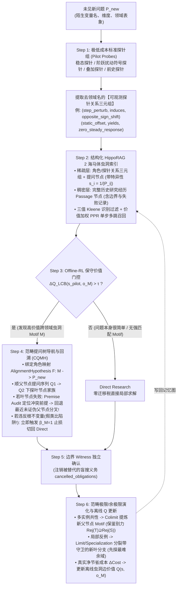

# 04 — Hegel 下一代核心架构与实验总方案：范畴提问树 × 海马体虫洞 × 离线价值拼接（CQM-Hippo）

**保存日期**：2026-11-18  
**起点基线**：`Hegel Machine` @ `787256bd415515905359626f6a5498174ad5db3c`  
**综合来源**：用户 V16 核心构想 + 全仓五代历史考古（`02`） + GPT-6 V16 审计与 MathRSI/AWM/HippoRAG 报告（`01`） + 范畴论/Offline RL/结构类比前沿文献（`03`）。  
**当前阶段原则**：**方案先行、对齐设计、严禁盲目堆砌模块**；待确认核心设计取舍后再进入分阶段编码与前瞻实验。

---

## 一、核心问题定调：Hegel 究竟要证明什么？（统一你的直觉与 GPT-6 的严苛标准）

经过 V11 到 V15 五轮高强度迭代，我们现在可以极其清楚地回答：**为什么之前一直觉得“差一口气”？以及真正的终点线画在哪里？**

1. **终极科学命题（North Star Claim）**：
   > 在**强普通方法（Strong Ordinary Agent）拥有完全相同的求解工具、实验权限和原始历史档案，且允许按需重建知识或在重建不划算时直接求解当前问题**的公平条件下，Hegel 从既往研究经历中提炼并组织的**“哲学模型（高层范畴角色图式 + 诊断提问判别树）”**，能否像**折叠学科曲面的虫洞**一样，帮助系统在面对**表面截然不同但深层机制同态的未见问题**时，以显著更少的实验探测/计算预算找到可验证的正确规律——同时在面对**表面相似但机制相悖的陷阱问题**或**完全无关问题**时，能低成本识别并安全退回普通直接研究？

2. **一针见血诊断 V15 为什么“走通了真实复用链，却没赢下目标成本”**：
   - **病根 1（迁移粒度太脆——只传了“末端结论”，没传“提问路径”）**：
     V15 的 `concept_0005` 只保存了末端程序 `accumulate(...)`。当未见目标改变了尺度、对象数或阈值区间时，末端实例首轮打分直接失败（12 道兼容 `A` 题中 5 题被标为 `empirically_excluded`、7 题 `scope_not_established`），系统没有“退回父节点、重跑诊断提问分支”的树回溯机制，只能退回普通全量搜索，白白多交了一笔检索与审计税。
   - **病根 2（缺乏离线价值门控——无脑预付迁移/重建重税）**：
     V15 移除组在入口把 84 万全额主预算塞进历史重建；持久组 `K` 在简单题上也照跑全套承诺检索与分支比对。没有像 Offline RL 那样先估一下 $\Delta \hat{Q} = \hat{Q}(\text{走虫洞}) - \hat{Q}(\text{直接解})$ 是否大于 0。
   - **病根 3（测试场平面距离太短——走平路只要 3 步，修虫洞当然亏本）**：
     在单域 `AnonymousObjectLab` 上，完全冷启动的 `Ordinary` 平均只需 `5.8万 ~ 7.9万` compute 就能把兼容目标直接暴力拟合出来！平面距离太短，掩盖了跨领域抽象本应具备的指数级剪枝威力。

---

## 二、核心架构脑洞收敛与形式化：**CQM-Hippo** 三层一体架构

把你提出的四个直觉——**① 决策树层级回溯、② 范畴论定义结构同态、③ HippoRAG 加速跨领域联想跳跃、④ Offline RL 路径拼接价值评估**——去掉冗余、严丝合缝地拼在一起，得到下一代 Hegel 的核心数据结构与运行闭环：

### 2.1 核心对象定义：什么是 Hegel 里的一个“哲学模型”？（`PhilosophicalMotifTree`）

不再把哲学模型写成一句自然语言口号，也不写成死板的单一末端公式，而是定义为**“范畴角色图式 + 诊断提问树 + 末端可执行叶族”的三元组** $\mathfrak{M} = (\mathcal{D}_{\text{root}}, \mathcal{T}_Q, \{\mathcal{L}_j\})$：

1. **根节点 / 中间抽象节点：范畴角色图式 $\mathcal{D}_v = (O_v, M_v, \mathcal{I}_v, \mathcal{N}_v)$**
   - **$O_v$（带类型角色槽 Typed Roles）**：例如共轭反抗图式中的 `{State, ConjugatePerturbation, InducedResponse, ProjectedEffect, LoopGate}`；或守恒扩散图式中的 `{SiteQuantity, NeighborGradient, BoundaryFlux, SourceInput}`。
   - **$M_v$（方向态射与组合律 Morphisms & Composition）**：角色间的因果/算子作用方向与时间阶数（瞬时 `lag=0`、差分变化率 `d/dt`、累积记忆 `accumulate`）。
   - **$\mathcal{I}_v$（可执行不变量残差泛函 Invariant Violation Functional）**：如反抗方向律 $V_{\text{opp}}(D; b) = \sum \max(0, \Delta_D Q \cdot \Delta_R Q + \epsilon)$，或守恒残差 $V_{\text{cons}}(D; b) = |\Delta Q_{\text{tot}} - \sum u_{\text{in}} + \sum u_{\text{leak}}|$。
   - **$\mathcal{N}_v$（保鉴别力硬负例诊断集 Diagnostic Perturbations）**：继承 AWM 的 $\operatorname{Rej}(T) \supseteq \operatorname{Rej}(S)$——任何通过余极限（Colimit）向上合并生成的父节点，**必须在保留各源域正例的同时，继续拒绝 $\mathcal{N}_v$ 中的硬负例**（例如“恒定噪声”“正反馈发散 $k>2$”“开路伪相关”），彻底杜绝泛化成“万能正确的废话”！

2. **内部树边：可执行诊断提问算子 $q_{v \to \{c_1, \dots, c_k\}}$（直接激活 `question_semantics.py`！）**
   - 每个非叶节点 $v$ 挂接一个**最小区分问题 `QuestionSpec`** $q_v: \mathcal{M}_v \to \{c_1, \dots, c_k, \texttt{OUT\_OF\_MOTIF}\}$：
     - 包含：**怎么构造受控探针序列**（用 `b` 把抽象角色投射到当前问题控制量）、**观测什么无量纲判据**、以及**每个答案分支把模型空间缩小到哪个子节点 $c_i$**！
   - **叶节点失效时的“回退父节点分支”算法（Parent-Ascent Backtracking）**：
     - 当候选叶节点 $\mathcal{L}_1$ 在目标问题上预测残差超标时，调用 `premise_dependency_audit` 检查：是**叶节点特有的细分前提**（如“静态偏离驱动”或“Neumann 零通量边界”）破了，还是**根节点的核心不变量**（如“存在反向恢复作用”）破了？
     - **若根不变量仍成立（`OBSERVED_MATCH`），仅细分前提破损**：**回退到最近未证伪祖先节点 $v^*$**，执行 $v^*$ 的区分问题 $q_{v^*}$，切换到兄弟分支 $\mathcal{L}_2$（例如从“化学静态势偏离恢复”一跃切换到“楞次变化率驱动感应恢复”，或从“Neumann 保守墙”切换到“Dirichlet 吸收墙”）！
     - **若根不变量本身被证伪（`OBSERVED_VIOLATION`）**：说明遇到了“表面相似但底层机制相反”的陷阱题，立即触发宏动作终止条件 $\beta_{\mathfrak{M}} = 1$，零留恋退回 `direct_research`！

3. **末端叶节点 $\mathcal{L}_j$：参数化可执行程序族 + 显式判例锚点**
   - 存放具体的参数化 `Program` / 微分差分算子模板、已验证的 `scope_guard`，以及至少 1–2 个产生该叶节点的源 `EpisodePassage` 指针（借鉴 `v16_final_results.md`“抽象法条必须挂具体判例锚点”的成功经验）。

---

### 2.2 相似性与“曲面虫洞”如何严格定义并高速检索？（范畴同态 × HippoRAG 2 双图 PPR）

你问：“说来说去最终还是落到定义相似性的问题，定义得好，两个问题就能迅速被识别为同类问题，就知道下次用哪些已有的哲学模型解决。”

我们把“相似性”明确拆成**“快系统（海马体毫秒级联想召回）”**和**“慢系统（范畴态射与实验证伪对齐）”**两级，既快又准：

#### 第一级（快系统）：双层结构化 HippoRAG 2 关联检索（`StructuralHippoIndex`）
1. **图里存什么节点？（无须重型图数据库，纯内存/JSONL 稀疏矩阵即可毫秒级运算）**
   - **稠密上下文节点（`EpisodePassage` Nodes）**：每次完整源问题的研究档案（初始观测特征、遇到过的预测分叉、什么探针解决了分叉、最终确认的程序与作用域）。
   - **稀疏结构短语/关系节点（`StructuralPhrase` & `ProbeTriple` Nodes）**：**严禁只存领域表面变量名**！由确定性探针特征器从任何问题的早期 `pilot` 数据中自动提取**无量纲结构三元组**，例如：
     - `(steady_nonzero_input, produces, zero_steady_output)`（微分/变化率耦合指纹！）
     - `(opposing_perturbation_pair, induces, sign_inverted_restoring_shift)`（勒夏特列/楞次反抗指纹！）
     - `(spatial_sum_over_sites, remains, invariant_under_zero_boundary_drive)`（守恒律指纹！）
     - `(identical_instant_state_different_history, causes, divergent_output)`（潜变量/记忆累积指纹！）
   - **层级树节点（`MotifNode` & `QuestionNode`）**：通过 `realizes` / `discriminates` 边与上述探针三元组和经历段落相连。
2. **新问题来时怎么跑 PPR 穿过虫洞？**
   - **Step A（Query-to-Triple 链接）**：对新问题的 `pilot` 探针行为生成查询三元组集合 $T_{\text{query}}$。
   - **Step B（Strong Kleene 三值识别记忆过滤）**：
     吸取 `SCAR v1` 98.9% 覆盖崩塌的教训！对尚未测到的探针维度标为 `UNKNOWN`（不扣分、不删边）；对已测到明确矛盾的三元组标为 `OBSERVED_VIOLATION`（抑制对应冲突边）；只保留相容的桥接三元组作为 PPR 种子。
   - **Step C（特异性 + 离线价值加权的 Personalized PageRank）**：
     节点 $i$ 的重置概率与边转移权重同时融合 **HippoRAG 节点特异性** $s_i = |P_i|^{-1}$（出现于所有题目的万金油废话节点权重趋近 0！）与 **Offline RL 历史净节省优势** $w_{e} \propto \text{softplus}(\Delta \hat{Q}_e)$，运行单步阻尼 PPR（`damping = 0.5`，`EpisodePassage` 重置权重 `0.05`），直接输出 Top-$K$ 候选 `(PhilosophicalMotifTree, SourceEpisode, BridgeTriples)`！

#### 第二级（慢系统）：部分范畴态射绑定（`AlignmentHypothesis`）与树深度同构度
对 HippoRAG 召回的候选 $\mathfrak{M}$，构造显式、可被实验证伪的 **`AlignmentHypothesis`** $F: \mathcal{D}_v \rightharpoonup P_{\text{new}}$：
- 检查角色类型相容性（可控输入只能映到可控输入或已知扰动通道，状态只能映到状态/历史读出，时间因果序不倒置）；
- 两个问题 $P_1, P_2$ 的**验证后结构同构深度**定义为它们在 $\mathfrak{M}$ 中共同满足 `OBSERVED_MATCH` 的最深公共范畴节点层级 $d_{\text{LCA}}(P_1, P_2)$：
  - $d_{\text{LCA}} = 0$：无关或机制相悖（拒绝迁移）；
  - $d_{\text{LCA}} = 1$（根 Motif 同态，如勒夏特列与楞次）：共享高层角色符号不变量与顶层诊断问题，但在第 2 层按“静态势偏离 vs 变化率感应”分叉，**省去全部顶层盲搜与角色配对探索**！
  - $d_{\text{LCA}} = L$（叶级同构，如热传导与 Fick 扩散）：一直同构到末端微分算子骨架，只需做一次线性系数标定即可一步到位！

---

### 2.3 Offline RL 价值拼接门控：让“多懂一套哲学”永远不会变慢！

为了彻底解决 GPT-6 指出的“采用了正确对象反而花 `291k > 58k`”以及“移除组烧光 `840k` 预算预重建”的问题，我们在调度器入口建立 **Offline Conservative Option Selector**：

1. **五个平等竞争的元动作（所有对比臂共享同一套选择权，绝不偏袒 Hegel！）**：
   - $a_0 = \texttt{direct\_research}$：直接启动局部合成与探索；
   - $a_1(\mathfrak{M}, b) = \texttt{wormhole\_tree\_guided}$：绑定候选哲学树 $\mathfrak{M}$ 与角色映射 $b$，按提问树剪枝搜索空间（显式注销被剪掉的盲搜分支 `cancelled_obligations`！）；
   - $a_2(q) = \texttt{discriminating\_probe}$：当两个候选分支或映射存在高价值分歧时，购买最小区分探针；
   - $a_3(b_{\text{sub}}) = \texttt{bounded\_local\_reconstruct}$：仅在预期后续复用能回本时，在**硬子预算上限 $b_{\text{sub}} \le 0.25 B_{\text{total}}$** 内按需从原始历史重建缺失抽象（预留独立确认预算，且失败结果跨题缓存！）；
   - $a_4 = \texttt{abort\_transfer\_fallback}$：一旦在子预算内未获正决策增量（MathRSI `global-reassessment` 准则），立即止损切回 $a_0$。
2. **离线 Q 值计算公式（无需黑盒神经网络训练，小样本确定性可审计！）**：
   对任意候选宏动作 $o_M$，定义单位成功净价值 $V = R_{\text{solve}} - \lambda_c \text{Compute} - \lambda_{\text{obs}} \text{Obs}$。利用源阶段及过往已完成任务积累的离线账本 $\mathcal{D}_{\text{offline}}$，估计：
   $$\hat{C}_{\text{wormhole}}(s_{\text{pilot}}, o_M) = C_{\text{align}}(o_M) + \hat{C}_{\text{tree\_solve}}(o_M \mid s_{\text{pilot}}) + (1 - \hat{p}_{\text{compat}}(s_{\text{pilot}}, o_M)) \cdot C_{\text{probe\_abort}}$$
   只有当保守上界满足：
   $$\hat{C}_{\text{wormhole}}^{\text{UCB}}(s_{\text{pilot}}, o_M) < \hat{C}_{\text{direct}}^{\text{LCB}}(s_{\text{pilot}}) - \delta_{\text{margin}}$$
   系统才授权进入虫洞 $o_M$！
   - **直接推论**：如果一道目标题像 V15 里的简单题那样，$\hat{C}_{\text{direct}}$ 只需要 5 万算力，而某条复杂重绑定路径预计要花 8 万算力，门控器在毫秒内就会选 `direct_research`！**知识库再大，也绝不会拖慢简单题！**

---

## 三、如何设计真正公平、硬核、能一锤定音的实验？（避免玩具同域，也避免剧本做题）

结合你说的“勒夏特列原理与楞次定律同胚迁移”和 GPT-6 对实验严谨性的全部要求，我建议分**两步走实验设计**（先在完全无预训练剧透嫌疑的**匿名多物理机制实验台**上拿到铁证，再附一个直观的**勒夏特列—楞次跨领域可交互实验**作为画龙点睛的案例展示）：

### 3.1 主战场：`WormholeLabSuite`（跨表征、多机制家族匿名科学发现基准）

为什么主实验必须对变量名、物理外壳做**匿名化与跨维度重接线**？
因为如果直接写明英文 `"magnetic_flux"` 和 `"Le Chatelier"`，审稿人（和 GPT-6）会立刻质疑：“强普通 LLM 本来就背过教科书知道它俩都是负反馈，不是你 Hegel 自己学出来的！”
反过来，如果我们构造**外在表象（控制通道数、传感器读出形式、变量名、非线性末端函数）完全不同，但底层动力学共享范畴提问树**的匿名物理世界，任何人都无法靠背课文作弊，而**平面局部盲搜的计算复杂度又天然高达 $10^5 \sim 10^6$**（因为面对 8–12 个匿名通道和多种动力学算子，不靠提问树先定性“是不是变化率驱动、是不是对偶反抗、是不是守恒通量”，组合搜索空间会指数爆炸！）：

| 机制家族（根哲学 Motif） | 源领域装置（系统在此自我探索并提炼哲学树 $\mathfrak{M}$） | 未见跨表征“虫洞”目标装置（表象大变、底层同态） | 表面相似但机制相悖的硬负例陷阱（测防误迁移！） |
|---|---|---|---|
| **家族 M1：共轭扰动—反抗平衡族** （抽象版 **勒夏特列 $\leftrightarrow$ 楞次**） | **装置 S_Chem（静态势偏离恢复型）**：多组分非线性化学质量作用平衡，外加共轭势阶跃引发反向平衡移动 + 惰性通道零响应守卫 | **装置 T_Lenz（通量变化率感应反抗型）**：乘积耦合通量 $\Phi = c_1 \cdot c_2$，静态非零无响应，唯有变化率 $\Delta \Phi/\Delta t$ 诱发反向阻尼响应 + 开路开关守卫（测试叶节点失败后**回退根 Motif 走 Q1 分支**！） | **陷阱 N_Runaway（正反馈热失控 / 过增益发散 $k>2$）**：变量接口与 S_Chem/T_Lenz 完全一致，但扰动诱发同号放大或震荡发散（必须被 `Q_sign/Q_stab` 探针一枪毙掉！） |
| **家族 M2：守恒通量—梯度耗散族** （抽象版 **热传导 $\leftrightarrow$ 物质扩散**，直接复用并升级现有 `ContinuumFieldLab` / `ManifoldPDELab`） | **装置 S_Heat1D**：1D 匿名有界链热传导（Neumann 绝热守恒边界 vs Dirichlet 恒温漏热边界） | **装置 T_DiffGraph**：异构不规则图网络上的物质扩散 + 局部非线性传感器读出（表面图拓扑与维度全变，但守恒探针 + 拉普拉斯邻域提问树完全同态！） | **陷阱 N_AdvectSource**：表面相似的多站点场，但由非守恒外源注入与单向双曲平流主导 |
| **家族 M3：阈值门控—路径历史记忆族** （无缝兼容并承接 V15 的 `AnonymousObjectLab` `accumulate` 遗产） | **装置 S_ObjectMem**：`N=4` 离散对象局部条件交换 + `accumulate` 累积记忆冲突流（`S_cal..S4`） | **装置 T_HysteresisRelay**：`N=6` 跨通道迟滞继电器系统（不同表面通道编码，但共享“同当前输入不同前史导致分叉”的提问子树） | **陷阱 N_MemorylessNonlinear**：高阶静态多项式交叉项（看似复杂，实则前史探针差值为 0，无需开潜变量搜索！） |
| **家族 M0：独立无关基线问题** | 无对应源经历 | 简单独立代数/局部响应装置（局部直接搜索极便宜） | 验证 Offline-RL 门控自动选择 `direct_research`，**零迁移税**！ |

### 3.2 四组严格公平对照（堵死一切审计漏洞）

1. **`H_wormhole`（完整下一代 Hegel）**：独立跑源阶段形成 `PhilosophicalMotifTree` + `StructuralHippoIndex` + `Offline-RL Value Gate`，再在冻结预算下解未见目标集。
2. **`O_strong`（强普通研究代理——最强公平对手！）**：
   - 拥有与 `H` **完全相同的局部求解器、微分/记忆算子语法、主动探针生成器、范围表与失败缓存权限**；
   - 独立跑完相同源任务，保留**全部原始历史轨迹与自己学到的平坦概念库**；
   - 在目标阶段**同样拥有 `direct_research` / 按需局部重建 / 跳过迁移的自由选择权**（绝不强迫它烧光预算预重建！）。
3. **`H_flat_selector`（同内容去图消融对照 `F` vs `G`）**：
   - 与 `H_wormhole` 拥有完全相同的 `PhilosophicalMotifTree` 库，但把 `StructuralHippoIndex` (PPR) 替换为普通 Flat BM25/特征扫描排序。专门用来在记忆库规模从 `M=6` 扩展到 `M=48~96` 时，实测海马体关联图在候选召回率与检索预算分配上的独立贡献！
4. **`C_cold`（无先验冷启动基线）** & **`E1_clean_remove`（修复有界子预算后的干净单对象移除干预）**。

### 3.3 核心评价指标（直接衡量“虫洞加速”）
1. **研究起点跃迁曲线（Jumpstart Curve $S(b)$）**：在总预算的 `10% / 25% / 50% / 100%` 处，已找到经外部 48 行独立测试验证（$\text{MSE} \le 10^{-7}$）的正确模型的题目比例，以及**首次命中有效候选机制的累计实验行数与计算量（Cost-to-First-Valid-Mechanism）**！
2. **严格成功率与假确认率（Strict Success & False Confirmation Rate）**：目标必须同时满足内部独立 holdout 确认与外部盲测确认，假确认目标趋近 `0`。
3. **全生命周期净成本摊销 $\Delta C_{\text{total}}(m)$**：把源阶段学习费、建树与图索引维护费、检索费、失败探测止损费全部摊入总账，检验目标数 $m = 1, 3, 6, 12$ 时的端到端净收益，并按 $2\times 2$ 矩阵（真虫洞目标 / 同域近邻 / 假类比陷阱 / 无关简单题）分层透明汇报！

---

## 四、分阶段施工路线图（遵循“控制变量法 / 增量替换”，每步可独立验证）

为了绝不重蹈“一次性推翻重写全部代码导致失控”的覆辙，建议按以下 **四个递进里程碑（P0 $\to$ P3）** 在现有 `Hegel Machine` 代码库上增量演进：

| 阶段 | 代号与核心任务 | 主要涉及模块（全部在现有 `cognition/` 上演进） | 独立验收闭环标准（Gate） |
|---|---|---|---|
| **阶段 P0** （地基除虫与诊断） | **闭合 GPT-6 指出的 V15 六项工程/计量瑕疵 + 12 道 A 目标逐题归因** | `branch_reconciliation.py`, `memory.py`, `unified_research.py`, `premise_commitment_index.py` | 1. 版本 Hash 闭合、探针严格匹配、`revoked` 支持根过滤、互斥 leaf 计费桶全部单测通过； 2. 有界可选重建修好后，移除组不再出现 `839,933` 烧空预算； 3. 输出 V15 12 道 A 题“为何采用却更贵/为何排除”精确损耗表。 |
| **阶段 P1** （核心树结构与离线价值门控） | **实现范畴提问树 `PhilosophicalMotifTree` + 父节点回溯 + Offline-RL 选择器 $\Delta \hat{Q}_{\text{LCB}}$** | 新增轻量模块 `categorical_motif_tree.py`, `value_gated_reuse.py`；对接已有 `question_semantics.py`, `premise_dependency_audit.py`, `world_structure_commitments.py` | 1. 源经历能通过余极限（保拒绝 $\operatorname{Rej}(T)\supseteq\operatorname{Rej}(S)$）提炼出带提问节点的两层/三层树； 2. 叶节点失配时能自动回退父节点执行区分问题切换到兄弟叶分支； 3. 在简单无关题上自动选 `direct_research`，保证不比 `Ordinary` 慢！ |
| **阶段 P2** （海马体虫洞检索层） | **接入双层结构化 HippoRAG 2 索引 `StructuralHippoSelector`（探针关系三元组 + 经历段落 + 三值识别过滤 + 特异性 PPR）** | 新增轻量模块 `structural_hippo_index.py`（吸收旧 `rag_to_memory_baseline.py` 与 `structural_patterns.py` 精华，零硬编码词表作弊），挂载到 `_recall` / `_world_commitments` | 1. 在多域记忆库（`M >= 32` 条经历）上，跨表面表征的同 Motif 候选 Top-3 召回率显著高于词面/Flat 基线； 2. 表面相似但符号相反的硬负例被三值验证器 100% 拦截，不产生假确认。 |
| **阶段 P3** （前瞻虫洞大实验） | **构建并冻结 `WormholeLabSuite`（含勒夏特列 $\leftrightarrow$ 楞次抽象对、热 $\leftrightarrow$ 扩散图 PDE 对、记忆继电器对及硬负例陷阱），运行前瞻 `H vs O vs F vs C` 实验** | 新增实验套 `wormhole_lab_suite.py`（整合扩展 `AnonymousObjectLab` + `ContinuumFieldLab` + `ManifoldPDELab` + 新共轭平衡/感应实验器）及独立验证器 `05_STANDALONE_VERIFY_V16.py` | 检验核心命题：在同权限强普通方法 `O_strong` 允许按需重建或直接求解的条件下，`H_wormhole` 在跨表征同态目标上显著降低首次命中有效机制成本与总观测/计算开销，且在陷阱题上零负迁移崩塌！ |

---

## 五、需要你拍板的四个关键决策点（对齐后立即开工）

在动手写任何一行新代码前，希望先听听你对下面四个关键取舍的看法：

1. **关于“哲学模型”的表示形态（P1 核心）**：
   将假设升级为 **“高层范畴角色与不变量（父节点） + 可执行诊断提问分支（中间边） + 具体域参数化程序与判例（叶节点）”** 的树结构，并在叶节点失败时回退父节点跑区分问题——这个结构是否完全契合你脑海里的“决策树 + 范畴关系”画面？有没有你觉得还漏掉的维度？
2. **关于 Offline RL 价值门控的实现方式（P1/P2 衔接）**：
   第一版先采用**无需训练神经网络、完全可解释的离线保守表格式/线性价值估计 $\Delta \hat{Q}_{\text{LCB}}(s_{\text{pilot}}, o_M)$**（同时作为是否开启虫洞的开关，以及 HippoRAG 图上边的强化权重），还是你希望单独训练一个小型神经 Q 网络来做路径价值预测？*(我个人强烈建议先用确定性离线统计/线性 LCB，零黑盒噪声且完全满足可审计要求，等跑通正结果再试神经 Q 网络。)*
3. **关于勒夏特列—楞次定律的实验落地形态（P3 重点）**：
   你是希望：
   - **方案 A（双轨并行，最稳妥也最出彩）**：主定量表使用**完全匿名化、重命名且跨维度的四大家族物理实验台 `WormholeLabSuite`**（彻底杜绝“LLM 背过教科书”质疑），同时单独做一个**显式物理/化学交互环境下的“从勒夏特列平衡实验自主迁移解出陌生楞次电磁感应回路（含惰性气体/静态磁场/开路反例）”端到端案例展示**；
   - **方案 B**：先只做纯匿名 `WormholeLabSuite`；
   - **方案 C**：直接在带真实物理量语义的科学定律发现环境里测？
4. **关于推进节奏**：
   你是否同意按 **P0（先修净 V15 六个局部缺陷并拆清 12 道 A 题成本账） $\to$ P1（范畴提问树 + 价值门控） $\to$ P2（结构化 HippoRAG 2） $\to$ P3（前瞻虫洞实验）** 的增量顺序推进？还是希望把 P0 和 P1 合并在第一批直接跑一个最小“勒夏特列 $\leftrightarrow$ 楞次”虫洞原型看看火花？
