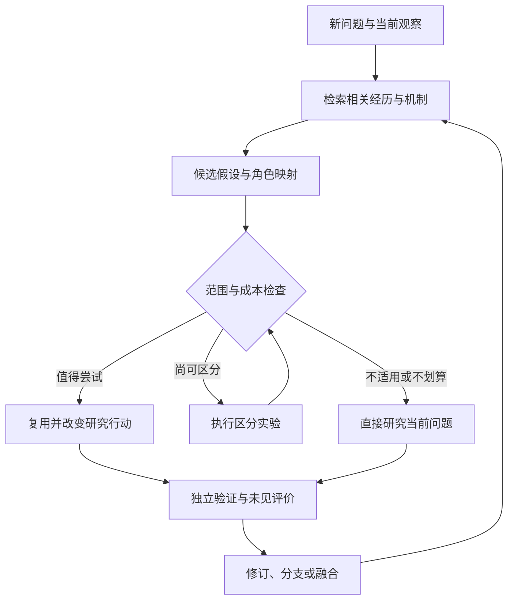

# 我：
(首先我上传了Algebraic World Model: From Exploration to Proofs 这篇论文)
https://lisresearchgroup.github.io/math-rsi/#top
这是我刚发现的一个mathRSI项目，看看哪些有hegel machine能用上的，和前面AWM一起考虑

# GPT：
**有，而且 MathRSI 和 AWM 放在一起，能给 Hegel Machine 提供一套很具体的改进方向。**

我认为最值得吸收的是三件事：

1. **从 MathRSI 学习：让新知识真正改变下一次研究行动。** 新假设、新定理或新工具返回以后，研究器要实际使用它，撤掉已经多余的搜索，并说明原问题还剩什么困难。
2. **从 AWM 学习：让假设的修订、分支和融合具有明确的证据合同。** 哪些旧判断必须保留，哪些应该因新证据撤回，不能混在一起。
3. **由 Hegel 自己完成：在强普通方法可以重建同一知识的条件下，证明这些变化对未见问题究竟有什么价值。** 两个项目都提供了有用机制，但它们的结果还不能替代这项实验。

我按 MathRSI 官方仓库的 **`8cef5169` 固定版本**审阅了文档、相关代码和保存的运行记录；AWM 本次以你上传的 **v1** 为准；Hegel 的现状沿用刚完成的 **`c9b60dc5` / V14 审计**。本轮没有重跑大型数学实验，也没有修改 Hegel 仓库。AWM 主来源：2610.40503v1(1).pdf

---

## 一、先判断 MathRSI 到底提供了什么

MathRSI 有三个需要分别看待的层次：

| 层次 | 我核实到的内容 | 对 Hegel 的价值 |
|---|---|---|
| 研究工作流 | 研究技能、领域插件、任务知识库；从问题准备、路线选择到证明、核验和交接的调用规则 | 改善研究过程，减少局部工作与原目标脱节 |
| 可执行研究循环 | `cube_coevolve` 能生成搜索程序、执行、独立核验、提出候选不等式、消费反例并反馈下一轮 | 提供“假设怎样进入后继执行”的具体实现范例 |
| 方法维护 | `meta-evolve` 从真实研究经历中修改技能、插件和调用方式 | 提供研究经验怎样形成方法改进的组织方式 |

其中，**`cube_coevolve` 是实际存在的可执行系统**。这部分值得认真看，不能只根据它使用 Markdown 技能就忽略。官方代码确实把候选、实际程序、输入输出、反例和下一轮奖励连了起来。[官方实现说明](https://github.com/lisresearchgroup/math-rsi/blob/8cef516922f00887630686b45b7b2fe8a3a38e29/plugins/hypercube-extremal/tools/cube_coevolve/README.md)

但关于“RSI 效果”，官方材料的表述相当克制：

- `meta-evolve` 是独立的外层维护，不会在每次研究交接后自动启动。
- 技能变化没有训练基础模型。
- 历史数学成果不能追认为后来版本的解题实验。
- 通用提速或 RSI 效果，需要另外开展研究评测。

因此，我核到的材料支持“有真实研究能力、反馈机制和方法维护”，**尚不足以证明长期跨未见任务的净效用已经优于强普通方法**。它自己的验收说明也明确保留了这一边界。[维护说明](https://github.com/lisresearchgroup/math-rsi/blob/8cef516922f00887630686b45b7b2fe8a3a38e29/docs/EVOLUTION_WORKFLOW.md)；[技能验收说明](https://github.com/lisresearchgroup/math-rsi/blob/8cef516922f00887630686b45b7b2fe8a3a38e29/docs/SKILL_ACCEPTANCE.md)

这与我们审查 Hegel 时坚持的标准是一致的。

## 二、MathRSI 最值得 Hegel 吸收的五项机制

### 1. 新知识返回后，要改变“同一个原问题”的实际执行

这是我认为**最应该立即迁移**的一项。

MathRSI 的 `actual-input-coverage` 要求，得到一个新定理或已核验工具后，调用方必须检查：

- 它对当前原输入是否适用；
- 需要什么合法表示、参数和前提；
- 结论怎样回到同一个原输入；
- 它已经解决了哪部分；
- 哪些后续搜索或证明任务因此可以撤掉。

它还要求按原输入去重：同一个对象换三个表示，各成功一次，不能算新增解决了三个问题；某个表示失败，也不能直接断言原问题失败。[原输入覆盖与消费协议](https://github.com/lisresearchgroup/math-rsi/blob/8cef516922f00887630686b45b7b2fe8a3a38e29/base/skills/mathrsi-prove/references/actual-input-coverage.md)

对 Hegel，我建议明确区分下面这些事实：

> **被检索 → 生成候选 → 实际执行 → 被采用 → 改变后继行动 → 改善最终结果。**

每一步需要的证据不同。

例如，“日志里出现了 `concept_0004`”只能说明它可能被引用；“由它产生了一个候选”还不能证明它改变了行动；“最终采用了它的合法派生”也还不能直接证明总体更省。

#### 这正好对应 V14 的当前状态

上一轮审计已经确认，1041000 来源链形成了含 `accumulate` 的新修复机制，具有版本、新确认数据以及后续合法派生采用。因此，可以承认：

**系统在既有表达语言中形成了新的可执行机制假设。**

无需再增加“必须自行发明 `accumulate` 原语”这个门槛。

但其后继 T1 中：

- K：计算 **115848**；
- R：计算 **117711**；
- cold：计算 **106193**；
- 三组都通过。

这说明**真实使用链与增量效用还需要分别判断**。名义删除对象的对照又存在残留载体，尚不能解释这个知识对象的因果贡献。01_V14_系统审计与主目标判定.md[V14 审计](sandbox:/workspace/scratch/9d1e58286220/hegel_c9b60dc5_review/01_V14_系统审计与主目标判定.md)

迁移 MathRSI 后，Hegel 每次采用知识，应该自动产生这样的记录：

> 因为使用了 H 的具体版本及合法绑定，研究器取消了原计划中的某项搜索，或改选了某个区分实验；仍需执行哪些确认；实际花费怎样变化。

这里不需要另建庞大账本，直接补进现有消费事件和 dispatcher 即可。

### 2. 把“候选假设”和“寻找反例”接成真正的双向循环

MathRSI 的 `cube_coevolve` 很适合作为具体参考。

它的一个循环包括：

1. 从档案选择对象与来源程序，冻结本轮奖励。
2. 模型生成搜索程序。
3. 执行程序，提交具体图。
4. 宿主独立检查图的合法性并重新计算指标。
5. 提出带条件的不等式候选。
6. 在全部已归档合法图上检验候选。
7. 将真实反例反馈给下一轮，移除已经被反驳的奖励项。

源码保存了实际程序、输入、输出、父程序来源及 `reward_before / reward_after`。相关测试还检查上一轮的奖励输出是否确实成为下一轮实际收到的输入。[循环源码](https://github.com/lisresearchgroup/math-rsi/blob/8cef516922f00887630686b45b7b2fe8a3a38e29/plugins/hypercube-extremal/tools/cube_coevolve/cube_coevolve/loop.py)

这对 Hegel 的启发非常直接：

- 假设提出器从真实经历中提出候选；
- 区分实验器根据候选之间的分歧选择下一次观测；
- 新观测改变候选状态、范围或绑定；
- 这些变化必须进入下一次真实实验选择。

**“提出了问题”与“后继研究真的消费了答案”之间的连接，应成为可核验的生产行为。**

不过，MathRSI 的公开试跑也提醒我们不要过度解读：我核读的 Q8 构建记录中，三轮、六次模型调用后，最好结果仍是 **682 边**；四条候选都只是 `empirical`，没有新的 Q8 数值界，也没有长期效率实验。它的自适应档案和留出图也不构成独立的最终泛化测试。[构建与试跑记录](https://github.com/lisresearchgroup/math-rsi/blob/8cef516922f00887630686b45b7b2fe8a3a38e29/plugins/hypercube-extremal/tools/cube_coevolve/implement-stage/BUILD_NOTE.md)

所以，应该借它的**执行连接与反馈方式**，再用 Hegel 自己的未见任务检验收益。

### 3. 新分支产生前，先检验最难的剩余部分

MathRSI 有一项特别适合解决你担心的“分支越长越多”：

> 准备采用“容易的子族＋剩余域”这种划分时，先对最难的剩余分支做一次有界、实质性的探针。

容易分支不断通过，不能清零共享难点的停滞记录。[分类准入与最难余域](https://github.com/lisresearchgroup/math-rsi/blob/8cef516922f00887630686b45b7b2fe8a3a38e29/base/skills/mathrsi-prove/references/actual-input-coverage.md)

Hegel 可以把它改造成一个很小的行为变化：

**每次提出 scope split，先面对促使这个 split 出现的那个原始冲突。**

例如：

- 原反例是否真的被新分支解释？
- 两个 guard 的交集是否仍有冲突？
- 边界附近是否存在两边都不适用的情况？
- 所谓“其它情况”是否只是把原来的失败换了一个名字？

如果最难处仍没有可执行路径，就调整划分或保持未决。

这里要保留一个边界：**未解决最难分支，不会使已经成立的窄域知识失效。** 它限制的是“整个问题已经推进或解决”的宣称，以及继续大量扩张同一路线的理由。

这样可以减少一种常见的假进展：系统新增很多分支，每支都有局部成功，但最初的冲突始终没有被处理。

### 4. 按“原问题的决策增量”衡量研究进展

MathRSI 的 `global-reassessment` 提出了一个很好的判断：

**规约成立与规约有用，需要分别判断。**

一个问题可以反复换表示、增加中间引理，逻辑上都成立，但最难的部分可能只是被搬到了分类完整性、共同相容性或最后的装配步骤。[全局进展重评](https://github.com/lisresearchgroup/math-rsi/blob/8cef516922f00887630686b45b7b2fe8a3a38e29/base/skills/mathrsi-research/references/global-reassessment.md)

Hegel 每批研究结束后，建议回答三个问题：

1. **原来缺什么，现在真正少了什么？**
2. **假设本批局部任务全部成功，原问题还缺什么？**
3. **下一步为什么更可行，或者会消除哪项影响行动的不确定性？**

有效反例可以算进展，因为它排除了错误路线。关闭真实必要的子问题也可以算进展。仅仅多了一份解释、一条分支或一张表，不能自动算进展。

这对当前成本尤其重要。V14 父任务对照中：

- 普通失败重试：**5/6** 通过，平均计算 **228395.17**；
- 子问题驱动修复：**4/6** 通过，平均计算 **532292.33**。

递归组少用了一些观测，但计算约为普通组的 **2.33 倍**。两组还有调度配置差异，所以这是当前完整策略的结果，不能单因子归结为“递归无效”；但它确实要求我们研究：哪些递归工作没有改变父任务决定，哪些确认和维护在重复付费。01_V14_系统审计与主目标判定.md[V14 审计](sandbox:/workspace/scratch/9d1e58286220/hegel_c9b60dc5_review/01_V14_系统审计与主目标判定.md)

我建议吸收这项判断方式，**不必照搬每轮固定启动两位 reviewer 的配置**。可以先用已有事件进行便宜的内部检查，出现实质争议或准备扩大投入时，再做独立重评。

### 5. 把世界假设、领域方法和研究策略分层提升

MathRSI 的 `meta-evolve` 会判断一项经历应该进入：

- 单题状态；
- 领域插件；
- 通用研究行为；
- 暂缓提案。

它要求沿着“原目标—实际行为—改变判断的证据—真正修改的动作—当前适用范围”提炼经验，再修改真实调用处。[方法维护技能](https://github.com/lisresearchgroup/math-rsi/blob/8cef516922f00887630686b45b7b2fe8a3a38e29/base/skills/mathrsi-meta-evolve/SKILL.md)

这对 Hegel 很重要，因为下面两种知识不同：

> **世界假设：** 当前系统的演化需要一个累积历史变量才能解释。  
> **研究方法：** 当相同可观测摘要下持续出现预测分叉时，优先做一个有界的历史依赖区分实验。

前者描述研究对象，后者描述研究器应怎样行动。

Hegel 当前应先把前者的生命周期与效用测清楚。后续可以只允许一种方法变化，例如：

- 区分实验排序；
- 何时触发递归子问题；
- 何时先重绑定、何时提出新机制；
- 什么时候值得提前维护分支。

这些策略应从真实经历中提出，再用新任务检验。**开发者把一条经验直接写进调度器，可以是一项有效工程改进；要称系统自己学会了它，还需保留产生和采用它的真实过程。**

方法学习可以作为下一阶段研究，并不影响我们现在承认 Hegel 已形成某个新的世界假设。

## 三、AWM 应当怎样补进这套逻辑

### 1. 把“反例、域外、未知、执行失败”分开

AWM 的可执行概念包含声明、scope、支持转移、checker 和可选 predictor。其判定区分 TRUE、FALSE、NA，以及 checker 异常或超时产生的 ERR。[arxiv.org](https://arxiv.org/html/2610.40503v1?utm_source=chatgpt.com)

Hegel 应借鉴这种区分，同时保留自己更丰富的状态：

- **域内真实预测错误：** 当前声明或绑定遭遇反例。
- **明确域外：** 当前假设不能用于这里。
- **范围尚未识别：** 需要区分实验或暂缓。
- **检查器错误、超时、预算不足：** 验证未完成，没有新增科学否定。

这直接关系到 V14 的一个缺口：

> 固定实例失败 → scope 无法识别 → 整支 refuted → 同源模板也被取消资格。

这里可能混淆了三个不同结论：

1. 旧固定绑定不能普遍成立；
2. 旧规则在哪个局部范围仍有效；
3. 同一参数化模板是否存在另一个合法绑定。

**一个真实反例足以推翻固定规则的普适性，但不能自动证明所有合法重绑定都不可能。**

另外，AWM 的单一概念账本 gate 不宜完整照搬到 Hegel 的竞争假设库。Hegel 可以保留有分歧的待证分支，并继续做区分实验；限制应该落在“哪些分支可以被当作当前已支持知识来使用”，避免某一支未决就阻止全部研究。

### 2. 融合与纠错必须使用不同验收规则

AWM 对结构压缩提出了一个非常有价值的约束：

\[
\operatorname{Rej}(T)\supseteq \operatorname{Rej}(S)
\]

即在指定诊断集上，替换后的规则不能丢掉旧规则已经具备的拒绝能力，同时还要保留已记录有效转移的覆盖和判定。[arxiv.org](https://arxiv.org/html/2610.40503v1?utm_source=chatgpt.com)

这很适合 Hegel 的**融合、共享参数化和冗余消除**：不能为了减少分支数量，把原来能识别的错误一起压没了。

但有一条重要边界：

**真实经验纠错，有时必须撤销旧规则的错误拒绝。**

假如旧假设错误地排除了一个真实合法行为，新观测已经证明这一点，就应该修订。若要求所有旧拒绝永远保留，系统会把错误知识锁死。

因此，我建议按下表处理：

| 场景 | 合理动作 | 需要保留或补充的证据 |
|---|---|---|
| 旧绑定失败，模板仍可合法拟合 | 重绑定，形成新实例/版本 | 旧反例、新绑定、新确认 |
| 不同范围分别支持不同规律 | 分支或限域 | guard、交集、余域及支持归属 |
| 多支可以由共享机制表达 | 融合或泛化 | 源实例回代、旧有效覆盖、必要拒绝及重叠相容 |
| 新真实证据推翻旧规律 | 经验修订 | 被撤销的旧判断、决定性证据、受影响依赖 |
| 某物化分支的能力被另一载体完整覆盖 | 淘汰冗余载体 | 独立支持、消费者接替与鉴别能力保持 |
| 同域冲突但证据不足 | 保留竞争、安排区分实验 | 冲突见证、未决范围、下一问题 |

这张表是我针对 Hegel 提出的组合设计。**MathRSI 当前的候选规范化和反例维护，并没有替我们实现完整的跨分支蕴含、融合与淘汰系统。**

还要防止一种形式上的“通过”：新规则把 scope 缩成空集，或者对所有困难输入都返回 NA。这样可能避免报错，却没有保住任何有用覆盖。融合验收必须同时检查适用性、有效覆盖和必要拒绝。

### 3. 借鉴 AWM 的下游效用实验，但补齐完整成本

AWM 有一项比总体得分更贴近我们目标的实验：

将 lp85 的 **11 个概念**合成一条共享置换规则，然后让两个模型面对相同的 **34 个任务**，每题重复三次。

| 指标 | 原 11 概念模型 | 合并模型 |
|---|---:|---:|
| 成功运行 | 99/102 | 102/102 |
| 辅助引理数 | 5.33 | 2.50 |
| 证明行数 | 58.33 | 28.67 |
| kernel 检查时间 | 2.11 秒 | 1.55 秒 |

后三项是**成功运行内的组中位数，再对六组取宏平均**，不是全部尝试的端到端成本。来源为上传 v1 的附录 B.3、p.22 Table 8。

这项实验值得复制，因为它直接问：

> **抽象之后，同一组下游问题的推理工作具体发生了什么变化？**

但 Hegel 还要补上两项：

- 形成、验证、维护和检索这个抽象的费用；
- 普通方法从相同经历重建同一抽象的权限和费用。

论文这项对照没有专门完成我们要求的这一完整合同。

另一个有启发的结果是 AWM 的依赖指导反例实验。两臂都有模型、模型内证明和游戏访问；C1 没有显式证明依赖清单，找到真实反例 **17/63**；C2 额外获得清单，达到 **32/63**。但 token 中位数也由 **2.35M** 增至 **3.29M**。这支持“实际依赖能帮助定位问题”，同时显示它可能需要更多计算，而不是自动省钱。来源为 v1 C.6、pp.26–27。

对 Hegel，应该据此测试：

**沿实际采用的前提找反例，是否比普通研究更容易修正关键错误；这种成功率提升值不值得其成本。**

## 四、把两个项目放在一起，Hegel 应形成怎样的研究循环

我建议保留现有主体，让下面这些环节具有明确输入、输出和消费关系：

1. **普通研究产生经历。**  
   保存实际观察、动作、失败和研究决定。

2. **经历形成新假设。**  
   假设可以出现在现有语法中，但必须具有可执行内容、版本、来源及适用范围。

3. **候选驱动区分实验。**  
   选择能区分竞争解释、范围边界或合法重绑定的实验。

4. **真实结果驱动分支决定。**  
   重绑定、限域、分支、融合、撤回或暂缓，分别附上对应证据。

5. **新知识进入原调用方。**  
   实际取消工作、改变实验、改变候选顺序，或生成新的可验证解答。

6. **在未见问题上评价效用。**  
   与具备同等经历和工具、能够重建知识的普通方法比较。

7. **从上述过程提炼研究方法。**  
   只有真实经历支持时，才提出下一版实验选择或调度策略，并单独检验。

其中，**正确性、环境符合性、研究效用要分别记录**。

AWM 本身就展示了这个区别：模型内有 kernel-checked 证明，并不保证初始模型给出的现实边界正确；错误前提仍需要环境反馈和模型修订。这也意味着，增加形式证明不能自动修复 Hegel 的版本错配、对象残留或无效消融。

## 五、对当前 Hegel，我建议怎样安排下一轮

### 第一阶段：先完成 V14 的四项有限修复

当前最先处理的仍然是：

- **真实对象移除。** 清理指定版本及其独占可执行派生，保留原始经历与合法重建。
- **在线与重放语义一致。** 若声称只比较维护时机，就共用知识更新语义。
- **修正局部失败的过度撤销。** 区分绑定、范围与模板资格。
- **真实消费与报告。** 用实际事件说明采用、分支决定和失败，不通过字符串或模板叙述补证据。

这些问题已经在上一轮定位；引入 MathRSI 或 AWM 不会自动解决它们。02_下一轮最小施工与实验合同.md[上一轮施工合同](sandbox:/workspace/scratch/9d1e58286220/hegel_c9b60dc5_review/02_下一轮最小施工与实验合同.md)

### 第二阶段：只补三项研究行为

| 新增行为 | 接入已有位置 | 验收重点 |
|---|---|---|
| 新知识返回后改变原问题队列 | `unified_research`、消费事件、dispatcher | 哪项任务被取消或改变，哪些仍保留 |
| 分支/融合先检查关键冲突与最难余域 | `branch_reconciliation`、范围检查 | 原反例是否被解释，旧有效覆盖是否丢失 |
| 候选变化进入下一次真实实验 | 区分实验策略与父问题预算 | 后继实际输入是否消费变化，决策增量和费用是什么 |

这里先用已经曝光的 V14 链做回放。它们是开发验收材料，不再充当未见任务。

### 第三阶段：开展两个不同的科学实验

#### E1：持久保存这个知识对象，有没有边际价值？

比较：

- **Keep：** 保存对象及合法派生；
- **Remove-and-rebuild：** 真正移除该版本及独占派生，但保留相同原始经历、工具和重建权限；
- 必要时增加 **Branch-only**，只检验提前物化分支或缓存的价值。

普通方法可以重新生成等价对象，然后正常使用。重建很快、使差距消失，也必须接受。

这个实验回答：

> **提前保存与组织这项知识，究竟比需要时重新恢复它多提供了什么？**

#### E2：完整递归研究策略，有没有端到端价值？

普通组和递归组分别：

- 完成自己的来源研究；
- 形成自己的知识库；
- 使用自己的库处理同一批冻结的后继任务；
- 计入全部来源、维护、目标研究、失败和确认成本。

不能再把普通组较低的来源成本，与递归来源库产生的后继结果拼成一个未实际运行的普通流水线。

这个实验回答：

> **把整条研究策略换成递归学习，整体是否更有效？**

两项实验都应报告成功、失败、未决、逐来源簇差异及完整成本。不能只保留成功样本，或让单个收益很大的簇掩盖其它簇的额外费用。

### 第四阶段：再试一项研究方法的自改进

前面两项能可靠回答以后，才选择一个小对象：

> 从真实失败与修正中，形成一个“什么时候应该优先检查历史依赖”的实验策略。

固定验证器、工具权限和评价规则，让该策略在新任务上与旧策略、强普通方法比较。

这时才有机会把两条证据链连起来：

- **系统学到了关于世界的新知识；**
- **系统还学到了怎样更有效地产生和使用这类知识。**

## 六、我对项目方向的最终判断

**MathRSI 会使 Hegel 下一轮的施工目标更具体；AWM 会使其知识变换的验收更严格。**

我最希望下一轮报告新增的，仍然是一条完整、可核对的研究链：

> 哪些经历产生了 H；  
> 哪个真实冲突促使它修订或分支；  
> 为什么某些分支被融合、保留或淘汰；  
> H 的哪个版本改变了未见任务 T 的哪项行动；  
> 普通方法在相同权限下怎样重建它；  
> 两者在成功、失败、观测与总计算上分别发生了什么。

如果最后发现“真实学习与复用成立，但普通方法能很快重建，因此总体打平”，这也是有价值的结果：它会告诉我们，持久知识在这一类任务中的收益条件是什么。

如果优势只出现在重复结构多、观测昂贵或范围冲突频繁的情景，就把这些条件写成明确的适用范围。**这样形成的结论，才足以指导下一次递归、融合和维护是否值得执行。**

### 完整文件

我已把详细诊断、具体接口、验收用例和 E1/E2 协议整理成可直接继续交给 Gemini/Codex 的文件：

- :chatgpt-content-reference{index="5"}[01_MathRSI_AWM_对Hegel的启示与取舍.md](sandbox:/workspace/scratch/9d1e58286220/hegel_mathrsi_awm_20261118/01_MathRSI_AWM_对Hegel的启示与取舍.md)
- :chatgpt-content-reference{index="6"}[02_最小迁移施工与实验合同.md](sandbox:/workspace/scratch/9d1e58286220/hegel_mathrsi_awm_20261118/02_最小迁移施工与实验合同.md)
- :chatgpt-content-reference{index="7"}[03_来源与证据边界.md](sandbox:/workspace/scratch/9d1e58286220/hegel_mathrsi_awm_20261118/03_来源与证据边界.md)
- :chatgpt-content-reference{index="8"}[Hegel_MathRSI_AWM_Integration_Plan_20261118.zip](sandbox:/workspace/scratch/9d1e58286220/Hegel_MathRSI_AWM_Integration_Plan_20261118.zip)

# 我：
(这里我上传了From RAG to Memory Non-Parametric Continual Learning for  Large Language Models 和 HippoRAG: Neurobiologically Inspired Long-Term Memory for Large Language Models这2篇论文)
我觉得你刚刚说，Hegel要解决的是“在强普通方法可以重建同一知识的条件下，证明这些变化对未见问题究竟有什么价值。” 非常好，这才是hegel最要解决的问题。
先和之前一样，仔细诊断分析目前hegel代码和结果，给出详细诊断，尤其是这个距离这个目标实现还差在哪，以及最重要的是如何朝着目标继续走。我自己觉得，还是要先有一个同类数据集，不可能任何两个问题之间都可以迁移并获得比不迁移的优势。hegel做的，其实就是送所有问题到一个很高的起点(jumpstar)，LLM虽然本身就可以做到这点，但是LLM没有一个系统，或者说地图，例如如楞次定律和勒夏特列原理一个属于物理一个属于化学，但是这两个定律却是描述的同一个假设，但是LLM目前没办法把这两者联系起来（就像虫洞一样走曲面而按照学科划分就是走平面会很遥远，我记得最早的assumption第二版还是第三版本）就做过一个以HippoRAG 2为参考的版本，当时有效果，看看和目前的版本能否用起来（我理解的HippoRAG1/2本质就是让两个相似的概念之间建立相似性联系，从而缩短了很多原本搜索需要走的路径）。
我说的不一定对，仔细分析下，我感觉离成功不是很远了

# **这次 V15 确实向前走了一步：真实假设的形成、修订、重建和后继采用，已经有可核查的执行证据。但你强调的核心目标——在强普通方法可以重建同一知识的条件下，证明这些变化提高了未见问题的研究效果——仍未完成。**

现在可以把卡点说得更具体：**新知识已经进入研究流程，但进入以后，往往没有减少研究工作；验证、绑定、搜索和维护的额外开销反而超过了收益。**

我赞同你提出的“先选择有迁移关系的问题族”。不过，本轮实验已经包含相当相关的来源和目标，不能把结果完全归因于问题之间不相关。下一步需要同时解决两件事：

1. **把“同类”定义为可检验的机制兼容关系。**
2. **让系统判断什么时候复用值得、什么时候应当直接研究当前问题。**

完整审计和可交给 Gemini 的施工合同已经整理好：

- :chatgpt-content-reference{index="3"}[01_V15_系统审计与主目标判定.md](sandbox:/workspace/scratch/9d1e58286220/hegel_787256bd_v15_review/01_V15_系统审计与主目标判定.md)
- :chatgpt-content-reference{index="4"}[02_下一轮最小施工与机制迁移实验合同.md](sandbox:/workspace/scratch/9d1e58286220/hegel_787256bd_v15_review/02_下一轮最小施工与机制迁移实验合同.md)
- :chatgpt-content-reference{index="5"}[Hegel_787256bd_V15_Audit_and_Mechanism_Transfer_Plan.zip](sandbox:/workspace/scratch/9d1e58286220/Hegel_787256bd_V15_Audit_and_Mechanism_Transfer_Plan.zip)

下面展开最重要的判断。

---

## 一、这次哪些问题确实解决了

本次按 V15 实际承接的上一轮方案审计；MathRSI 和重新接入 HippoRAG 的建议放在未来方案里。

我核对了固定提交与上传包中 **13 个关键变更文件**，运行了作者提供的验证器，并独立复算了保存的实验结果。另对对象移除、协议匹配、支持依赖和缓存运行了实际函数的隔离反例。**没有重跑全部科学实验，也没有调用付费模型。** 详细范围与复现入口见03_来源与复核范围.md[来源与复核范围](sandbox:/workspace/scratch/9d1e58286220/hegel_787256bd_v15_review/03_来源与复核范围.md)。

### 1. 对象删除真正进入了实际的数据结构

上一轮存在“删除逻辑没有覆盖真实 list 形态的概念、模板等载体”的问题。这次已经处理：

- `concepts`；
- `abstracts`；
- `definitions` 和 `definition_bindings`；
- `meta_priors`；
- 分支、索引和相关缓存。

因此，不能继续把这次对象移除说成“只是删了一个标记，实际程序还留着”。

### 2. 普通方法确实获得了原始经历重建权限

这次保留原始经历、去除预先求解的对象内容，并允许计费重建。

实际控制中，系统花费 **67,053 计算单位**，从保留经历重建出可执行对象，确认误差约为 \(1.08\times10^{-16}\)。这说明“允许普通方法重建同样知识”已经有实际执行路径。

不过，后面会解释：**允许重建已经做到，合理地选择是否重建还没有做到。**

### 3. 范围不明不再直接等于全局反驳

之前的 `scope_unidentified` 可能把仍有来源支持的对象全局否定。这次旧反例进入 `instance_scope_unknown`，并执行模板层面的检查。

这个修复很重要。它开始区分：

> 当前绑定失败，和整个模板被推翻，是不同的事情。

### 4. 在线处理和按需重放共用了状态转换逻辑

`apply_reconciliation_step_from_evidence` 已经接入两个路径。

历史 24 对加新目标 36 对，共 **60 对已比较的路由字段没有差异**。这是实际进展。

但它覆盖的是所选状态和路由字段，不是所有程序、guard 内容、版本、候选顺序和未来执行过程的完全等价证明。

### 5. E2 普通方法终于用自己的来源知识库继续研究

这次不再把 Hegel 形成的来源知识接给普通方法，再称为完整策略比较。

K 和 Ordinary 分别形成自己的来源库，然后继续目标阶段；局部研究能力与预算也大体对齐。这个比较比上一轮更有解释力。上述修复及其边界均有scope_cache.md[代码与函数控制记录](sandbox:/workspace/scratch/9d1e58286220/hegel_787256bd_v15_review/evidence/scope_cache.md)。

---

## 二、结果究竟说明了什么

### 1. 未见目标阶段，尚未出现优势

| 方法 | 严格成功 | 外部准确 | 假确认 | 平均计算成本 |
|---|---:|---:|---:|---:|
| K：Hegel 持久组织知识 | 33/36 | 34/36 | 2 | 168,817 |
| R：同历史、按需重放 | 33/36 | 34/36 | 2 | 172,203 |
| 移除新对象、开放重建 | 5/36 | 5/36 | 1 | 735,629 |
| cold：只保留初始校准知识 | 32/36 | 32/36 | 2 | 174,034 |
| Ordinary：自己形成来源知识 | **34/36** | **35/36** | **1** | **135,224** |

这里的“严格成功”同时要求合法完成、内部确认、独立外部评价达标和预算合规。

**K 与 R 的目标结果逐题相同；Ordinary 的目标成功率略高，平均计算更低。** 这不足以证明 Ordinary 在一般任务分布上显著更强，但足以说明：本轮没有建立 Hegel 的未见目标优势。recomputed_results.json[独立复算结果](sandbox:/workspace/scratch/9d1e58286220/hegel_787256bd_v15_review/recomputed_results.json)

而且这种情况不限于不兼容目标：

| 目标类别，各 12 题 | K 严格成功 | Ordinary 严格成功 | K 平均计算 | Ordinary 平均计算 |
|---|---:|---:|---:|---:|
| A：兼容新记忆机制 | 12/12 | 12/12 | 138,289 | **79,151** |
| B：返回旧域 | 9/12 | **10/12** | 136,123 | **118,561** |
| C：不相容反例 | 12/12 | 12/12 | 232,039 | **207,960** |

**在最有希望展示迁移收益的 A 类，Hegel 也没有节省计算。**

这意味着下一步不能只增加更多“相似问题”。需要查明：正确机制为什么没有更早进入有效候选，或者进入以后为什么仍然付出了大量普通研究成本。

### 2. 完整研究轨迹有正结果，应当保留

| 范围 | K | Ordinary |
|---|---:|---:|
| 来源阶段严格成功 | **30/30** | 24/30 |
| 未见目标严格成功 | 33/36 | **34/36** |
| 完整轨迹严格成功 | **63/66** | 58/66 |
| 完整计算总量 | **9,754,927** | 11,520,807 |

完整计算总量，K 约低 **15.3%**。

这是值得继续研究的结果。问题在于收益发生的位置：

- 来源阶段，每簇 K 平均省约 **495,873**；
- 加入六个目标后，优势降到约 **294,313**；
- 目标阶段，K 平均每题反而多花约 **33,593**。

六个来源成功差都发生在 S3；产生新 focal 对象的 S4，两边都是 6/6 成功。S1、S2 也有成本节省，所以不能把所有收益只归到 S3。results_protocol.md[逐簇与来源阶段复算](sandbox:/workspace/scratch/9d1e58286220/hegel_787256bd_v15_review/evidence/results_protocol.md)

因此，当前比较稳妥的表述是：

> **Hegel 对顺序研究中的历史组织和冲突处理出现了正面信号；这些收益尚未转化成后继未见目标的研究优势。**

还有两个统计边界：

- 独立来源簇只有 **6 个**；
- E1 和 E2 复用了同一条 K 轨迹，不能算两次独立复现。

---

## 三、最关键的一项诊断：真实新假设已经产生和被使用，但仍然更贵

这次终于可以具体回答“系统形成了什么新假设，后来在哪里用了”。

以 `1051000` 簇为例：

1. 前面的研究形成 `concept_0001` 至 `concept_0004`。
2. S4 对旧 `concept_0003` 做科学修订，得到含 **`accumulate` 历史累积机制**的程序。
3. 新程序被学为 `concept_0005`，内部确认和外部评价都通过。
4. 未见 N=5 的 `T4_A2` 将它实例化，经过区间调整进入最终研究程序。
5. 五阶段消费记录明确显示 `confirmed_adopted=true`。

**这条链是真实的。** 我不会再要求它必须先发明一个全新原语，才能承认这是系统形成的新知识。

但同题对照是：

| 真正采用新假设的未见目标 | K | R | cold | Ordinary |
|---|---:|---:|---:|---:|
| `1051000:T4_A2` | 291,248 | 291,249 | 118,762 | **58,396** |
| `1056000:T5_A2` | 69,977 | 69,978 | 65,214 | **59,995** |

**四种方法在这两题都严格成功。两次真正采用新对象时，Hegel 都没有比强普通更省。** 两条来源—实例化—最终采用链和成本都保存在recomputed_results.json[复算文件的 `trace_cases`](sandbox:/workspace/scratch/9d1e58286220/hegel_787256bd_v15_review/recomputed_results.json)。

这把下一步的研究问题收得很窄：

> 采用旧假设以后，究竟取消了哪项原本需要做的搜索、测量或验证？

如果没有取消任何工作，只是在普通研究之前增加一次检索、检查和绑定，就很难产生 jumpstart。

另一个重要现象是：12 个兼容 A 目标中，只有这两题最终采用新的 focal 对象，其余目标采用的是更早的对象，再经过普通修订得到答案。

其中 5 题在首轮把 focal 列为经验排除，7 题列为范围未知。**现在还不能断言这 5 次排除错误**，因为摘要缺少对应的逐批评分和决定性证据；也不能把它们当成整个模板不适用的证明。

下一轮应优先解释这些题，而不是继续增加更多模块。

---

## 四、还有哪些缺陷会妨碍主目标判断

### 1. 移除组的 5/36，不能当作新对象不可替代的证据

这次对象删除比以前真实，但删除后，系统会在目标研究入口先尝试恢复缺失对象，并把几乎整个预算交给重建。

一个实际记录是：

- 重建前剩余预算：839,952；
- 重建花费：839,933；
- 重建后剩余：19；
- 结果：`budget_deferred`。

五个簇各六题重复了这种情况，共 30 次。只有一个簇成功重建，然后取得 5/6 成功。results_protocol.md[原始事件摘录与调用路径](sandbox:/workspace/scratch/9d1e58286220/hegel_787256bd_v15_review/evidence/results_protocol.md)

所以这测量的是：

> 删除对象，同时启用一种昂贵的强制预重建策略，会发生什么。

它还不是干净的对象边际价值实验。

**“允许普通方法重建”必须包含“普通方法可以判断重建不划算，于是直接研究目标”。**

下一版所有臂都应能选择：

- 直接研究；
- 便宜地重绑定旧机制；
- 有限额重建相关知识；
- 暂时跳过迁移。

重建失败还要缓存；没有新证据或新增额度时，不能每道题重新烧掉整个预算。

### 2. 档案协议匹配仍有一个严重边界

真实回调中，如果找不到匹配实验，会回退到第一个未使用的档案批次，仍标为 `reused_exact_protocol`。

我用实际函数构造了一个控制：

- 请求：`x=1，reset=True`；
- 档案：`x=99，reset=False`；
- 返回：仍是精确复用。

这是确定的函数缺陷，**但没有证据证明当前 E1/E2 实际触发了这条回退**。

需要删掉任意回退，按真正影响实验语义的协议字段匹配；无匹配时返回不可用或待验证。历史证据的冻结版本也不能被当前请求版本覆盖。

### 3. “还有一个父节点”不等于“还有独立有效支持”

受控案例中，第二个父来源已经 `revoked`，共享后代仍被保留为可执行，并被列为有独立支持。

更根本的问题是，`parents` 同时承载了几种不同含义：

- 曾参考的来源；
- 程序仍然需要的定义；
- 多项共同成立才够用的支持；
- 任一成立即可的替代支持。

这几种关系不能用同一条“还有一个 parent 就保留”的规则处理。

下一版只需把必要依赖和替代支持区分清楚，并给替代支持附实际有效证据，不需要先建设庞大的通用证明系统。

### 4. 本轮已经出现重建版本身份不一致

同一个重建对象，事件记录版本为：

`d16da439cede2073d663ffc6`

库存版本却是：

`0220d69b8783ff749caf1a41`

原因是先算 hash，再添加一个会进入 hash 的成本字段。

这不否定该模型的预测成功，但会破坏“哪个版本被生成、采用、移除”的关联。应统一记录完成与版本发出顺序，并测试事件版本可以准确用于干预。以上三项都有scope_cache.md[实际函数控制和回执摘录](sandbox:/workspace/scratch/9d1e58286220/hegel_787256bd_v15_review/evidence/scope_cache.md)。

### 5. 计量和确认还需要小而具体的修正

七桶成本把一些外层动作和内部重建重复相加。240 次执行中，66 条记录的桶和超过真实 ledger 总数。**总成本仍可用，七桶分解暂不能承担归因。**

两个假确认也需要定向处理：

- 一个候选多出了位置二次项；
- 另一个候选阈值与真实阈值有偏差；
- 两者内部 24 行确认近零，外部 48 行却失败。

另外，作者报告把第三个未通过也归到 B2，实际是一个 **B1、外部准确但未合法完成**的任务。

下一轮应保存候选分歧和边界 witness，并设计能区分它们的实验。不能仅靠“再增加一些随机确认行”来代替识别尚未确定的条件。results_protocol.md[假确认与成本分解诊断](sandbox:/workspace/scratch/9d1e58286220/hegel_787256bd_v15_review/evidence/results_protocol.md)

---

## 五、你提出“同类问题”和“虫洞”，我认为应该怎样落实

### 1. “同类”应以机制为中心

我赞同：

> 不可能任意两个问题都通过迁移获益。

但“同类”不能只按学科、关键词或 embedding 距离定义。更有用的划分是：

|  | 机制兼容 | 机制不兼容 |
|---|---|---|
| **表面相似** | 常规迁移 | 最容易误迁移的反例 |
| **表面不同** | 你希望找到的结构捷径 | 应快速放弃的候选 |

例如，两题名称、变量、对象数都不同，但可能共享：

- 关系方向；
- 条件触发；
- 守恒约束；
- 历史依赖；
- 某种组合规律；
- 相同的可识别实验结构。

反过来，两题都写“反馈”“平衡”“扩散”，实际机制也可能不同。

**Hegel 的地图应帮助系统发现并验证这些关系，同时保留不成立的范围。**

### 2. 当前实验已经包含同机制近邻

这点必须正视：当前来源 N=4、目标 N=5，来自同一个匿名物体实验器家族，也设置了兼容记忆机制目标。

因此，下一步的重点应是：

> 在机制相关目标上，正确旧知识为什么没有更便宜地转化为可用候选？

可能是候选排序，可能是实例和模板范围混淆，可能是绑定和确认重复，也可能是普通方法重学本来就很便宜。现有证据还不足以选定唯一原因。

### 3. 楞次定律与勒夏特列原理：适合作为待检验映射

你举的例子很适合说明 Hegel 想做什么，但“描述同一个假设”需要加上条件。

- 楞次定律涉及反抗**磁通量的变化**，不是反抗原有磁场本身。
- 勒夏特列原理讨论平衡体系受到扰动后的平衡移动，具体方向依赖扰动方式、反应计量及条件。[OpenStax](https://openstax.org/books/university-physics-volume-2/pages/13-2-lenzs-law?utm_source=chatgpt.com)

可以提出一个候选结构：

> 在指定变量和条件下，扰动引出的响应，对扰动的某种影响具有抵消方向。

但响应方向可类比，不意味着响应幅度、时间尺度、参数和动力学方程都能直接迁移。

因此，地图中应保存一个 **`AlignmentHypothesis`：映射假设**，包含：

- 哪些变量对应什么角色；
- 保留哪种关系；
- 需要哪些条件；
- 在目标中预测什么；
- 什么实验能否定它；
- 目前是候选、部分支持还是已被反例限制。

还应把“LLM 无法联系这两者”留作对照问题，不能直接当作前提。强普通方法应使用同一 LLM、同一资料和实验权限，也允许显式提出类比。Hegel 要测的是额外的组织与验证价值。

---

## 六、HippoRAG 1/2 能借用，但它并不只是相似概念连边

你对“缩短原本很长的检索路径”的理解抓住了一部分价值。不过，HippoRAG 2 的方法更具体：

1. 从段落抽取关系三元组；
2. 构建短语节点、关系边和近义连接；
3. 保留段落节点及上下文连接；
4. 用完整查询匹配三元组和段落；
5. 过滤相关三元组；
6. 用 Personalized PageRank 传播并排序。

它尤其强调把概念和原始上下文联系起来。其公开研究支持检索和 QA 收益；不能直接把这些成绩解释为自主科学假设修订收益。[proceedings.mlr.press](https://proceedings.mlr.press/v267/gutierrez25a.html?utm_source=chatgpt.com)

方法和消融表已对照你上传的完整论文复核。From RAG to Memory Non-Parametric Continual Learning for Large Language Models.pdf

### 对 Hegel 最值得借用的是四点

- **保留真实经历上下文。** 不只存一句结论，还存什么问题、什么条件、什么实验和什么失败产生了它。
- **查询关系而不只是名词。** “当前目标中缺少什么机制、哪里预测失败”应进入查询。
- **允许关联路径提出远距离候选。** 路径可以连接学科外观不同的经历。
- **把相关性和适用性分开。** 检索高分表示值得检查，不表示可以直接采用。

### 早期实现确实存在，用户记忆有依据

我找到了几种不同的历史结果：

| 历史材料 | 有什么结果 | 能支持到哪里 |
|---|---|---|
| 十题跨域结构匹配 | 结构方法 10/10，简化 PPR 3/10，包含楞次—勒夏特列 | 结构臂额外获得预编码角色和不变量，属于限定结构任务 |
| 三千题 Meta-QA | 报告全 support 召回约 0.3077→0.3630 | 存在全样本选择 retained policy 后再评估的隔离问题，宜作为开发发现 |
| 十二题官方代码对照 | frozen_P 与官方 HippoRAG 都为 14/29 support | RAW 实际只是前五段；不是胜过强普通方法的证据 |

另一个十五题 QA 探针并未出现整体收益；后续 M3 评价器切换也未产生额外检索搜索收益。**这些结果应分别保留，不能统称“以前无效”，也不能合成一条已经验证的递归进步曲线。**hipporag_history.md[历史代码与证据审计](sandbox:/workspace/scratch/9d1e58286220/hegel_787256bd_v15_review/evidence/hipporag_history.md)

当前 Hegel 的主召回路径没有接入旧 PPR。可以直接在：

- `UnifiedResearchAgent._recall` 的候选记录上加可替换 selector；
- 或利用 `KnowledgeLibrary.propose` 已有的 `source_concept_ids` 接口。

返回的是**对象、精确版本、来源经历、关联路径和检索成本**，之后继续走现有绑定、范围检验和执行链。无需把整个旧系统搬回来。

---

## 七、如何让 HippoRAG、AWM、MathRSI 真正服务同一个目标

我建议它们各自承担一项明确职责：

| 来源 | 给 Hegel 的主要帮助 |
|---|---|
| HippoRAG 2 | 找到可能有用的经历和机制候选 |
| AWM | 把候选写成可执行、带条件、可被反驳的模型；维护支持和反例 |
| MathRSI | 检查新知识是否进入实际调用，并取消已被替代的研究工作 |

这是工程分工建议，不是把三项研究的成绩相加。

AWM 对模型、范围、验证与融合的处理适合约束“地图上的边”具有什么资格。MathRSI 的 [actual-input-coverage](https://github.com/lisresearchgroup/math-rsi/blob/8cef516922f00887630686b45b7b2fe8a3a38e29/base/skills/mathrsi-prove/references/actual-input-coverage.md) 则直接要求新工具进入原问题的真实调用、撤下被替代的任务。2610.40503v1(1).pdf

落实到 Hegel，可以是一条很短的主流程：

其中最重要的变化是：**图检索不拥有直接宣布适用的权力，复用也不拥有优先消耗整个预算的权力。**

分支管理可以收敛到下面几条规则：

| 证据情况 | 应采取的行动 |
|---|---|
| 当前参数绑定失败，模板仍可能有效 | 重绑定或局部修订 |
| 不同条件下分别成立 | 分支并明确 guard |
| 同一范围内预测冲突，证据不足 | 做区分实验，暂存双方 |
| 新证据否定局部范围 | 缩域，保留其他有效范围 |
| 支持根失效且没有独立替代支持 | 停用或撤销 |
| 更简单规则能保留旧支持、有效反例并通过新验证 | 融合 |
| 预算不足、范围无法识别 | 保留未知 |

**分支不需要为了减少数量而强行融合。** 合并应该减少未来工作，同时保留仍有效的条件和见证。

---

## 八、下一轮我建议只交付三件事

### 交付一：修准对照，并解释这 12 个兼容目标

先完成协议匹配、对象身份、有效支持、有界重建和互斥计费这些局部修复。

然后针对 12 个 A 目标，导出：

- focal 假设第一次出现在候选中的位置；
- 是实例失败、模板失败、范围未知，还是暂未调度；
- 首次形成有效绑定花了多少；
- 最终为何用了旧对象或新对象；
- 哪些审计、拟合和实验被重复执行；
- 真正采用以后，具体少做了什么。

优先解释那两个“采用却更贵”的案例。

**如果瓶颈不在召回，就先不加大图。** 当前小库里只有少数概念时，flat 扫描可能已经足够便宜；图的价值需要实际测出来。

### 交付二：实现选择性复用

所有方法共享下面的权利：

> 直接研究、绑定旧机制、做区分实验、有限额重建、跳过迁移。

关键要求是：

- 重建有子预算；
- 预留独立确认额度；
- 失败重建可以缓存；
- 没有新证据时不反复重来；
- 对范围未知保留探索机会；
- 根据当前可见观察选路，不能读取生成器真值或最终评测标签。

这一交付的目标，是让“有更多知识”不再自动等于“付出更多工作”。

### 交付三：冻结机制相关的新任务族，验证未见收益

第一轮继续用现有实验器，不必立即扩到真实物理、化学全文研究。

任务覆盖：

- 同机制、参数和尺度变化；
- 同机制、变量名和角色表述变化；
- 表面相似但方向、条件或历史依赖不同；
- 范围边界未知，需要实验决定；
- 没有明显迁移价值，应快速放弃。

来源链和目标按完整生成过程分割，不能把同一轨迹的行随机拆开。当前 V15 的六簇转为开发诊断，后续修正后不能再称为新的前瞻测试。

主对照仍是：

- **Hegel：独立形成并维护自己的来源知识；**
- **强普通：同样可以归纳规则、做范围表、缓存失败、重建同样知识，也能直接研究目标。**

如果引入图，再做一个有限的 **同内容 flat 与 graph 对照**，区分收益到底来自知识内容、检索组织还是研究策略。

### 最重要的指标

不能只看最终答对率。建议至少包括：

1. **第一次得到有效候选的累计成本。**
2. **给定预算下已解决或已合法确认的任务比例。**
3. **最终严格成功与假确认。**
4. **来源、组织、检索、失败尝试、验证和目标研究的完整成本。**
5. **兼容目标收益与不兼容目标损失分别报告。**

如果最后成功率都接近满分，Hegel 仍然可以通过更低的达到正确候选成本、更少实验或更好的早期质量曲线，证明 jumpstart。

但不能只计算成功题的平均成本，也不能把同一来源下六个目标当六个独立来源簇。合同中已写入这些分母、冻结和成本要求。

---

## 九、距离成果还有多远

我认为，**距离一个范围明确的小成果，确实比前几版更近了。**

理由是现在已经不必继续争论“有没有真实对象、有没有真实消费”。这两件事已有正证据。普通对照的完整来源轨迹也已经建立，当前瓶颈开始具体到可以定位的调用和支出。

但最关键的一步仍然需要实验回答：

> **在某类机制相关的新问题上，系统从经历形成的范围化假设与映射，是否让它更早找到有效机制、少做一些必要研究工作；把维护和验证都算进去后，强普通允许重建同样知识时，这个优势是否仍存在？**

你说的“地图”可以服务这个目标。地图应同时告诉系统：

- 哪里有可能有用的机制；
- 要满足什么条件；
- 哪条映射尚未验证；
- 哪些道路走过后失败；
- 当前走哪条路线最划算；
- 什么时候直接从当前问题出发更好。

**下一轮最值得争取的成果，是一组能清楚指出“这次经验形成的这个变化，帮助这些未见问题少做了这些工作”的结果。** 这比再增加一层抽象或再扩大一个领域，更接近你一直要求的 Hegel 主目标。

完整包中附有详细诊断、施工合同、来源索引、独立复算脚本、逐题结果和新增反例探针，可直接交给 Gemini 使用：

:chatgpt-content-reference{index="5"}[Hegel_787256bd_V15_Audit_and_Mechanism_Transfer_Plan.zip](sandbox:/workspace/scratch/9d1e58286220/Hegel_787256bd_V15_Audit_and_Mechanism_Transfer_Plan.zip)