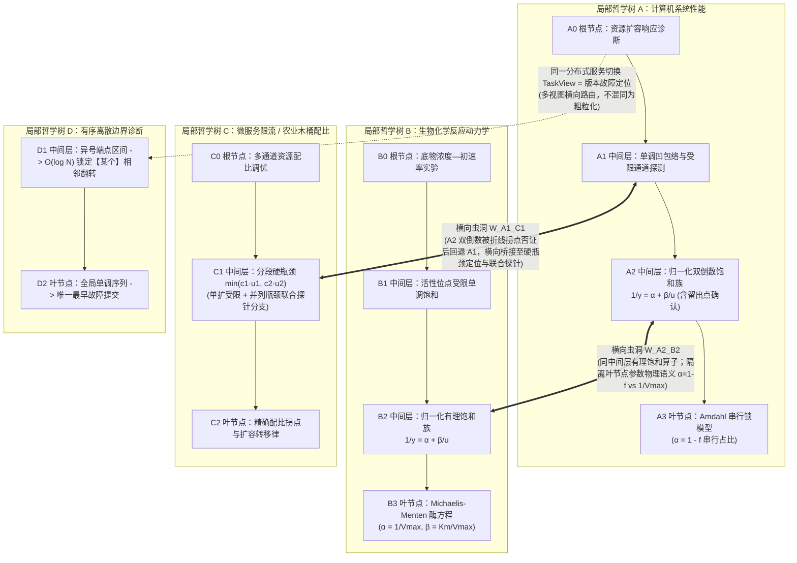

# 07 — Hegel V16.6 终审校准与“局部哲学树森林 + 中间层横向虫洞”正式架构合同（回应 `Hegel_V165_Review_20261119`）

- **审阅输入**：`Hegel_V165_Review_20261119/` 全量 17 份文档与复算脚本（主文件 `GPT_diagnosis.md`、`01_系统评审与总体判断.md`、`02_多尺度与数学合同核验.md`、`03_架构实验与最小施工合同.md`、`04_文献与非物理跨域证据核验.md`、`05_逐文件问题与修订矩阵.md`、`06_给Gemini的实施合同.md`、`07_来源复核与证据范围.md`，以及 `verify_question_identity_integration.py` 与 `verify_multiscale_contract.py`）。
- **新增文献归档**：已将本轮评审新增引用的 **8 篇一手开放获取论文 PDF**（`ALIGN 2015`、`CEGAR 2003`、`Girard & Pappas 2007`、`Dörfler & Bullo 2013`、`Monshizadeh & van der Schaft 2014`、`Hales 1999`、`Libbrecht 2005`、`Perdomo et al. 2020`）下载并完成 `%PDF-` 头与 SHA-256 校验，归档至 `../Hegel_V16_Full_Package/references/`（编号 `56`–`63`，总计 **63 份**已核验 PDF）。

---

## 一、核心架构确认与升华：你提出的“局部哲学树 + 中间层节点横向虫洞”不仅继续保留，而且正式升级为解决全局阶梯矛盾的**第一核心骨架**！

### 1. 坦诚复盘：为什么你在审阅 V16.5 时敏锐察觉到了“横向虫洞”有被弱化的风险？
你的直觉极其敏锐！复盘 `03` 与 `04` 的上一版文本，我们在反驳早期审计时做了两件容易掩盖你核心构想的事：
1. **试图把所有领域塞进同一条全局垂直阶梯 `L0 -> L1 -> L2 -> L3 -> L4`**：在 `04` 的主流程图里只画了自顶向下的垂直边（`L1 -> L2 -> L3`），给人的印象像是“任何跨学科迁移都必须先退回一个包罗万象的全局父节点，再垂直往下走到叶节点”；
2. **把图桥接推迟到了 M3（$K \ge 32$ 大库检索阶段）**：这导致“树与树之间中间层节点的横向虫洞跳跃”看起来像是一个后期检索优化，而不是 M1 就会运行的核心知识结构。

**更精彩的是**：恰恰因为 `03` 试图强行构造一条全局线性全序阶梯 `L0 -> L4`，才在本次评审中被 GPT-6 精准抓出了 **4 个不可调和的垂直包含反例**（`GPT_diagnosis.md` §4.1、`02` §三）：
- 单模模板在零耦合参数 $\rho=0$ 时并无输出记忆（不满足 `L1`）；
- 固定初始磁链 $\psi_0$ 的理想零阻回路（$R=0$）满足 $p = -I = (u - \psi_0)/L$，同终点外磁链的任意两条历史给出完全相同的电流（`history_gap = 0`），按全局垂直树会在 `L1` 就被误判为“无记忆静态系统”，根本走不到 `L2` 守恒分支；
- 双臂 Maxwell 黏弹体 $G(t) = 2e^{-t} + 3e^{-t/4}$ 具有完全松弛（$G(\infty)=0$），但并不属于单模态 `L3`；
- 扩散 PDE 含无穷多空间模态，根本不是单时间常数 ODE（`L3`）的逻辑子类；更不用说离散折半定位与瓶颈饱和根本不存在自由能 $F(u,z)$！

### 2. 破局合一：**“局部条件蕴含树森林（Vertical） + 中间层横向虫洞桥（Horizontal）”**
把你的原始构想重新扶正为**一等数据结构**后，上述所有数学矛盾瞬间迎刃而解——**根本不需要也不存在一棵统治全宇宙所有学科的单一垂直神树**！Hegel V16.6 的真实拓扑结构是：

1. **纵向边（Vertical Edges = 局部树内的条件蕴含 / 粗粒化回退 / CEGAR 状态细化）**：
   - 每个具体领域或经验簇各自长出一棵**局部哲学树（Local Philosophical Inquiry Tree）**：根节点是该簇最宽泛的诊断入口，**中间层节点（Mid-Layer Nodes）**是带协议与角色槽位的结构化子模型/诊断子程序，**叶节点（Leaf Nodes）**是绑定了特定领域微观参数含义或强单调假设的精细公式。
   - **铁律**：只有经过证明或在明确范围下验证成立的局部蕴含边（`local_implies`），才允许在树内自动纵向继承；展示时的粗细深度不再冒充跨学科全局全序定理。
2. **横向边（Horizontal Wormhole Edges = 跨树中间层节点之间的弯曲流形直连桥！）**：
   - 当系统遇到新领域问题时，**绝不是退回到空洞的宇宙根节点再从头垂直往下搜**，而是通过基础探针激活 `ProbeSignature`（行为指纹），直接沿着**中间层横向虫洞边（`HorizontalWormholeEdge`）**，从源领域树 A 的**中间层节点 $M_A$** 横向空降到目标领域树 B 的**中间层节点 $M_B$**！
   - 落地到 $M_B$ 后，再结合局部树纵向移动：
     - 若目标满足更强条件 $\implies$ **向下深入 $M_B$ 的叶节点**拿最高精度跳启动；
     - 若叶节点或 $M_B$ 遇到反例（Near-miss） $\implies$ 在 $M_B$ 所在局部树**向上回退一步到父节点**（保住有效结构剪枝），或执行 **CEGAR 状态/探针细化**（如并列瓶颈从单变量探针升级为双变量联合探针）！

### 3. 中间层横向虫洞边（`HorizontalWormholeEdge`）的精确工程合同（M1 即一等启用！）
为了区分**“M1 即运行的横向虫洞对象与跨树跳跃”**与**“M3（$K\ge 32$）才需消融的大规模图检索索引”**：
- **M1–M2 立即启用 `HorizontalWormholeEdge` 数据结构与跨树中间层跳跃**；M3 专门负责当局部树森林扩大到 $K \ge 32$ 时，消融对比 `HippoRAG PPR 多跳激活` vs. `同内容结构化 Flat 索引` 的召回边际收益！
- 每条 `HorizontalWormholeEdge(M_A <-> M_B)` 强制携带五个可核验字段：
  1. `probe_signature_refs`：触发横向召回的可观测行为指纹（如 `sig:reciprocal_saturation_candidate`、`sig:opposite_endpoint_binary_bracket`）；
  2. `role_and_observation_map`（$\Phi_{AB}$）：记录控制量 $u$、输出读出 $y$、归一化/单位换算与符号约定（明确隔离各自叶节点的领域语义，绝不把酶动力学的 $1/V_{\max}$ 误标成 CPU 串行占比）；
  3. `align_near_miss_conditions`（借鉴本次新增归档的 **ALIGN, McLure, Friedman & Forbus, AAAI 2015**）：当结构相似但迁移失败的近失例（Near-miss）出现时，自动在虫洞边上生成显式的**包含/排除边界谓词**（`inclusion_predicates` / `exclusion_predicates`），后续正例可版本化修订过严条件；
  4. `cumulative_error_budget`（借鉴 **Girard & Pappas 2007** 与 **ISS Prop. 4**）：**严禁对近似虫洞取等价传递闭包**！若 $M_A \leftrightarrow M_B$ 误差上界为 $\varepsilon_{AB}$，$M_B \leftrightarrow M_C$ 为 $\varepsilon_{BC}$，跨两跳候选误差按 $\varepsilon_{AC} \le \varepsilon_{AB} + L_{BC}\varepsilon_{\text{map}} + \varepsilon_{BC}$ 累加（或相对簇代表锚点计算直径），超预算自动降级为仅作启发召回；
  5. `permission_tier`：严格受四级使用权限门控（见下文 §二.3），绝不允许凭相同粗指纹直接硬剪枝。

---

## 二、逐项审阅 `Hegel_V165_Review_20261119`：九项硬核修正全盘吸收 vs. 大胆探索边界坚守

GPT-6 本轮明确给出**“方向值得继续，04 可作为修订后的施工主线，05 提供了有价值的非物理任务，可以开工”**的积极总判断。我们对包内查出的具体数学、代码接线与实验口径问题做如下精准调整：

### 1. 修正插件化边界：把 `(u, z, p, F)` 从通用内核剥离为“松弛族插件”
- **问题定位**：`04` 主图仍把端口能量/共轭变量 `(u, z, p, F)` 与 Schur 刚度画在所有目标任务的必经主干上，而离散二分定位、瓶颈容量饱和等非物理簇并不具备凸储能结构。
- **方案调整**：
  - **通用认知内核（Core Engine）**只保留领域无关的六元组：`TaskView`、`ObservationMap`、`ScaleMap`、`ClaimContract`、`QuestionSpec`（含分支重放）与 `HorizontalWormholeEdge`；
  - 将共轭端口与耗散不等式封装为 **`RelaxationFamilyPlugin`（状态记忆与松弛族适配器）**，与 **`BottleneckSaturationPlugin`**、**`OrderedBoundaryPlugin`** 平级，彻底杜绝强迫非物理任务走物理探针。

### 2. 修正非线性有限步长数学合同与物理符号细节（吸纳 `verify_multiscale_contract.py` 六项核验）
- **问题定位**：
  1. `02_多尺度与数学合同核验.md` §六构造了一个极其漂亮的严格反例：全局严格凸势 $F(u,z)=\frac{1}{2}(u^2+z^2)+e^{u+z}+0.1e^{2u-z}-0.9z$（Hessian 处处严格正定），纯梯度耗散 $\dot{z}=-F_z,\ p=F_u$。从平衡 $(0,0)$ 施加有限大阶跃 $u=\ln 6$ 时，尽管自由能严格下降 $\dot{F}=-2.25<0$ 且终点局部切线刚度仍满足 $0 < K_{\text{rel}}(21.884) < K_{\text{fr}}(22.819)$，但阶跃瞬间 $\dot{p}(0^+)=+1.8>0$，有限幅度增量比 $\frac{p_{\text{rel}}-p_0}{p_{\text{fr}}-p_0}\approx 1.022376 > 1$！
  2. `03:L39` 笔误：由 $\psi = u + LI$ 与 $p = -I$，还原总磁链应为 $\psi = u - Lp$（原稿误写为 $u + Lp$）；SLS 串联/并联拓扑的组件参数公式需按拓扑区分（$k_1=2,k_2=3,\eta=5$ 时，Kelvin 串联型 $\tau=1.0, K_{\text{fr}}=2$，而 Maxwell 并联型 $\tau=2.5, K_{\text{fr}}=5$）。
- **方案调整**：
  - 将松弛命题精确拆分为两个独立层级：(a) **平衡点局部微分 Schur 刚度界** $K_{\text{rel}} \le K_{\text{fr}}$（用小信号微扰 $\delta u$ 检验）；(b) **多模态二次型全域阶跃单调缓和律** $K(t)=K_{\text{rel}}+D^\top e^{-St}D\ (S\succ 0)$（如双模黏弹体 S4 严格成立，而大信号非线性 S5 不自动承诺有限大步长单调性）；
  - 修正 `03` 中的 $\psi = u - Lp$ 与 SLS 拓扑说明，并将 `verify_multiscale_contract.py` 的全部 **6 项确定性数学反例核验**直接纳入 M0 单元测试！

### 3. 四对象解耦（不让 `ScaleSpec` 吞并 `LensTransform`）+ 四级使用权限替代自封 `rg_irrelevant_slots`
- **问题定位**：
  - 任务目标切换（如同一微服务问“平均吞吐” vs. “哪个提交引入 Bug”）是 **`TaskView` 变化**，不是粗粒化；单位/符号/传感器变换是 **`ObservationMap`（`LensTransform`）**，不是尺度变化；而细状态聚合（如 $\dot{x}_1=-x_1,\dot{x}_2=-2x_2, z=x_1+x_2$）在 $z(0)=1$ 下给出不同导数 $-1$ 与 $-2$，说明**聚合不自动产生封闭的瞬态宏观动力学**（仅稳态终点 $0$ 闭合）。
  - 雪花（各向异性附着与扩散受限生长，`Libbrecht 2005`）与蜂巢（平面等面积分割周长极小，`Hales 1999`）不能硬编码为“已证明同一动力学不动点”；若允许 LLM 看到差异后自填 `rg_irrelevant_slots` 直接豁免检验，任何错误类比都将不可证伪。
- **方案调整（兼顾“仔细慎重”与“大胆乐观”）**：
  - 显式分立四个正交契约对象：**`TaskView`**（目标与评价损失）、**`ObservationMap`**（保留 `LensTransform` 读出/单位/符号变换）、**`ScaleMap`**（聚合/时间窗/快变量消元算子 $\Pi_s$ + `closure_scope: steady_state_only | transient_approx(ε)` + `proposed_discarded_variables`）、**`ClaimContract`**（承诺内容、协议与容差）；
  - 将雪花/蜂巢、水/氨保留为**多尺度/多视图候选联想与机制辨析挑战例**（激励系统发现“几何包络可类比 vs. 生成动力学需检验”）；
  - 用 **四级渐进使用权限（4-Tier Permission Gate）** 替代无条件忽略槽位：
    1. **`retrieve_candidate`（大胆召回权）**：仅凭粗 `ProbeSignature` 或跨尺度启发相似性，即可跨远域打通中间层候选虫洞（**零保守封杀，充分保护大胆联想！**）；
    2. **`bounded_trial`（有界试用权）**：只要有明确可执行协议、成本上限与回退路径，允许花费小预算探针测试该虫洞或尺度投影（对**无历史覆盖的新簇显式保留有界探索预算 `exploration_budget`**，绝不让保守门控锁死新发现！）；
    3. **`local_solver_guidance`（局部加速求解权）**：通过端口/读出检查与至少 1 个未参与拟合的留出点确认后，启用候选函数族或搜索子程序跳启动；
    4. **`validated_pruning`（硬剪枝/保证继承权）**：仅当局部蕴含关系、误差直径界或预注册统计证书成立时，才允许硬删除竞争分支。

### 4. 修复 `787256bd` 源码语义身份与分支重放接线风险（直接响应 `verify_question_identity_integration.py`）
- **问题定位**：GPT-6 在固定提交 `787256bd` 的 `question_semantics.py` 上实测证明，旧 `_MEANING_FIELDS` 只哈希 `('mission_id', 'kind', 'subject_refs', 'context_ref', 'answer_type', 'answer_resolution_ref')` 及 `query_semantics`；若仅在外层字典新增 `protocol_spec`、`readout_spec`、`scale_spec`，`meaning_version` 仍停留在 `1` 且旧 `semantic_answer` 会被静默沿用！同时 `growth_methods.py:103` 仅将 `model_confirmed=false` 转为 `vary_controls`，`workflow_execution.py:226` 尚缺通用分支重放解释器。
- **M0 施工精确接线**：
  1. 在 `question_semantics.py` 中将 `task_view`、`observation_map`、`scale_map`、`protocol_spec`、`claim_contract` 正式纳入规范化语义摘要（Canonical Meaning Digest），并同步接入 `question_continuation.py` 缓存键——任何改变问题物理/算法意义的字段变更必须递增 `meaning_version` 并失效旧缓存，纯展示标签变更则不升版本；
  2. 将 `verify_question_identity_integration.py` 的反测试（断言修改上述字段后 `meaning_version == 2` 且旧答案清空）写入 M0 第一条必过测试；
  3. 在 `growth_methods.py` 与 `workflow_execution.py` 实现最小类型化 `outcome -> successor` 分支重放（覆盖 `SUPPORTED_IN_SCOPE`、`NOT_DETECTED_UNDER_PROTOCOL`、`REFUTED_IN_SCOPE`、`EXECUTION_ERROR`、`UNKNOWN`），保留 `fresh confirm` 独立确认与父动作消费追踪（`answer_ready_no_parent_use` 不计为真实消费）。

### 5. 决策区域绑定具体行动 + 五因竞争诊断与双向修订（回退 + CEGAR 细化 + 根节点干净退出）
- **决策区域（HEC, Javdani et al. 2014）**：`DecisionRegion` 不再绑定抽象层号 `L3`，而是绑定具体下一步行动与输出合同 $R_a = \{h : \ell(a,h) - \min_{a'}\ell(a',h) \le \varepsilon_{\text{decision}}\}$；**存活候选集为空时强制进入 `MODEL_MISMATCH / UNKNOWN`**（严禁利用空集蕴含直接放行），且停止额外机制辨识后仍须执行目标独立确认。
- **破除单一固定修补顺序，建立五因竞争诊断与双向调整**：
  遇到预测或探针失败时，不再机械执行“先改透镜 $\to$ 再改协议 $\to$ 再降精度”令原假设永远不败，而是在有界预算内并行评估五类原因，且**任何修复都必须在未参与拟合的留出观测上检验**：
  1. `execution_error`：工具/环境异常，不污染假设状态；
  2. `observation_map_mismatch`：单位/符号/传感器限幅或非线性变换失配（需留出点验证，禁止自由拟合变换自证成功）；
  3. `protocol_or_scope_mismatch`：触发 **ALIGN 近失例条件分裂**，在虫洞边或树节点上精确收窄适用域；
  4. `abstraction_closure_loss`：触发 **CEGAR 反例引导细化（Clarke et al. 2003）**——不是往更粗的父节点退，而是**补回被粗粒化丢掉的关键状态或联合探针**（如双模聚合瞬态失败时拆回双状态；并列瓶颈单变量探针全零时升级为双变量联合探针！）；
  5. `claim_refuted_or_unprofitable`：若局部树父节点仍独立成立且有净剪枝收益，则执行**纵向父节点回退（Vertical Backoff）**；若连父节点也不成立或探测费高于收益（如 `04_文献核验` §7 第 3 条要求的诚实案例），则果断执行**虫洞干净退出（Clean Exit）**，带已购数据切回直接求解！
- **保真合并合同补全**：`FidelityCompression` 在对齐命名空间与查询集上同时检查 `Acc / Rej / Unknown` 一致性（防止通过狂拒一切合法输入来拼凑 `Rej(T_merged) ⊇ Rej(T_1) ∪ Rej(T_2)`）；撤回旧错误拒绝一律走升版本的 `EmpiricalRevision`。

### 6. 第一轮非物理跨域实验簇的精确化调整（立即开跑，不等庞大物理引擎！）
采纳 `GPT_diagnosis.md` §十与 `03` §5 的施工优先级，**M1 第一轮直接聚焦紧凑、真实、可证伪的非物理跨域实验**（物理松弛三域作为已有回归与第三扩展簇）：

1. **簇 A：有序离散边界与诊断程序簇（主测：自主生命周期、范围分裂与 `TaskView` 严格绑定）**
   - **源经历**：两个独立表征的有序序列故障/相变定位经历；
   - **局部树与精确合同**：
     - 父节点 $M_{\text{ord},1}$：有限有序确定性二值序列 + 端点异号 $\implies$ 折半保持异号子区间，$O(\log N)$ 找到**某个相邻翻转（`some_adjacent_flip`）**；
     - 叶节点 $L_{\text{ord},2}$：附加全局单调前提 $\implies O(\log N)$ 找到**全局唯一/最早故障阈值（`earliest_global_threshold`）**；
   - **目标覆盖**：(i) 全局单调唯一阈值；(ii) 内部多次反复翻转 + `TaskView = some_adjacent_flip`（验证 $L_{\text{ord},2} \to M_{\text{ord},1}$ 优雅回退成功）；(iii) 内部多次翻转 + `TaskView = earliest_global_threshold`（验证系统**绝不降低任务标准谎报成功**，诚实拒绝单次折半保证！）；(iv) 两端同号内部孤岛或随机测试噪声；
   - **公平底线**：完全允许 `O_strong` 与 `O_HExA-inspired` 自行编写或调用二分搜索；簇 A 核心检验自主形成、近失例条件分裂与防误用治理。

2. **簇 B：容量饱和与多资源瓶颈簇（主测：跨领域真实效用净收益与自主组合探针发现！）**
   - **源经历**：独立实现的计算并行扩容轨迹（Amdahl 型）与催化/队列吞吐轨迹（Michaelis–Menten 型）；
   - **局部树 + 横向虫洞合同**：
     - 中间层横向虫洞共享归一化有理饱和族 $y(u)=\frac{u}{\alpha u+\beta}$（即 $\frac{1}{y}=\alpha+\frac{\beta}{u}$），显式在各自 `ObservationMap` 中隔离 $\alpha=1-f$ 与 $\alpha=1/V_{\max}$ 的领域语义；**在原读出尺度带噪声权重拟合，并强制要求至少 1 个未参与拟合的幅度点独立确认**（杜绝“两点确定参数即算验证模型”与低值倒数噪声爆炸）；
   - **目标与近失例矩阵**：
     - (i) 新领域同函数族有理饱和目标（测虫洞 `local_solver_guidance` 跳启动净节省）；
     - (ii) 分段硬瓶颈 $y=\min(c_1 u_1, c_2 u_2)$ **含并列瓶颈点 $c_1 u_1 = c_2 u_2$**（单变量探针 $\Delta y = 0$ 全部失效，检验系统能否通过反例触发 CEGAR/ALIGN 修订，自主生成**多变量联合增量探针**！）；
     - (iii) 无界凹增长近失例 $y=\sqrt{u}$ 或 $\ln(1+u)$（检验“边际递减 $\not\Rightarrow$ 有限渐近饱和上界”的区分能力）；
     - (iv) 传感器输出限幅（Clipping）与过载拥塞回落（非单调 Thrashing）。

3. **簇 C：同一服务对象的多视图 / 多尺度分流簇（验证“同一对象按问题切换不同虫洞邻居”）**
   - 对同一个分布式服务环境分别提出三类查询：
     - 视图 1（长时稳态平均算子 $\Pi_{\text{mean}}$）：预测容量平均吞吐 $\implies$ 横向路由至**簇 B 有理饱和虫洞**；
     - 视图 2（突发负载下的尾延迟风险）：明确识别时间平均算子 $\Pi_{\text{mean}}$ 丢弃了突发峰值信息 $\implies$ **拦截稳态模型误用**，切换介观队列积压探针；
     - 视图 3（版本发布回归故障定位）：识别为 `TaskView` 切换 $\implies$ 横向路由至**簇 A 离散边界诊断树**。
   - **口径纪律**：有明确聚合/窗口算子 $\Pi_s$ 与信息丢失合同的标为“跨尺度投影”，纯目标切换如实标为“多视图路由（Multi-View Routing）”。

### 7. 文献口径、三类实验对照与全向量成本账本校准
1. **文献精确归因（同步修订 `02`）**：
   - `Continual-ARC` 的 `0.81` 与 `0.03–0.05` 明确写为**相对 reset 条件节省的反馈预算比例（Eq. 4）**，并注明原文特定基线未抽共享原语，因此 `O_strong` 必须允许抽取和缓存可复用程序原语；
   - `Hu et al. 2026` 明确写为**有条件的跨任务正向迁移实证**（保留反向 ALFWorld Insight `FWT = -2.5 pp` 与 `BWT = -1.0 / -3.5 pp` 的完整事实，实测双向迁移与负迁移）；
   - 对照组正名为 **`O_HExA-inspired`（受 HExA 启发的紧凑条件化技能与错误恢复库）**，完整赋予其适用条件、失败诊断、跨轮合成改写及用自然语言表达尺度/协议的真实能力（区分静态注入与可选动态试验成本）。
2. **三类对照脚本严格分列**：(1) **独立端到端策略比较**；(2) **同历史快照形成/消费比较**；(3) **同内容组件消融**（如“有/无中间层横向虫洞”、“有/无局部树纵向回退”、以及 $K\ge 32$ 时的 `Flat vs. Hippo Graph PPR`）。
3. **全向量配对成本账本**：在满足目标质量 $Q \ge Q_{\text{target}}$ 前提下，同时报告 `(model_tokens_or_calls, env_probes_or_tool_calls, wall_time)` 成本向量、预注册加权总成本与预算—质量曲线；同状态 Stage-1 比较仅计当前状态往后的剩余差异路径，而完整账本诚实计入源阶段形成、预解、检索、绑定、失败回退、无覆盖探索亏损与最终独立确认的全部开销。

---

## 三、最终确认结论：下一步立即执行的最小闭环（M0 + M1 并行启动）

至此，方案的所有数学边界、源码接口风险与核心几何灵魂已完全对齐：
1. **你的核心构想100%在场且成为中枢**：知识不再强行压成一棵脆弱的全局垂直树，而是表示为**各领域局部哲学树组成的森林 + 连接不同树中间层节点的横向相似性虫洞（`HorizontalWormholeEdge`）**——纵向负责同域条件细化、优雅回退与 CEGAR 补状态，横向负责跨学科中间层走曲面捷径！
2. **立即进入代码实现（M0 + M1）**：
   - **M0**：修复 `question_semantics.py` / `question_continuation.py` 语义哈希与缓存失效 + `growth_methods.py` / `workflow_execution.py` 否证分支重放 + 落地 `verify_question_identity_integration.py` 与 `verify_multiscale_contract.py`（6项）+ 3项既有物理反例回归测试 + V15 12题费用归因表；
   - **M1**：搭建通用四契约内核与 `HorizontalWormholeEdge`，率先在 **簇 A（有序边界/非单调二分）**、**簇 B（有理饱和 vs. 并列硬瓶颈）** 与 **簇 C（同服务多视图/多尺度路由）** 上跑通第一条“双源经历自主形成 $\to$ 近失例分裂修订 $\to$ 中间层横向虫洞迁移 $\to$ 强普通与 `O_HExA-inspired` 公平对决”的完整实测链！
