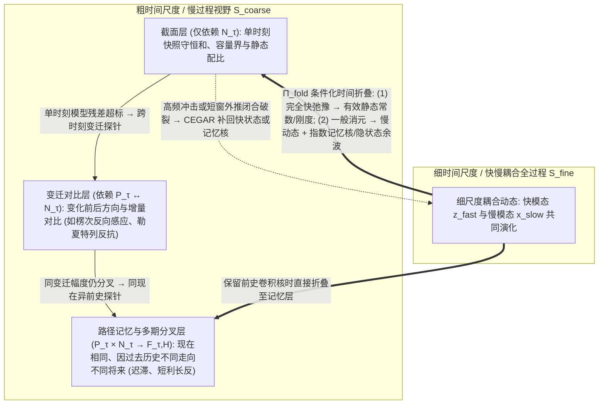
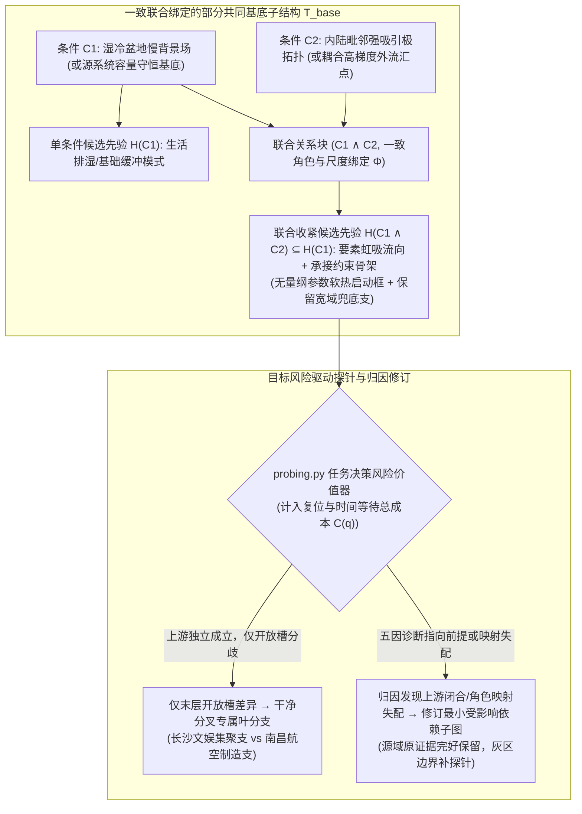

# 20 — Hegel 总体方案终局定稿版（`M5` 收官总蓝图 v2）：泛化跨时刻多尺度时间折叠 × 部分共同基底子树先验与不确定性治理（融合独立终审裁决与双轨实验设计）

- **定位**：在 `M0`–`M4.5` 与 `M5.0` 已打牢计量防漏、密码学实例绑定、多尺度快慢消元（$\Pi_s$）及跨进程在线持续写回地基之后，本定稿版全面恢复原方案（[03](./03_Multi_Precision_Hypothesis_Theory_and_3Domain_Ladder.md)–[07](./07_V16_6_Review_Audit_and_Horizontal_Wormhole_Architecture.md)）最富灵气的两大灵魂支柱——**① 泛化跨时刻动态（过去/现在/将来）与多尺度时间折叠**、**② 跨领域“部分共同结构树”逐层利用与少样本方差治理**——并结合 `Hegel_M5_Plan_Review` 红队评估作出**我方独立主权裁决**（吸收真正增强系统灵动性与数学严密性的修订，坚决顶住令先验退回空壳保守化的倾向），锁定 **`M5` 一战封顶收官**。
- **双轨同核实验呈现**：同时运行 **① 纯匿名防背书硬核基准轨**（洗去全部领域名词防预训练记忆质疑，产出一锤定音的定量统计表）与 **② 直观现实语义孪生展示轨**（100% 同一引擎与数学过程，挂上电磁/化学松弛、短期刺激 vs 长期反转、长沙型 $\leftrightarrow$ 南昌型多层基底树等真实语义外壳，零背景一眼看懂树在每一步如何思考与分叉）。

---

## 一、针对 `Hegel_M5_Plan_Review` 的独立主权裁决矩阵（吸收真知灼见 vs. 坚守大胆探索）

外部评审在本轮已明确认同：**“两项核心方向值得完整实现……支持保留复杂动态模型、潜在状态、学习到的映射和不完全匹配的子结构，它们能否被执行、比较和修订，比每个中间概念能否被人直观解释更重要。”** 在此基础上，我方行使独立设计决定权，明确划分 **5 项精准吸收升级** 与 **3 项大胆探索坚守**：

| 维度 | 红队提醒的核心风险 | 我方独立裁决 | 定稿修改落点（为什么这样改反而更强、更不平庸？） |
|---|---|---|---|
| **1. 快慢尺度与基底准入** | 若把“非 `slow_structural` 禁入基底树干”写死，会误杀按 $t/\tau_i$ 归一化后高度稳定的快动态共性（如毫秒电磁感应 $\leftrightarrow$ 分钟化学松弛） | **果断吸收（解放快动态虫洞！）** | 取消对快尺度的死板准入禁令！**任何尺度的动态关系块只要具备条件与范围支持均可进入共同基底树**；慢尺度作为高稳定性排序线索，仅拦截“未经机制验证的单次偶然脉冲波动”。 |
| **2. 时间折叠 `Π_fold` 产物形态** | 快变量消元一般会留下历史卷积记忆项与初态余波（Mori–Zwanzig 项），若一律折成静态常数会重新压丢“同现在、异过去 $\implies$ 异将来” | **果断吸收（保住折叠后的记忆！）** | 允许 `Π_fold` 按闭合检验产出三类模型：**① 有效静态常数**（完全快弛豫）、**② 低阶慢微分/差分动力学**、**③ 轻量指数记忆核 / 隐状态摘要**；并严格区分 $\Delta t$（采样步长）、$\tau_i$（内生时间常数）、$w$（提取窗）、$H$（预测时距）与在线因果截止点 $t_0$。 |
| **3. 主动探针选择准则** | 裸预测方差最大易偏向与目标决策无关的大幅度干扰项（仓库 `test_forecast_experiment_value.py` 已有 `±100` vs `±0.1` 直接反例） | **果断吸收（直接复用现成强资产！）** | 裸方差降为廉价初筛；正式选针直接接入仓库现成 [`probing.py:value_forecast_experiments`](../../src/hegel_machine/cognition/probing.py)——按**单位总探测成本（含复位与时间等待费）带来的预期目标决策风险下降量**选实验，配合 `HEC` 决策区域停止规则。 |
| **4. 共同子树绑定与反例归因** | 两段独立局部边若中间状态不一致不能硬拼；背景叠加（气候 AND 区位）不必硬写成因果先后；末端失败可能是上游闭合前提失配；中点 `b<=1.85` 存在未测超差灰区 | **果断吸收（严密且保留生长性！）** | 共同子树强制要求**跨共享节点一致的角色、读出、时间锚点与尺度绑定**，同时原生支持因果链 $u\to z\to y$ 与并列前提 $C_1 \land C_2 \Rightarrow \text{Prior}$；反例复用五因竞争归因修订**最小受影响依赖子图**（不搞盲目祖先免死）；支持点与反例点之间 `(b_sup, b_ref)` 设为待探测灰区而非盲信中点。 |
| **5. 综合联动流与对照解耦** | 分开测 A、B、C 不如在同一持续流里同时考两项机制；`M5.0` 的 `Dynamic_Flat` 同时少了粗通道授权，混合了能力消融与图组织收益 | **果断吸收（一战打出铁证！）** | 在保留 A/B/C 清晰切片外，新增**“时间折叠 × 共同基底子树”同场联动旗舰流**；严格分列**① 同原始历史+同动态工具的端到端强基线对决**与**② 同发现内容+同通道证书的纯树图组织消融**。 |
| **6. 跨源参数先验收缩** | 担心少样本下域间方差 $\sigma^2_{\text{between}}$ 不确定，倾向弱化参数区间收缩 | **坚守大胆热启动（修净 `D_eff` 顺序漏洞，绝不退回全盲搜！）** | 先将多样性升级为**与入库顺序无关、剔除同源换皮复制的集合谱多样性 $D_{\text{eff}}^{\text{set}}$**；承认 $\sigma^2_{\text{between}}>0$ 不做免检硬剪枝，但**坚决保留无量纲参数（如特征时间比、归一化饱和度 $\rho\in[0,1]$）的软先验热启动框 + 宽域兜底回退分支**，经目标独立确认后放行，兼顾零漏解与高速收敛！ |
| **7. 内部潜在状态与泛化 `P/N/F`** | 过去为追求人工字面可解释曾把状态压回浅层显式公式 | **坚守非平庸表达力！** | 泛化 `过去 / 现在 / 将来` 可承载轨迹段、机器自动合成的潜状态摘要或卷积核，**不强求每个中间潜变量都有人类教科书名词**，一切以可执行预测、可跨树对齐、可被反例修订为准！ |
| **8. 里程碑战线控制** | 避免无限补丁化或不断换题刷表 | **坚守 `M5` 有限封顶收官！** | 预先冻结历史、工具、预算与评测集，实事求是报告收益族与回退边界（封存评测实测假确认为 `0` 且达标完成率），以完整 `M5` 为整代架构圆满收官。 |

---

## 二、核心支柱一（定稿规范）：泛化的“过去 / 现在 / 将来” × 多尺度时间折叠

### 1. 四类时间量解耦与严格在线因果截止语义
在保持跨领域提问层使用直观泛化的**过去态 $\mathcal{P}_\tau$ / 现在态 $\mathcal{N}_\tau$ / 将来态 $\mathcal{F}_{\tau,H}$**（无需将等间隔离散模型妖魔化，只要保留真实步长 $\Delta t$ 与时间常数归一化 $t/\tau_i$，差分、微分、事件与潜状态模型均可作为底层执行器）的同时，在 `ScaleMap × ObservationMap × protocol_spec` 中显式区分四个时间量与三条因果铁律：
- **四个正交时间参数**：采样间隔 $\Delta t$、系统内生松弛/适应时间常数 $\{\tau_i\}$、状态提取/聚合窗口 $w$、目标预测时距 $H$（连同事件锚点与初态复位条件）。
- **三条操作语义铁律（杜绝未来信息泄漏）**：
  1. **源历史回顾压缩（Retrospective Folding）**：对源域已完整发生的历史轨迹，可将快过程完整三幕剧压缩提炼为慢尺度有效模型；
  2. **目标在线状态估计（Causal State Estimation）**：在当前决策截止时刻 $t_0$，提取过去与现在角色严格受限于历史前缀 $(\mathcal{P}_{\tau}, \mathcal{N}_{\tau}) = G_{\tau, w}(\mathcal{H}_{\le t_0})$，严禁使用跨越 $t_0$ 的居中窗口或未来峰值划定当前相位；
  3. **目标未来预测（Horizon Forecasting）**：基于 $(\mathcal{P}_{\tau}, \mathcal{N}_{\tau})$ 与候选干预协议 $q$ 预测 $\mathcal{F}_{\tau, H} \sim p(\cdot \mid \mathcal{H}_{\le t_0}, q)$。

### 2. 动态研究路径与保留多形态记忆的时间折叠（`Π_fold`）
局部树支持丰富的有类型关系（逻辑特化、空间/拓扑粗粒化、状态扩充、`requires_premise_and`），其中针对动态过程的核心生长路径按历史依赖深度自然展开，且跨尺度边 `coarse_grains_to(via = Π_fold)` 不再局限于压成静态常数：

- **短期红利 vs 长期反转的诚实表征**：对快正慢负双模态系统（如 $y(t)=a(1-e^{-t/\tau_f})-b(1-e^{-t/\tau_s})$，抽象自短期补贴红利与长期套利反转、抗菌初期有效与耐药反弹），当已购数据仅覆盖短窗 $H \ll \tau_s$ 时，系统不谎称“仅凭标签即可看穿未观测到的慢反转”，而是**显式保留长期时距不确定性（候选集中同时存活单调饱和支与慢反馈反转支）**，由任务风险价值器决定是否值得支付长窗口等待成本去区分它们！

---

## 三、核心支柱二（定稿规范）：一致绑定的“部分共同基底子树”与校准版少样本方差治理

### 1. 共同基底子树（`SharedBaseSubtreePrior`）的联合绑定与生成消费链
我们将跨领域共享结构形式化为**带一致局部绑定的连通有向关系子图** $\mathcal{T}_{\text{base}} = (V_{\text{shared}}, E_{\text{shared}}, \Phi_{S \rightharpoonup T}, U_{\text{open}})$：
- **一致联合角色与时间尺度绑定（Joint Consistent Morphism $\Phi_{S \rightharpoonup T}$）**：
  若源子图含连接边 $u \to z$ 与 $z \to y$，目标匹配必须将两边的中介节点 $z$ 绑定至**同一个目标状态/潜变量槽位与一致的时间/尺度锚点**，严禁两条边各自找互不相干的变量硬凑“两层匹配”！
- **同时支持“因果传递链”与“并列背景组合（`AND`）”**：
  继承原方案 `local_implies` 与 `requires_premise_and`。例如在“长沙 $\leftrightarrow$ 南昌”原型中，气候条件 $C_1$ 与内陆毗邻珠三角区位 $C_2$ 表达为**联合前提 $C_1 \land C_2$ 共同收紧下游人口流动与就业结构补全空间 $\mathcal{H}_{C_1 \land C_2} \subseteq \mathcal{H}_{C_1}$**，且先验权重仅按**扣除重复编码后的新增独立条件证据**更新，绝不靠同一事实换句话说来重复加分。
- **从源经历自动抽取与消费的完整闭环（对接 `branch_reconciliation.py`）**：
  1. **抽取**：在现有 typed AST anti-unification 基础上，将多个已确认源工作区共享的“前提谓词 + 时态算子子结构 + 角色连接”提炼为 `SharedBaseSubtreePrior`，未重合部分留作开放自由槽 $U_{\text{open}}$；
  2. **召回与绑定**：目标通过已购 Pilot 观测特征激活 `HippoRAGWormholeIndex` 候选基底，校验共享节点角色、读出与尺度相容性；
  3. **探针区分与分叉写回**：对 $U_{\text{open}}$ 中的竞争补全分支调用任务风险价值器选探针，确认后将目标专属新分支写回森林。

### 2. 校准版四重少样本方差与不确定性治理机制

1. **条件化机制稳定性优先（兼容归一化快动态共性）**：
   慢时间尺度与守恒/拓扑结构赋予更高初始检索排序优先级；同时允许特征时间归一化（$t/\tau_i$）后经源内多轨迹验证的快动态算子进入共同基底，仅将源内未经重复检验的单次瞬态噪声排除在基底之外。
2. **顺序无关且去同源复制的集合多样性 $D_{\text{eff}}^{\text{set}}$ + 软先验热启动（Soft Dimensionless Warm-Start）**：
   - 将源集合 $S=\{E_1,\dots,E_M\}$ 先按血缘谱系（`provenance_lineage_id`）去重合并（同一轨迹换三种学科名词外壳仍只计 `1` 个独立血缘！），再用**集合级核矩阵有效秩 / 行列式多样性**计算顺序无关评分：
     $$D_{\text{eff}}^{\text{set}}(S) = \operatorname{tr}\!\left(K_S (K_S + \gamma I)^{-1}\right) \cdot \text{LineageFactor}(S)$$
     彻底消除 `A,B,C` 与 `A,C,B` 顺序不同导致跳变的问题！
   - **共享骨架与局部参数分离**：单独立源时默认只迁移函数/动态骨架；多独立异质源支撑时，提供**无量纲参数软先验热启动区间（加速非线性拟合起步），但显式保留考虑域间异质性 $\sigma^2_{\text{between}}$ 的宽域兜底拟合分支**，且必须通过目标留出轨迹独立确认后才授予 `local_solver_guidance`。
3. **基于 `probing.py` 的预期目标决策风险下降选针（含时间等待成本与决策区域停止）**：
   - 先用低开销预测分歧筛出候选探针面板，再调用仓库已验证的 `value_forecast_experiments` 最大化单位总成本风险下降：
     $$q^* = \arg\max_{q} \frac{R(\mathcal{D}) - \mathbb{E}_{o \mid \mathcal{D}, q}\big[R(\mathcal{D} \cup \{q, o\})\big]}{C_{\text{probe}}(q) + C_{\text{reset}}(q) + C_{\text{horizon\_wait}}(q)}$$
   - 当存活候选已落入同一行动决策区域（`HEC`）时立即停止额外机制探针；若所有候选残差均超标（共同漏掉真机制），立即触发干净退出切回开放组合发现！
4. **归因门控的最小受影响依赖子图修订 + 灰区边界管理**：
   - 遇到预测失败时运行五因竞争诊断：唯有前 $k$ 层在目标域仍有独立观测支持且矛盾隔离于第 $k+1$ 层开放槽时才执行局部劈叶；若归因指向目标角色绑定错位或上游闭合假设（如误判无外漏）破损，则撤回/修订该最小受影响子图（源域原知识保持完好）；
   - 在作用域边界学习上，已确认支持上界 $b_{\text{sup}}$ 以内才授予免重拟直发权限，而未测过渡区 $(b_{\text{sup}}, b_{\text{ref}})$ 诚实标为 **`UNKNOWN_GRAY_ZONE`（需补边界折半探针或走 `bounded_trial`）**，彻底消除算术中点盲目认证漏洞！

---

## 四、双轨同核 × 四维终局验收设计（`M5` 封顶施工合同）

### 1. 为什么做“纯匿名硬核轨 + 现实语义孪生轨”双轨并列？
- **轨道一（纯匿名防背书主实验轨 — Anonymous Discovery Benchmark）**：所有变量与通道洗为匿名符号（`u_0, u_1, y_0, t`），在多随机种子下产出全部公平对比主表，100% 杜绝“靠大模型预训练背过物理定律或城市常识”的质疑。
- **轨道二（直观现实语义孪生展示轨 — Real-World Semantic Twin Showcase）**：底层调用**完全同一套代码与数学引擎**，将同构任务映射回真实世界可读案例（① **电磁感应 $\leftrightarrow$ 化学平衡 $\leftrightarrow$ 黏弹迟滞**的跨时刻三层树；② **短期政策刺激红利 $\leftrightarrow$ 长期套利/耐药反转**的跨尺度时间折叠与展开；③ **长沙型 $\leftrightarrow$ 南昌型区域气候+区位+产业**逐层共同基底树与探针分叉），生成一目了然的决策轨迹图谱。

### 2. 三个专项切片（A / B / C）+ 一条“时空折叠 × 共同基底”联合旗舰持续流（J）
在保留原定 **场景 A（同现在、异过去 $\implies$ 异将来）**、**场景 B（多尺度时间折叠含记忆核 vs 短利长反）**、**场景 C（1 层 vs 2 层联合共同基底子树 + 关键反例分支：快但可共享、慢但不可迁移、同结构异参数、上游前提失配）** 的基础上，新增**旗舰联合持续流 J（Joint Spatio-Temporal & Base-Subtree Continual Stream）**：
1. **源 A** 含快响应骨架与慢正向缓冲，自主探索提炼出动态关系树；
2. **源 B** 与 A 共享按 $t/\tau$ 归一化的快响应基底，但读出符号相反且慢反馈呈长期反转，系统提炼出共享快基底 $\mathcal{T}_{\text{base}}$ 与慢反馈分叉点；
3. **目标 C** 到达时短窗行为与 A、B 均高度相似，系统利用 $\mathcal{T}_{\text{base}}$ 跳过顶层盲搜，由 `value_forecast_experiments` 自动权衡短窗探针与长窗探针成本，精准锁定目标慢反馈分支；
4. **尺度切换与跨进程冷恢复**：随后切换驱动快慢比与任务观察窗口（检验 `Π_fold` 何时采用粗模型、何时保留记忆核、何时触发 CEGAR 展开状态），并在独立子进程冷恢复后继续零失真消费整段历史！

### 3. 两类严格分离的公平对照与实事求是的封顶红线
1. **端到端同源历史强基线比较（测完整发现+复用能力）**：所有方法从**完全相同的原始历史轨迹、时间戳与动态/状态空间工具集**出发，各自承担形成、维护与探测成本——核心强对手是**同样拿到全部历史与动态状态空间拟合工具的 `Strong_Dynamic_StateSpace_Agent`**（而无历史静态模型与盲搬参数仅作为专项能力消融列示，绝不拿弱消融冒充强对手！）。
2. **同信息同证书纯组织消融（测森林+共同子树+PPR 的纯粹结构增益）**：固定完全相同的已发现节点、多尺度证书与粗通道授权（彻底修净 `M5.0` 中 Flat 缺少粗通道授权的混杂），隔离测量 `Hegel_M5_BaseSubtree_Forest` 相对 `EqualAuth_Dynamic_Flat` 与 `SingleNode_Wormhole_Only` 的净成本与探测节省。
3. **封顶验收红线**：历史回归测试全绿；封存域外集诚实返回 `scoped_unknown`；在固定预算与高完成率约束下，**指定封存评测中实测假确认数为 `0`**，并透明汇报净胜出的任务族与诚实回退的成本边界，一战完成整代 Hegel Machine 收官！
