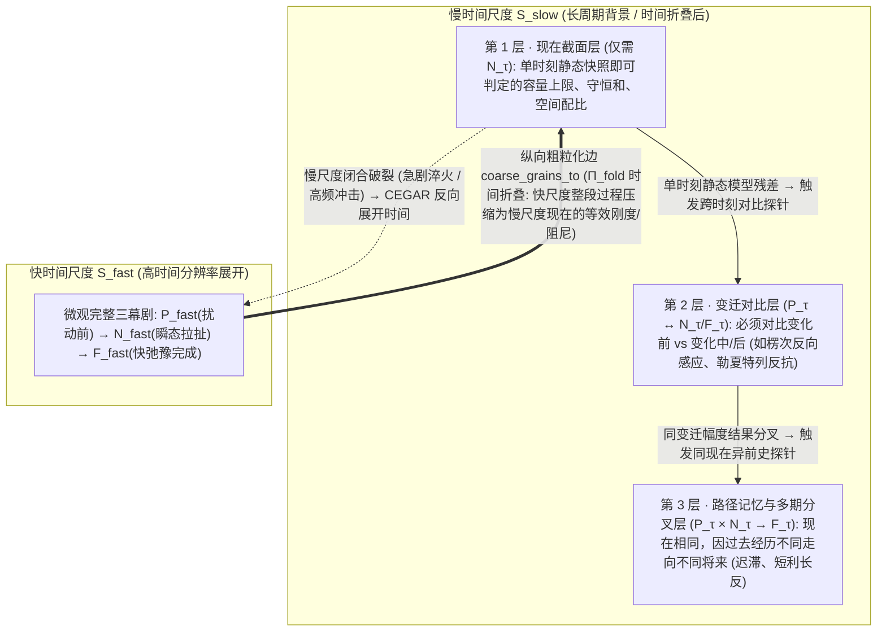
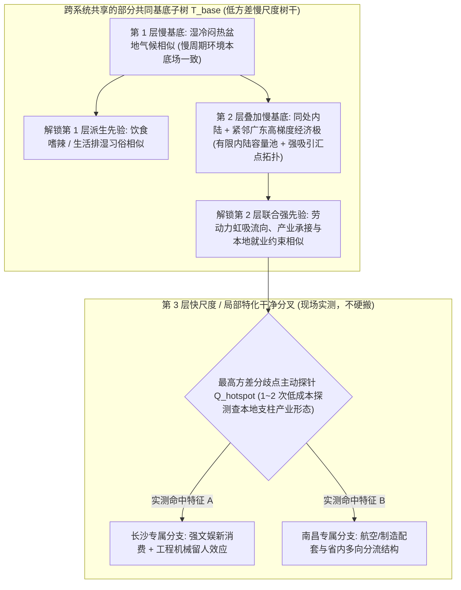

# 20 — Hegel 总体方案终局修订版（`M5` 收官总蓝图）：泛化跨时刻多尺度时间折叠 × 部分共同基底子树先验与少样本方差治理

- **定位**：在 `M0`–`M4.5` 与 `M5.0` 已将计量防漏、密码学实例绑定、多尺度快慢消元（$\Pi_s$）及跨进程在线持续写回地基彻底打牢之后，本方案回溯并恢复初始设计（[03](./03_Multi_Precision_Hypothesis_Theory_and_3Domain_Ladder.md)–[07](./07_V16_6_Review_Audit_and_Horizontal_Wormhole_Architecture.md)）中最具灵气、却在后期审计攻防中被过度静态化/单点化的两大核心支柱——**① 泛化跨时刻动态（过去/现在/将来）与多尺度时间折叠的原生入树**、**② 跨领域“部分共同结构树”逐层先验对齐与极少样本高方差治理**——并将完整的 **`M5`** 锁定为整代 Hegel Machine 的**收官终章**（拒绝无休止的碎片化补丁叠加）。
- **与原方案核心文件的融合关系**：相关核心升级已同步内嵌回 [03](./03_Multi_Precision_Hypothesis_Theory_and_3Domain_Ladder.md)（局部树纵向跨时刻视野展开）、[04](./04_Hegel_V16_5_Architecture_and_Execution_Master_Plan.md)（`M0 -> M5` 完整收官路线图）、[06](./06_Multi_Scale_Renormalization_and_Emergence_Upgrade.md)（跨尺度重整化即时间折叠）与 [07](./07_V16_6_Review_Audit_and_Horizontal_Wormhole_Architecture.md)（单点虫洞升维为部分共同基底子树与方差治理），零另起炉灶、零平行状态机重写。

---

## 一、为什么要做这次“回看原方案”的灵魂复位？（零背景一眼看懂）

在 `M1` 到 `M5.0` 的工程推进中，我们已经成功解决了老版本最大的瓶颈——**在严格公平计费下，哲学森林 + 横向虫洞已经在总成本和检索效率上全面击败了不用这套机制的强普通方法与扁平记忆库**。

但为了迎合连续多轮严苛的防作弊审计，系统也出现了一定程度的“矫枉过正”：
1. **时间维度被压扁了**：绝大多数树节点退化成了“同一个时刻下 $x$ 推出 $y$”的静态公式；而像**楞次定律**（必须对比磁通量变化前后的状态才能看见反向感应）、**经济补贴/耐药性演化**（短期变好、长期反转）这类必须靠跨时刻对比才能存在的规律，还没有成为树层生长的主干逻辑。
2. **跨学科联想被压成了“单点连单点”**：虫洞只连接树 A 的某一个孤立节点和树 B 的某一个孤立节点，缺少人类做跨领域推演时最自然的**“抓上半截共同结构树当基底、逐层加深假设”**的能力（例如从“长沙与南昌气候相似 $\to$ 饮食民风相似”这第一层，顺着树干叠加“都在内陆且接壤广东 $\to$ 就业与人口流动结构也相似”这第二层，同时还要管住“只看一两个样本就下先验带来的高方差”）。

更美妙的是，一旦把这两块拼回原方案，它们**根本不是两件独立的事，而是同一枚硬币的两面**：
- **多尺度决定了什么叫“过去、现在、将来”**（微观尺度下完整的一整段“过去 $\to$ 现在 $\to$ 将来”，折叠到大尺度下只是“现在”这一个瞬间里的等效属性）；
- **多尺度也直接解决了跨领域共同基底树的“高方差”难题**（百年/十年慢尺度的结构天然稳定低方差，用来做跨领域共享的**基底树干**；月度/秒级快尺度的波动高方差，留在**树叶**靠现场 1～2 次主动探测校准）！

---

## 二、核心支柱一：泛化的“过去 / 现在 / 将来” × 多尺度时间折叠原生入树

### 1. 为什么绝不能写成死板的 `t-1, t, t+1`？
如果把跨时刻关系硬编码成离散下标 `x[t-1], x[t], x[t+1]`：
- 传感器采样率快一倍或慢一倍，公式直接失效；
- 电磁感应发生在**毫秒级**，化学平衡移动发生在**分钟级**，抗生素耐药与区域产业转移发生在**数年/十年级**——死板的 `t-1` 永远无法在它们之间架起虫洞。

人类与科学定律真正使用的跨时刻概念，就像日常语言里的“昨天、今天、明天”一样，是**绑定在当前观察尺度 $\tau$ 下的三个泛化定性相位（Scale-Relative Temporal Regimes）**：
- **过去态 $\mathcal{P}_\tau$（`Past / Pre-Regime`）**：变化或冲击发生前的基准平衡态，或在该尺度之前累积下来的历史路径摘要；
- **现在态 $\mathcal{N}_\tau$（`Present / Active-Window`）**：当前尺度窗口 $\tau$ 内正在观测的截面与正在施加的扰动变化；
- **将来态 $\mathcal{F}_\tau$（`Future / Post-Horizon`）**：经过尺度窗口 $\tau$ 消化冲击之后，系统去往的新平台、恢复方向或远期趋势。

### 2. 局部树的纵向每一层 = 需要调动多少跨时刻信息才能看见的规律
不再把局部树的“根 $\to$ 中间层 $\to$ 叶”仅仅理解成公式写得越来越长，而是直接与**跨时刻视野的逐层展开**对齐：

### 3. 多尺度为什么在引入时间后成为生死枢纽？——“跨尺度时间折叠（Temporal Folding）”
当时间进入树中，原方案 [06](./06_Multi_Scale_Renormalization_and_Emergence_Upgrade.md) 的 `ScaleMap`（尺度投影契约）立刻展现出了最核心的物理与认知意义：
1. **向上粗粒化 = 时间折叠（`Π_fold: (P_fast, N_fast, F_fast) ↦ EffectiveProperty(N_slow)`）**：
   微观快尺度里一整段“过去 $\to$ 现在 $\to$ 将来”的激烈拉扯（例如快速内部缓冲先抵抗外力再弛豫完毕），放大到慢时间尺度看，整段过程已经结束，直接折叠成了慢尺度“现在”截面里的一个**有效常数**（例如等效刚度变软 $K_{\text{rel}} = K_{\text{fr}} - F_{uz}F_{zz}^{-1}F_{zu}$）。
2. **跨尺度视角的“将来变现在”反转检测**：
   在短时间尺度 $\tau_{\text{short}}$ 下的“好将来” $\mathcal{F}_{\text{short}}$（例如短期政策刺激拉升指标、猛药短期杀灭敏感菌），放到长时间尺度 $\tau_{\text{long}}$ 下看，仅仅是长尺度“现在冲击期” $\mathcal{N}_{\text{long}}$ 的前半段；长尺度的真正“将来” $\mathcal{F}_{\text{long}}$ 可能因内生适应而彻底掉头！显式绑定尺度 $\tau$ 的时态三元组，让系统再也不会把短尺度瞬态红利误判为长尺度稳态定律。

### 4. 对现有四契约内核（`wormhole_forest.py`）的无感原生扩展
无需新建平行类，直接在现有 `ScaleMap` 与 `ObservationMap` 上补齐泛化时态字段（并自动纳入 `question_semantics.py` 语义哈希）：
- `ScaleMap` 扩展字段：
  - `temporal_horizon_class`: `"instantaneous" | "fast_transient" | "meso_adaptation" | "slow_structural"`；
  - `regime_partition_op`: 定义如何从不规则时间戳、事件前后对（Before/After pairs）或多阶段窗口中提取无量纲化的 $(\mathcal{P}_\tau, \mathcal{N}_\tau, \mathcal{F}_\tau)$ 摘要（完全不依赖等间隔 `t-1, t, t+1`！）。
- `ObservationMap` 扩展字段：
  - `temporal_readout_mode`:
    1. `"present_snapshot"`：仅读取 $\mathcal{N}_\tau$；
    2. `"before_after_contrast"`：读取跨时段对比泛函 $\Delta_\tau(\mathcal{P}_\tau, \mathcal{N}_\tau)$ 或 $\Delta_\tau(\mathcal{N}_\tau, \mathcal{F}_\tau)$（如变化率方向、阶跃前后增量比）；
    3. `"history_conditioned_horizon"`：读取带前史状态的转移泛函 $g(\mathcal{P}_\tau, \mathcal{N}_\tau) \mapsto \mathcal{F}_\tau$。

---

## 三、核心支柱二：渐进式“部分共同基底子树”先验与少样本高方差治理

### 1. 从“单点虫洞”到“抓部分共同结构树做基底（`SharedBaseSubtreePrior`）”
单节点虫洞 `M_A <-> M_B` 只表达“某一个局部节点相似”；而真实跨领域推演往往像**长沙与南昌**的对比一样，是**沿着一棵局部因果树自上而下逐层对齐共同树干，每多对上一层，下游先验就扎实一分**：

这与监督学习形成了极其清晰的对照：
- **普通监督学习**：靠成千上万条扁平样本 $(x^{(i)}, y^{(i)})$ 硬拟合相关性；如果只给 **1～2 个样本（只见过长沙）**，它无法区分哪几个特征是因果树干、哪几百个特征是偶然巧合，方差直接爆炸。
- **Hegel 的共同基底子树（`SharedBaseSubtreePrior`）**：从极少数已被深度研究出内部层级结构的源经历中，抽取上半截连通子树 $\mathcal{T}_{\text{base}} = \{v_1 \to v_2 \to \dots \to v_k\}$ 作为新问题的**结构化少样本先验（Few-Shot Structural Prior）**——对上 1 层给弱先验，顺着树干对上 2 层给强联合先验，对不上的深层就地分叉。

### 2. 正面攻克核心统计学难题：极少样本抽出的先验，【高方差】怎么解决？

只从 1～2 个源案例提炼先验时，高方差来自三处：**① 单样本偶然巧合混入树干（伪相关）**、**② 把源案例特有的具体数值幅度生搬过去（参数过拟合）**、**③ 漏看关键隐藏差异导致本该分叉处没分叉**。

我们在原方案四级权限门控（`retrieve_candidate -> bounded_trial -> local_solver_guidance -> validated_pruning`）之上，原生植入**四重少样本方差治理律（Four-Law Variance Governance）**：

#### 定律 1：慢尺度做树干、快尺度留树叶（Slow-Scale Trunk Eligibility）
- **规则**：只有满足 `temporal_horizon_class == "slow_structural"`（或已验证守恒/拓扑结构不变性）的节点，才有资格作为跨领域 `SharedBaseSubtreePrior` 的上层树干锚点；快时间尺度的瞬态波动（`fast_transient`，如短期热潮、偶然脉冲）一律禁止充当跨领域基底树干。
- **降方差机理**：慢尺度结构在时间上高度平稳，天然滤除了绝大部分高频偶然巧合（就像气候和地理接壤不会今年变明年改，而短期网红热点年年变）。

#### 定律 2：按“独立异质源多样性 $D_{\text{eff}}$”执行结构—幅度收缩（Support-Diversity Shrinkage）
定义共同基底子树 $\mathcal{T}_{\text{base}}$ 的**有效异质支撑度**：
$$D_{\text{eff}}(\mathcal{T}_{\text{base}}) = 1 + \sum_{m=2}^{M} \left(1 - \operatorname{SurfaceSim}(E_m, E_{1..m-1})\right)$$
（表面领域越不相似的源案例共同穿过同一棵子树，贡献的去巧合权重越高！）
- **当 $D_{\text{eff}} = 1$（单源先验，如仅见过长沙）** $\implies$ **“只借骨架，不借数字”**：
  强制收缩为**纯定性/结构先验**（锁定变量角色连接、单调/反抗正负号、函数族骨架 AST，对应 `bounded_trial` 权限），参数先验区间设为宽泛无信息先验，**严禁直接拷贝源案例的具体数值比例**！
- **当 $D_{\text{eff}} \ge 2$（跨领域异质三角测量，Cross-Domain Triangulation）** $\implies$ **“消去巧合，收紧区间”**：
  例如不仅“长沙”满足这棵树，连表面完全无关的“海外内陆腹地毗邻沿海大都会”甚至“流体/队列缓冲池毗邻高抽吸汇点”都穿过同一棵两层子树 $\mathcal{T}_{\text{base}}$——所有只属于单一文化或单一学科的偶然巧合被异质求交彻底抹除，此时允许按经验贝叶斯收缩公式将无量纲参数先验收紧至跨源稳定区间，经目标确认后晋升 `local_solver_guidance`！

#### 定律 3：最高方差分歧点优先扎针（Active Variance-Hotspot Disagreement Probe）
- **规则**：当目标问题匹配上基底子树 $\mathcal{T}_{\text{base}} = \{v_1 \to \dots \to v_k\}$ 并激活下游先验猜测时，系统绝不闭眼直接交卷，而是计算兼容 $\mathcal{T}_{\text{base}}$ 的各候选下游补全分支 $\{h_1, \dots, h_r\}$ 在未测特征/协议上的**最大预测分歧度（Variance Hotspot）**：
  $$q^* = \arg\max_{q \in \mathcal{Q}_{\text{cheap}}} \frac{\operatorname{Var}_{h \in \mathcal{H}(\mathcal{T}_{\text{base}})}\big[\mathbb{E}[y \mid q, h]\big]}{\operatorname{Cost}(q)}$$
- **降方差机理**：不随机撒网采样，而是专门挑**“如果这个先验猜错了，最可能栽在哪儿”**的地方扎 1～2 针极低成本探针，让少样本先验的后验方差以最快速度坍缩！

#### 定律 4：反例局部劈叶隔离（Localized Leaf-Split Isolation）
- **规则**：若主动探针证伪了第 $k+1$ 层的派生猜测，归因审计只将证伪定位在边 $v_k \to v_{k+1}$，原地分裂出带 `ALIGN` 区分谓词的兄弟叶节点，**前 $k$ 层已验证通过的共同基底树干 $\mathcal{T}_{\text{base}}$ 保持零降级、零污染**。

---

## 四、整代 Hegel Machine 的完整里程碑版图（`M0 -> M5` 收官封顶）

至此，从最初原计划的 `M0 -> M3`，到补齐多尺度与持续压缩的 `M4`，再到如今将两大灵魂支柱彻底融回内核的 **`M5` 终章**，整个项目形成了一条首尾呼应、有限且完整的闭环路线：

| 里程碑 | 核心使命 | 当前状态 |
|---|---|---|
| **`M0`** | 历史账本闭合、四契约语义哈希接线、9 项数学反例回归门 | **已完成**（`V16.6`） |
| **`M1`** | 局部哲学树森林 + 横向虫洞 + 四级权限门控跨非物理簇首胜 | **已完成**（`V16.6`–`V16.7`） |
| **`M2`** | 开放 Python 代码工作区、纯数据流 AST 归一与原生 `CodeAgent` 反例修订 | **已完成**（`V16.8`–`V16.9`） |
| **`M3`** | 大规模森林（$K=36\sim 52$）HippoRAG 多跳图游走 $\times$ 虫洞等价池化 $2\times 2$ 消融 | **已完成**（`V17.0`–`V17.1`） |
| **`M4`** | 开放组合式 AST 发现、可执行 $\Pi_s$ 快慢消元、零重拟合分发器与全生命周期双回本 | **已完成**（`V17.2`–`V17.7 / M4.5`） |
| **`M5.0`** | 零步骤硬编码的结果驱动持续扬弃在线流 + 跨进程冷恢复底座 | **已完成**（`V17.7` 桥接底座） |
| **`M5`（终章）** | **泛化跨时刻（过去/现在/将来）$\times$ 多尺度时间折叠 + 部分共同基底子树渐进先验与四重少样本方差治理** | **本方案已定型，待启动收官实现** |

---

## 五、`M5` 收官施工与终局验收设计（待你确认后执行）

一旦后续进入 `M5` 施工，我们不再堆砌琐碎的账本补丁，而是围绕上述两大核心支柱完成**干净利落的三步收官验证**：

1. **内核轻量升维（直接长在 `wormhole_forest.py` 与 `hipporag_wormhole_index.py` 上）**：
   - 为 `ScaleMap` 与 `ObservationMap` 接入泛化时态三相位 $(\mathcal{P}_\tau, \mathcal{N}_\tau, \mathcal{F}_\tau)$ 提取算子与跨尺度时间折叠边（`Π_fold`）；
   - 新增 `SharedBaseSubtreePrior`（向下兼容单点 `HorizontalWormholeEdge` 为深度 1 特例），内置慢尺度树干准入校验、有效异质支撑度 $D_{\text{eff}}$ 先验收缩器与最高方差分歧点探针选择器 `select_variance_hotspot_probe()`。

2. **三大标志性终局实验场景（把“省钱优势”彻底扩大为“定性能力代差 + 省钱双杀”）**：
   - **场景 A（跨时刻变迁与路径记忆树：楞次/勒夏特列变迁对比 $\to$ 同现在异过去分叉）**：
     同一系统包含三层现象：① 静态截面守恒、② 变化前后反向感应/缓冲（单时刻快照完全不可见）、③ 当前读数完全一致但因过去冲击历史不同而走向相反将来。验证静态基线在 ②③ 层定性崩溃，而 Hegel 沿纵向跨时刻提问树精准锁定层级。
   - **场景 B（多尺度时间折叠与短/长周期反转：短期红利 vs 长期反噬）**：
     微观快尺度完整三幕剧折叠为慢尺度等效刚度；以及短尺度“将来”正向增益、长尺度“将来”因内生适应反转的跨尺度系统（抽象自补贴套利 / 耐药演化 / 双时间尺度缓冲），验证 `ScaleMap` 时间折叠与破裂展开能力。
   - **场景 C（“长沙 $\leftrightarrow$ 南昌”式渐进共同基底子树迁移与少样本方差受控对照）**：
     构造多层慢背景 + 局部快分支的跨学科任务族：
     - 对比 **`1` 层基底匹配** vs **`2` 层连通基底叠加匹配** 的搜索剪枝深度跃迁；
     - 对比 **无方差控制盲目搬运单源参数（高方差过拟合翻车）** vs **单点扁平虫洞（丢掉多层联合结构）** vs **Hegel 四重方差治理基底子树（慢树干 + $D_{\text{eff}}$ 收缩 + 方差热点一针探针）** 的假确认率、预测方差与全生命周期净收益！

3. **刚性验收红线（延续 `M0`–`M5.0` 全部铁律）**：
   - 保持历史全部测试 `100%` 绿灯，域外任务诚实返回 `scoped_unknown`，**假确认率严格为 `0`**；
   - 在完全相同的工具、原始历史与计费标准下，同时击败**强普通开放重发现**、**动态扁平结构记忆**、**单节点虫洞（无基底子树叠加）**与**无方差收缩少样本迁移**四类关键对照！
