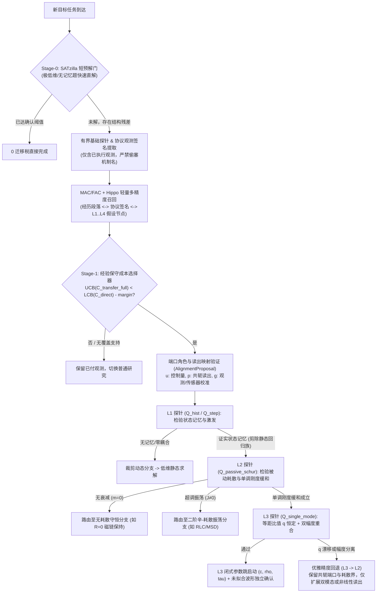

# 04 — Hegel V16.5 总体架构与实施主计划：多精度假设格 + 协议化诊断 DAG + 两阶段虫洞成本门控

- **基准提交**: `787256bd415515905359626f6a5498174ad5db3c` (`codex/hegel-cognitive-mainline`)
- **核心设计信条**: **仔细慎重守底线（协议精确、透镜/角色对齐、外评只读、全账互斥），大胆乐观拓上限（“管中窥豹”——从勒夏特列/楞次提炼完全领域无关的多精度假设抽取 $\mathcal{L}_1\sim\mathcal{L}_4$ 与反例辩证扬弃元模式，覆盖算法调试、计算机系统、运筹经济、生化与物理等一般领域）**。

---

## 一、北极星问题与三阶递进完成标准

**唯一主问题**：
> 从真实研究经历中自主提炼出的**多精度假设格与可执行诊断程序**，在强普通方法（`O_strong`）及紧凑经验技能库（`O_HExA`）拥有**完全相同的模型、工具、原始经历、主动采样、程序归纳、缓存及可选直接求解/重建权限**的条件下，能否在预先定义的**跨表征与跨领域（共享部分机制层级的）未见任务分布**上，实现同等严格质量下的**全生命周期净成本降低**或**固定预算严格成功率提升**？

三阶独立验收（严禁用前一阶替代后一阶，也不因后一阶尚在调优而抹杀前一阶成果）：
1. **Tier-A（自主多精度机制链闭合）**：由源经历分歧触发候选对应与多精度假设提案 $\to$ 源内反例自检过滤错误瞬时律 $\to$ 冻结入库 $\to$ 在未见目标上真实执行 `QuestionSpec` 探针，观察到**正向跳启动（$\mathcal{L}_3$）**与**遇反例优雅回退（$\mathcal{L}_3 \to \mathcal{L}_2 / \mathcal{L}_1$）**并改变父研究动作。
2. **Tier-B（预登记实例级净节省）**：在预登记未见目标上，同等确认标准下真实取消原搜索工作并获得净计算/观测节省；同时完整公开所属簇全部成功与失败样本。
3. **Tier-C（冻结分布级净效用）**：在按源簇隔离的冻结测试集（含同机制跨表征、$\mathcal{L}_3$ 全共性跨物理、$\mathcal{L}_2/\mathcal{L}_1$ 部分共性近邻、以及表面相似硬负例）上，相对 `O_strong` 与 `O_HExA` 取得统计可辨识的成本—质量帕累托优势。

---

## 二、核心架构升级：直接建在现有源码接口上的四大组件（零平行重写）

源码核查确认，`src/hegel_machine/cognition/` 已有 `question_semantics.py`、`question_agenda.py`、`question_continuation.py`、`growth_methods.py`、`research_methods.py`、`method_revision.py`。V16.5 **不新建平行的 CQM 状态机**，而是在现有六大模块上做精准增量升级：

### 1. 表示层：带类型多尺度×多精度假设与诊断 DAG（`MS-HIDAG`，树作为求解投影视图）
将单一概念树升级为正交区分**“跨尺度粗粒化（Multi-Scale $\mathcal{S}$）”**与**“同尺度承诺精度（Within-Scale Precision $\mathcal{L}$）”**的带类型有向无环图（详见 `06_Multi_Scale_Renormalization_and_Emergence_Upgrade.md`）：
- **跨尺度粗粒化与同尺度精度细化边（双轴正交）**：
  - `coarse_grains_to(S_fine -> S_coarse, via=Π_s)`：**重整化/涌现边**——通过显式粗粒化算子 $\Pi_s$（如慢时间渐近消元 $t\gg\tau$ Kron/Schur 约化、空间/节点分块聚合 $\hat{x}=P^\top x$、集体界面/成本变分极值化）滤除底层重整化无关细节（`rg_irrelevant_slots`），生成新尺度的**有效假设（Effective Hypothesis）**，使同一对象在微观尺度（如水$\leftrightarrow$氨极性；系统微观指令`git bisect`）与介/宏观尺度（如雪花$\leftrightarrow$蜂巢能量变分；系统宏观吞吐 Amdahl$\leftrightarrow$酶饱和）合法连接完全不同的跨领域虫洞邻居，同时杜绝把宏观平衡律硬套回微观瞬态的“跨尺度混同错误”！
  - `refines_precision(L_k -> L_{k+1}, at_scale=S)`：**同尺度精度边**——在固定尺度 $S$ 内，从 $\mathcal{L}_1$（定性探测问法）$\to \mathcal{L}_2$（变分/单调不等式界）$\to \mathcal{L}_3$（带参数槽的定量有效算子/算法模板）$\to \mathcal{L}_4$（精确特化实例）；
  - `binds_port`：记录变量到操作角色 $(u, z, p, F)$ 的候选对应及单位/符号约定；
  - `observes_via`：连接有效状态/共轭量与外部传感器可见读出 $y = g(u, p)$；
  - `degenerates_at_boundary`：如 $m \to 0$（$R=0$ 零阻守恒边界）、$b \to 0$（$\rho=0$ 惰性气体零耦合边界）。
- **前提与证据依赖边（区分 `AND` 与 `OR`）**：
  - `requires_premise_and`：例如“观测和守恒探针”同时依赖 `latent_mass_conservation` **AND** `linear_sensor_readout`；当观测和不守恒时（如 $y_i=c_i^2$ 反例），利用 Reiter 冲突集定位是传感器非线性还是质量泄漏，而非粗暴否定守恒父节点！
  - `supported_by_or`：多个独立源经历提供替代证据支持；删去单一源经历不会误杀仍有独立支持的父假设。
- **修复 `growth_methods.py` 的关键盲区**：
  - 当前 `growth_methods.py:_compile`（第 81–125 行）只保留最终 `confirm` 的成功证据祖先并跳过失败节点。V16.5 将严格区分 **`execution_error`（工具调用崩溃）** 与 **`scientific_refutation_witness`（成功执行探针并排除了某候选分支，如排除了 $\mathcal{L}_3$ 单模性从而触发回退到 $\mathcal{L}_2$）**——后者作为一等条件分支节点写入 `ResearchMethodBook`！

### 2. 问题语义层：协议完备的 `QuestionSpec` 与决策区域停止准则
在 `question_semantics.py` 现有字段基础上，每个诊断问题必须绑定：
- `protocol_spec`：`{controlled_vars, held_boundary_vars, reset_requirement, waveform_type, rise_time_bound, sampling_grid}`；
- `readout_spec`：`{raw_channel, conjugate_transform, sign_convention, noise_tolerance}`；
- `outcome_partition`：显式包含 `SUPPORTED_IN_SCOPE`、`REFUTED_IN_SCOPE`、`BOUNDARY_DEGENERATE`、`SENSOR_MISMATCH`、`UNKNOWN`、`PROTOCOL_ERROR`；
- `decision_region_map`（借鉴 Javdani et al. 2014 `HEC`）：一旦存活候选全部落入同一精度决策区域 $V(S) \subseteq r_{\mathcal{L}_k}$，立即停止额外探针，进入该层求解器，绝不为区分不影响当前行动的微观细节浪费预算。

### 3. 分支治理层：拆分“保真压缩”与“经验纠错”两套合同
- **保真重组/合并（`FidelityCompression`）**：仅当两分支在重叠范围内预测相容且声称不改变知识语义时启用，强制执行 AWM 式拒绝保持 `Rej(T_merged) ⊇ Rej(T_1) ∪ Rej(T_2)` 且消费者回归测试全过。
- **经验纠错/精度修订（`EmpiricalRevision`）**：当新证据发现旧反例系由读出错配（如把总磁链误当共轭电流）或未复位历史引起时，生成新 `meaning_version`，**允许撤回旧错误拒绝**并重验下游依赖对象，完整保留变更原因链。

### 4. 检索与门控层：SATzilla 两阶段成本门控 + MAC/FAC-Hippo 虫洞索引
1. **Stage-0 短预解门（Pre-Pilot Presolver，解决简单题“迁移税反噬”）**：
   - 借鉴 `SATzilla`（Xu et al., 2008 §3.5），在分配固定 $\le 0.05 B$ 的极小预算内先跑一次原生轻量无记忆/一阶基线检查；若残差已低于确认门槛，直接确认退出，**真正实现简单题 0 检索/对齐税**。
2. **MAC/FAC + HippoRAG 多精度二分图召回（候选库扩大后启用）**：
   - 严禁在 Pilot 阶段把未经验证的机制词（如 `lenz`、`equilibrium`）塞入查询三元组；
   - 图节点仅由**已实测的协议观测特征签名**（如 `sig:endpoint_matched_history_gap`、`sig:step_monotone_attenuation`、`sig:equal_spacing_exp_ratio`）与源经历段落、多精度假设节点（$\mathcal{L}_1\sim\mathcal{L}_4$）相连；
   - 第一轮固定 PPR 阻尼与重启权重（不与准入选择器同时训练，杜绝选择后乐观偏差），输出 Top-$K$ 候选 `(HypothesisNode, PrecisionTier, CandidatePortBinding)`。
3. **Stage-1 配对经验成本门控（Auditable Empirical Cost Selector）**：
   - 在开发源簇上，从相同决策前快照采集 `Direct` vs. `Transfer(Tier L_k)` 的完整路径配对代价（含绑定、探针、失败回退及独立确认：`C_transfer_full`）；
   - 仅在满足预设严格完成率与零新增假确认约束下，当经验区间满足：
     $$\widehat{\operatorname{UCB}}\left(C_{\text{transfer\_full}}(s, \mathcal{L}_k)\right) < \widehat{\operatorname{LCB}}\left(C_{\text{direct\_remaining}}(s)\right) - \delta_{\text{margin}}$$
     时准入执行，并设置硬探针止损上限（如附加探针开销 $\le 0.20 B_{\text{rem}}$），超限立即带已购数据无缝回退原生求解。样本量较小时诚实标注为**经开发簇校准的经验保守门控**，不虚称逐状态有限样本定理下界。

---

## 三、慎重而进取的四阶段推进路线（`M0 -> M3`）

我们既吸取 GPT-6“严控同时变化变量、先修 P0 账本”的工程审慎，又坚决拒绝“缩回同分布单域温室、放弃跨表征与多精度跨学科验证”的保守退却，制定如下紧凑四步路线：

### Milestone M0（前置底座）：P0 八项边界闭合 + 三大数学反例回归门
1. **闭合 V15 遗留 P0 项**：版本不可变身份、`exact-protocol` 严绑初态与前史、AND/OR 支持传播分离、干净载体移除（清理派生副本但保留原始历史与独立推导）、可选有界重建、按版本/范围隔离的失败缓存、全流程互斥计费账本。
2. **完成 V15 12 道 A 目标逐题轨迹拆解**：精确量化此前目标端多花预算究竟出在检索、绑定、重复拟合还是确认阶段。
3. **三大反例写入自动化单元测试**：
   - `test_rl_unreset_history_sign_reversal`（验证 $0<t<\ln 2$ 瞬时乘积反例不会误杀 $\mathcal{L}_2/\mathcal{L}_3$ 共轭模型）；
   - `test_rl_smooth_pulse_ratio_exceeds_one`（验证 $\Phi_e = A\theta^2 e^{-\theta}$ 下 $\theta/3 > 1$ 自动拦截无条件点态比值律，同时通过微分算子检验）；
   - `test_nonlinear_sensor_conservation_separation`（验证 $y_i=c_i^2$ 触发传感器标定分支 `SENSOR_MISMATCH` 而非误判质量不守恒）。

### Milestone M1（核心突破切片）：领域无关的自主多精度形成与跨表征/跨任务族迁移（正面迎战 `O_strong` 与 `O_HExA`）
- **核心原则（绝不局限在物理！）**：勒夏特列—楞次只是帮助我们看清“角色/透镜对齐 + 协议条件化 + 多精度假设格 + 遇反例优雅回退”的显微镜（详见 `05_Universal_Hegel_Dialectical_Pattern_Beyond_Physics.md`）。代码内核与 M1 主实验**完全领域无关（Domain-Agnostic）**，一行物理专用公式都不硬编码！
- **M1 覆盖三大通用非物理/跨领域抽象机制簇（每簇均含 $\mathcal{L}_3$ 高精度全共性目标 + $\mathcal{L}_2/\mathcal{L}_1$ 部分共性回退目标 + 透镜错位例 + 硬负例）**：
  1. **状态记忆与内生缓冲簇**（涵盖缓存/队列背压、经济/生态内生适应、阻尼松弛）：检验同终点异前史 $\mathcal{L}_1$ 探针、阶跃缓和界 $\mathcal{L}_2$ 与单模率参数模板 $\mathcal{L}_3 \to \mathcal{L}_2$ 双模回退；
  2. **瓶颈容量饱和与木桶限制簇**（涵盖计算机系统 Amdahl 并行加速、运筹排队吞吐、生化酶催化饱和 $\to$ 微服务/农业 Liebig 最小因子硬瓶颈回退）：检验单因子边际递减探针 $\mathcal{L}_1$、凹上包络界 $\mathcal{L}_2$ 与双倒数线性模板 $\frac{1}{y}=\alpha+\frac{\beta}{u}$（$\mathcal{L}_3$）遇到折线硬瓶颈时优雅回退至 $\mathcal{L}_2$ 瓶颈定位；
  3. **离散跳变/悬崖定位与折半诊断簇**（涵盖软件回归 `git bisect`、连续控制混沌悬崖如 `HExA`、数据流水线变点检测）：检验异号区间夹逼 $\mathcal{L}_1/\mathcal{L}_2$、折半探测程序 $\mathcal{L}_3$ 在全局非单调（多处反转）目标上从 $\mathcal{L}_4$（唯一阈值）优雅回退至 $\mathcal{L}_2/\mathcal{L}_3$ 仍以 $O(\log N)$ 锁定有效边界！
- **自主形成协议**：不预塞问题树或正确分支；让代理在源任务流中经历“朴素无记忆/线性/全量扫描失败 $\to$ 主动分叉探测 $\to$ 多精度假设提炼 $\to$ 源内反例自检 $\to$ 冻结入库”。
- **三臂公平主对照**：
  1. `Hegel V16.5`（通用多精度假设与诊断 DAG + 两阶段成本门控）；
  2. `O_strong`（强普通研究器：同模型、同原语、同原始历史、主动实验、允许按需归纳/重建函数并缓存、允许直接求解）；
  3. `O_HExA`（参照 `HExA 2606.29315v2` 实现的紧凑“自然语言策略 + 错误恢复 Bank”基线，从完全相同的源经历对比提炼并冻结，计入全部蒸馏与注入成本）。
- **两项局部因果干预**：(a) 预登记同历史快照移除对象（测对象边际贡献）；(b) 提案前源经历移除/匹配替换（测双源对比经历对多精度抽象形成的真实因果作用）。

### Milestone M2（旗舰跨学科语义虫洞验证）：穿透不同学科外壳的真实迁移测试
将同一套通用引擎（不改一行代码）投入披着真实异质学科外衣的封存测试集，验证“不走学科平面、通过 `ProbeSignature` 虫洞走高维曲面”的真实加速：
- **虫洞测试组 W1（系统工程 $\leftrightarrow$ 生物化学 $\to$ 运筹/生态瓶颈）**：从并行计算扩容轨迹与酶反应实验轨迹自主提炼瓶颈多精度格，迁移求解未见的分布式微服务限流与多资源配比优化问题；
- **虫洞测试组 W2（软件工程调试 $\leftrightarrow$ 物理参数控制 $\to$ 复杂流水线故障隔离）**：从离散回归排查与连续悬崖控制提炼折半夹逼多精度格，迁移求解含非单调干扰的多阶段流水线异常定位；
- **虫洞测试组 W3（化学平衡 + 电磁感应 $\to$ 黏弹力学 / 经济内生缓冲 + 未知传感器标定解耦）**：作为经典跨自然科学与社会系统代表，检验对偶读出透镜（如 $-I \leftrightarrow \delta\mu_A$）、$\mathcal{L}_3 \to \mathcal{L}_2$ 双模态回退、$R=0$ 守恒边界分叉以及 `observes_via` 非线性观测校准解耦。

### Milestone M3（规模化虫洞检索消融）：同内容 `Flat vs. Multi-Precision Hippo Graph`
- 当跨源簇累积经历达到 $K \ge 32$（跨越记忆、松弛、守恒扩散、振荡、无记忆代数及硬负例多家族）导致候选召回出现实测稀释时，冻结完全相同的多精度对象库、元数据与 Stage-1 门控，**仅替换检索通道（BM25/Dense Flat vs. 协议签名多精度图 PPR）**，计入建图费用，量化关系虫洞在规模化记忆下的独立边际收益。

---

## 四、全生命周期账本与停止准则

1. **互斥成本向量**：每一步事件唯一归入
   $$C_{\text{total}} = C_{\text{source}} + C_{\text{formation}} + C_{\text{index/maint}} + \sum_{j=1}^{N} \left(C_{\text{presolve}} + C_{\text{pilot}} + C_{\text{retrieve}} + C_{\text{bind}} + C_{\text{probe}} + C_{\text{solve}} + C_{\text{confirm}} + C_{\text{fallback}}\right)_j.$$
   同时单列目标阶段条件成本与含源阶段摊销曲线（有限前缀 $N=1, 3, 6, 12$）。
2. **主指标与统计单位**：以**独立源学习簇（Source Cluster）**为统计推断单位，报告固定预算严格成功率、满足预设无量纲精度下的总成本、首次合法确认成本、假确认率（False Confirmation Rate）、真机制误剪率（True-Mechanism Pruning Error）以及 $\mathcal{L}_1/\mathcal{L}_2/\mathcal{L}_3/\mathcal{L}_4$ 各精度层级的实际触发与回退命中率。
3. **诚实诊断分流**：
   - 若 $\mathcal{L}_3$ 跳启动与 $\mathcal{L}_2$ 回退均跑通且在跨表征/跨学科簇显著优于 `O_strong` 与 `O_HExA` $\implies$ 核心论点成立，进入 M3 规模化扩展；
   - 若在全共性 $\mathcal{L}_3$ 上与 `O_HExA` 持平，但在部分共性近邻（双模/非线性/边界退化）上显著胜出 $\implies$ 精准定位 Hegel 多精度 DAG 相对扁平技能库的核心优势在于**抗负迁移与优雅精度降级**！
